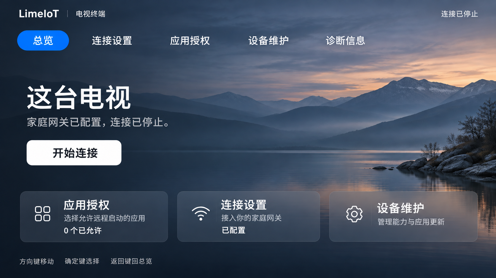

# 电视 Agent 体验设计

更新日期：2026-11-04。目标：让电视上的普通使用者能看懂当前状态、用遥控器找到操作，并明确掌握远程控制的授权。实际验收范围以[实施进度](../../docs/24-实施计划与进度.md)和实机证据为准。

## 信息与流程

| 入口 | 用户任务 | 显示内容 |
| --- | --- | --- |
| 总览 | 判断电视是否可控、开始或停止连接 | 当前状态、下一步操作、应用授权数量、控制能力 |
| 连接设置 | 首次接入家庭网关 | 配置导入、原证书申请与签发步骤、已保存身份摘要 |
| 应用授权 | 允许或取消远程启动 | 电视应用卡片、当前授权、不可启动应用的撤权入口 |
| 设备维护 | 调整能力、更新或维护身份 | 能力配置、本次音频授权、APK更新、折叠的证书/密钥操作 |
| 诊断信息 | 核对原记录、排查连接问题 | 设备与证书摘要、原申请/换钥状态、明确恢复入口 |

首页只展示来自当前Runtime的状态。未配置、证书过期、连接中、已连接和已停止使用不同说明，不能将“已保存配置”显示成已连接。没有自动开始、自动授予音频权限或更新后自动继续安装。

网络连接失败/等待重连显示“暂时无法连接网关”和明确重试说明，不能因为Runtime线程仍在运行就显示“正在建立安全连接”。网络建立后的设备会话核对使用独立标题；只有Runtime为ready才能显示已连接。旧联调包保留的临时网关材料不等于已有长期在线网关，测试服务和ADB转发关闭后需要配置实际可用的接入环境。

现有接入合同通过系统文件选择器导入配置与证书。当前没有手机配对码或扫码认领API，因此不展示可误导用户的二维码或虚构短码；文件选择器不可用时必须明确提示，不伪装接入成功。完整签发、换钥、模型扩展和APK确认仍使用原领域用例。

## 遥控器与可读性

以960×540dp的16:9屏幕设计，左右保留48dp安全区。第3版采用原创山湖暮色背景、白色文字和蓝色焦点。首页主标题40sp，操作页标题30sp，正文15–17sp；按钮至少48dp，首页入口110dp高。背景以1672×941静态WebP打包，约53KB；原生左右/上下暗渐变保证文字可读，操作页额外增加78%黑色遮罩。不引入视频、持续模糊或额外UI框架，保留API23。

顶部横向排列五个导航项。左右键切换并显示页面，下键或确定键进入内容；内容顶部继续向上时回到当前页导航，不跳到相邻页。导航左右端不循环。非首页按返回键回到总览，总览再返回交还系统。聚焦使用亮蓝色底与白色轮廓，离开导航后保留深蓝选中态；主操作常态为白底深字，获得焦点后为蓝底白字。API23–32使用返回按键，API33起使用系统返回回调。页面重建仅保存当前页，不保存凭据或复活批准。应用授权刷新后恢复原卡片焦点。

首页采用直接叠在背景上的状态与操作区，下方并排“应用授权”“连接设置”“设备维护”三个半透明入口。连接停止时显示开始连接，运行时显示停止；未配置时引导进入连接设置。入口的授权数量、配置状态和能力来自Runtime。文案直接说明当前状态；“这台电视”是中性标题，不能用未配置的示例房间名代替真实设备资料。

连接提示和授权状态使用中文短句；协议模型名、证书摘要及原申请记录集中到核对或诊断场景。所有已有授权、取消、前台代次和一次消费规则继续成立，UI不拥有运行连接或建立第二份设备状态。

## 调研与取舍

2026-11-04实际查看用户的MiTV4-ANSM0（Android6.0.1/API23，固件2061）桌面VIP内容页和系统设置浮层，并查看Google TV官方首页图片及Projectivy官方商店截图。真实小米系统有按场景变化的强调色，不能直接把品牌橙色或VIP金色当作统一主色。

| 证据 | 实际观察 | 本项目取舍 |
| --- | --- | --- |
| 小米桌面VIP内容页 | 深灰背景采样`#1B1D21`，白色横向导航、大幅内容图片；该VIP页为香槟金焦点 | 参考底色、导航和图片层次；金色只作为该页观察，不推广到全系统 |
| 小米系统设置浮层 | 深色蒙层、大图标网格；焦点块内部15500个像素均为`#0072FF` | 设备工具使用该蓝色作为聚焦色，辅以白色轮廓 |
| [Google TV官方首页](https://tv.google/) | 大背景、左侧暗渐变、顶部横向栏目和下方内容行 | 保留背景空间，通过原生渐变承托操作文字 |
| [Projectivy官方商店](https://play.google.com/store/apps/details?id=com.spocky.projengmenu&hl=en) | 自然风景背景、少量入口和明确焦点 | 使用原创山湖图，避免把设备工具做成影视内容目录 |

原始电视截图包含家庭网络名和观看信息，仅保存在本机`.dev/tv-ux-20261104/xiaomi-research/`，未上传图像服务、未放入公开文档或APK。尝试切换普通首页后仍停留VIP页，因此没有“普通首页颜色已验证”的结论。这些观察只覆盖指定型号/固件，不代表所有小米电视或HyperOS电视。

以下公开资料补充布局、焦点与流程依据；未复制其他应用的代码、品牌或图像。

- [Android TV：Design for TV](https://developer.android.com/design/ui/tv/guides/foundations/design-for-tv)：约三米观看距离、大字、低阅读负担与D-pad操作。
- [Android TV：Navigation](https://developer.android.com/design/ui/tv/guides/foundations/navigation-on-tv)：固定清晰的导航层级与可预期的返回行为。
- [Android TV：Focus system](https://developer.android.com/design/ui/tv/guides/styles/focus-system)：区分默认、聚焦、按下、选中和禁用，结合轮廓、颜色与缩放。
- [Android TV：Layouts](https://developer.android.com/design/ui/tv/guides/styles/layouts)：16:9画面、密度无关尺寸和边缘安全区。
- [Moonlight Setup Guide](https://github.com/moonlight-stream/moonlight-docs/wiki/Setup-Guide)：引导用户完成接入，每步给出明确的下一步；其PIN协议没有直接移植到LimeIoT。
- [Projectivy Launcher](https://play.google.com/store/apps/details?id=com.spocky.projengmenu)：简洁分区、克制背景以及对较旧电视的性能关注。本Agent不接管系统桌面。

## 视觉素材

按用户指定的图像服务，通过imagegen配套CLI生成，采用两个指定模型。第3版选用山湖暮色作为原生背景；另一幅云海图作为备选，完整首页设计稿只作为视觉参考。完整提示词、尺寸、输入图及摘要见[artwork.json](artwork.json)，不包含服务密钥。

| 设计稿 | 模型 | 用途 |
| --- | --- | --- |
| [山湖暮色](../../output/imagegen/limeiot-tv-mountain-dusk-v3.png) | `gpt-image-2.5-flare` | 正式静态背景的原图 |
| [云海晨光](../../output/imagegen/limeiot-tv-cloud-dawn-v3.png) | `gpt-image-2.5-sunburst` | 备选背景，当前不显示 |
| [首页设计稿](../../output/imagegen/limeiot-tv-xiaomi-inspired-overview-v3.png) | `gpt-image-2.5-flare` | 以原创山湖图编辑生成的布局参考，非实机截图 |

文字、按钮、入口、图标和焦点全部为Android原生Views及矢量资源。[压缩风景背景](app/src/main/res/drawable-nodpi/tv_mountain_dusk.webp)用于当前界面；[桌面入口横幅](app/src/main/res/drawable-nodpi/tv_launcher_banner.webp)由同一原创背景、静态品牌文字和电视图标合成。完整首页设计稿不进入APK、不承担交互或设备状态显示。设计稿生成时蓝色按视觉估算为`#007FFF`，最终原生实现按实机精确采样调整为`#0072FF`。前期绿色背景/插画和第2版黑白方案为已弃用探索，当前页面不显示。

## 本阶段验证范围

各版APK、宿主测试、lint与MiTV4-ANSM0/API23实机遥控结果分别保存在[体验证据](../../docs/evidence/2026-11-04-tv-agent-experience.json)，不能跨版沿用。实机导航检查要求连接保持停止，APK替换与导航前后的整个Agent数据库字节一致。层级检查不代表视觉截图验收。API33以后的返回回调需另行运行验证，lint通过不等于该系统实测。

自动截图instrumentation当前受阻：系统报告测试组件安装成功，但其登记的APK路径实际不存在；停止本次测试进程及重新安装后仍未恢复。失败日志保留，不继续重试，不清数据、不重启电视或放开产品FLAG_SECURE。现有测试源码保留，后续具备可运行的测试组件时再执行；当前没有新UI实机截图，不将生成插画称为运行截图。阶段结果见[体验证据](../../docs/evidence/2026-11-04-tv-agent-experience.json)。
