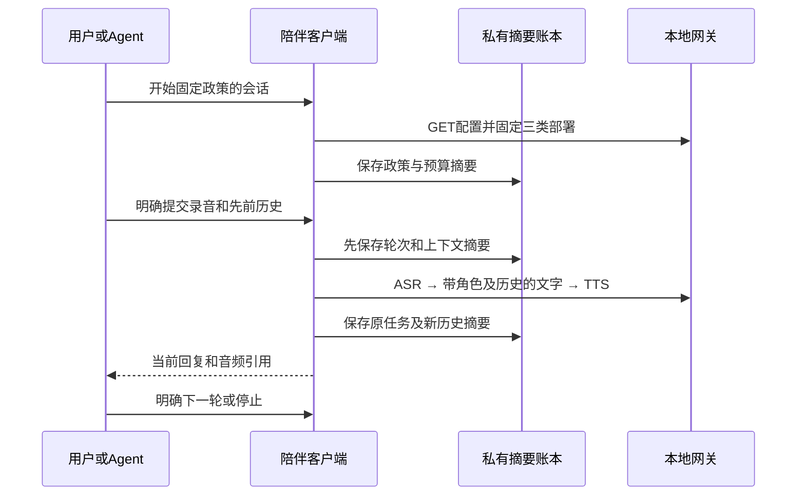

# 有限陪伴会话

[政策Schema](companion.schema.json)定义源码CLI及[共享客户端](../packages/protocol/companion.mjs)的有界语音会话。每轮复用[语音回合](voice-turns.md)、已有录音、ASR、文字和TTS，不新增网关HTTP、数据库、执行队列或模型工具权限。[积木小狗样板](../examples/companions/block-puppy/README.md)演示角色与两轮上下文。

## 政策和开始

政策包含schema_version、policy_id、version、name、instructions、language、voice、max_turns和max_seconds，未知字段拒绝。角色提示最多1024字符，声音须来自当前TTS配置，轮数为1–8，时长为30–1800秒。政策正文最多16KiB、2层和32节点，沿共享JSON边界拒绝重复键、非法Unicode、不安全数值及控制字符。

`start`由本地所有者明确调用，读取并核对ASR/文字/TTS配置，将完整政策摘要、三类部署修订和期限固定到会话。开始不采音、不上传、不调用模型。角色、声音、预算或实际模型配置变化后不能沿旧会话推理；可查询旧任务并明确结束，再开始新会话。

session_id为1–64位ASCII字母、数字、下划线或连字符。每轮编号固定为`{session_id}_t{序号}`，三个阶段继续使用原回合键。当前会话未停止或停止结果未核实前，不能覆盖为新会话；同一账本保留最多256个旧会话编号并拒绝复用，不自动删除历史以腾出容量。

## 每轮与上下文

每次`reply`都由调用者明确选择已有录音。创建回合前核对完整政策、预算、期限、实际部署和上一轮历史摘要；先保存占用的轮次，再创建原语音回合。准备记录已保存但尚无回合时，恢复只显示prepared，不自动重建或换编号；可明确停止该会话。

语音回合的上下文扩展使用内部v2账本：只增加`text_context: {digest, history_messages}`，其余任务身份、固定部署、五分钟上限及原键策略复用v1。角色提示和历史正文仅在当前调用内存中；其规范JSON摘要在ASR开始前固定。文字阶段把此前交替的user/assistant消息与本次转写组合，最多15条消息、8192上下文字节。超过容量直接拒绝，不截断历史或再次调用模型。

默认`parseVoiceTurn`及原有CLI/网页/原生单回合继续使用v1；只有显式contextual模式读取v2。陪伴会话存储在独立companion命名空间，不将嵌套v2记录交给旧原生客户端继续。上下文扩展不改变网关的文字请求合同。



只有识别、文字和合成均成功，且当前转写/回答仍可读取时，才把本轮问答加入调用者内存历史并保存新摘要。每个回合占用一次预算，准备失败后留下的占用、失败或unknown不会自动退款。失败、unknown或未完成回合阻止替代回合；生成成功不授权播放或控制设备。

## 保存和恢复

会话账本最多65535字节、16层和8192节点，保存原嵌套回合、会话/政策/上下文摘要、轮数、期限、模型修订、停止决定及旧会话编号。摘要校验用于发现损坏，不提供签名信任、防旧备份回退或跨设备全局配额。

| 操作 | 行为 |
| --- | --- |
| start | 明确固定政策及模型并初始化会话，零推理 |
| reply | 明确为所选已有录音创建一轮，不能替代未知回合 |
| resolve | 只GET原回合，可以没有政策或历史，不创建下一阶段 |
| continue | 需要原政策与准确历史，明确推进尚未创建的阶段 |
| stop | 无需政策/历史，先保存停止决定，再按原键放弃未决输出并清除各轮成功的文字回答 |

重启不自动恢复历史正文。调用方可用仍持有的准确历史继续；缺失、删改或超额历史均不触发新推理。只查询仍可显示当前任务的有效结果，但不能凭单个当前结果重建全部旧历史或悄悄开始新会话。

停止后停止推进并隐藏会话输出。停止响应丢失只查询原放弃意图；stop_settled为false时仍阻止新会话。源录音/ASR文本和已生成音频按原媒体TTL、删除及撤销合同处理；停止会话不证明外部模型已停止计算，也不撤回已授权的音箱播放或充当物理急停。

## CLI

```sh
node packages/cli/src/main.mjs companion schema
node packages/cli/src/main.mjs companion start --space-id space-demo --policy "./policy.json" --id puppy-UNIQUE
node packages/cli/src/main.mjs companion reply --space-id space-demo --policy "./policy.json" --context "./context.json" --input "./reply.json" --wait
node packages/cli/src/main.mjs companion resolve --space-id space-demo
node packages/cli/src/main.mjs companion stop --space-id space-demo
```

政策、context和reply文件均须是当前用户拥有的0600普通文件。context为`{"history":[]}`或准确的既有交替问答，reply为`{"media_id":"media-已有编号"}`。`--state-dir`设置私有账本目录；endpoint/Token规则与原语音CLI一致。读取原始私有JSON后再做有界解析，不先丢弃重复键。

`--wait`仅用于reply/continue，在本次明确批准的进程内轮询推进，最多305秒。SIGINT/SIGTERM取消当前调用并释放本机独占锁；原请求仍须resolve核实。硬终止遗留锁时保守拒绝，不自动删锁。未知结果退出码6，失败或discarded退出码7，调用者须同时读取JSON状态。

输出包含当前转写/回答，可能是私人内容。只有显式使用`--emit-context`才输出当前完整内存历史；平台不自动保存其明文文件，调用方管理终端、管道或自己选择保存的上下文。停止不输出历史。详细运行步骤见样板。

## 家庭网页

本地家庭页面和完整私有工作台的“陪伴”入口使用同一共享客户端，地址为`/?view=companion`，独立维护入口为`/local/?view=companion`。只有本地工作台增加该菜单，云控制台不因此获得家庭模型调用权。选择积木小狗或自定义角色、声音后明确开始，默认四轮、十分钟。开始只固定政策和配置，不调用模型。上传录音后选择“本轮录音”并发送；每轮自动衔接仅限当前明确批准的在线前台。生成音频在下方选中，授权和播放仍由原媒体入口分别确认。

浏览器独立使用`limeiot.companion:{API前缀}`摘要记录和Web Locks，与旧v1语音回合隔离。写入失败或记录损坏会阻止新请求，不自动清空账本。角色正文和完整问答只在当前页面内存；刷新、离开、退出、断线或会话到期后清除，不写入localStorage或sessionStorage。失去历史后只查询当前原任务，不能凭其结果重建过去问答，结束后才能开始新会话。

临时切后台会取消当前请求并清除屏幕正文，当前页面内存中的历史保留到离页或到期。返回只查询；下一阶段须明确继续，不自动推理。其他标签修改账本会清除本页角色和历史，再核对原记录。unknown没有替代发送入口；结束不需要恢复角色或正文，仍先持久保存停止决定。

## 原生客户端

Swift/Kotlin的`CompanionClient`读取同一v1外层会话与嵌套v2原回合，独立存储键为`origin#companion:space_id`，不占用单轮`#voice-turns:`记录。必填`SessionStore`保存摘要并回读，进程内互斥和原字节比较防止旧实例覆盖；不提供跨进程并发写保证。原回合的创建、任务绑定和停止复用`VoiceTurnClient`，旧单轮消费者默认仍拒绝v2。

本地“设置 → 音频 → 陪伴”可编辑角色说明、选择实际声音并开始，默认四轮、十分钟。每轮明确选择已上传录音，当前在线前台自动衔接已有三阶段；生成结果仍须另行选择、授权和播放。角色与历史只在内存，不进入Keychain/Keystore会话账本。后台、离页、离线、退出或空间更换清除上下文并取消推进；恢复只GET。明确查询可显示仍有效的原输出，但不能据此重建历史或启用下一轮。停止不需要上下文，先记录停止，再清各轮文字；丢停止回执后只查询原任务。

`pause/close`的状态层先取消在途Task/Job，屏幕立即清文；等待原任务退出后再次清除SDK上下文，再允许后续操作，阻止迟到结果恢复历史或创建TTS。SDK单独使用者也须取消并等待当前操作，再调用`forgetContext()`。会话期限同时约束嵌套回合；到期后不接受下一轮。

## 验证范围

`npm run test:companion`检查政策/JSON边界、固定角色和两轮历史、预算/期限、模型变化、历史丢失、准备保存与暂停、unknown、原键恢复、停止清文、CLI中断与旧v1网页/CLI回归。真实网关/MQTT/SQLite与协议提供方用于验证软件行为。

`npm run test:companion:web`另验家庭陪伴页面、双轮准确历史、390px浅深主题、重载缺历史、无正文停止、保存失败、丢响应、后台暂停、同源锁竞争和网关重启unknown，并回归旧v1语音页面。`npm run test:companion:workspace`检查私有工作台导航、同页挂载、真实网关回合和离页清历史，控制面的只读身份/空间接口为明确夹具。源码网页通过不代表现有NAS镜像、真实Go/MySQL安装或完整容器恢复已更新。

`npm run test:companion:native`检查JS/Swift/Kotlin完全相同的两轮账本、角色与准确历史、保存失败/保存后取消零POST、预算与配置变化、unknown原键恢复、v1隔离，以及实际原生状态层的暂停、离线、停止和迟到响应。两条原生宿主旅程连接真实Rust/SQLite/MQTT，每端三个进程、两次网关重启，验证两轮、停止丢回执和JS只读同一账本。协议提供方与本机文件存储为明确夹具；Android APK/lint、Swift宿主编译和SwiftUI语法分别记录。

完整iOS/Android页面运行、生产安全存储、模型回答质量、儿童适龄内容与监护授权、真实麦克风/发声、玩具固件、自动唤醒、持续流、长期记忆和运动控制仍分别验收；角色提示不等于已落实这些产品政策。实机按用户要求跳过，源码与宿主通过不代表整个平台完成。
