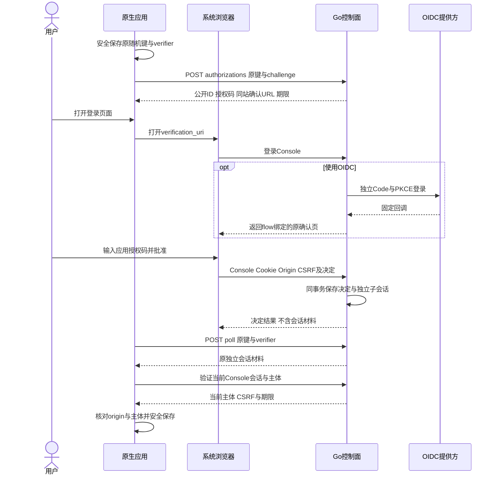
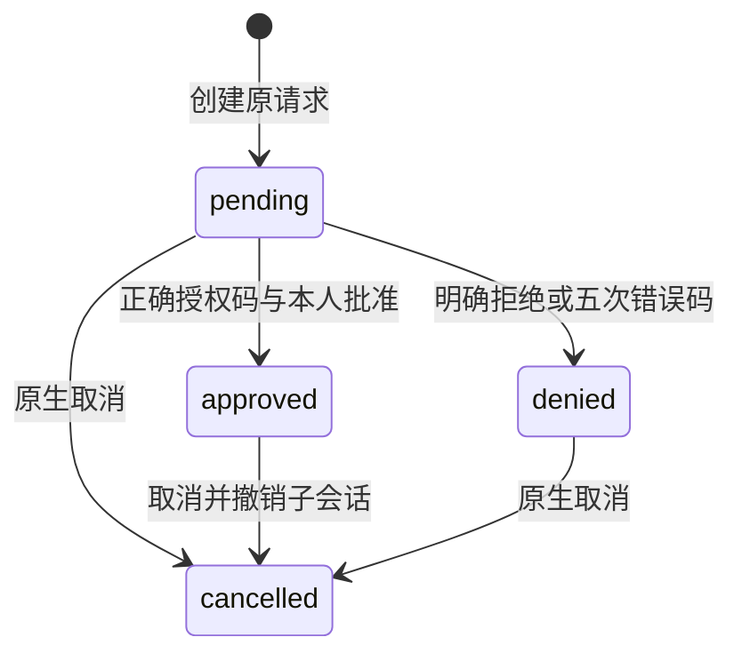

# 原生客户端控制面授权

本合同定义原生应用取得独立 Console 会话及恢复远程操作的行为，HTTP 字段以 [OpenAPI](control.openapi.yaml) 为准。平台接受 `ios/android/macos/windows`；Go 后端和同站确认页共用原授权规则，Swift/Kotlin/.NET 提供独立授权、读取与远程命令库。.NET 库和桌面平台协议不代表 Windows 原生界面已接入或运行通过。当前真实库检查使用临时 MySQL、HTTPS/WSS、MQTT 模拟设备、OIDC 提供方夹具和 Chromium，不能代替手机或正式 LimeCloud 联调。

## 授权过程

应用先在系统安全存储中保存当前精确 origin、256 位随机 `request_key`、PKCE verifier 和平台。保存失败时不得发送请求。`request_key` 使用 64 位小写十六进制；verifier 遵循 PKCE 的 43–128 位字符集，S256 challenge 为无填充的规范 base64url。

应用仅打开返回的同 origin `/console/?native=<公开ID>`。浏览器页面不接收授权码、原键或 verifier 的 URL 参数；用户在页面输入手机或电脑应用显示的 8 位授权码。登录、打开页面和轮询均不自动批准。确认页只读取平台、期限和状态，展示当前账号，不加载家庭设备。

Console 的 OIDC `auth/start` 可携带 `native_authorization`，只接受当前 pending 请求。公开 ID 加密绑定到一次性 flow，回调固定返回原确认页；请求不能指定任意 `redirect_uri`，Admin 不能携带该参数。OIDC 本身的 state、nonce、PKCE 和当前身份校验继续生效。

## HTTP 与身份边界

| 调用方 | 路径 | 身份与行为 |
| --- | --- | --- |
| 原生端 | `POST /api/native/v1/authorizations` | JSON 中提交原键、challenge、ios/android/macos/windows；同键同参返回原 ID、码与期限，异参 409 |
| 原生端 | `POST /api/native/v1/authorizations/poll` | 原键与 verifier；只读原状态和原材料，不再次签发 |
| 原生端 | `POST /api/native/v1/authorizations/cancel` | 原键与 verifier；同事务取消并撤销原子会话，重复取消成功 |
| 浏览器 | `GET /api/console/v1/native-authorizations/{authorization}` | 当前 Console 会话；不返回码、原键、PKCE 或材料 |
| 浏览器 | `POST /api/console/v1/native-authorizations/{authorization}` | 本人网页登录、精确 Origin、CSRF、应用授权码与 approve/deny；子会话不可再委派 |

原生三项接口拒绝 `Origin`、`Cookie`、`Authorization` 与 URL 查询参数，Host 必须匹配 Console origin。普通浏览器凭据和本地网关 Bearer 均不作为原生授权证明。安装了固定回源凭据的实例，仍由受控边缘代理注入该凭据，手机不持有它。所有响应 `no-store`，客户端禁止重定向与自动写重试，持续验证 TLS 与主机名。

批准与子会话在同一 MySQL 事务提交，并发批准只保留一个子会话。重复相同决定要求同一原父会话与主体；其他账号或相反决定返回冲突。手机仅取得最长一小时的独立 Console 会话，不导出浏览器父 Cookie 或外部提供方 Token。每次使用重查原父登录、主体及当前外部身份；父退出、到期或永久身份拒绝后失效，提供方临时故障返回 503 并允许之后核实。子会话退出只撤销自身。

会话材料包含 `version=1`、精确 `origin`、`audience=console`、`session`、`principal_id` 和 `expires_at`。HTTPS 请求使用 `__Host-limeiot_console` Cookie，写请求仍需精确 Origin 与当前 session 返回的 CSRF；开发回环 HTTP 使用 `limeiot_console`。材料应与 NAS 本地会话分开存储，不进入 stdout、模型、诊断日志、浏览器存储或系统剪贴板。

取得会话不会增加空间、网关、scope 或 Admin 权限。设备执行继续受 [本地配对](control-pairing.md) 和 [受限远程](control-relay.md) 的当前授权约束。

## 状态与恢复

`pending`、`denied`、`cancelled` 响应不含 `material`；`approved` 仅在原授权窗口、子会话和父身份仍有效时返回原材料。五分钟期限从第一次创建起计算，同键恢复不续期。超过期限后创建、领取和浏览器决定返回 410；原生端仍可用原证明取消。领取窗口与已领取会话的有效期分别处理。

| 情况 | 客户端恢复 |
| --- | --- |
| 首次创建响应丢失 | 保留原键与 verifier，同键同参恢复，不能另建请求绕过 |
| 批准响应丢失 | 浏览器可重复相同决定；手机查询原请求，不自动生成新授权 |
| 领取响应丢失或 Go 重启 | 使用原证明只读原加密材料，不新建子会话 |
| 取消与批准同时发生 | 数据库行锁串行化；最终取消撤销可能已经签发的原子会话，迟到批准不能恢复 |
| 已取消或拒绝 | 不重开原请求；重新登录必须由用户明确发起新授权 |
| 401、410 或 429 | 分别处理身份失效、窗口过期或限流；停止无界轮询，保留取消所需原证明 |
| 本地会话保存失败 | 不进入已登录界面；保留原证明以查询或明确取消，不能宣称登录完成 |

建议前台每三秒查询，后台、离开授权页或网络不可达时暂停，恢复前台先核实原状态。每客户端 IP、每动作每分钟 30 次；多实例分布式限流尚未实现。实例最多保留 4096 条授权，请求过期至少一天后才允许 Sweep 分批清理，旧键在清理前不得复用。取消后原材料清空，子会话删除；响应与取消发生竞争时可能到达已经失效的材料，客户端必须验证当前 session，不能据材料存在推断有效。

## 存储与验证

显式迁移 v3 新增原生授权表和配额 guard；v1/v2 原字节不变。数据库保存原键与授权码摘要，授权码、会话材料及 OIDC flow 上下文加密。API 启动和 ready 只检查迁移，不自动 DDL。数据库和控制面密钥需共同备份，恢复不延长请求或会话期限。

`node tools/test-control.mjs --control-cli --control-web` 同时执行 Go race/vet、临时 MySQL/OIDC、真实 API 进程重启与浏览器测试。原生专项包括私有/OIDC、固定返回、Admin/跨账号隔离、Origin/CSRF/PKCE、重复批准、错误码上限、过期、取消竞争、父退出，以及提交/领取响应丢失后的重启恢复。浏览器制品位于 `.dev/native-auth-*/`，联合结果位于 `.dev/control-cli-test/report.json`。这组证据不代表 Swift/Kotlin/.NET 云入口、系统安全存储、系统浏览器或前后台生命周期已经验收。

独立客户端为 Swift/Kotlin `ControlClient` 和 [.NET `ControlClient`](../packages/dotnet/LimeIoT.Client/README.md)，复用既有传输与窄安全存储接口，安全存储参数必填。`beginAuthorization`在任何请求前保存原证明；同一origin的恢复沿用原键、verifier和平台。`pollAuthorization`拒绝跨origin/Admin材料、无批准材料和主体不一致，先验证当前Console会话/CSRF/期限，再保存会话并向界面返回不含Token的结果。读取接口覆盖空间、网关、设备分页与物模型；每次重查当前身份，401清理材料，503保留以供核实。原生请求不带Cookie/Origin/Authorization，只有Console动作使用独立Cookie与CSRF。

云记录使用`limeiot.control:v1:<精确origin>`存储键，不覆盖NAS本地会话。取消成功才清原证明与材料；响应丢失或保存失败时保留恢复信息。退出直接用当前本站Token派生的CSRF，不依赖提供方userinfo在线，也不影响父网页登录。库不后台轮询、不自动打开浏览器或重试写请求；Swift/.NET 拒绝同一实例上的并发操作，Kotlin 用 Mutex 串行化，界面须取消/结束当前轮询后执行用户决定。

`hasPendingAuthorization`只读取当前origin的持久证明是否存在，不发HTTP或创建新授权。App启动先核实原会话；没有会话但存在原证明时恢复同一请求，没有原证明时等待用户明确登录。临时503保留材料，并提供“恢复会话”核实入口；已过期或拒绝的请求由用户明确结束后重新发起。

## 原生远程操作

Swift/Kotlin/.NET `ControlClient` 共享以下行为（.NET 方法采用 Async 后缀和 PascalCase），网络操作仍使用正式受限远程 HTTP 接口，不增加另一套云命令协议。

| 方法 | 行为 |
| --- | --- |
| `prepareCommand` | 核实当前主体、空间、有效绑定、`commands.write` 与设备 ready；type 限 property.set/action.invoke（默认属性），path 每段最多64、总长最多129；生成 64 位十六进制原键及 20 秒原期限，先保存完整请求 |
| `submitCommand` | 先保存 `attempted=true`，再发送唯一一次创建请求；旧键已经尝试时只读 `by-key`，404 也不补发 |
| `resolveCommand` | 只读取原云记录；显式指定 `reconcile=true` 才请求核实原 `remote_id`，不创建设备命令 |
| `commandRecords` | 返回当前主体保存在本机的原操作；省略 space 恢复全部空间，明确指定 space 时过滤；不能作为全量云历史 |
| `forgetCommand` | 允许明确放弃未尝试发送且无结果/拒绝的准备记录，或清理明确拒绝/已有终态的记录；已尝试而结果未知的记录不能删除 |

每条记录绑定精确 origin、主体、云空间、本地空间和完整原请求。每个 origin 最多保存 128 条记录，达到上限时先由用户清理终态记录，不覆盖未知操作。存储失败时不发送；超时、响应丢失、408、409、5xx 和无法核实的结果保留原身份，重新创建客户端或登录同一主体后继续查询。其余明确 4xx 保存原拒绝，401 同时清理会话材料。退出和取消清理会话及授权证明，保留原操作。

返回结果须匹配原请求、主体、空间和本地空间；已观察到的 `remote_id`、摘要及终态不得改变或降级。`confirmed` 还须匹配原设备、模型修订、操作、期限、原远程键和本地命令，且 error 为 null。属性写入要求 device_result.reported 包含原目标值；动作要求严格六字段 action_result、原 path、合法输入摘要格式、非 null 输出、submitted/observed 和合法观察时间。远程证据没有 issued_at，手机按 expires_at 前32秒和当前时间后2秒检查，Rust 仍按原 issued_at 精确校验。

[.NET 本地检查](../packages/dotnet/LimeIoT.Client.Checks/ControlChecks.cs) 还覆盖安全存储回读失败零请求、调用方修改返回 JSON 不改变耐久原请求、401 保留操作，以及显式核实失败前先保存 GET 观察到的原远程身份。当前提供的是 SDK 与隔离检查，Windows WinUI、安全存储适配和真实系统旅程分别验收。

客户端绑定完整原输入并检查摘要格式和连续性，未独立重算 RFC 8785 请求或动作输入摘要；正式规范化摘要由 Go/Rust 验证，精确 output Schema 和模型 completion 由 Rust 验证。客户端外壳校验不能独立鉴别格式合法但错误的摘要。动作 submitted 显示“输入已提交”，observed 显示“效果已观测”；缺少合法范围时不展示为已完成。正式动作规则见 [命令合同](commands.md)。

## 客户端联调证据

`npm run test:control:native` 构建 Home、Console/Admin、Rust 与 Go，执行 Go race/vet、无宿主卷临时 MySQL/OIDC 和进程重启检查，再运行 Swift/Kotlin 真实库、私有文件存储夹具及 Chromium 明确批准。Swift/Kotlin 每端分别验证属性与动作，共四个旅程；显式设置 `LIMEIOT_DOTNET` 为 .NET 10 可执行文件的绝对路径时，再运行 .NET 的属性/动作两个旅程，共六个；每个旅程使用独立 Rust 网关、真实 WSS 和 MQTT 模拟设备，完成 HTTPS 授权、读取、命令丢响应、Go 重启、重建客户端后查询原操作及显式核实，只允许一条云命令和一条设备命令；动作必须返回绑定输入的action_result/submitted。子退出后父浏览器会话仍有效。已有 Swift/Kotlin 旅程的实际结果见 [实施进度](../docs/24-实施计划与进度.md)。

报告位于 `.dev/control-native-test/report.json`，`dotnet_clients` 与 `native_journeys` 明确记录本轮是否执行 .NET 及旅程数量；成功时标记 `passed=true`、`native_clients=true`、`native_remote=true`、`native_actions=true`、`transport=https`、`native_app=false`、`hardware=false`；每端按property/action分开的无秘密结果位于 `.dev/native-remote-*/result.json`。测试先断言生产默认传输拒绝未受信 CA，再仅由测试目录适配器信任本次独立 CA，并保持主机名验证；没有生产跳过 TLS 开关或系统信任变更。该报告不包含云界面端上运行证据。

## App接入与验证边界

SwiftUI `CloudStore/CloudViews`与Compose `CloudViewModel/CloudViews`已接入本合同，沿用平台安全存储适配器和默认受信HTTPS传输。两端提供NAS/云入口选择、授权码与系统浏览器按钮、空间/绑定/设备/模型读取、布尔/数值与模型动作控制、原操作查询/终态清理和独立退出。NAS与云共用遥控/应用启动控件，其他动作提供模型输入样例和参数编辑；按键只展示模型枚举中的已知键，应用ID输入不代替执行端白名单。每空间当前只允许一个有效网关，设备页逐页核对其绑定revision，切换空间清除旧投影；规则和草案仍只在NAS入口开放。

Swift前台Task与Android STARTED生命周期内每3秒查询授权，后台/离开入口取消，网络和授权错误暂停并由用户继续查询；不会自动打开浏览器或批准。远程记录在网关离线时也先恢复，查询原操作不要求旧设备投影仍在线；受理状态不会显示为设备完成。

两端状态层统一拥有当前云任务；进入后台或离开云入口时取消轮询、刷新和按钮发起的任务，异步返回后再次检查取消。iOS还在scenePhase和连接模式变化时明确pause，旧前台循环不能继续刷新。暂停不承诺撤回已发出的请求：已耐久保存attempted的记录保持原键，只查询。保存准备记录期间暂停时不进入提交，恢复前台只读取原记录；它显示“未发送”，可以明确“放弃未发送操作”，释放该设备的本机阻塞。不能通过放弃清除已尝试的unknown/accepted/dispatched。isPrepared/canForget是两端SDK的计算属性，不改变持久JSON格式、后端权限或HTTP。

`npm run test:clients:state`顺序执行Swift实际状态管理的宿主检查和Android core/5项状态测试/APK/lint；可用`-- ios`或`-- android`选择平台。检查注入内存存储和HTTP夹具，覆盖后台不轮询、取消中的授权恢复、原命令丢响应/重建/离线查询不重复创建、已尝试非终态拒绝清理、绑定/空间隔离，以及准备存储挂起时后台零提交、未发送记录明确放弃和迟到刷新不得恢复online。挂起夹具故意忽略取消，验证生产状态层与库的取消检查。Swift状态源码可在macOS编译运行；SwiftUI整包、系统安全存储及真实浏览器仍分别验收，不能由宿主结果推定完成。

2026-11-05 桌面平台扩展与 .NET 云库的本轮结果见[阶段证据](../docs/evidence/2026-11-05-native-desktop-cloud.json)：Go race/vet、18 组 .NET 检查、Swift/Kotlin 检查、7 项原生联合检查（含六个库旅程）及独立 10 项网页联合检查通过。浏览器覆盖 macOS/Windows 平台展示和明确批准；.NET 在 macOS 宿主运行，尚未验收 WinUI 或正式云提供方。测试身份初始化和运行共同使用显式 LIMEIOT_TEST_TARGET_DIR，默认路径不变。
