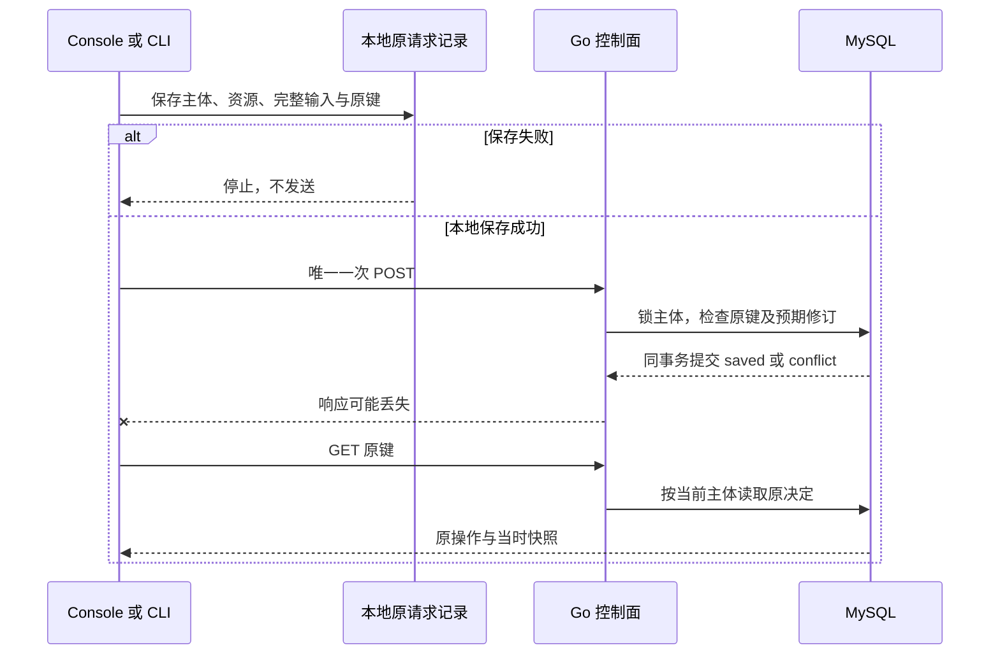

# 产品物模型草稿合同

正式 HTTP 字段见 [OpenAPI](control.openapi.yaml)，Agent 动作见 [控制面工具目录](tools/control.json)。草稿服务使用当前 Console 主体，独立于家庭空间；当前主体即唯一发布者，不隐含组织、团队共享或 Admin 权限。

## 生命周期与资源

当前实现创建、列表、读取、保存和原操作查询。每个产品一直为 `status=draft`、`validation=unvalidated`；允许 `{}` 等不完整 JSON 对象。保存只检查 JSON 安全与存储边界，不执行正式模型 Schema、运行时语义、兼容性或签名校验，不发布模型或改变设备绑定。

`product-<64hex>` 标识产品；`prodrev-<64hex>` 是每次成功保存后生成的聚合修订。即使只改名称、正文未变，也生成新修订，避免先改后还原绕过并发保护。`document_digest` 是正文 RFC 8785 JCS 后的 SHA-256，带 `sha256:` 前缀；不能当成正式模型已发布的证据。

| 动作 | HTTP | 工具 ID |
| --- | --- | --- |
| 列表 | `GET /api/console/v1/products?after=产品ID` | `products.list` |
| 创建 | `POST /api/console/v1/products` | `products.create` |
| 最新草稿 | `GET /api/console/v1/products/{product}` | `products.get` |
| 保存 | `POST /api/console/v1/products/{product}/drafts` | `products.save` |
| 原决定 | `GET /api/console/v1/product-operations/by-key/{key}` | `products.resolve` |

列表按产品 ID 升序，每页最多 16 个，`next=null` 表示结束；否则将 `next` 原样作为下一页 `after`。不存在与无权访问均返回 404。所有读写检查当前身份，写操作另需同源 `Origin` 和当前 CSRF；Admin Cookie 不授予 Console 权限。

## 输入与并发

创建正文只接受 `request_key`、`name`、`model`，不允许 `expected_revision`。保存另需 `expected_revision`。

```json
{"request_key":"edit-001","name":"桌面环境灯","model":{},"expected_revision":"prodrev-0123456789abcdef0123456789abcdef0123456789abcdef0123456789abcdef"}
```

原键为 1–128 位 ASCII 字母、数字、下划线或连字符。名称为 1–80 个 Unicode 字符，首尾无空白。正文为 UTF-8 JSON 对象，原文与 JCS 后均不超过 8192 字节；根深度为 0，最大深度 16，最多 2048 个值节点。拒绝重复键、非法 Unicode、非有限数和绝对值超过 `2^53-1` 的整数。HTTP 请求最大 16384 字节，拒绝未知顶层字段与追加 JSON。

修订相符时保存完整名称和正文，生成新修订；不相符时不修改产品，并保存 `status=conflict` 的原决定。两种业务结果均返回 HTTP 200，消费者必须读取 `status`。HTTP 409 `idempotency_conflict` 表示原键异参，不能和业务修订冲突混为一谈。

冲突结果包含当时服务器快照。客户端保留本地输入，另读最新草稿，由开发者核对后明确采用最新修订，再以新键提交；不能自动换基线覆盖另一位编辑者。

## 原决定与恢复

原键在同一主体的所有产品操作之间唯一，跨创建、保存和产品 ID 共享。请求摘要为以下对象 JCS 后的 SHA-256（此字段不带前缀）：

```text
{kind, product_id, request}
```

`kind` 为 `products.create` 或 `products.save`；创建时参与摘要的 `product_id` 为空字符串，保存时为路径中的产品 ID。`request` 是名称、原键、规范化模型及保存时的预期修订。创建结果中的 `product_id` 已填入新资源 ID，不能用该返回值替代摘要输入中的空字符串。

同键同摘要始终返回原操作 ID、状态、时间和当时产品快照，包括曾经的冲突；不再更新产品，也不随最新版本改变快照。同键异摘要返回 409。每主体最多 128 个产品、1024 条操作，满额 429 `product_capacity_reached`；旧键仍可恢复，不删除历史来重新受理。

MySQL 同事务完成产品变更、原决定和审计；先锁主体，再核对原键、配额与产品修订。新增显式迁移 v4 保留 v1–v3 原字节；API 启动只检查迁移，不执行 DDL。MySQL DDL 不是整体事务，迁移不能声明原子回滚。



Console 和 CLI 在第一次发送前持久化完整输入。旧记录在刷新、退出、重新登录或进程重启后只发 GET 原键；即使 404 也不补发 POST。未知结果不能当失败重新建产品。Console 使用独立主体命名空间与逐操作记录，监听同源标签页变更；退出保留记录，不保存 Cookie 或外部 Token。CLI 使用本人私有目录和 0600 文件，记录资源 ID，阻止同键误指另一产品。

“一次发送”指应用只调用一次新建/保存动作。浏览器网络栈在未收到响应头的连接中断后可能透明重试同一POST，因此服务端仍必须按原键与完整参数幂等决定。验证分别计数浏览器请求事件和代理收到的传输请求，并断言恢复后两者均不增加、只产生一个产品及原决定；不能仅凭一次fetch声称网络绝不重传。

CLI `saved` 返回 0，业务冲突或已知异参返回 4；丢响应、无效绑定响应和原键 404 返回 6。已知输入错误为 2、身份错误为 3、服务或本地文件错误为 5。`request_digest` 由服务端正式 JCS 生成，客户端核对主体、资源、完整输入、状态与快照关系，不以客户端排序算法宣称独立验证了该摘要。

## 验证入口与未覆盖范围

运行 `npm run test:products`：构建 Console/Admin，检查 JSON 边界，再创建无宿主卷临时 MySQL，执行 Go race/vet、迁移升级、当前身份及并发检查，并启动真实 API/Chromium/CLI 检查原操作恢复。报告写入忽略目录 `.dev/products-test/report.json`，逐次截图及检查结果位于 `.dev/products-*/`。

该入口使用回环 HTTP 和 OIDC 夹具，没有硬件、网关模型安装、正式 LimeCloud、公网部署或 NAS 容器验收。当前输入的独立检查见[物模型校验合同](model-validation.md)，不会改变本合同的草稿状态。发布、签名、版本兼容性及设备模型切换继续独立实现；[已发布模型规范](../docs/05-自研物模型规范.md) 与运行时合同保持原边界。
