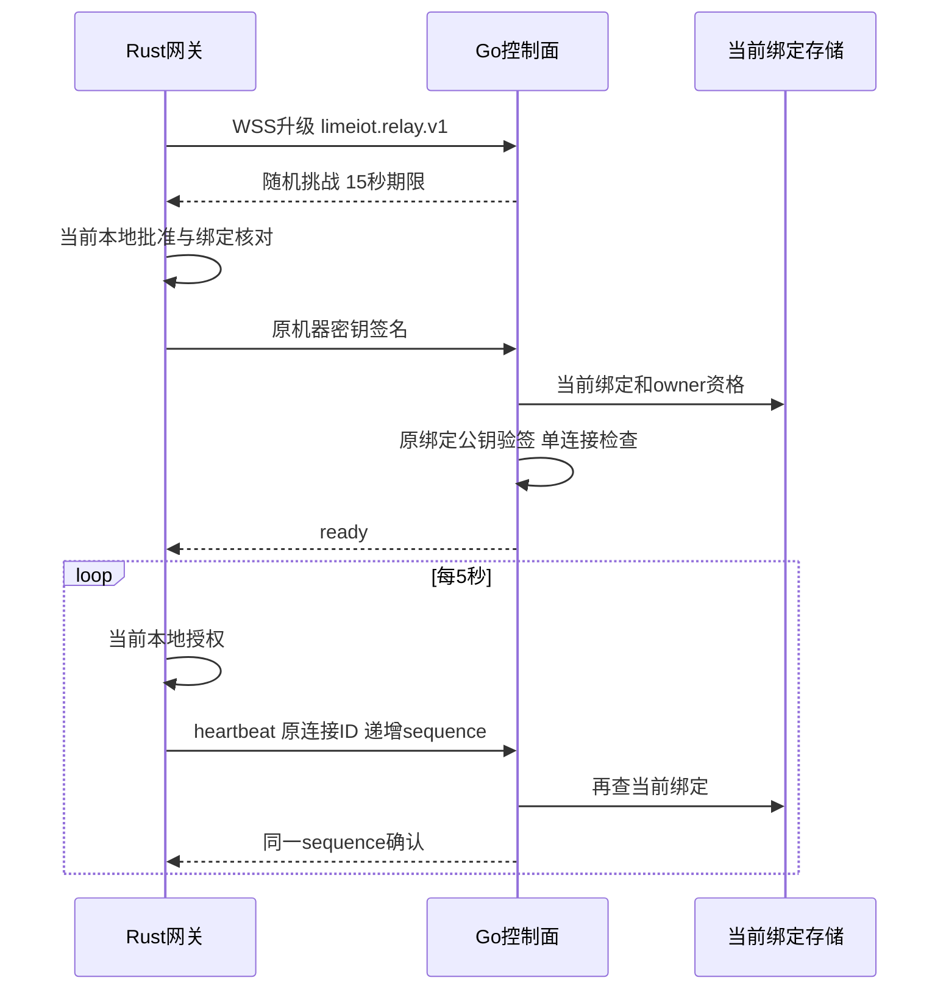
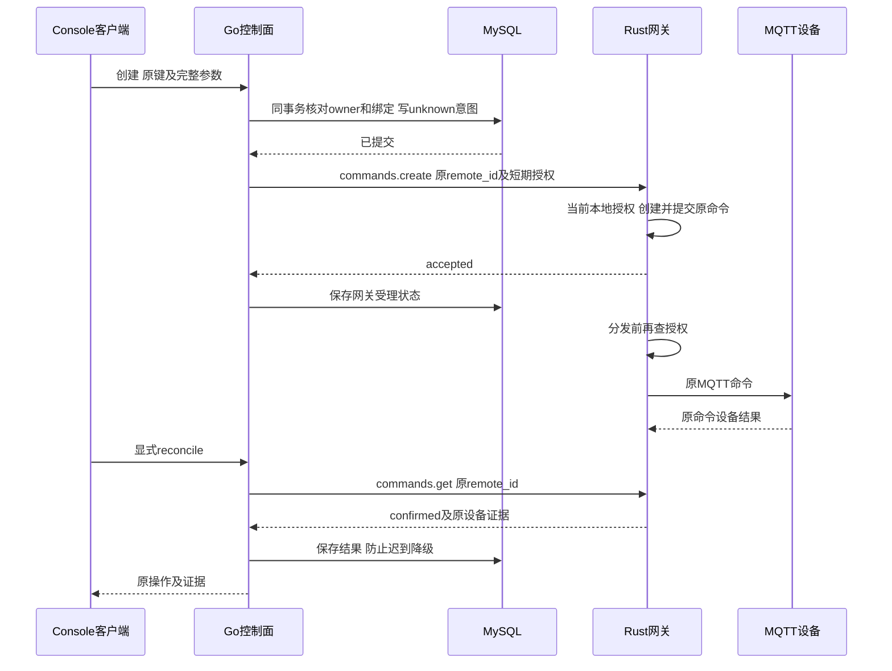

# 网关机器连接 0.1

本合同定义当前出站连接的认证、保活、撤销和受限远程动作。帧结构见 [JSON Schema](control-relay.schema.json)，HTTP入口见 [OpenAPI](control.openapi.yaml)。远程动作复用本地领域合同；不提供任意HTTP、MQTT、Shell、URL或工具隧道。

## 建立连接

安装者配置允许的控制面origin，并显式设置 `LIMEIOT_CONTROL_RELAY_ENABLED=1`。网关只为经过本地审批且状态active的原绑定连接；不以云登录或已升级WebSocket代替本地批准。没有绑定时不发起连接。

网关主动连接 `wss://<control-host>/api/gateway/v1/connect`，子协议固定 `limeiot.relay.v1`。只有字面回环地址可使用实验ws。拒绝Origin、Cookie、Authorization和URL参数；机器私钥、配对码与长期Token均不出现在握手URL。HTTP源站继续校验精确Host及可选固定边缘回源凭据。

TLS校验服务端证书、用途、期限和主机名；私有CA通过安装配置提供。连接固定本次获准DNS解析结果，禁止代理和重定向。DNS最多16个地址、2秒期限，整次TCP/TLS/升级最多8秒。WebSocket不使用压缩，文本帧/消息最多16384字节。

1. 服务端升级后生成随机 `connection_id` 和256位challenge，15秒到期，发送challenge帧。未认证连接与已认证连接合计最多128条，每客户端每分钟最多30次尝试。
2. 网关核对精确origin、随机字段与期限，以原机器私钥签署下述证明，再发送authenticate。网关不提供自选公钥；服务端只信任数据库中当前绑定的公钥。
3. 服务端读取当前active绑定及当前owner成员资格，逐项比对云/本地空间、主体及revision，再验签。同一网关身份只允许一条连接，重复连接拒绝，不替换现有连接。
4. 服务端发送ready。网关验证连接ID、绑定revision和心跳周期后才将本地传输状态设为connected。



## 证明格式

输入为以下字段的UTF-8，字段间一个LF，最后一行无换行。过期时间取challenge的整数Unix秒；signature为64字节Ed25519签名的标准Base64，保留填充。

```text
LIMEIOT-CONNECT-1
<control_origin>
<connection_id>
<challenge>
<expires_unix_seconds>
<cloud_space_id>
<gateway_id>
<local_space_id>
<principal_id>
<binding_revision>
```

连接挑战只用于所在WebSocket，不持久保存、不允许跨连接使用。固定 [跨语言向量](examples/control-connection-proof.json) 由Node生成，Go与Rust独立复签；其中私钥种子仅用于公开测试，不能用于真实机器。

## 保活与撤销

客户端每5秒发送heartbeat，sequence从1逐次加1，必须携带原connection_id。服务端每次确认前重新读取绑定、owner资格、公钥、scope及revision；读失败、绑定撤销或变化时关闭连接。12秒收不到有效心跳关闭；单次写入最多2秒。网关等待心跳确认最多3秒。

本地撤销、重新核实导致授权状态改变时，网关关闭该连接。云侧撤销成功后关闭该revision已有连接；并发建立连接的竞态在下次心跳核对时关闭，最迟受12秒无心跳期限限制。旧revision和旧签名不能认证新连接。实例退出主动关闭已接管的WebSocket，不依赖普通HTTP Shutdown处理它们。

断线后以1、2、4、8、16、30秒及最多500ms抖动退避重连；每次生成新挑战并复核原绑定。重连不重发claim、设备命令或历史事件。绑定未知、撤销或没有原密钥时不建立连接。

`GET /api/console/v1/spaces/{space}/gateways/{gateway}/connection` 只对当前Console所有者返回进程内连接状态。`connected`表示当前传输已认证，心跳间可能存在观测延迟，不表示设备在线或动作完成。进程重启丢弃连接表，原绑定仍保存在MySQL。

本地 `control-pairings.list` 返回独立的connection状态：`disabled/unpaired/connecting/connected/disconnected`，与耐久配对状态分开。默认不启用出站连接，基础本地设备与规则不依赖它。

## 受限动作与当前授权

ready完成后允许控制面发送request，与心跳及其确认交错。每帧有随机request_id、原connection_id、binding_revision、云/本地空间、principal_id和最多10秒的委托期限。网关从已认证连接取link_id和control_origin，不接受帧覆盖。云端每次动作核对当前Console会话及提供方主体、空间owner、原绑定与scope；本地在SQLite事务内核对当前active及已批准绑定、原主体、空间、revision、scope与期限。

| action | scope | payload | 结果 |
| --- | --- | --- | --- |
| devices.list | devices.read | after，首屏为空串 | items最多8个、next游标、binding_revision |
| models.get | devices.read | 原revision | revision与已发布model |
| commands.create | commands.write | remote_id、正式CommandRequest | 原命令投影或明确拒绝 |
| commands.get | commands.write | 原remote_id | 只查本来源的原远程命令 |

每条连接最多16个待返回RPC，单次等待8秒，委托9秒；帧和消息最多16384字节。不在线时拒绝新命令，不建离线队列。设备投影不含会话、seen和retired_boots；结果过大返回relay_result_too_large。读动作不开放命令列表或任意本地command_id。rules scope目前不提供远程规则动作。

result关联原request_id、connection_id和revision。控制面收到后再检查当前绑定，未知或已超时的request_id忽略。断线立即结束该连接的等待，返回的网络不确定性不能解释为设备失败；重连只恢复传输。读失败、未找到和超时均不触发创建。

## 耐久原操作和执行结果

Console POST remote-commands先持久化unknown发送意图及审计，再发送一次commands.create。原键唯一范围为云空间和主体，摘要为规范化RemoteInput的RFC8785/SHA256；Go规范化隔离在JCS适配器，值以原JSON数字传递。MySQL每空间最多保留1024条远程记录，不自动删除原键。更改参数409；同参旧键无论期限是否过去都只返回云记录。

网关把remote_id作为本地幂等键，强制原本地空间，并保存授权来源；不会建立第二套执行状态机。创建/查询同一命令不能续期旧执行授权；本地同键命令不能被云读取或占用。命令进入dispatched前再次检查本地授权和期限，撤销或过期即拒绝下发。

本地投影仅含command_id、request、request_digest、status、evidence和error。云端验证原空间、remote_id、设备、模型、时间、操作和摘要，再保存结果；不能把accepted/dispatched当作设备完成。confirmed必须来自原本地命令的设备回执。明确受理前拒绝可记为rejected；存储/网络不确定保持unknown。

命令支持 `property.set` 与 `action.invoke`，动作参数沿用 operation.value；path 总长最多129，两段分别最多64个字符。confirmed 属性结果仍要求 device_result.reported 与原目标一致；confirmed 动作要求 action_result 绑定原 path 和输入 JCS 摘要，输出存在且非 null、completion 为 submitted/observed、观察时间合法且 error 为 null。Go 还拒绝未知/重复动作证据字段；精确模型输出 Schema、模型声明的完成范围及设备会话由 Rust 核心验证。submitted 只表示输入已提交，字段校验不证明界面效果；详细规则与消费者边界见 [命令合同](commands.md)。

GET原操作只读云记录；POST reconcile只发commands.get。未找到不能证明旧create不会迟到，保持原状态。confirmed/failed/rejected/expired不会被迟到的accepted、dispatched或网络错误覆盖；已经观察到的unknown也不能被旧受理结果降级。已保存结果在离线或授权撤销后，仍仅允许当前空间owner读取本人记录；授权撤销不恢复执行权。



若创建意图已提交而进程在发送前退出，原操作可能一直unknown；平台选择保留不确定性，禁止自动重发。当前为单副本控制面，机器连接不跨进程路由；多副本部署需要独立的连接归属和转发方案，当前不能直接横向扩容。
