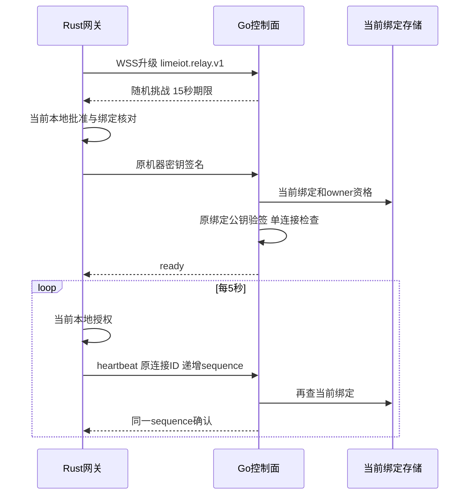

# 网关机器连接 0.1

本合同定义当前出站连接的认证、保活和撤销。帧结构见 [JSON Schema](control-relay.schema.json)，HTTP入口见 [OpenAPI](control.openapi.yaml)。当前不转发设备命令、HTTP请求、浏览器Cookie、媒体或事件流；远程执行须另行实现受限动作及当前授权。

## 建立连接

安装者配置允许的控制面origin，并显式设置 `LIMEIOT_CONTROL_RELAY_ENABLED=1`。网关只为经过本地审批且状态active的原绑定连接；不以云登录或已升级WebSocket代替本地批准。没有绑定时不发起连接。

网关主动连接 `wss://<control-host>/api/gateway/v1/connect`，子协议固定 `limeiot.relay.v1`。只有字面回环地址可使用实验ws。拒绝Origin、Cookie、Authorization和URL参数；机器私钥、配对码与长期Token均不出现在握手URL。HTTP源站继续校验精确Host及可选固定边缘回源凭据。

TLS校验服务端证书、用途、期限和主机名；私有CA通过安装配置提供。连接固定本次获准DNS解析结果，禁止代理和重定向。DNS最多16个地址、2秒期限，整次TCP/TLS/升级最多8秒。WebSocket不使用压缩，文本帧/消息最多16384字节。

1. 服务端升级后生成随机 `connection_id` 和256位challenge，15秒到期，发送challenge帧。未认证连接与已认证连接合计最多128条，每客户端每分钟最多30次尝试。
2. 网关核对精确origin、随机字段与期限，以原机器私钥签署下述证明，再发送authenticate。网关不提供自选公钥；服务端只信任数据库中当前绑定的公钥。
3. 服务端读取当前active绑定及当前owner成员资格，逐项比对云/本地空间、主体及revision，再验签。同一网关身份只允许一条连接，重复连接拒绝，不替换现有连接。
4. 服务端发送ready。网关验证连接ID、绑定revision和心跳周期后才将本地传输状态设为connected。



## 证明格式

输入为以下字段的UTF-8，字段间一个LF，最后一行无换行。过期时间取challenge的整数Unix秒；signature为64字节Ed25519签名的标准Base64，保留填充。

```text
LIMEIOT-CONNECT-1
<control_origin>
<connection_id>
<challenge>
<expires_unix_seconds>
<cloud_space_id>
<gateway_id>
<local_space_id>
<principal_id>
<binding_revision>
```

连接挑战只用于所在WebSocket，不持久保存、不允许跨连接使用。固定 [跨语言向量](examples/control-connection-proof.json) 由Node生成，Go与Rust独立复签；其中私钥种子仅用于公开测试，不能用于真实机器。

## 保活与撤销

客户端每5秒发送heartbeat，sequence从1逐次加1，必须携带原connection_id。服务端每次确认前重新读取绑定、owner资格、公钥、scope及revision；读失败、绑定撤销或变化时关闭连接。12秒收不到有效心跳关闭；单次写入最多2秒。网关等待心跳确认最多3秒。

本地撤销、重新核实导致授权状态改变时，网关关闭该连接。云侧撤销成功后关闭该revision已有连接；并发建立连接的竞态在下次心跳核对时关闭，最迟受12秒无心跳期限限制。旧revision和旧签名不能认证新连接。实例退出主动关闭已接管的WebSocket，不依赖普通HTTP Shutdown处理它们。

断线后以1、2、4、8、16、30秒及最多500ms抖动退避重连；每次生成新挑战并复核原绑定。重连不重发claim、设备命令或历史事件。绑定未知、撤销或没有原密钥时不建立连接。

`GET /api/console/v1/spaces/{space}/gateways/{gateway}/connection` 只对当前Console所有者返回进程内连接状态。`connected`表示当前传输已认证，心跳间可能存在观测延迟，不表示设备在线或动作完成。进程重启丢弃连接表，原绑定仍保存在MySQL。

本地 `control-pairings.list` 返回独立的connection状态：`disabled/unpaired/connecting/connected/disconnected`，与耐久配对状态分开。默认不启用出站连接，基础本地设备与规则不依赖它。
