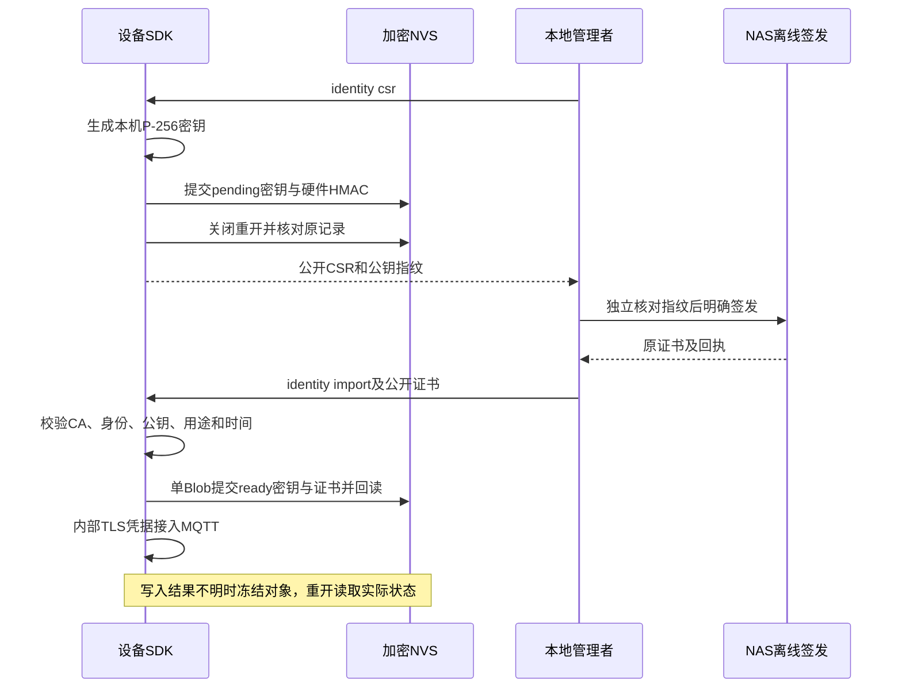
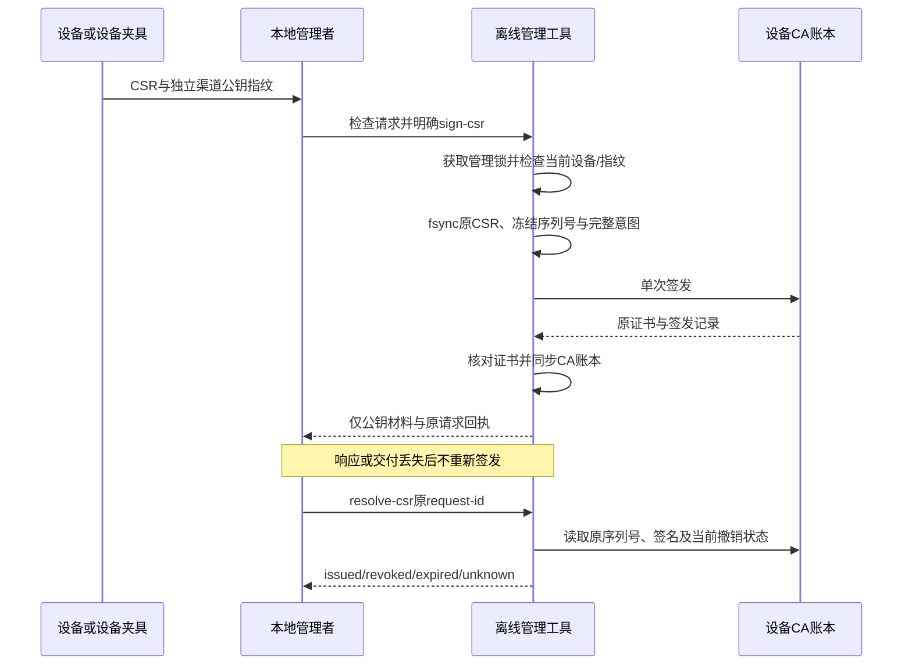

# 外部设备公钥请求签发

本合同定义离线管理工具的CSR检查、单次签发和原结果恢复，机器格式见[device-enrollment.schema.json](device-enrollment.schema.json)。设备端保留私钥，仅向管理端提供P-256/SHA-256证书请求。该流程只为当前NAS配置中已经绑定的设备签发，不变更设备归属、模型或Broker ACL，不替代设备物理认领。

## 准备与发现

在仓库根目录准备独立身份管理环境，依赖不安装到全局或运行容器：

```sh
python3 -m venv ".dev/identity-tools/venv"
".dev/identity-tools/venv/bin/python" -m pip install -r "deploy/nas/requirements-identity.txt"
python3 "deploy/nas/device_identity.py" csr-schema
```

`csr-schema`不依赖密码库、NAS安装或网络。其他CSR命令使用已安装固定依赖的解释器。旧开发`issue`、撤销和刷新CRL继续只依赖原Python/OpenSSL环境。

## 核对与明确签发

检查单份公开请求，不签发证书：

```sh
".dev/identity-tools/venv/bin/python" "deploy/nas/device_identity.py" inspect-csr \
  --directory ".dev/nas" --device-id device-lamp --csr ".dev/device-request.csr"
```

只接受完整单份PEM CSR，DER必须规范，签名有效，公钥为P-256，签名摘要为SHA-256。Subject恰好只有一个CN且等于设备ID；请求属性、扩展、附加Subject、私钥和多个PEM块均拒绝。输出的`csr_sha256`针对CSR DER，`public_key_fingerprint`针对公钥SPKI DER，均为`sha256:`加64位小写十六进制。

检查输出是候选材料，不能证明设备归属。操作者须通过独立受信渠道核对设备公钥指纹。以下指纹占位必须替换为已核对的实际值：

```sh
".dev/identity-tools/venv/bin/python" "deploy/nas/device_identity.py" sign-csr \
  --directory ".dev/nas" --device-id device-lamp --csr ".dev/device-request.csr" \
  --public-key-fingerprint "sha256:<64位小写十六进制>" \
  --request-id enrollment-lamp-001 --output ".dev/enrolled-lamp-001"
```

设备/请求ID为1–64位ASCII标识，首字符为字母或数字，后续允许下划线和短横线。普通`sign-csr`拒绝未绑定设备、指纹不符、已有有效证书、未知原签发和已有请求ID。旧`issue`入口同样不能绕过未知CSR签发；保留旧身份的换钥须使用下方独立`rotate-csr`流程。

CA私钥只留在NAS安装的`device-authority`，不挂载给网关、Broker或Web。签发、撤销、CRL刷新和NAS备份共用同一文件锁，并发操作拒绝，不自动等待或重试。新CSR入口要求私有NAS/CA/操作目录、本人所有的普通文件和受限权限，拒绝符号链接与多硬链接。

成功仅在新0700目录创建0600的`request.csr`、`device.crt`、`ca.crt`和最后耐久保存的`enrollment.json`。不生成或接收设备私钥，也不交付CA私钥。证书仅含设备CN、CA:FALSE、digitalSignature及clientAuth；CSR不能请求服务端或CA权限。证书仍须由设备验证CA、设备身份和本机公钥后导入；C3可选本机身份路径见下一节。

## C3本机密钥与证书导入

SDK的[设备身份接口](../firmware/components/limeiot_espidf/include/limeiot_device_identity.h)只在HMAC存储档位启用，通过固定ESP-IDF的PSA/Mbed TLS适配器生成P-256密钥和SHA-256单CN CSR。公共接口不暴露密码库类型；产品串行持有身份对象，不并发打开多个写入者。私钥只在加密NVS和同进程TLS内使用，不经USB、网络、工具回执或普通日志导出。这不提供安全元件式不可导出密钥，也不保护已被攻陷的运行进程。

离线配置将原`identity`对象替换为以下内容，并同时指定HMAC准备参数。只接受mode和ca，不能混入certificate/private_key；默认明文档位拒绝此模式：

```json
{
  "identity": {
    "mode": "device-local",
    "ca": "nas/device-authority/ca.crt"
  }
}
```

准备镜像仅保存固定CA及`identity_mode=2`、`identity_ver=1`，没有设备私钥或叶证书。启动若只存在一个标记、版本未知、混入旧凭据或构建未启用该模式，停止而不回退开发身份。HMAC构建强制启用证书日期校验；缺少密码库日期校验能力的接口拒绝导入和读取可用凭据。

灯/按钮开发产品依次完成配置读取、USB可信时间初始化和Wi-Fi/IP就绪，然后恢复身份；无线启动后的密钥生成使用SDK的随机数源。无已导入身份时才开放USB初始化命令：

1. 输入`identity csr`。首次明确请求生成密钥，耐久提交、关闭重开并核对完整记录后才输出公开CSR及SPKI指纹；pending重复请求复用原键。将CSR另存为管理端文件，通过独立受信渠道核对指纹。
2. 管理端按本合同`inspect-csr`和`sign-csr`操作；丢响应查询原request-id，不能重新签发。
3. 输入`identity import`，随后粘贴一份完整公开证书PEM。产品验证后提交ready身份，读取内部凭据并启动MQTT；以后正常启动不进入初始化循环。

SDK导入要求精确单设备CN、P-256且与本机公钥匹配、固定CA签名链、显式CA:FALSE、仅digitalSignature和clientAuth、SHA-256签名及当前有效期。多PEM、附加Subject、未知关键扩展、错误CA/公钥/用途、过期或尚未生效均拒绝且不修改pending记录。每次取得TLS凭据重新验证证书和可信时钟。重复原证书为只读成功；不同新证书返回冲突，不作为自动续期。



身份记录位于journal分区的`li-identity`命名空间、`identity`单Blob；密钥和证书不分开提交。初始身份使用版本1，精确4722字节，整数为单字节，字符串使用NUL终止且其后全部填零；首次轮换才明确写入下方版本2：

| 偏移 | 长度 | 内容 |
| --- | --- | --- |
| 0 / 8 / 9 | 8 / 1 / 1 | `LI-ID01`及NUL、版本1、状态1 pending或2 ready |
| 10 | 6 | 保留零字节 |
| 16 / 81 | 各65 | space_id、device_id |
| 146 | 32 | 固定CA证书DER的SHA-256 |
| 178 | 512 | 私钥PEM |
| 690 | 4000 | 叶证书PEM；pending时全零 |
| 4690 | 32 | 硬件HMAC-SHA256(root_key, 前4690字节) |

读取先验证MAC，再检查格式、空间/设备、CA与私钥。写入、提交、重开或回读结果不明时当前对象冻结，不重新生成或覆盖；重新打开后以实际耐久pending/ready状态为准。损坏、缺硬件钥、错绑、未知版本和存储不足均不自动擦除。不包含独立单调计数器，无法检测同设备旧备份回退。

USB初始化目前没有有期限的物理按键窗口和随机挑战，不修改NAS设备归属或ACL，不能视为完整认领。实际Wi-Fi熵源、USB、NVS掉电和芯片保护按用户要求跳过。`npm run test:firmware:identity`使用固定SDK原始密码库及ASan/UBSan验证实际C代码，和NAS签发、真实Broker的mTLS/撤销交叉检查；NVS/eFuse/HMAC根材料、随机数运行环境及OpenSSL传输端口是宿主夹具，实际NVS加密另由官方解密/CRC/字段检查覆盖。

## 保留旧身份的密钥轮换

轮换使用同一设备、空间和固定CA，必须使用新的P-256私钥。它不是重新认领，也不迁移CA。SDK将新键耐久暂存为rotating，同时继续提供旧证书/私钥；新证书完整验证并单Blob提交成功后才切换。丢响应重开读取实际状态，不能自动取消、生成另一新键或降级旧版记录。

开发产品使用独立维护镜像，正常镜像不因已就绪身份停在USB管理循环：

```sh
npm run build:firmware -- --storage hmac --hmac-key-id 0 --identity-maintenance
```

输出目录增加`-identity-maintenance`，维护标记必须与实际构建配置一致。维护镜像仍需已有受保护HMAC配置和可信时间；初始化完成后也等待`identity continue`，在该命令前不启动MQTT。它不自动刷写或安装，不提供生产按键认领窗口。实机操作按用户要求跳过。

1. 通过`identity status`读取state、generation、rotation_id、当前证书/公钥及待签发公钥指纹。state为0 empty、1 pending、2 ready、3 rotating；generation初始为0，成功切换后递增，不是硬件防回退计数器。
2. 输入`identity rotate rotation-lamp-001`，保存公开CSR及新公钥指纹。SDK要求当前证书有效；同ID恢复原待签发键，不同ID冲突。正在轮换时旧凭据仍可使用；ready拒绝重复已完成ID创建另一新键。
3. 管理端独立核对新公钥、原证书DER指纹和原序列号，明确签发：

```sh
".dev/identity-tools/venv/bin/python" "deploy/nas/device_identity.py" rotate-csr \
  --directory ".dev/nas" --device-id device-lamp --csr ".dev/rotation-lamp.csr" \
  --public-key-fingerprint "sha256:<新SPKI指纹>" \
  --previous-serial "<原证书序列号>" \
  --previous-certificate-fingerprint "sha256:<原证书DER指纹>" \
  --request-id rotation-lamp-001 --output ".dev/rotation-lamp-001"
```

管理端要求该设备只有这一张V状态旧证书，旧证书CA/设备/用途/当前有效期与指纹一致，新公钥不同，且没有未知原签发或未完成的已签发轮换。其他设备、服务证书、过期/撤销旧证书、同键续签、并发新轮换均拒绝。签发仅允许原身份与这一次候选短暂共存，不修改旧证书有效期；没有自动缩短过渡期或限时撤销调度，操作者必须完成后续步骤。

版本2管理意图除原字段外冻结`replaces_serial`、`replaces_certificate_sha256`与随机32字节`activation_challenge`（64位小写十六进制），均包含在原请求摘要中，调用CA前fsync。丢签发响应沿用`resolve-csr`，有原有效证书时明确重导出，不能另行重签或替换挑战。

4. 在设备输入`identity rotate-import rotation-lamp-001`并粘贴新公开证书。它只能匹配待签发的新键；原子切换后generation加一，清除逻辑记录内的旧私钥和暂存键。重复同ID/同证书只读；错误证书或不同ID不修改记录。不承诺Flash旧页安全擦除。
5. 使用原回执挑战输入`identity proof rotation-lamp-001 <activation_challenge>`。SDK仅在已至少成功切换一次、有当前有效凭据时签名；响应只有ECDSA DER签名的小写十六进制。它证明当前新键可用，不证明网络在线、物理持有或实体芯片。
6. 管理端明确提交该证明，先耐久保存激活意图，再撤销前证书并生成CRL：

```sh
".dev/identity-tools/venv/bin/python" "deploy/nas/device_identity.py" complete-rotation \
  --directory ".dev/nas" --request-id rotation-lamp-001 \
  --activation-proof "<设备公开签名十六进制>"
```

7. 按[NAS撤销步骤](../deploy/nas/README.md#设备证书)重启Broker，并用新身份重新连接；设备维护入口输入`identity continue`继续启动。不能以管理回执代替Broker已切断旧连接。完整流程应在开始下一轮前收尾。

激活签名使用P-256 ECDSA/SHA-256，原消息为以下六行ASCII字节，以单个LF分隔，末尾没有LF：

```text
limeiot.device-rotation-activate/v1
<space_id>
<device_id>
<request_id>
<新证书DER的sha256:指纹>
<activation_challenge>
```

管理端使用原签发证书公钥验证，不能以CSR签名、新公钥指纹或TLS连接标志替代。证明精确绑定请求、设备/空间、新证书和原挑战；跨请求、旧键、错误挑战或篡改签名均无效。证明权限只限撤销该原操作冻结的前证书，不作为通用签名或登录凭据；其可用期限受候选证书/CA当前有效期约束。SDK允许仍持有同一有效当前键时补取原证明，即使已开始下一轮暂存；NAS仍禁止未完成轮换时签发下一候选。

`resolve-csr`对版本2另返回`previous_decision`、`activation_confirmed`、`crl_updated`和`rotation_completed`。后者只在激活文件有效、旧账本为revoked且当前CA签名/有效CRL含原序列号时为true，不证明Broker已重载。激活意图保存后异常只查询原操作；旧账本已撤销而CRL未写入时为未完成，重复`complete-rotation`只补CRL，不重复签发或恢复旧权。部分文件损坏会阻断恢复，需要管理者诊断，不自动删除重建。

设备版本2记录精确5331字节，沿用版本1的前4690字节字段位置。版本字节8为2；状态为2 ready或3 rotating；10–13为已完成generation的uint32小端，14–15为0。初始版本1只读兼容，读取本身不升级或写入；旧程序不能读取版本2。

| 偏移 | 长度 | 版本2附加内容 |
| --- | --- | --- |
| 4690 | 65 | 当前/最近rotation_id，NUL及零填充 |
| 4755 | 512 | rotating的新私钥PEM；ready时全零 |
| 5267 | 32 | 此轮原证书DER的SHA-256 |
| 5299 | 32 | 硬件HMAC-SHA256(root_key, 前5299字节) |

rotating读取核对新旧键不同、原证书指纹及原绑定；ready保留最近ID/前证书摘要并要求generation大于0。生成或切换提交、重开、回读故障均冻结对象；重开后只按实际Blob恢复，绝不推断写入未发生。上限uint32拒绝溢出，记录回退依然没有独立硬件检测。

CA账本、版本2意图及`activation.json`沿用同一管理锁和NAS备份范围。设备私钥仍只在设备侧，只读原查询不恢复当前账本已撤销的凭据。恢复旧NAS/CRL备份可能回退撤销状态，须独立保留并恢复撤销记录；当前没有独立单调锚保证。有效身份使用本节受控轮换，过期身份另走下方明确维护；自动续期调度、在线签发、重新认领及CA迁移仍待交付。

## 过期身份的受控管理端恢复

`recover-csr`是管理者明确执行的离线操作，保留已经绑定的设备、空间、固定CA与ACL。它要求独立核对新CSR/SPKI、旧序列号及旧证书DER指纹，且使用不同的新公钥；不接收设备私钥，不恢复旧证书有效期，不证明物理持有或新的所有者归属。TV源码已接入[受控过期维护](tv-agent.md#过期身份的受控维护)，C3入口见下节；维护读取和明确恢复均不授予旧证书TLS能力，软件、运行期端口与实际端上结果分别见进度。

```sh
".dev/identity-tools/venv/bin/python" "deploy/nas/device_identity.py" recover-csr \
  --directory ".dev/nas" --device-id device-lamp --csr ".dev/recovery-lamp.csr" \
  --public-key-fingerprint "sha256:<新SPKI指纹>" \
  --previous-serial "<过期旧证书序列号>" \
  --previous-certificate-fingerprint "sha256:<过期旧证书DER指纹>" \
  --request-id recovery-lamp-001 --output ".dev/recovery-lamp-001"
```

只有实际叶证书已经到期、CA仍有效、旧账本为V或E且没有撤销时允许恢复；不能只凭E状态把未到期证书当成过期。核对原CA签名、设备CN、P-256、用途及旧指纹，不接受未来、未知、撤销或错绑旧证书。该设备所有V/E未撤销记录必须恰好只有该旧证书；多张历史证书不自动猜选。未知原签发及未完成、尚未撤销的轮换/恢复候选均阻止新请求，即使候选已经过期也不能绕过。损坏CA或账本需管理者诊断，不清记录解锁。

管理意图v3保留v2全部字段，并增加固定`recovery_reason="certificate_expired"`；版本和用途一起纳入`request_sha256`，调用CA前耐久保存。有效身份仍由`rotate-csr`生成v2，不静默切到恢复入口；初次签发仍为v1。v3不是TV材料v3、SQLite版本或C3记录格式，旧消费者不理解时应拒绝，不能降级解释或去掉用途字段。

恢复沿用原六行新键激活证明及`complete-rotation`，不新增通用签名接口。先签发新候选，设备核对并耐久切换后，管理者提交新键证明，才撤销原过期旧证书并更新CRL；Broker应用与新身份连接仍须另验。签发或响应不明只`resolve-csr`原请求，保留原序列号、摘要和挑战；激活/撤销/CRL中断也只恢复原操作。NAS备份包含v3原意图及激活记录，恢复不重签，不改变设备归属。管理结果仍为`hardware=false`、`physical_claim=false`。

软件证据、故障范围与端侧剩余工作见 [24第4.31节](../docs/24-实施计划与进度.md#431-过期身份恢复的管理端合同与软件闭环)。本功能不提供过期CA恢复、CA迁移、自动续期、设备密钥丢失恢复或旧备份防回退，也不放宽TLS的有效期检查。

## C3过期身份维护与原CSR恢复

开发维护镜像在启动MQTT前操作，普通镜像不自动进入恢复。`identity status`核对完整已存身份并增加`certificate_expired`与`recovery_origin`，读取叶证书到期事实不输出私钥。固定CA必须当前有效，未来日期、坏签名、错设备/公钥/用途及不可信时钟仍拒绝；`credentials`和`identity continue`始终拒绝过期证书。维护不能修复丢钥、损坏记录、CA到期或归属变化。

| 当前耐久状态 | 用户明确操作与恢复 |
| --- | --- |
| ready且原叶证书已到期，无候选 | `identity recover ID`生成不同新键与CSR，一起提交版本3并重开核对，成功后才输出公开CSR。重复同ID返回相同CSR字节，其他ID冲突 |
| 版本2 rotating，旧证书随后到期 | `identity recover-pending ID`后粘贴原先保存的完整CSR；核对原ID、候选公钥、精确设备CN及P-256/SHA-256签名，再提交版本3。没有原CSR不能重建另一请求，须从管理端原操作或原导出文件恢复 |
| 版本3 rotating | `identity recover ID`只读恢复原候选与耐久CSR；若再提供CSR，必须与已存字节相同。候选缺钥、未知结果或记录损坏不自动重建 |

没有原管理签发意图时，按上节以相同ID/CSR调用`recover-csr`生成管理v3；已经签发普通轮换或结果不明时只`resolve-csr`原管理v2意图，不改ID或重签。管理者核对原序列号、CSR的DER摘要及用途后，再用既有`identity rotate-import ID`导入当前有效的新证书；之后复用原`identity proof`、`complete-rotation`、CRL与Broker核对。C3端口消费公开证书，不直接解析管理JSON或保存其挑战；管理回执与用途的核对仍由离线操作者完成，不能宣称具有TV回执解析器的全部校验范围。

过期时普通`rotate_request`与旧版本2候选导入均拒绝，不能代替明确维护批准；初次导入也不能覆盖当前身份。版本3切换前仍核对原旧证书的CA/设备/用途/持钥，候选须完整通过当前有效期及新键匹配检查；切换同Blob保存新凭据、原ID/CSR、来源和递增generation，逻辑清除旧私钥与候选。重复已切换同ID/同证书只读，写入不确定冻结重开；不清命令日志、OTA日志或设备绑定。

设备身份版本3精确6355字节，独立于管理记录v3、TV材料v3或SQLite版本。沿用版本2前5299字节位置，字节8为3，字节14为恢复来源1 `expired_identity`或2 `pending_rotation`，字节15为0；5299–6322为1024字节的原CSR PEM及NUL/零填充，6323–6354为覆盖前6323字节的硬件HMAC。rotating的CSR对应原候选键，ready对应切换后的当前键；读取同时核对CSR签名和绑定。旧v1/v2保持可读，普通新轮换仍写v2，读取不自动升级；不理解v3的旧程序须拒绝，不能清数据降级。没有防旧备份回退或Flash旧页安全擦除保证。

软件结果及原始失败见 [24第4.34节](../docs/24-实施计划与进度.md#434-c3过期身份维护与原csr恢复)。实际USB、芯片密钥设施和掉电验证仍按用户要求跳过；身份存储恢复、运行期连接到期保护和实机分别取证，不能由本节宿主链路推导完整产品已交付。

## 耐久意图与恢复



调用OpenSSL前，工具在`device-authority/csr-operations/<request_id>`保存规范CSR和`request.json`，先fsync文件与目录。意图冻结空间、设备、预留CA序列号、CSR摘要、公钥指纹、CA证书指纹和原请求摘要。原请求摘要为排除`request_sha256`字段后，所有键排序、无额外空白、ASCII JSON字节的SHA-256；本合同只包含ASCII字符串与整数版本号，不定义通用JSON规范化替代品。

签发开始后的异常不证明没有签发。保留原目录，不覆盖、不自动补发，也不自动判定失败。查询原操作：

```sh
".dev/identity-tools/venv/bin/python" "deploy/nas/device_identity.py" resolve-csr \
  --directory ".dev/nas" --request-id enrollment-lamp-001
```

恢复同时核对原意图/CSR摘要、当前空间与设备配置、相同CA、原序列号账本、实际证书签名、公钥和用途。`issued`表示原证书已签发且当前有效；`revoked`和`expired`分别保留撤销与有效期状态；账本或证书证据缺失为`unknown`。坏意图或错绑返回错误且不改写原记录。查询不调用签发、不延长证书期限，也不恢复已撤销凭据。

原证书为`issued`但交付目录丢失或不完整时，可明确提供新的输出目录，只导出原材料：

```sh
".dev/identity-tools/venv/bin/python" "deploy/nas/device_identity.py" resolve-csr \
  --directory ".dev/nas" --request-id enrollment-lamp-001 \
  --output ".dev/enrolled-lamp-recovered-001"
```

已有输出目录保持原样。未知、撤销或过期不导出可用包；未知操作阻止同设备以新请求或旧开发入口重新签发。若中断发生在完整意图提交之前，坏操作目录会阻断签发，需管理者检查；本版本不自动清理或提供跳过检查的重试。OpenSSL自身的中断可能留下部分CA文件，当前不承诺自动修复CA数据库或事务型回滚。

## 撤销、备份与范围

撤销和CRL步骤沿用[NAS设备证书](../deploy/nas/README.md#设备证书)。当前仍须重启Broker才能关闭原连接并应用CRL；管理工具返回成功不能证明在线连接已停止。原查询能读到撤销状态，新签发使用新请求和新序列号。

NAS备份在同一管理锁内复制CA账本、证书与原意图，恢复后可查询原证书并导出到新目录。设备端私钥不由这条路径备份；生产设备的密钥恢复与转移另行设计。同一NAS及设备一起回退旧备份不具备独立防回退保证。

`hardware=false`和`physical_claim=false`表示工具没有执行或证明实体设备认领。CSR签名只证明请求生成者持有对应私钥，不能证明物理持有、设备品类、制造身份或所有者。C3已有可选本机密钥/导入源码和软件验证，物理窗口/随机挑战、动态归属变更及自动换证仍未实现，不能把此阶段报告为完整认领完成。

验证入口为`npm run test:device-enrollment`，可用`LIMEIOT_IDENTITY_PYTHON`指定已安装固定密码库的解释器。检查覆盖正式Schema、签发前拒绝、真实Broker mTLS/ACL/撤销、签发前后故障、未知禁换键、同序列号重导出、备份恢复和管理锁；另覆盖v3过期恢复、原激活/CRL中断、歧义拒绝、过期候选不绕过以及用途/版本损坏拒绝。设备密钥在独立宿主夹具生成，实机按用户要求跳过。

测试默认复用已有的`.dev/firmware-tools/venv/bin/python`。使用本节独立环境时执行：

```sh
LIMEIOT_IDENTITY_PYTHON="$PWD/.dev/identity-tools/venv/bin/python" npm run test:device-enrollment
```
