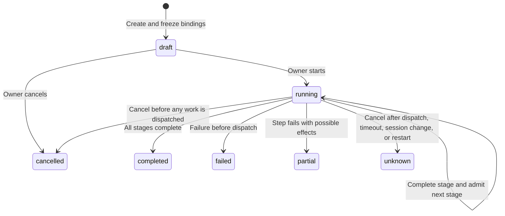

# Bounded execution plans

[简体中文](execution-plans.md)

This contract provides explicitly authorized orchestration for a local gateway owner: persist a plan, admit commands through the existing command ledger, wait for typed task events, and cancel work that has not been dispatched. It does not provide a physical transaction across devices, audio beat synchronization, safe robot stopping, or new permission to move.

The machine contract is [execution-plans.schema.json](execution-plans.schema.json); the core implementation is [execution_plans.rs](../gateway/crates/core/src/execution_plans.rs). Device identity, exact model bindings, inputs, outputs, idempotency, deadlines, and completion evidence remain governed by [commands.md](commands.md).

## Scope and limits

| Item | Current limit |
| --- | --- |
| Registered plans | 128; plan IDs are permanently unique and cannot be overwritten or reused |
| Management operations | 1024; resolve the original decision by its key within the space |
| Participating devices | 8 per plan |
| Steps | 16 in total; at most one step per device in each stage |
| Plan validity | At most 15 minutes after creation |
| Child command deadline | 1–30000 ms, capped by plan expiry |
| Task event wait | 1–900000 ms, capped by plan expiry |
| HTTP change body | 16384 bytes; duplicate keys, unknown fields, and excessive nesting are rejected |
| Execution route | Native device sessions only; external adapter routes are not admitted |

Capacity exhaustion rejects new work explicitly. It does not erase history or reuse old task IDs. Production archival, reclamation, and device rejection of retired generations require a separate contract; replay protection records must not simply be deleted.

## Creation and management

The core request is `{space_id,idempotency_key,change}`. HTTP takes the space from the path and the original key from exactly one `Idempotency-Key` header. Its JSON body contains only `change`, with `Content-Type: application/json`.

| Method and path | Behavior |
| --- | --- |
| `POST /api/v1/spaces/{space}/execution-plan-operations` | Create, start, cancel, or release a plan |
| `GET /api/v1/spaces/{space}/execution-plan-operations/by-key/{key}` | Resolve the original management decision; do not replace the key after a lost response |
| `GET /api/v1/spaces/{space}/execution-plans/{id}` | Read the current plan, original child command references, and task event evidence |
| `GET /api/v1/spaces/{space}/execution-plans?after={id}` | List plans ordered by ID, at most 16 per page |

These endpoints require the existing local owner authorization. Cloud command authority, website waitlist registration, device categories, model declarations, and Agent proposals do not grant plan management authority.

Example creation change; replace the device revision and timestamp with actual values:

```json
{
  "type": "plans.create",
  "plan_id": "family-show-001",
  "generation": "family-show-generation-001",
  "expires_at": "2026-11-03T10:10:00Z",
  "stages": [{
    "steps": [{
      "step_id": "first-light",
      "device_id": "robot-a",
      "model_revision": "sha256:0000000000000000000000000000000000000000000000000000000000000000",
      "operation": {"type": "property.set", "path": "light.level", "value": 37},
      "command_timeout_ms": 5000,
      "completion": {"type": "command"}
    }]
  }]
}
```

The client chooses `plan_id` and `generation` before creation. Task inputs and terminal events must echo both exactly. Plan IDs cannot be reused, and `step_id` is unique across the entire plan. Creation freezes every participant's exact model revision, boot, and session. It creates a `draft` without issuing commands or reserving devices. An expired draft cannot start; the background loop does not automatically start or repeatedly advance drafts.

A management change's `expires_at` uses the server's canonical UTC spelling, such as `2026-11-03T10:10:00Z`. Zero fractional seconds are omitted; nonzero precision uses the supported 3, 6, or 9 fractional digits. Parsing compares the canonical digest of the typed request with the original JSON. It rejects spellings such as `.000Z` or timezone offsets that would normalize to a different string, rather than silently rewriting the original request. This restriction applies to management changes, not to the device events below, which preserve their original time strings.

Start, cancel, and release require the current revision returned by a read:

```json
{"type":"plans.start","plan_id":"family-show-001","expected_revision":"sha256:<64 lowercase hexadecimal digits>"}
```

Use `plans.cancel` or `plans.release` for the other changes. The revision is the SHA-256 digest of the complete canonical plan projection with `revision` itself excluded. A separate `definition_digest` covers the immutable definition. Model, step, frozen binding, or progress changes affect the plan revision.

Management decisions have status `applied`, `conflict`, or `rejected`. The same original key and identical full request return the original decision; a changed request under the same key conflicts. A valid request rejected by domain checks also retains its decision. Do not reuse that key after device conditions improve. Malformed input, a wrong space, or an invalid key does not create an operation.

The public operation result is `{kind:"execution_plan",id,revision}` or `null`; GET retrieves the current plan. Internal storage keeps the original request digest and `applied_snapshot` to validate the original decision. HTTP and SSE omit this internal duplicate snapshot.

## CLI

Configure the local `LIMEIOT_ENDPOINT` and private `LIMEIOT_TOKEN_FILE`, then run from the repository root:

```sh
npm run cli -- schema execution-plan-changes.create
npm run cli -- invoke execution-plan-changes.create --space-id home \
  --input "./plan-change.json" --idempotency-key plan-create-001
npm run cli -- invoke execution-plans.get --space-id home --id family-show-001
npm run cli -- invoke execution-plans.list --space-id home
npm run cli -- invoke execution-plan-changes.resolve --space-id home --id plan-create-001
```

Create, start, cancel, and release use their respective change files and distinct original keys. `--state-dir` selects the private local operation directory; `--after` is only for list pagination. The CLI durably records the original request before sending. Repeating the same key and request only queries the original operation. A disconnected request or missing original decision remains unknown and is not automatically resubmitted. The CLI checks the request digest, space, original key, resource reference, and plan revision; a current webpage state is not evidence of an original decision.

Exit codes are 2 for input errors, 3 for authorization rejection, 4 for conflicts, 5 for read or response validation errors, 6 for unknown outcomes, and 7 for explicit rejection, failure, or partial failure. Continue resolving an unknown request by its original key. A plan read returning `completed` still does not establish that a device has physically stopped.

## Stages and completion

Start rechecks frozen sessions, model authority, current readiness, existing accepted/dispatched commands, OTA reservations, and other plans. Any failed check rejects the entire start decision.

All child commands for a stage are admitted in one deterministic transaction. If admission fails for the second device, the first device's candidate command for that stage is also discarded. After commit, the existing MQTT dispatcher sends each original command. Database atomicity does not mean that physical execution is simultaneous or all devices execute successfully.

Every child retains an original `CommandRequest`, deterministic idempotency key, original command ID, and `run_id=plan_id`. Only the plan's temporary internal admission authority can use this run ID; supplying the same run ID externally does not bypass reservations. A command deadline is not extended to cover a long show, and an `idempotent` declaration does not enable automatic replay.

There are two completion gates:

- `completion:{type:"command"}` waits for the original command to become `confirmed`. Properties use the original property evidence. Actions must declare `completion=observed`. This establishes only the effect defined by that model.
- `completion:{type:"event",path,timeout_ms}` waits for the action's quick `confirmed` acknowledgment and an accepted terminal event for the same task step. Actions declaring `completion=submitted` require this gate. Submission alone cannot finish a stage or plan.

All steps in the current stage must complete before the next stage is admitted. Devices execute separately. One may already have produced an effect when another fails, yielding `partial` or `unknown`; this is not a successful physical rollback.



## Typed task events

A long task's action `value` must include `task_id=plan_id`, `generation`, and `step_id`. Other inputs still follow the exact bound model. The gateway does not inject undeclared fields.

The gate must reference an existing model event whose `data` supports this terminal shape:

```json
{"task_id":"family-show-001","generation":"family-show-generation-001","step_id":"first-show","status":"completed"}
```

`status` is `completed` or `failed`. The generic gate does not infer product fields, scores, or vision results. Products can report detailed observations through other events.

The event first passes existing MQTT topic, device model, boot/session, sequence, event ID, model Schema, historical flag, and freshness checks before becoming a [DeviceEvent projection](device-events.en.md). The plan additionally checks the current stage, frozen device session, task ID, generation, step ID, event path, original child, original event body digest, and deadlines. The event occurrence cannot precede child admission, and its receipt cannot exceed the gate deadline or the current gateway time.

A plan terminal event body contains only `event_id`, `path`, `occurred_at`, `historical:false`, and `data`. The projection preserves the already validated original `occurred_at` string and parses it for time comparisons. Valid spellings such as `.000Z` and `+08:00` therefore retain their original body digest. Additional body members outside this contract are not interpreted as task completion; ordinary events still follow the general event contract.

An original event ID cannot advance a plan twice. Old generations, old steps, wrong devices, historical events, events predating child admission, and events arriving after cancellation cannot finish the current task. An event may be recorded before the quick command acknowledgment arrives, but the stage still waits for the original command confirmation.

## Cancellation, unknown outcomes, and release

Cancellation durably prevents future stages. Accepted but undispatched children become `rejected` with `plan_cancelled`; dispatched or submitted commands retain their actual states. A plan with no dispatched work can become `cancelled`. With possible effects it becomes `unknown`, with `physical_stop=unknown`.

This contract has no preemption channel and does not inject actions based on stop-like names. Stopping a rule, cancelling a plan, confirming network submission, or releasing a reservation does not prove that a driver has stopped. Older commands may still arrive from the Broker, SDK, or device queue. Sending stop and then continuing does not establish safety.

A plan that has started reserves its participants even after reaching any terminal state, until the local owner explicitly calls `plans.release`. Ordinary commands, other plans, and OTA are rejected while the reservation remains. Release only permits new control. It does not change the original `unknown`, replay old work, or establish physical safety. Verify an uncertain moving device locally before releasing it.

Gateway restart changes `running` plans to `unknown`, rejects remaining accepted children, and does not automatically reconstruct, resend, or advance stages. A later original receipt may add facts to the original command but cannot automatically convert a terminated plan into success.

## Durable validation and verification scope

Before recovery, validation recomputes plan bounds, definition digests, revisions without self-reference, original requests and keys, management decisions, frozen bindings, child references, original command requests and evidence, event body digests, stage completeness, terminal constraints, and exclusive device reservations. Successful deserialization alone is insufficient. Missing references, fabricated progress, changed bindings, invalid completion evidence, or overlapping reservations reject the snapshot.

Run the core checks with:

```sh
cargo test --locked -p limeiot-core --test execution_plans
```

These checks cover stage barriers, original command semantics, task events, cancellation, partial failures, restart without replay, atomic stage admission failure, and invalid snapshots. Runtime HTTP/MQTT/SQLite, SSE visibility after commit, CLI, and migration checks are separate evidence and cannot be inferred from core tests.

[gootuan-show-simulator-v2.json](models/gootuan-show-simulator-v2.json) is a software simulator model containing `light.level`, quickly submitted `show.run`, and `show.finished`. It has no motion, priority remote stop, or beat synchronization capability and does not establish these abilities on physical Gootuan hardware.

The Gootuan product still needs device task/control generation barriers, local timelines, verified assets, clock uncertainty estimates, and independent control leases and stopping circuits. The current C SDK's boolean/integer properties and single-integer events cannot directly carry this contract's multi-field task actions and terminal events; compatible firmware is required. Parent consent, child participant changes, capture permission, content, budgets, and game refereeing remain in the Gootuan product layer. Physical claiming, camera, audio, motion, and safety acceptance require real device evidence.
