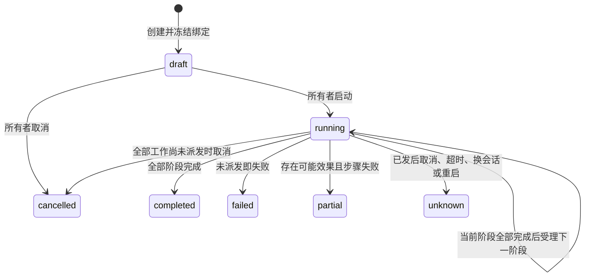

# 有界执行计划

[English](execution-plans.en.md)

本合同提供本地所有者明确授权的多设备分阶段编排：持久保存计划、按原命令账本受理子命令、等待类型化任务终态事件，以及取消尚未派发的工作。它不提供跨设备物理事务、音频节拍同步、机器人安全停车或自动运动权限。

机器格式见 [execution-plans.schema.json](execution-plans.schema.json)，核心实现见 [execution_plans.rs](../gateway/crates/core/src/execution_plans.rs)。普通命令的身份、精确模型、输入输出、幂等、期限和完成范围继续遵循 [commands.md](commands.md)。

## 边界与容量

| 项目 | 当前限制 |
| --- | --- |
| 已登记计划 | 最多 128，计划 ID 永久唯一，不覆盖或复用 |
| 管理操作 | 最多 1024，按空间内原幂等键查询原决定 |
| 参与设备 | 每计划最多 8 台 |
| 步骤 | 总计最多 16；每阶段每设备至多一个步骤 |
| 有效期 | 创建后最多 15 分钟 |
| 子命令期限 | 1–30000 ms，并受计划到期时间截断 |
| 任务事件等待 | 1–900000 ms，并受计划到期时间截断 |
| HTTP 变更正文 | 最多 16384 字节；拒绝重复键、未知字段和过深对象 |
| 执行端 | 当前只支持原生设备会话；不允许外部适配器路由 |

容量耗尽时明确拒绝，不自动清除历史或重用旧任务 ID。生产长期运行的归档、回收及设备端拒绝历史代次需要独立合同，不能直接删除防重放记录。

## 创建与管理

核心请求为 `{space_id,idempotency_key,change}`。HTTP 将空间放在路径，将原幂等键放在唯一的 `Idempotency-Key` 请求头，正文仅为 `change`，并要求 `Content-Type: application/json`。

| 方法与路径 | 行为 |
| --- | --- |
| `POST /api/v1/spaces/{space}/execution-plan-operations` | 创建、启动、取消或解除占用 |
| `GET /api/v1/spaces/{space}/execution-plan-operations/by-key/{key}` | 查询原管理决定；丢响应时不换键重做 |
| `GET /api/v1/spaces/{space}/execution-plans/{id}` | 读取当前计划、子命令引用和任务事件证据 |
| `GET /api/v1/spaces/{space}/execution-plans?after={id}` | 按计划 ID 顺序分页，每页最多 16 项 |

这些入口沿用本地所有者鉴权。云命令权限、网站候补登记、设备分类、模型声明和 Agent 提案均不授予计划管理权。

创建变更示例；设备修订和时间必须替换为实际值：

```json
{
  "type": "plans.create",
  "plan_id": "family-show-001",
  "generation": "family-show-generation-001",
  "expires_at": "2026-11-03T10:10:00Z",
  "stages": [{
    "steps": [{
      "step_id": "first-light",
      "device_id": "robot-a",
      "model_revision": "sha256:0000000000000000000000000000000000000000000000000000000000000000",
      "operation": {"type": "property.set", "path": "light.level", "value": 37},
      "command_timeout_ms": 5000,
      "completion": {"type": "command"}
    }]
  }]
}
```

客户端在创建前生成 `plan_id` 和 `generation`，任务输入与完成事件精确回传二者。计划 ID 不复用；同一计划内 `step_id` 全局唯一。创建冻结全部参与设备的精确模型、boot 与 session，只生成 `draft`，不发命令，也不占用设备。过期草稿不能启动，后台不会自动启动或反复推进草稿。

管理变更的 `expires_at` 使用服务端规范 UTC 表示，例如 `2026-11-03T10:10:00Z`；零小数省略小数部分，非零精度使用服务端支持的 3、6 或 9 位小数秒。解析会核对类型化请求与原 JSON 的规范摘要，拒绝会被规范化为不同字符串的 `.000Z` 或时区偏移表示，避免原请求被静默改写。该限制只用于管理变更，不用于下述保留原时间字符串的设备事件。

启动、取消与解除占用均要求读取到的当前修订：

```json
{"type":"plans.start","plan_id":"family-show-001","expected_revision":"sha256:<64位小写十六进制>"}
```

将 `type` 替换为 `plans.cancel` 或 `plans.release` 即为另外两种变更。修订是计划完整规范投影的 SHA-256，投影排除 `revision` 自身；计划定义另有 `definition_digest`。模型、步骤、冻结绑定或进度变化都会改变计划修订。

管理操作状态为 `applied`、`conflict` 或 `rejected`。同一原键和相同完整请求返回原决定；同键不同请求返回幂等冲突。合法请求的领域拒绝同样保存原决定，不能在设备恢复后复用该键碰运气。格式错误、错误空间或非法幂等键不会创建操作。

公开操作的 `result` 为 `{kind:"execution_plan",id,revision}` 或 `null`，后续通过 GET 读取当前计划。内部快照保存原请求摘要及 `applied_snapshot`，用于校验原决定；HTTP 和 SSE 不重复暴露该内部快照。

## CLI

使用本地 `LIMEIOT_ENDPOINT` 和私有 `LIMEIOT_TOKEN_FILE`，在仓库根目录执行：

```sh
npm run cli -- schema execution-plan-changes.create
npm run cli -- invoke execution-plan-changes.create --space-id home \
  --input "./plan-change.json" --idempotency-key plan-create-001
npm run cli -- invoke execution-plans.get --space-id home --id family-show-001
npm run cli -- invoke execution-plans.list --space-id home
npm run cli -- invoke execution-plan-changes.resolve --space-id home --id plan-create-001
```

创建、启动、取消和解除占用分别写入对应变更文件，使用独立原键发送。`--state-dir` 可指定本地私有原操作目录，`--after` 仅用于列表分页。CLI 在发送前耐久记录原请求；再次使用同键同参只查询原操作，断连或原决定查不到保持 unknown，不自动补发。它核对原请求摘要、空间、原键、资源引用和计划修订，不把网页当前状态当作原决定。

退出码：2 表示输入错误，3 表示鉴权拒绝，4 表示冲突，5 表示读取或响应校验错误，6 表示结果未知，7 表示明确拒绝或失败/部分失败。未知结果继续查询原键；读取计划结果为 `completed` 仍不等于设备已经物理停止。

## 阶段推进和完成范围

启动时重新核对冻结会话、模型授权、当前设备就绪、已有受理/派发命令、OTA 和其他计划占用。任一条件不满足，整个启动决定被拒绝。

每阶段在一个确定性事务中受理全部子命令。第二台设备受理失败时，第一台的本阶段候选命令也不会留下。事务成功后仍由原 MQTT 派发流程发送；该数据库原子性不保证多台设备同时执行或全部执行。

每个 child 都拥有原 `CommandRequest`、确定性幂等键、原 command ID 和 `run_id=plan_id`。只有计划内部短暂的受理权限能使用该 run ID；外部调用仅伪造同名 run ID 不能绕过设备占用。命令到期不延长到节目结束，不因 `idempotent` 声明自动重发。

阶段有两种完成门槛：

- `completion:{type:"command"}`：等待原命令 `confirmed`。属性按原属性证据校验；动作必须声明 `completion=observed`。这里只确认该模型定义的效果。
- `completion:{type:"event",path,timeout_ms}`：等待原动作快速 `confirmed`，并等待同一任务步骤的合法终态事件。动作 `completion=submitted` 必须使用此门槛，提交成功本身不能结束阶段或计划。

一个阶段全部步骤完成后才能受理下一阶段。同阶段的命令分别执行，一台失败时可能已有另一台产生效果；结果会是 `partial` 或 `unknown`，不能描述成回滚成功。



## 类型化任务事件

长任务动作的 `value` 必须包含 `task_id=plan_id`、`generation` 和 `step_id`，其余输入继续按绑定模型验证。网关不注入模型未声明的字段。

完成事件必须是模型已有事件，其 `data` 支持以下严格终态形状：

```json
{"task_id":"family-show-001","generation":"family-show-generation-001","step_id":"first-show","status":"completed"}
```

`status` 只能是 `completed` 或 `failed`。通用门槛不推断任意产品字段、分数或视觉结果；产品可通过其他事件报告详细观测。

事件先经过原 MQTT topic、设备模型、boot/session、seq、事件 ID、模型 Schema、历史标志及新鲜时间校验，才进入 [DeviceEvent 投影](device-events.md)。计划继续核对当前阶段、冻结设备会话、任务 ID、代次、步骤、事件路径、原 child、原事件正文摘要及期限。事件发生时间不能早于子命令受理时间，接收时间不能晚于任务门槛期限或当前网关时间。

计划终态事件正文仅使用 `event_id`、`path`、`occurred_at`、`historical:false`、`data`。投影保留已经校验的原 `occurred_at` 字符串，时间比较时再解析，因此 `.000Z`、`+08:00` 等合法表示不会因序列化规范化丢失原正文摘要。附加未纳入合同的正文成员不会被推断为任务终态；普通事件仍按通用事件合同处理。

同一原事件 ID 不重复推进，旧代次、旧步骤、错误设备、历史事件、发生在 child 受理前的事件和已取消后的迟到事件都不能完成当前任务。事件可以先于快速回执到达并被记录，但阶段仍须等待原命令确认。

## 取消、未知与解除占用

取消先耐久阻止未来阶段。已受理但未派发的 child 改为 `rejected` 并记录 `plan_cancelled`；已派发或已提交的命令保留真实状态。没有已发工作时计划可为 `cancelled`；存在可能副作用时计划为 `unknown`，且 `physical_stop=unknown`。

此合同没有抢占通道，也不会注入名称看起来像 stop 的动作。停止规则、取消计划、确认网络提交和解除设备占用均不证明驱动已经停止。已发命令仍可能在 Broker、SDK 或设备队列中到达，不能通过“先发 stop 再继续”保证安全。

启动过的计划在所有终态下仍占用参与设备，直到本地所有者显式执行 `plans.release`。占用期间普通命令、其他计划及 OTA 会被拒绝。解除占用只允许之后的新控制，不改变原 `unknown`、不补发旧工作，也不证明物理安全；未知运动设备应先在本地确认安全再解除。

网关重启将 `running` 变为 `unknown`，拒绝剩余 accepted child，不自动重建、重发或推进阶段。后续原回执可以补充原命令事实，但不会自动将已终止计划改成成功。

## 持久校验与验证范围

恢复前重新校验计划边界、定义摘要、去除自引用后的修订、原请求与原键、管理决定、冻结绑定、child 引用、子命令原请求及证据、事件原正文摘要、阶段完整性、终态约束及设备独占关系。仅能反序列化不是有效快照；引用缺失、伪造进度、篡改绑定、非法完成证据或重复占用均拒绝加载。

核心专项入口：

```sh
cargo test --locked -p limeiot-core --test execution_plans
```

专项覆盖分阶段屏障、真实原命令语义、任务事件、取消、部分失败、重启无重放、整阶段受理失败回滚和坏快照。运行时 HTTP/MQTT/SQLite、SSE 提交后可见性、CLI 与迁移由对应集成检查分别验收，不从核心单元测试推断。

[gootuan-show-simulator-v2.json](models/gootuan-show-simulator-v2.json) 是纯软件模拟模型：`light.level`、快速提交的 `show.run` 和 `show.finished`。它没有 motion、远程优先 stop 或节拍同步能力，不表示实体 Gootuan 已支持这些功能。

Gootuan 产品还需实现设备侧任务/控制代次屏障、本地时间线、素材校验、时钟误差估计、独立控制租约与停车回路。当前 C SDK 的布尔/整数属性及单整数事件不足以直接承载本合同的多字段任务动作与终态事件，需要固件协议配套。家长同意、儿童参与者切换、拍照授权、内容、预算和游戏裁判仍属于 Gootuan 产品层；物理认领、摄像头、音频、运动和安全验收需要实机证据。
