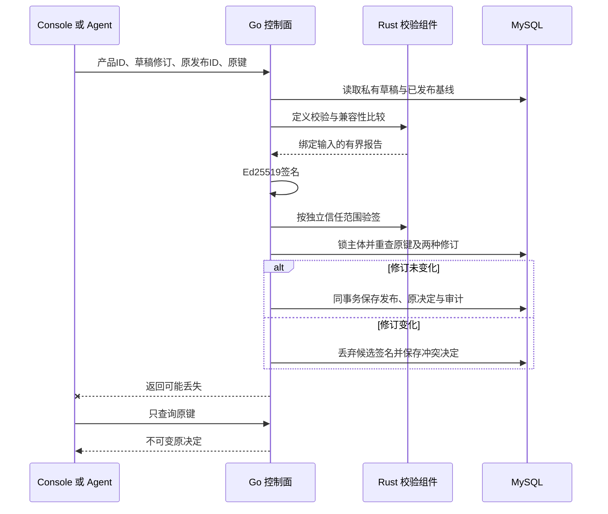

# 物模型签名发布合同

本合同覆盖产品草稿到不可变公开制品的服务端发布，以及无需网络的制品验签。发布 HTTP 字段见 [OpenAPI](control.openapi.yaml)，结构分别见[制品](model-release.schema.json)、[信任材料](model-release-trust.schema.json)和[验签报告](model-release-verification-report.schema.json)。本地安装与设备绑定继续使用独立授权，不由下载或签名自动获得。

## 发布者与密钥

`GET /api/console/v1/publisher` 返回当前 Console 主体在该实例的 `issuer`、`publisher_id`、`namespace` 和当前签名器的公开 `trust`。身份按以下规则派生，原 OIDC subject、邮箱和内部主体 ID 不进入公开制品：

```text
h = SHA256("LimeIoT Publisher v1\n" + issuer + "\n" + principal_id)
publisher_id = "publisher-" + h
namespace = "p-" + h[0:30]
```

`issuer` 为安装时固定的控制面精确 origin；更换 origin 或内部主体即产生不同发布身份。开发者从返回的命名空间创建 `urn:<namespace>:model:...`，不能自报 `limeiot`、`xiaomi` 或其他发布者命名空间。同一发布者的同一 `model_id` 只能由一个产品首次发布；后续版本沿用该产品及同一模型 ID。

签名器为独立 Ed25519 PKCS#8 PEM 私钥。显式设置 `LIMEIOT_MODEL_RELEASE_KEY_FILE=/absolute/private/model-release.pem`，文件须为不超过 8192 字节的普通文件，组与其他用户无读写执行权限。配置非法时 API 启动失败；未配置时 `trust=null`，新签名返回 503 `release_signer_unavailable`，不自动生成临时签名身份。历史制品和原决定的读取不依赖该密钥。

私钥不存入业务数据库、镜像、前端或公开信任 JSON；生产运行材料由部署者单独提供。`signing_key_id` 为原始 32 字节公钥的 SHA-256，带 `sha256:` 前缀。更换运行密钥只影响新制品；历史制品携带各自原公开材料，不重签旧版本。消费者须独立确认公钥和发布范围，不能因为制品附带 `trust` 就自动信任。

## 冻结输入与原决定

```http
POST /api/console/v1/products/{product}/releases
```

正文严格包含四个字段：

```json
{
  "request_key": "publish-lamp-001",
  "expected_revision": "prodrev-0123456789abcdef0123456789abcdef0123456789abcdef0123456789abcdef",
  "expected_release_id": null,
  "visibility": "public"
}
```

`expected_revision` 固定已保存的产品草稿；发布接口不接收另一份模型正文。`expected_release_id` 必须出现，首次发布为 `null`，升级为开发者已核对的上一发布 ID。缺失、空字符串或错误类型均拒绝；`visibility=public` 表示明确允许公开签名模型。未保存的编辑不参与发布。

调用须有当前 Console 身份、精确 Host/Origin 和 CSRF，Admin 会话不授予权限。无权访问的产品和不存在的产品均为 404。每主体最多保留 1024 条发布决定，不回收历史键；与草稿操作的键空间分别管理，发布键跨该主体所有产品共享。

请求摘要为 `{kind:"releases.create",product_id,request}` 的 JCS SHA-256，不带前缀。同键同摘要始终返回原状态、时间、报告和制品，同键异参为 409。查询原决定：

```http
GET /api/console/v1/release-operations/by-key/{key}
```

发送前应持久保存资源、完整输入和原键。丢响应后只 GET 原键；404 不足以证明未受理，不能自动改键或补发 POST。服务端可以接受传输层的同键重试，但不会因此重签或另建发布。

| `status` | 含义 | `release` |
| --- | --- | --- |
| `published` | 校验、兼容性、签名、验签和数据库事务均完成 | 原签名制品与公开信任材料 |
| `rejected` | 定义非法、非本主体命名空间、不兼容或另一产品已发布该模型 ID | `null` |
| `conflict` | 草稿修订或上一发布 ID 已变化 | `null` |

上述业务结果都返回 HTTP 200，消费者必须读取 `status`。503 表示签名器、校验组件或存储故障，不能解释为已发布或已明确拒绝。限流与 `models.validate` 共用每地址每分钟 30 次；查询和原键命中不重新消耗模型处理预算。

## 校验与事务

1. 读取当前主体私有草稿及数据库中该产品最近一次成功发布，不接受调用者上传的基线。
2. 核对两种预期修订；调用共享 Rust [模型校验](model-validation.md)，保留源正文摘要与规范模型修订的区别。
3. 校验成功后核对发布者命名空间；升级调用共享 Rust [兼容性检查](model-compatibility.md)，要求同模型 ID 和严格递增版本。
4. Go 构造签名，Rust 对完整制品及显式信任范围重新验签和检查模型。
5. MySQL 先锁当前主体，与草稿保存使用相同锁序；再查原键、配额、草稿及发布头。期间发生编辑或发布时，清除候选签名和过期报告，保存不可变冲突。
6. 同事务保存成功制品、原决定和审计。任一步失败整体回滚，不能留下可下载的孤立发布。拒绝和冲突也保存原决定及审计。



迁移 v5 只新增发布与发布决定两张表，v1–v4 原字节不变。API 仅检查迁移，不自动执行 DDL；生产迁移单独授权。MySQL DDL 非整体事务，不宣称迁移可原子回滚。发布保留草稿的 `draft/unvalidated` 状态，不改变网关模型、设备绑定或运行规则。

## 制品与离线验签

签名消息为 UTF-8 `LimeIoT Model Release v1\n` 加不含 `signature` 的 `{version,algorithm,signing_key_id,statement}` 的 RFC 8785 JCS 字节。`statement` 绑定实例、发布者、产品、发布 ID、源修订、源摘要、规范模型与修订、校验器版本、上一发布引用和 UTC 秒级发布时间。签名是标准 Base64 编码的 64 字节 Ed25519 签名。

```http
GET /api/console/v1/products/{product}/releases?after={release_id}
GET /api/console/v1/products/{product}/releases/head
GET /api/catalog/v1/model-releases/{release_id}
```

私有产品列表按发布 ID 升序，每页最多 16 项；`next=null` 表示结束。`/head` 返回 `{release: ModelPublication|null}`，只允许产品所有者读取；发布前用该入口核对最新基线，不能把分页列表顺序当成版本顺序。公开下载不要求浏览器会话，但仍通过实例的 Host 和边缘回源保护，只返回已提交的 `{artifact,trust}`。没有公开产品草稿列表或公开原决定查询。

将 `artifact` 和已独立确认的 `trust` 分别保存为 JSON 后，在核心仓库执行：

```sh
LIMEIOT_MODEL_VALIDATOR="/absolute/path/to/limeiot-model-validator" \
npm run cli -- model verify --input "/absolute/path/to/artifact.json" --trust "/absolute/path/to/trust.json"
```

该入口不需要登录、不请求网络、不写原操作记录。返回有效制品退出 0，制品或信任无效退出 2，缺失组件或报告合同错误退出 5。验签不等于安装。

验签独立拒绝重复字段、未知字段、非规范投影、不安全 JSON、错误签名/域分隔符、公钥摘要不符、跨实例/发布者/命名空间、非法模型或摘要、非法历史引用及超过当前时间 300 秒的发布时间。制品最多 12288 字节，信任材料最多 2048 字节，封装最多 16384 字节。`baseline` 只提供上版引用；独立验签不凭引用证明完整版本历史，发布服务依据数据库中已提交基线执行兼容性检查。

固定公开测试向量在 [model-release.json](examples/model-release.json)，包含显式 `test_only=true` 与公开测试种子，只能用于跨语言检查，不能作为部署私钥。

当前新发布声明使用 `limeiot.model/1.1.0` 与 `limeiot.model-compatibility/1.1.0`，覆盖 Schema 1/2。验签保留原1.0/1.0组合的历史制品支持，但其模型必须为 Schema 1 且所有 actions 为空；拒绝混用版本或用旧声明为 Schema 2 背书。历史已签名制品和固定测试向量保持原字节，不通过重写元数据“升级”。该版本兼容不代替签名、信任范围及模型规则校验。

## 当前交付边界

`npm run test:models` 覆盖共享定义规则、兼容性、发布事务、签名与离线验签，以及真实 Go 进程的故障和重启恢复。新增安装旅程读取实际发布下载的制品，接入真实 Rust 网关和 MQTT 模拟器。使用一次性无宿主卷 MySQL 和软件夹具；不是生产迁移、Cloudflare/Railway 部署或实机证据。

Console 发布区和控制面 CLI/Agent 目录已接入发布者、发布头、历史、制品和原决定。未保存输入不能发布；请求先保存在本机，未知结果仅查询原键，404不补发。冲突不自动修改基线，必须明确读取最新发布后再发新请求。浏览器资源/摘要核对不替代Rust验签或定义规则。具体运行验证以当前进度记录为准。

## 本地信任、安装和设备绑定

网关从本地所有者接收明确变更，不接受控制面远程安装。五类动作共用 `POST /api/v1/spaces/{space}/model-operations`，正文见 [model-change.schema.json](model-change.schema.json)，唯一原键位于 `Idempotency-Key`。CLI 使用本地 Bearer，浏览器使用所有者会话、精确 Origin 和 CSRF；路径空间参与原请求摘要。所有资源和原决定在同一次 SQLite 更新中提交，写盘失败不更新内存或事件。

| 动作 | 必需输入 | 生效条件 |
| --- | --- | --- |
| `trust.add` | `trust`、`expected_signing_key_id` | 所有者独立核对指纹；共享Rust校验材料与公钥摘要 |
| `trust.revoke` | `trust_id`、`expected_revision` | 当前信任修订一致；撤销后不重新激活 |
| `models.install` | `trust_id`、`artifact`、`expected_release_id` | 已存信任有效、签名和模型有效，本地当前发布头与预期一致 |
| `devices.bind` | `device_id`、`installation_id`、`expected_model_revision`、`expected_binding_revision` | 两种当前修订一致，安装为模型当前头，已有规则仍受支持 |
| `devices.bind-bundle` | `device_id`、`bundle_id`、`expected_model_revision`、`expected_binding_revision` | 两种当前修订一致，来源为网关固定目录，规则/路由兼容且无OTA占用 |

首次安装的 `expected_release_id` 必须显式为 null；新设备的两种绑定预期也必须显式为 null。未知字段、重复字段、缺少显式 null 均拒绝。正文上限16KiB、深度20、2400节点。结构Schema只提供机器输入形状，不能代替Rust验签、兼容性和授权。

Trust ID 为 `trust-` 加信任材料 JCS 的 SHA-256；Installation ID 为 `install-` 加 `{artifact,trust_id}` JCS 的 SHA-256。同键同参读取不可变原决定，同键异参冲突。HTTP200中的 applied、conflict、rejected 分别表示已完成、冻结基线冲突、明确拒绝；冲突原因为 `revision_conflict`。网络中断和无法核对的结果由客户端标为未知，仅GET原键，不补发或自动换键。

首次可明确安装一个完整有效版本，不要求本地持有所有历史版本。升级与网关本地当前头比较，允许跳过中间版本，保持同实例、发布者、产品及模型标识，版本严格递增且兼容。制品内的 baseline 引用不能替代本地实际状态。安装只增加可用模型，已有设备仍保留原绑定；新绑定只接受当前头。

绑定切换会清除旧观测和会话，等待设备以精确新修订重新握手并上报完整快照。尚未发出的 accepted 命令变为 rejected，已发出的 dispatched 命令变为 unknown；已完成的设备回执保留。撤销信任立即停止相关设备的新控制、上报和分发，不抹除历史。恢复旧的 trust.add 或安装决定只展示当时结果，不能恢复信任或回退当前头。

读取入口如下；每项均检查本地所有者和空间：

```http
GET /api/v1/spaces/{space}/model-trusts
GET /api/v1/spaces/{space}/model-bundles
GET /api/v1/spaces/{space}/model-bundles/{bundle_id}
GET /api/v1/spaces/{space}/model-trusts/{trust_id}
GET /api/v1/spaces/{space}/model-installations?after={installation_id}
GET /api/v1/spaces/{space}/model-installations/{installation_id}
GET /api/v1/spaces/{space}/devices/{device_id}/model-binding
GET /api/v1/spaces/{space}/model-operations/by-key/{original_key}
```

安装列表每页16项，`next_cursor` 表示下一页起点，`heads` 返回 model_id 到当前 installation_id 的映射；不能用分页顺序猜测版本。读取当前头不在本页时，应通过安装详情读取。设备绑定返回当前模型修订、动态绑定及信任状态；有效但尚未注册的设备返回两个 null 和 `trust_active=false`，不自动注册。

内置目录编译嵌入两份正式TV模型，返回 `{items,next_cursor:null}`；单项为 `{bundle_id,model_revision,model}`。`model_revision`为规范模型正文JCS的SHA-256，`bundle_id`为 `bundle-` 加同一摘要的64位十六进制值；客户端核对正文/摘要/标识，不接受上传正文。来源信任来自网关交付与所有者选择，不伪装发布者签名。绑定结果严格包含installation_id或bundle_id其中一种，其他字段为device_id/model_revision/revision/bound_at。旧安装来源形状不变；恢复核对当前绑定及历史成功来源与正文，旧成功不重应用。信任撤销只影响该发布者安装来源，不撤销内置目录。目录更新不得静默换绑，移除历史引用项须先验证恢复兼容。

两种换绑共用基线、规则/路由、容量及OTA检查，清除旧会话、观测和原生能力证明，保留旧模型、完整命令和账本序号。重新握手/快照只证明实际声明的能力；模型包含remote.press不自动授予Agent按键或ADB执行权。网关换绑、本机材料/日志迁移、执行compose及APK更新分别管理。

当前上限为32份模型信任、128份安装、1024个模型原决定、64台设备；旧键不回收。模型注册在快照v2引入，OTA与执行路由后续演进；当前网关校验读取v1–9，提交写入v9。v8引入内置绑定来源与原决定，v1–7夹带新动作/绑定/结果均拒绝；旧安装来源无需字段迁移。v9增加属性阈值规则及采样证据，旧版本拒绝夹带，见[自动化合同](rules.md)。执行绑定/组合/撤销及原决定的恢复边界见 [执行合同](execution-routes.md)，OTA恢复见 [本地升级任务](ota-tasks.md)。未来版本拒绝且不改写快照；旧程序拒绝不认识的新版本，防止忽略撤销、绑定或升级状态。恢复须保留原启动配置和数据库；模型安装不包含固件传输/OTA，也不自动替换执行绑定。
