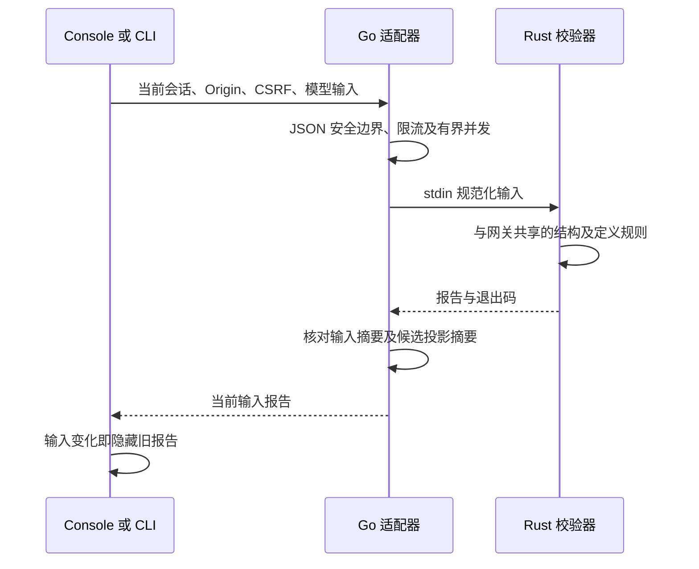

# 物模型校验合同

当前校验器 `limeiot.model/1.1.0` 检查 Schema 1/2 的受限定义。Rust 网关与独立校验器共用 `limeiot-core`；Go、CLI 和 Web 只适配进程或 HTTP、核对报告与输入绑定，不实现另一套语义规则。

机器来源：[模型结构](model.schema.json)、[报告结构](model-validation-report.schema.json)、[共享正反例](model-validation-vectors.json)、[HTTP](control.openapi.yaml)、[工具目录](tools/control.json)。JSON Schema 用于结构检查；跨字段唯一性、required 引用、范围关系、枚举符合对应类型/范围、版本整数范围及原始 JSON 安全仍由 Rust 检查。Schema 通过不能替代完整校验。

## 输入与支持范围

输入为 UTF-8 JSON 对象。原文及 RFC 8785 JCS 正文均不超过 8192 字节；根深度 0，最大深度 16，最多 2048 个值节点。拒绝重复键、非法 Unicode、非有限数和绝对值大于 `2^53-1` 的整数。独立进程最多读取 8193 字节判断超限；不是任意 Schema 执行器。

| 定义 | 当前规则 |
| --- | --- |
| 模型 | `schema_version=1` 或 `2`；三段模型版本，各段 uint32 且无前导零；1–16 个服务 |
| URN | 总长至多 512；命名空间 1–32 个小写字母、数字或连字符，首尾字母/数字；非空 NSS 仅 ASCII 字母、数字、`-_: .` 中除空格外的字符 |
| 标识 | `[a-z][a-z0-9_-]{0,63}`；服务标识唯一，每服务内属性、动作和事件共用唯一标识空间 |
| 服务 | 属性、动作、事件分别最多32项，三者不能全空；Schema 1 的 `actions` 仍必须为空 |
| 动作 | Schema 2 支持；必填 `id`、`semantic_id`、`input`、`output`、`idempotent`、`risk`、`completion`；输入/输出复用受限 Schema |
| 动作语义 | idempotent 为布尔值；risk 为 `low/medium/high`；completion 为 `submitted/observed`；不支持取消字段或任意执行代码 |
| 属性 | 非空且无重复的 `read/write/notify`；`max_age_ms` 必填且为 `1..2^53-1` |
| 单位 | 可省略；若有则为 1–32 个 ASCII 可见字符，不含空格；只验证机器码安全格式，不验证单位目录或业务换算 |
| 类型 | boolean、integer、number、string、有限 object；Schema 根深度 0，最多 4 层嵌套 |
| 数值 | minimum/maximum 仅用于数值类型，有限且绝对值不超过 `2^53-1`；integer 的边界必须是整数；minimum 不大于 maximum |
| 字符串 | minLength/maxLength 仅用于 string，Unicode 字符数 `0..4096`，下界不大于上界 |
| 对象 | 最多 32 个子字段；required 最多 32 个且唯一并引用已定义字段；additionalProperties 只允许 false，省略时仍拒绝未知值字段 |
| 枚举 | 1–32 个值，每个符合去除本层 enum 后的定义，按 JCS 去重；`1` 与 `1.0` 相同 |

所有结构拒绝未知字段；可选字段允许省略但拒绝显式 null。非 object 不能使用非空 properties/required 或显式 additionalProperties；空的 properties/required 可接受，并在规范投影中省略。extensions、数组、命名空间所有权、签名及真实硬件能力不在此版本的定义校验范围。动作调用、结果证据和恢复见 [命令合同](commands.md)。

两个有效定义的比较由独立的[兼容性合同](model-compatibility.md)承担；单模型 valid=true 不能替代兼容性结果。

## 报告与摘要

报告固定包含 `version=1`、`validator`、`valid`、`document_digest`、`model_revision`、`normalized_model`、`issues`。

报告外壳 version 仍为1，与模型 schema_version、模型业务版本和校验器版本分别管理。当前 Go 进程适配器要求1.1校验器；JS 历史报告检查兼容1.0，但旧版 valid 报告仅能描述 Schema 1 且所有 actions 为空，不能为 Schema 2 背书。共享向量当前为58份。

- JSON 安全检查未通过：三个摘要/模型字段为 null，issues 包含 `invalid_model_document`。
- JSON 安全通过、结构或语义错误：document_digest 保留输入 JCS 摘要；候选修订与模型为 null。
- 校验通过：issues 为空；normalized_model 为 Rust Model 的序列化投影；model_revision 是该投影的 JCS 摘要，与网关采用的摘要算法一致。

`document_digest` 绑定检查时输入；`model_revision` 是候选修订。规范投影会省略空的可选集合，因此两个摘要可能不同。消费者不得自动将投影覆盖到编辑输入，不得把候选修订作为已发布、签名或设备安装的证据。

issues 最多 32 条，仅返回 `path`（JSON Pointer，根为空字符串）和稳定机器 `code`。位置最多1024字节；超长输入键定位到最近的完整祖先，不截断Unicode或Pointer转义。结构错误为 `invalid_model_structure`，语义错误按规则返回 `invalid_urn`、`invalid_access`、`invalid_required_field`、`duplicate_enum_value` 等代码；不返回原始解析器或子进程诊断。

## 入口与隔离

离线入口读取模型正文，无需网络或会话：

```sh
cargo build --locked -p limeiot-model-validator
LIMEIOT_MODEL_VALIDATOR="/absolute/path/to/limeiot-model-validator" \
  node packages/cli/src/main.mjs model validate --input contracts/models/lamp.json
```

不设置路径时从 PATH 寻找同名组件；配置路径必须为绝对路径。进程 stdin 为模型原文，stdout 为一个报告 JSON；有效退出 0，模型错误退出 2，组件/IO 故障退出 5。CLI 限制输出 64 KiB、执行 3.5 秒，不记录原操作。

控制面入口为 `POST /api/console/v1/models/validate`，输入 `{ "model": {} }`。当前 Console 会话、Origin、CSRF、Host 和配置的边缘凭据均有效后才可调用；Admin 身份不授予访问权限。通用 JSON 安全错误返回 400；语义有效/无效均返回 200，读取 valid；每地址每分钟最多 30 次。

Go 通过 `ModelValidator` 窄接口调用固定本机组件，不接受请求提供的命令、参数或路径，不经过 shell。全进程最多 4 个校验进程、单次 3 秒、输出最多 64 KiB、忽略 stderr；核对报告版本、退出码、源摘要、候选摘要及有效/错误字段关系。缺组件、超时、并发满或非法报告均为 503 `validator_unavailable`；不回退其他规则，API 的健康状态不因此整体失败。

控制面 CLI 为 `control models validate --input request.json --session-file /private/session.json`，文件内容是 HTTP 输入封装。有效退出 0，无效退出 2，服务故障退出 5。该动作可重复，不需要幂等键或原请求日志。Web 校验报告仅显示在对应输入上，编辑内容变化后隐藏；晚到报告不能证明新输入有效。草稿继续为 draft/unvalidated。



## 验证

Rust：`cargo test --locked -p limeiot-core -p limeiot-model-validator`。CLI/报告：`node --test tests/model-validation-boundaries.test.mjs`（先构建校验器）。Go 的共享向量测试需设置 `LIMEIOT_MODEL_VALIDATOR`；未设置时明确跳过该项，其余进程边界测试仍运行。

完整隔离入口 `npm run test:models` 先构建组件和通用 Console/Admin，再创建自有无宿主卷 MySQL，运行 Go race/vet、草稿恢复回归和模型 API/CLI/浏览器检查。硬件、正式云、NAS 容器启动、发布签名和安装分别验收，不从本检查推导已完成。
