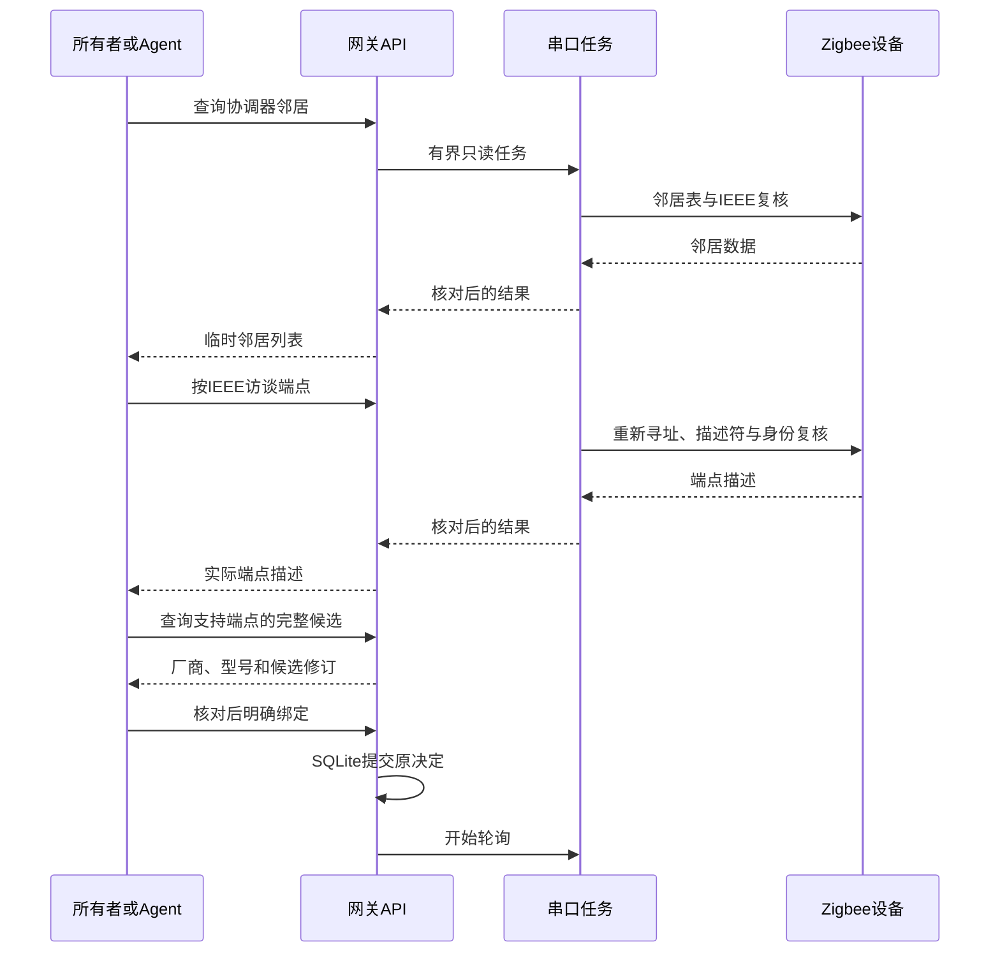
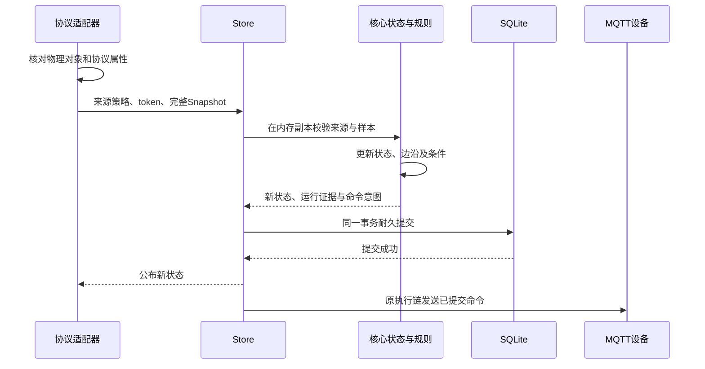

# 外部观测与属性桥接接入

本合同定义核心`observation` Port、托管来源决定与当前ZNP温湿度及标准On/Off映射。来源证据由网关宿主提供；绑定决定与观测更新使用原SQLite事务、设备视图和规则引擎。串口协议类型不进入领域核心。

同一设备需要可写属性时，宿主必须同时提供明确的[属性桥接授权](property-bridges.md)。只读绑定继续拒绝可写模型；标准On/Off可通过静态配置或运行中明确接入使用同串口任务与既有命令链路。

## 来源与会话

`Policy`包含`device_id`、`model_revision`和`source { adapter_id, revision }`。静态来源的目标设备必须已在初始配置声明；托管来源由后述明确决定创建新设备。静态与托管来源合计最多16个，已撤销的托管逻辑设备仍占容量；活跃adapter_id不能重复或占用动作执行来源。只读来源接受1–64项属性、无动作/事件、属性可读且不可写的精确模型；属性桥接须同时提供精确写路径授权，不支持一个设备的属性由多个来源拼接。

设备对象中的来源策略和来源会话不序列化。静态来源由Store将按device_id排序的完整策略与原Config共同计算配置摘要；无静态来源时保持原摘要算法。启动时先由同一宿主文件重新注入静态策略，再从独立决定账本恢复托管策略；恢复清除ready、来源会话和阈值基线，保留旧值供过期展示。删除、添加或改变静态语义来源后，旧数据库拒绝启动；不删除数据库、不改摘要或静默回退成原生设备。运行时候选接入使用下述明确决定；静态迁移仍未实现。运行中有限入网管理独立见[入网合同](zigbee-operations.md)，不与来源绑定混为同一授权。

`begin_observation`创建随机来源token并清除边沿基线，尚不将设备标为在线。token只在本次进程内使用；宿主调用Store时以设备标识作为开始/结束事件的输出，禁止把token作为可序列化业务输出写入事件表。`end_observation`仅接受当前token，旧任务不能关闭新会话。模型信任撤销或换绑也会使原会话失效；配置来源的模型修订被锁定，不能通过模型API换成后来的同路径模型。

原生MQTT的hello/state/result/availability/device_info/OTA消息均不能覆盖配置来源的设备。状态可用不产生原生执行会话、动作声明或OTA证明，Broker断开也不会清除独立来源的状态。设备视图可返回`observation_source { adapter_id, revision, ready }`，不暴露来源token。

## 托管来源决定

核心`observation_binding`、Store及网关HTTP/CLI已装配以下决定、查询和恢复语义，运行轮询由已提交绑定驱动。家庭网页在“设备接入 → Zigbee设备”、原生客户端在“设置 → Zigbee设备”提供邻居发现、端点访谈、查询、核对、明确添加、撤销、重新接入和原请求查询，并保留已知IEEE/端点入口。本节不代表Zigbee入网、全网发现或已有静态来源迁移已经可用。

请求包含`space_id`、`idempotency_key`与`change`。change只接受以下两种形状，不接受串口、客户端manifest或任意模型正文：

| type | 字段 |
| --- | --- |
| `sources.bind` | `device_id`、`source { adapter_id, revision }`、`expected_binding_revision`、`expected_model_revision` |
| `sources.revoke` | `device_id`、`expected_binding_revision` |

`observation_binding(device_id)`返回`device_id`、当前`revision`与可空`binding`。未绑定设备也有确定修订。binding包含`policy`、`manifest`、`active`、`generation`与`changed_at`；修订覆盖设备标识与完整绑定内容。首次绑定仅创建新逻辑设备，不能接管已有原生、模型API创建或静态配置的设备；重绑保留逻辑设备和精确模型修订，不允许通过来源或模型API变更模型。

协议适配器由宿主调用后构造不可反序列化的`Offer`，包含来源、精确模型、write_paths、语义manifest、`observed_at`与`expires_at`。候选不得来自未来，决定时必须未过期，最长有效60秒。manifest必须为非空对象，限制为4096字节、深度8、256节点，其JCS摘要必须等于来源revision。核心只校验大小、摘要与模型，不解释协议字段；宿主仍须校验物理目标唯一性和协议映射，不得把客户端提交的正文包装成授权证据。

所有修订和候选核对在设备、模型及策略变更之前完成。成功绑定同时保存设备、模型与授权，清除旧观测、来源会话和阈值基线；只有后续完整新鲜采样才能在线。撤销将`active`设为false，立即结束本地会话与阈值基线，保留设备、旧观测、模型、历史及策略。旧值按过期展示，原生MQTT仍不能接管。再次绑定必须使用新的明确请求、当前绑定修订和仍有效候选，生成新的generation；旧token不能提交样本或关闭新会话。撤销释放活跃来源占用，允许其他新设备明确绑定该来源，但保留的旧逻辑设备继续占容量。

每个有效新请求保存`operation_id`、连续`sequence`、原请求与摘要、`status`、`reason`、`result`和`created_at`。status为`applied`、`rejected`或`conflict`；修订冲突为`conflict/revision_conflict`。拒绝和冲突也耐久保存，不能自动换键重试。同键同参直接返回原决定，即使候选已过期或不可用；同键异参返回`idempotency_conflict`。无效请求和已耗尽容量不形成新决定。`observation_operation(key)`按原幂等键查询；最多256条决定，不自动裁剪，达到上限后拒绝新增决定，原查询与原请求恢复继续可用。

Store在同一SQLite事务提交设备、模型、决定与事件，提交失败不公布任何一项，也不废除先前已提交的token。首次保存决定将快照升级为v13，初始配置摘要不变；v13可以与定时规则和执行计划并存，也允许没有执行计划字段。v1–12夹带来源账本、v13缺失或为空账本、决定链不一致或未来版本均在恢复事件写入前拒绝，不改写快照。校验按sequence重建成功决定，核对原请求摘要、修订链、操作标识、generation、时间、结果及最终绑定，并检查当前设备、模型和来源占用。该校验拒绝不一致快照，不提供数据库写入者不可伪造的密码学签名。

恢复后重新注入活跃或撤销策略，不恢复在线、token或边沿基线。当前软件阶段只验证macOS宿主与隔离SQLite；NAS备份工具原样复制数据库和config目录，未因本阶段执行新NAS容器或Linux串口验收。旧版网关不能读取v13，不得用降级版本覆盖已有来源决定的安装。

## HTTP与机器工具

候选查询可增加`profile:"on_off"`，明确查询标准开关；省略时沿用温湿度读取。只有宿主完成对应只读访谈后，才生成模型固定为`contracts/models/on-off-light.json`、`write_paths:["light.power"]`的候选。客户端不能提交write_paths、manifest或串口来取得权限。

属性桥接的binding额外包含write_paths，只读绑定不输出该字段，原序列化和摘要保持兼容。宿主Offer的write_paths须精确覆盖模型所有可写属性；重绑锁定模型和写路径，不能改变设备能力。撤销或重绑先关闭旧会话，accepted命令转rejected，dispatched命令保持unknown；恢复和新采样均不补发旧命令。

动态属性桥接使用v15快照，静态桥接仍用v14，只读托管仍用v13。恢复要求路由精确等于当前活跃授权集合，已撤销绑定的路由必须为空。v15必须包含耐久桥接授权，旧版本夹带可写授权、路由缺失或多余时，在写入恢复事件前拒绝并保留原库。备份恢复须使用支持对应版本的网关。

下列路由均受原本地鉴权、空间与浏览器Origin/CSRF规则保护。相对路径位于`/api/v1/spaces/{space}`：

| 方法与路径 | 工具ID | 用途 |
| --- | --- | --- |
| GET `/observation-candidates` | `observation-candidates.list` | 已配置协调器及未过期候选，不返回串口 |
| POST `/observation-candidates` | `observation-candidates.query` | 读取指定IEEE/端点，仅生成短期候选 |
| POST `/observation-discoveries` | `observation-discoveries.query` | 读取指定协调器的已有邻居表 |
| POST `/observation-endpoints` | `observation-endpoints.query` | 按IEEE重新解析短地址并访谈实际端点 |
| GET `/devices/{id}/observation-binding` | `observation-bindings.get` | 当前绑定及预期修订基线 |
| POST `/observation-operations` | `observation-changes.create` | 明确绑定或撤销，要求唯一`Idempotency-Key` |
| GET `/observation-operations/by-key/{id}` | `observation-changes.resolve` | 查询原决定 |

来源决定与候选见[正式Schema](observation-bindings.schema.json)，发现与端点访谈见[发现Schema](observation-discovery.schema.json)，工具目录见[catalog](tools/catalog.json)。候选查询接收`coordinator_id`、`ieee_address`及`endpoint`和前述可选profile，不接收串口、manifest或模型正文，不创建设备、不提交状态或规则。查询超时返回504、同串口查询占用或候选容量耗尽返回429；协调器不存在返回404，不可用或feature未启用返回503。三类query都是有界读取，不使用耐久决定键，不自动重试。

CLI使用同一工具ID，创建决定前先同步私有原请求记录；记录保存失败时零POST。同键再次create只GET原决定；响应丢失、找不到原决定或坏摘要保留未知，不自动重新提交。验证覆盖原请求、manifest、模型及绑定摘要、generation和结果修订。业务决定事件为`observation.operation`，其`payload.data`为原Operation；SSE只在Store提交成功后通知。家庭网页收到该事件后重新读取当前设备，不根据旧applied事件重新激活来源。

来源ID独占双向校验：绑定观测来源会拒绝已有执行路由，之后的执行bind/compose也拒绝活跃静态或托管观测来源。撤销释放活跃ID；被拒绝的原决定不会因后来释放而改变，需明确发起新请求。

## 设备发现与端点访谈

邻居查询严格接收`{"coordinator_id":"home-znp"}`，共享运行中网关的串口actor，不另开串口。前后核对配置中的协调器IEEE，固定分页读取协调器的邻居表，最多64条；页变化或无进展、重复地址、坏长度和身份变化均失败，不输出部分列表。结果包含`coordinator_id`、`coordinator_ieee`、`scope:"coordinator_neighbors"`、`items`、`observed_at`、`expires_at`、`protocol:"zigbee-znp"`与`evidence:"unauthenticated_protocol"`。每条保留IEEE、短地址、原始位字段与链路字段，不把链路质量或邻居关系当成设备身份、在线或能力证明。

端点查询严格接收`{"coordinator_id":"home-znp","ieee_address":"1122334455667788"}`。每次重新按IEEE查询当前短地址，读取Node Descriptor及最多16个实际端点；末尾再次查询IEEE对应短地址并核对协调器和设备IEEE。结果返回当前短地址、厂商码与端点描述，不接受客户端短地址，不沿用邻居列表中的地址直接访谈。两类读取不注册AF、不读取ZCL属性，不生成候选Offer、不写SQLite或来源决定。端点Cluster声明不等于属性读取成功。

发现和访谈复用候选查询的单slot、容量1队列、同一期限、会话取消/失败关闭与查询之间到期轮询公平性；不消耗85组AF读取预算，但会在预算耗尽时正常轮换会话。超时只影响当前查询，协调器身份等共享异常仍使整组来源离线。页面取消HTTP请求后，已开始的串口读取仍受原期限约束，不自动补读。串口占用最长可达配置的30秒，其他来源的新鲜度可能在等待期间过期。

两类回执最长有效60秒，只是临时协议信息。邻居表不是原子快照或全网扫描，可能含旧记录、遗漏路由器下设备，分页也未必检出同数量的变化。即使发现信息有效，仍须对支持的端点执行原候选查询，再核对厂商/型号并明确绑定。没有permit-join、网络形成、全网路由遍历、设备认证或自动绑定。



## 家庭网页接入与恢复

家庭网页可从“发现已有设备”选择邻居、读取端点；当前仅profile `0x0104`且input clusters完整包含`0/0x0402/0x0405`的端点可继续查询环境候选。其他端点明确显示暂不支持；保留手填已知IEEE/端点入口。发现结果与端点描述只保留在页面内存，最长60秒；输入或协调器身份/来源上下文变化、后台、离线或离页使结果失效并取消在途发现请求，迟到返回不恢复。到期只清除结果，不自动查询，不持久化邻居清单。

查询完整候选后，核对候选摘要、物理目标和当前绑定基线再展示确认。设备编号默认由IEEE生成，也可在查询前修改；原生或静态逻辑设备不能被接管。候选、核对正文和撤销核对仅存当前页面内存，输入变化、事件更新、离线、进入后台或离开页面使核对失效；过期候选不能提交。撤销先读取当前绑定并明确确认，再停止采样；重新接入重新查询完整候选，不重用旧读取结果。

浏览器原请求以`limeiot.observation-operation:<space-prefix>:`命名保存在同origin的localStorage，记录版本、origin、完整Request，每空间最多128条，不自动裁剪或删除。写入前使用同origin/空间的Web Lock独占检查未决原请求，保存并回读完整字节后才POST；缺少安全上下文/Web Locks、存储失败、旧记录被改写或移除均拒绝新写。未知结果阻止同设备或同来源换编号再提交。此记录不是密码学账本，不能防御已完全控制同origin脚本或浏览器存储的攻击者。

丢响应、404或坏回执保留未知和原键；刷新、重连和“查询原操作”只GET原决定，严格核对完整原请求。旧applied结果只更新原请求状态，当前设备另行读取；不能据历史结果重绑已撤销设备。原请求不会包含串口、manifest、凭据或设备观测值。家庭页面将原事件流变化传入来源面板，面板不另开SSE连接；状态采样不会反复重载绑定列表。此入口只管理本地所有者空间，不自动开放控制面远程来源管理。

## 完整属性提交

`Snapshot`包含`sequence`和`samples`。sequence从1开始逐次加1，上限为JavaScript安全整数；每项Sample包含path、value、unit与observed_at。当前最多64项，必须与模型属性集完整一致，拒绝重复、缺失和额外属性。

值按模型Schema验证，单位精确匹配。时间不能早于来源会话开始、不能在未来，也不能超过属性max_age_ms；同会话后续采样的每个属性时刻都必须前进。同序号、缓存时刻改值或乱序均拒绝，不刷新状态或基线。来源字符串由核心按`adapter:<adapter_id>:<revision>`生成，调用方不能伪造观测来源或质量。`confirmed`表示适配器按该映射确认了协议值，不表示协议对象具有平台密码学身份。

成功提交更新reported、last_seen和持久state_revision；来源sequence和token仍只在内存。状态连接新鲜度为15秒，属性新鲜度还受max_age_ms限制。来源关闭、会话重建、网关恢复或观测间隔中断时重建阈值基线，首个高温样本不补发旧边沿。条件和阈值沿用已有规则预算、滞回、冷却、证据及命令账本；外部事件摘要使用来源与来源会话，原生MQTT事件摘要保持原形状。



事务失败时不公布状态、来源sequence、阈值基线、运行或新命令，宿主不能旁路修改Data。只读查询、网关恢复和来源恢复均不重放已发生动作。

## ZNP环境映射

网关默认发行版包含可关闭的`zigbee-znp` feature；使用`--no-default-features --features zigbee-znp`可独立编译。未编译该集成或不是Unix时，显式设置`LIMEIOT_ZIGBEE_CONFIG`会拒绝启动。文件必须是绝对路径，按65,536字节、深度12、4096节点验证；正式形状见[配置Schema](zigbee-environment.schema.json)，CLI可离线执行`zigbee config-schema`。

配置的每个binding提供逻辑设备、adapter_id、固定环境模型修订、串口、协调器/目标IEEE与端点、manufacturer_code、精确Basic signature、timeout_ms与poll_interval_ms。当前只映射[环境模型](models/environment.json)。应用/硬件版本、厂商或型号不匹配时整次读取拒绝，不自动学习或放宽。

配置v1保留上述静态来源行为；v2保留`bindings`并增加最多4个`coordinators`，可只配置协调器而不预建逻辑设备，示例见[动态协调器](../deploy/dev/zigbee-coordinator.example.json)。静态来源与动态来源共用同串口actor及会话；同串口最多一个查询slot和一个有界队列，期限包含排队。每次查询之间先服务至少一个到期轮询，查询与轮询共用85次完整读取预算。每协调器最多16个内存候选、有效60秒，重启清空；仅已提交绑定进入轮询。

动态来源adapter_id为`znp-`加`EnvironmentTarget`的JCS SHA-256 hex。manifest固定包含`mapping:"znp-environment-v1"`、target、manufacturer_code、signature及model_revision，摘要等于来源revision。恢复时严格解析manifest，核对来源ID、模型、协调器及当前配置，串口仍由宿主配置选择；缺少协调器时保留设备和过期状态，不回退成MQTT。Store开始/采样事务内核对generation，撤销或重绑前的在途读取不能更新新来源。

来源revision绑定`znp-environment-v1`映射、协调器/设备IEEE、端点、manufacturer_code、signature和模型修订。串口路径、轮询间隔、超时可调整而不改变语义来源；仍须由协议重新核对同一对象。示例文件中的IEEE和厂商型号为软件夹具，不是采购兼容清单。

同一串口由一个任务独占，多个设备按到期时间轮流读取；同一协调器不能配置到两个路径，同一路径不能声明两个协调器。每设备轮询间隔为1000–10000ms，单次读取期限为100–30000ms。设备响应耗时会影响整组吞吐，超过属性期限的结果由核心拒绝，不承诺16个休眠设备都能在15秒内完成读取。

观测来源按设备独立开始、计序和结束。来源无法开始时，仅将该目标推迟1秒，不阻止其他来源。读取超时、目标ZDO拒绝、Profile不支持、ZCL拒绝或APS投递失败时，底层关闭本次串口传输，但只结束当前设备来源；型号不符或观测提交失败也仅结束该来源。该目标1秒后重新尝试，下一个到期目标可立即重新打开串口。其他来源保留序号和阈值基线，仍按各自最后成功采样的新鲜度判断状态。超时本身不能证明NCP正常，未得到新样本的其他设备仍会自然过期。

NCP复位、串口打开/IO失败、坏帧、未知响应、协调器/地址身份变化、能力或主机端点冲突等无法局限到目标的错误，会结束整组来源。整组等待1秒后重试，恢复后的首个样本重建各自边沿基线。模型失权、核心拒绝或保存失败不允许发布未经提交的新值。

每串口会话最多85组完整读取后主动换会话，避免8位AF编号回绕。正常容量轮换保留每设备来源、序号与阈值基线；新传输重新核对协调器、目标和主机端点。换会话不重放设备动作、重置NCP、开放入网或删除AF端点。具体字节及未经认证的IEEE边界见[ZNP合同](zigbee-diagnostics.md)。

独立来源不能消除共享串口的等待。单个目标读取最长可占用所配置的30000ms，超过其他设备15秒连接新鲜度时，其他来源会过期并在后续读取时重建基线；不保证所有设备数量、休眠方式和超时组合下的联动连续性。多目标软件验收使用两个目标、每次500ms读取期限与1000ms轮询间隔；Linux串口、空口和具体型号仍分别验收。

## 原生客户端接入与恢复

Swift `ObservationClient` 与 Kotlin `ObservationClient` 共用当前 `GatewayClient` 的 HTTPS 会话、Cookie、Origin 和 CSRF，不接收串口或协议清单，也不经过云控制面。`discover`、`endpoints` 和 `query` 在读取当前协调器清单后核对协调器 IEEE、目标和端点上下文，三类查询使用 35 秒客户端预算，其他请求保持 12 秒。来源 ID、manifest、模型、绑定修订及决定摘要按本合同和共用有界整数 JSON/JCS 校验；Swift/Kotlin 与 JS 使用同一份[向量](../tests/fixtures/zigbee/observation-native.json)，包括发现和端点的 29 份拒绝向量。

原请求独立存于 `origin#observation-operations`，跨空间最多 128 条完整记录，不自动裁剪。首次提交前检查未知的同设备或同来源占用，保存并按原字节回读后才发送唯一 POST。跨实例使用本领域互斥；已加载记录发生外部改写或移除时拒绝新写。同键同参只 GET，异参拒绝；404、网络错误和无效回执均保留原未决记录。已保存决定不可变，历史成功不替代当前绑定查询。

SwiftUI/Compose 的本地“设置 → Zigbee 设备”提供“发现已有设备 → 读取端点 → 查询此端点 → 核对 → 确认添加”，也保留手填查询。只有 profile `0x0104` 且 input clusters 包含 `0/0x0402/0x0405` 的端点允许继续查询，其他端点显示暂不支持。选择发现设备时按 IEEE 生成默认编号，保留用户已填写的自定义编号。发现和端点均不保存原请求、不生成来源决定。

发现、端点和核对只在内存，最长 60 秒；拒绝未来或到期观测，到期只清除，不自动重查。输入变化、设备/模型/来源上下文变化、离线、退后台、离页和关闭会话使其失效；独立选择序号保证上下文变化后即使恢复原值，迟到结果也不能复活。静态来源仅展示“配置接入”；托管来源按当前绑定展示活动或已撤销状态。原生客户端通过现有家庭快照刷新上下文，确认前另读取当前绑定和候选，再交给网关执行时核对修订，不另开事件流。

状态层拥有进行中的任务，暂停时取消，迟到返回不能恢复核对或 ready。存储等待期间暂停后不发送；已发请求仍保留原记录。查询旧成功决定后重新读取当前绑定，不以回执重新启用已撤销来源。原生入口不开放入网、迁移静态来源或授权设备动作。

`npm run test:zigbee:native` 验证两端合同、实际状态层、Android Debug APK/lint，以及原生宿主进程到 Rust/SQLite/MQTT/软件 NCP 的组合旅程。SwiftUI 仅语法检查；宿主恢复文件为存储夹具，不证明 Keychain、Keystore、iOS 整包或 Compose 实际页面运行。完整原生应用验收独立保留。

## NAS容器与来源恢复

来源配置随NAS安装的`config`目录备份，动态绑定与原决定随SQLite一致快照备份；不另建来源数据库。恢复到新目录后，v13决定、配置摘要和撤销状态保持，来源会话、token、候选及在线状态不恢复。配置没有提供对应协调器时，逻辑设备和来源策略仍保留，旧值过期；不允许原生MQTT接管该设备。重新启用协调器后重新核对网络和目标，首个采样建立新阈值基线。

查询历史applied只返回原决定，不修改当前绑定。重新接入已撤销设备需查询新候选、读取当前修订并明确提交新请求。已写v13的安装不能改用不支持该版本的旧镜像，不能修改初始Config来绕过来源决定。

`npm run test:nas:zigbee -- --image "limeiot/verification:YOUR_TEST_TAG" --platform "linux/arm64"`在独立安装中验证当前Linux制品、容器内PTY和软件NCP、HTTPS/CA、双设备来源、撤销后停轮询、重建零补发、v13备份/新目录恢复、缺少协调器和明确重绑后的confirmed阈值灯控；打包PWA也通过390px浏览器检查。镜像ID、构建摘要及范围见[NAS证据](../docs/evidence/2026-11-04-observation-nas.json)。物理设备透传、空口、采购型号、正常关停后termios恢复和AMD64动态来源旅程不由此验收。

## 新建软件部署

先核对[网关配置示例](../deploy/dev/zigbee-gateway.example.json)与[来源示例](../deploy/dev/zigbee-environment.example.json)。替换串口、IEEE、端点及精确型号信息后，在新数据库运行：

```sh
cargo build --locked -p limeiot-gateway
LIMEIOT_CONFIG="/absolute/path/gateway.json" \
LIMEIOT_ZIGBEE_CONFIG="/absolute/path/zigbee.json" \
LIMEIOT_DB="/absolute/path/new-gateway.sqlite" \
target/debug/limeiot-gateway
```

其余Broker、所有者凭据与HTTPS设置沿用[本地部署](../deploy/dev/README.md)或[NAS](../deploy/nas/README.md)。这个命令展示配置入口，不会替调用者创建Broker或凭据。动态接入改用v2协调器配置，再通过家庭网页或上述CLI/API查询与明确绑定，不修改原始Config或配置摘要；已有静态设备迁移和开放入网仍未实现，不能用示例覆盖已有配置。

`npm run test:zigbee:gateway`运行核心/Store检查、网关与模拟器构建、家庭网页构建、配置合同及伪终端NCP到真实Rust/SQLite/MQTT/浏览器的软件旅程。Linux容器PTY结果见上一节；硬件、空口、NAS容器设备透传与具体型号分别验收，当前实机按用户要求跳过。
