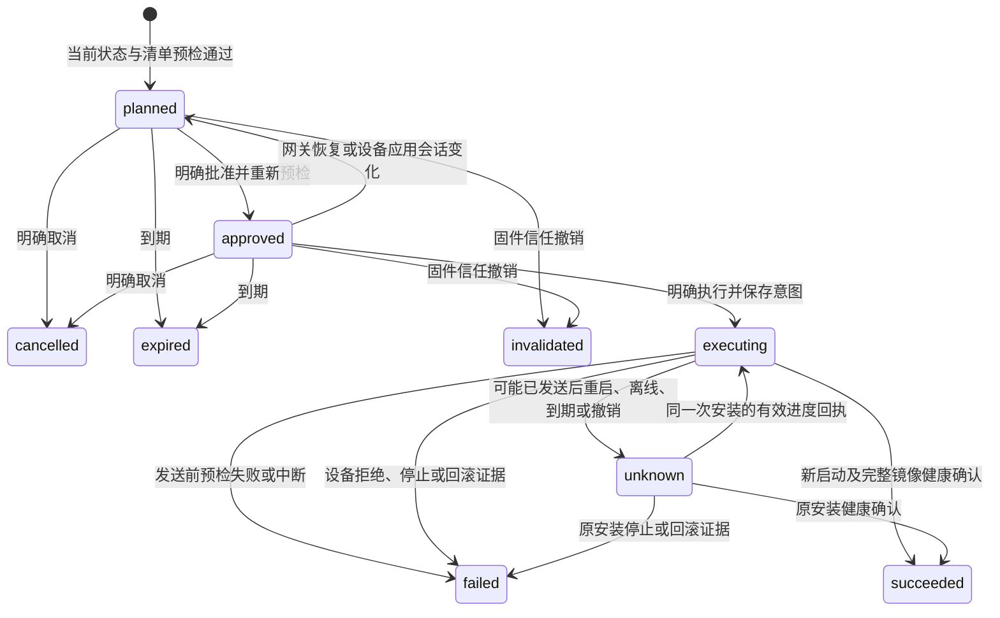

# 本地固件信任与升级任务

本合同实现本地所有者的独立固件信任、耐久升级计划、明确批准、执行与原操作查询。网关支持安装意图、MQTT调度、设备回执与中断恢复；C3设备SDK及产品已连接独立策略、HTTPS、备用区安装和启动结果恢复。批准只保存本地状态，另行明确执行才发送安装指令；实机验收按用户要求跳过。

结构来源为 [ota-tasks.schema.json](ota-tasks.schema.json)，机器发现入口为 [catalog.json](tools/catalog.json)。Schema中的固件定义由 [OTA Schema](ota.schema.json) 组合，测试核对二者逐项一致；签名和完整升级规则仍由共享Rust执行。

## 操作与授权

所有入口沿用本地所有者会话或Bearer、空间校验和浏览器Origin边界。它们不进入远程RPC或独立云控制面目录。

| 工具 | HTTP | 用途 |
| --- | --- | --- |
| `firmware-trusts.list/get` | GET `/api/v1/spaces/{space_id}/firmware-trusts[/{id}]` | 读取独立固件信任 |
| `ota-tasks.list/get` | GET `/api/v1/spaces/{space_id}/ota-tasks[/{id}]` | 读取当前任务；列表每页16项，使用after |
| `ota-changes.create` | POST `/api/v1/spaces/{space_id}/ota-operations` | 提交一次明确变更 |
| `ota-changes.resolve` | GET `/api/v1/spaces/{space_id}/ota-operations/by-key/{id}` | 只读恢复原决定 |

POST必须携带单个 `Idempotency-Key` 和application/json正文。正文不含空间或原键，它们分别来自路径和请求头；完整原请求为 `space_id/idempotency_key/change`。JSON最多16KiB、深度16、2048节点，重复键、不安全数字、未知字段和缺失字段拒绝。

| change.type | 完整字段（除type） | 规则 |
| --- | --- | --- |
| `trust.add` | trust、expected_signing_key_id | 信任必须通过共享固件信任校验；所有者另行核对公钥指纹 |
| `trust.revoke` | trust_id、expected_revision | 精确当前修订；撤销不允许通过重放旧add恢复 |
| `tasks.plan` | device_id、trust_id、manifest、expires_at | 完整签名清单、当前设备报告、独立信任；期限大于现在且不超过15分钟 |
| `tasks.approve` | task_id、expected_revision | 核对完整任务后明确批准，使用当前修订 |
| `tasks.execute` | task_id、expected_revision | 已批准任务再次实时预检，生成唯一耐久安装意图 |
| `tasks.reconcile` | task_id、expected_revision | 明确查询同一次安装；仅发送原操作查询，不携带镜像或安装清单 |
| `tasks.cancel` | task_id、expected_revision | 取消尚在planned/approved的本地任务 |

`fwtrust-` 加完整信任JCS摘要标识信任；修订在变更时更新。物模型信任、MQTT设备CA或清单同源下载材料均不能替代独立固件信任。信任数量最多32、任务128、原决定512；达到上限拒绝新记录，不删除历史绕过幂等边界。

## 计划、批准与互斥

计划保存完整清单及摘要、信任及其修订、当前设备历史观测、任务期限和修订。当前设备观测来自 [device_info](device-info.md)，不接受调用者提供的device快照作为实时事实。计划时完成清单验签和全部设备兼容/电源/忙碌检查；同一设备只能有一个活动任务。设备存在accepted、dispatched或unknown控制命令时不能建立或批准计划。

批准前再次读取小于5秒的当前报告、模型授权和信任撤销状态。产品/架构/芯片/板卡/硬件修订、运行版本、引导版本、协议/模型、安全代次和备用分区容量必须保持计划目标；外接电源、电量、忙碌及待确认状态允许变化，但须重新满足完整策略。旧修订、旧版本、过期、低电量或忙碌时拒绝，不把离线通过当作批准。

批准任务暂时占用该设备的控制入口；新属性/动作、规则、受限远程命令及模型换绑不能绕过。同键旧命令仍返回原结果。尚未执行的任务取消、到期或撤销后释放占用；可能已发出安装指令后，必须保留占用直到收到匹配的设备终态证据。批准前未决命令检查和批准后新控制互斥在同一SQLite事务边界提交。



状态变化更新任务修订。尚未执行时，网关/Broker恢复、新设备应用会话或离线会清除批准和当前设备缓存，保留任务、清单及原决定。重新读取任务、等待新握手与当前报告，再用新原键明确批准。执行意图存在时保留历史批准，按是否可能发送转为failed或unknown，禁止重新批准或重新执行。恢复旧批准的applied决定不会激活批准。

明确执行先调用共享 `approved_ota_request`，发送意图提交前再核对任务期限、当前信任、完整设备条件和批准时的设备启动/应用会话。任务进入executing并不证明已开始下载；只有分发事务成功提交attempted_at后，传输适配器才能发布一次。进程在提交和发布之间崩溃也保守记为unknown，不自动补发。

## 设备执行与原操作查询

设备执行使用已有MQTT身份ACL，所有报文retain=false、最大16KiB，沿用严格JSON、当前模型、启动/应用会话和上行递增序列。Schema的 `install-envelope/query-envelope/receipt-envelope` 为正式机器结构。

| 方向 | topic后缀 / kind | 正文 |
| --- | --- | --- |
| 下行安装 | `down/ota_install` / `ota_install` | task_id、execution_id、manifest_digest、完整manifest、expires_at |
| 下行原查询 | `down/ota_query` / `ota_query` | task_id、execution_id、request_digest、manifest_digest、expires_at |
| 上行证据 | `up/ota_result` / `ota_result` | task_id、execution_id、request_digest、manifest_digest、status、firmware_version、security_epoch、image_sha256、pending_update、error |

`request_digest` 是完整原安装Envelope的RFC8785 SHA-256；包含原消息ID、设备、模型、启动/会话、清单及期限。设备必须独立计算并耐久保存，不依据查询中的摘要创建安装。清单摘要另为完整manifest的JCS摘要。下行不携带可自动信任的公钥或trust；设备须使用独立预置信任校验签名、来源、兼容条件和实际镜像。

首次接收安装时，设备在下载或写入前保存完整意图和原摘要。同一execution_id同摘要只恢复原记录，异参拒绝；MQTT重传不得重复执行。下行期限只限制开始/接受安装，不能在期限结束后将已开始的安装当作未执行。设备启动/会话变化使旧安装Envelope失效，但可以用当前会话上报原安装的耐久结果。

回执status为installing、awaiting_boot、succeeded、rejected、failed或rolled_back。进度只能前进，完整同结果可重复报告，终态不能改变。成功须报告新启动ID、目标固件版本和安全代次、与签名清单相同的实际镜像摘要，且pending_update=false；摘要对应清单声明长度内的实际制品字节，不能替换为不同范围的分区或镜像内部摘要。failed/rejected/rolled_back须已停止安装、运行原版本及安全代次、pending_update=false，并有稳定错误码；rolled_back另须新的启动ID。待确认镜像不能报告成功或释放占用。网关不会根据版本报告、超时、传输成功或单独下载完成推断成功。

恢复unknown后，所有者以当前任务修订提交tasks.reconcile，查询有效期30秒，每任务最多32次。查询同样先提交发送标记；同键恢复不重新查询，丢失查询需要核对任务后另用新键明确发起。设备只读取原日志，没有记录或无法确认时保持未知；禁止用“未找到记录”证明未执行。查询允许晚于原安装期限及本地信任撤销，不授予新的安装权限。

## 当前C设备消费者

`limeiot_ota_device.h` 已把安装/查询接入C核心和ESP适配器。下行严格核对精确topic、结构、当前设备/模型/boot/session；新安装使用独立配置与本机基线，重复原请求只读取日志。原查询校验完整任务/执行/摘要及最多30秒期限，原安装过期或策略撤销不阻止读取历史结果。记录缺失、恢复未决或本机证据不足时不发终态，网关保持未知。

未配置安装提供方时，新请求保存耐久拒绝；完整预检通过时错误码为ota_installer_unavailable，不开始下载或写分区。已配置提供方须执行下述完整耐久流程。已有记录上报前重新核对本机运行镜像、版本、安全代次及已确认启动，回执采用当前boot/session和递增seq；查询不改写原日志。ESP分区镜像基线不代替安装按原清单声明长度执行的实际制品校验。

`npm run test:firmware` 当前覆盖11组核心检查及11条真实MQTT旅程，含C消费者、耐久安装、Rust/SQLite终态与新启动恢复；设备和启动为显式宿主夹具。C3产品须显式完整策略、独立CA及本次镜像健康确认才声明可升级。实机安装/断电/回滚验收按用户要求跳过，不计为通过。

## 原决定与持久化

每次合法变更请求形成不可变operation，记录完整请求摘要、applied/rejected/conflict、稳定原因及资源引用。业务拒绝同样耐久保存；语法错误和跨空间请求不创建决定。资源引用包含kind/id/revision，表示当时决定所引用的资源；当前状态须另行GET，不能用历史引用覆盖当前记录。

同键同请求返回原决定，不重验后重新执行；同键异参返回幂等冲突。修订冲突的决定仍是原结果，采用当前基线须由调用者明确核对并使用新键。HTTP200需读取业务status。

原决定、任务、信任、状态与审计事件同一次SQLite提交；写盘失败不公布新内存状态或返回待发送报文，终态提交失败保留原设备占用。OTA执行在快照v4引入，当前网关读取v1–9，校验后提交写入v9；v3任务无execution字段，v4起必须显式保留。v6保存执行绑定/撤销及原决定，v7增加native_paths/compose；旧字段版本约束继续生效，详见 [执行合同](execution-routes.md)。格式或未来版本拒绝且不改写快照，v8内置模型来源的门禁见 [模型合同](model-release.md#本地信任安装和设备绑定)，v9增加属性阈值规则及采样证据，见[自动化合同](rules.md)，不支持当前快照版本的旧程序不得继续控制。当前会话报告缓存不恢复；baseline/approval只作历史观测/授权，不能重新激活安装。网关快照v9与设备独立日志v2是不同版本体系。

设备被OTA任务占用时，新的适配绑定也返回ota_task_conflict；控制接入和升级权限仍独立。撤销适配绑定只阻断该控制路径，不代表取消已发送的固件安装，也不释放OTA占用或生成回滚能力。绑定变更与OTA互斥的批准、已标记发送及恢复unknown领域负例已通过，软件证据与实机缺口见[24第4.7节](../docs/24-实施计划与进度.md#47-适配绑定完整性与已有空间软件验收)。

## NAS网页入口

本地家庭工作台的“固件升级”消费上述同一组HTTP入口，包含独立固件信任、10分钟计划、读取当前任务后明确批准/执行/取消，以及原设备结果查询。完整私有工作台通过本机视图嵌入同一组件；官方云工作台和远程RPC不因此获得升级权限。页面使用既有布局、Radix主题和0.5px边框，不新增独立站点或授权机制。

浏览器在POST前保存origin、空间、完整change与原键；本机记录最多128项，与模型操作分开。保存失败零发送，损坏或记录被移除时阻止新写入并保留材料。丢响应、刷新、重新登录或网关重启后只GET原决定，并核对完整原请求、JCS摘要与资源身份；404保持未知。相同设备的未知计划、相同任务的未知变更阻止新键绕过，明确撤销固件信任仍可进行。任务状态单独读取，历史applied不会显示为升级成功。

`npm run test:ota:web` 使用真实浏览器、Rust网关、SQLite和MQTT设备夹具，覆盖保存失败、独立指纹、取消/计划/批准/执行、丢响应与重启、一次安装/一次原查询、终态证据、跨页签未知记录、撤销，以及错绑响应/畸形材料/损坏原记录拒绝。设备安装和新启动为模拟证据，hardware=false，不代替实机或新NAS镜像验收。

## 原生本地入口

SwiftUI和Compose在家庭网关的“设置 → 固件升级”消费上述本地接口，使用各自的 `OtaClient`、状态层和原生页面；云入口不增加OTA权限。原记录通过必填 `SessionStore` 使用独立 `origin#ota-operations` 键，生产分别接Keychain和Android Keystore。原请求与决定最多128项，退出或重新登录不删除；跨实例串行处理，保存并回读成功后才允许单次POST。损坏、移除、换origin、错绑响应或摘要不符不能变成新请求；404保持未知。独立公钥指纹必须另行填写，客户端不复刻验签或设备兼容策略。

界面先读取当前完整任务，批准后清除核对状态，执行需重新读取并明确选择。executing/unknown只开放原设备结果查询，不提供再次安装。历史operation的applied只显示“决定已保存”，升级成功仍读取含匹配设备终态的当前任务；会话失效后重新登录，继续GET原决定。页面状态测试以真实Rust/SQLite/MQTT和内存安全存储替身验证，不代表完整App、真实安全存储或手机运行。

`npm run test:ota:native`验证两端库，`npm run test:ota:native:state`先独立编译，再验证实际 `FirmwareStore/FirmwareController`。需要macOS/Swift、JDK21、Android SDK及仓库内Broker/Rust目标。实机按用户要求跳过，hardware=false。

## CLI与AI工具

```sh
npm run cli -- schema ota-changes.create
npm run cli -- invoke ota-changes.create \
  --space-id space-demo --idempotency-key firmware-trust-001 \
  --input "firmware-change.json" --state-dir ".dev/owner-operations"
npm run cli -- ota-changes resolve firmware-trust-001 --space-id space-demo
npm run cli -- ota-tasks list --space-id space-demo
```

`firmware-change.json`填写上表中的完整change。批准示例：

```json
{
  "type": "tasks.approve",
  "task_id": "ota-replace-with-current-task-id",
  "expected_revision": "replace-with-reviewed-revision"
}
```

CLI在首次POST前将origin、空间、完整输入与原键保存到私有原记录文件。落盘失败零发送；已有同请求记录只GET，404或响应丢失保持unknown，退出6，不自动补发。变更输入返回4；业务拒绝返回7，冲突返回4；成功返回0。CLI核对完整原请求、摘要、资源类型与身份；Rust负责签名和策略。固件操作使用独立 `ota-operations` 本地目录，与模型操作隔离。

将type改为tasks.execute并使用当前已批准修订，才会创建安装意图；结果不明时读取ota-tasks，再明确使用tasks.reconcile查询原设备日志。两者均使用独立原键，旧键不会重新执行。

执行 `npm run test:ota:tasks` 验证领域、存储、严格Schema、CLI边界及真实Broker/HTTP/SQLite恢复。测试使用公开签名向量和自报设备夹具，验证安装、原查询及匹配终态恢复，hardware=false、device_installation=false；C3产品配置/健康门禁及目标编译分别验证，不将宿主结果扩大为实机证据。

## C设备安装提供方

li_ota_device_set_installer 在连接前配置独立 current/stage/activate/restart 端口。原请求先提交intent，再提交installing后暂存；精确长度/摘要及完整重新预检、运行基线通过后，提交awaiting_boot，再选择启动。各IO边界重查实时连接代次、原会话、可信时间/期限、当前策略/撤销及设备电源/忙碌条件。整秒时钟将任务期限向下取整；总预算30秒不提供硬实时取消保证。

启动选择报错可能已经生效，保持awaiting_boot与设备占用，不生成失败终态或重放安装。选择前失败只有独立本机证据确认原镜像已确认运行，才耐久保存failed。日志提交返回失败即停止，即使实际已经提交；重新打开只读实际状态。恢复未决任务不会再次下载、选择启动或重启。

11条真实MQTT回归包含安装与新启动恢复旅程，以及Rust/HTTP/SQLite计划批准到终态及unknown恢复。宿主下载使用真实HTTPS，暂存和启动证据为显式文件夹具。ESP提供方和开发产品已接独立HTTPS CA与镜像健康门禁，缺少配置或未确认时拒绝升级。完整接口和限制见 [固件说明](../firmware/README.md#受控设备安装)。

## 启动凭据与结果恢复

启动选择成功后返回的本机凭据须耐久绑定到原awaiting_boot，再请求重启；提交返回失败即停止，包括实际已提交的情况。版本2日志只读兼容版本1，不补旧凭据。新启动观察器只按原凭据、精确实际镜像及确认状态收敛成功/回滚；终态先提交后发布，查询仍复核当前事实且不安装。旧期限或撤销不阻止历史结果恢复。11条MQTT旅程含Rust/SQLite成功收敛；宿主启动为显式夹具，接口及ESP校验见 [固件启动恢复](../firmware/README.md#启动结果恢复)。
