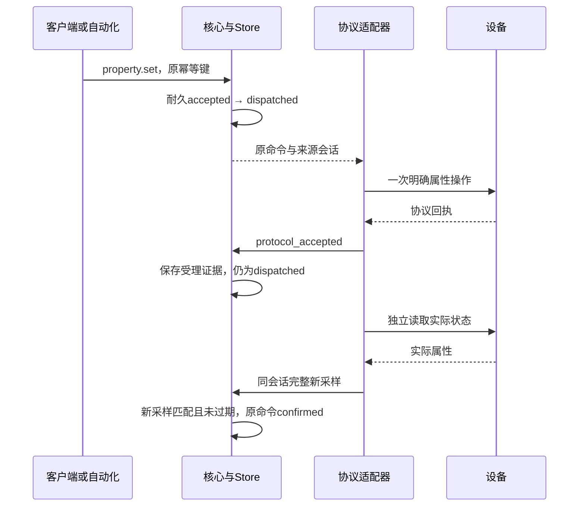

# 属性观测与执行桥接

本合同定义宿主授权的`property_bridge`领域入口。同一逻辑设备使用同一物模型提供可读和可写属性，复用既有`CommandRequest`、命令账本、设备队列与自动化规则。核心不解释Zigbee、串口或品牌字段。

当前已提供Rust核心、Store与运行网关的固定ZNP On/Off装配，家庭网页复用既有物模型控件；Swift/Kotlin也沿用既有属性控件与命令合同，完整App运行另验。本合同不新增HTTP、CLI工具或可由客户端提交的授权。

## 宿主授权

`Policy`严格包含`observation`和`write_paths`。前者沿用[观测来源](observation-sources.md)的`device_id`、`model_revision`与`source { adapter_id, revision }`；后者为完整可写属性路径集合。

静态目标设备须在初始配置中声明；动态目标由明确来源决定创建，模型包含1–64项可读属性，无动作或事件，至少一项可写属性。`write_paths`必须精确覆盖全部可写属性；只读与可写属性由同一来源提交完整快照，不拆成两个逻辑设备。来源与已有观测、动作路由不能冲突，全部观测来源合计最多16个。原只读入口仍拒绝可写模型，原动作绑定入口仍只接受动作。

宿主依次调用`with_observation_sources`、`with_property_bridges`和`restore_observation_bindings`装配权限。静态属性路由由宿主策略生成，不能直接在普通Config的`routes`中声明；模型API与动作绑定/撤销API不能改变属性桥接授权。运行策略不序列化；静态授权从宿主重新注入，动态授权从完整验证的来源决定链恢复。设备视图沿用既有`observation_source`、`routes`与`reported`。

## 来源与命令

复用`begin_observation`、`observe`和`end_observation`。开始来源清除在线与边沿基线，同时将原在途命令置为unknown、排队命令置为rejected；旧token不能提交或关闭新会话。首次完整新鲜采样才建立同token的内部适配会话。仅调用`adapter_seen`不能取得属性执行权限。

受理与派发均要求来源会话、路由、精确模型和完整状态一致，所有属性仍在各自`max_age_ms`内。命令通过既有`property.set`受理，固定原幂等键、摘要、序号、期限、来源修订与会话；只由`prepare_adapter_dispatch`派发，不能从MQTT通道执行或回填结果。设备FIFO、OTA冲突、远程授权和模型信任检查沿用原账本。

宿主必须先成功提交Store中的dispatched状态，再复核原命令并执行一次协议操作。属性命令已有受理证据后，`recheck_adapter_dispatch`拒绝再次取得发送授权。

## 协议受理与状态确认

协议完成后调用`apply_property_adapter_result(AdapterReceipt, now)`，receipt字段沿用内部执行合同，状态仅允许：

| status | 处理 |
| --- | --- |
| `protocol_accepted` | error必须为空；记录`property_adapter_result`证据，命令继续dispatched |
| `unknown` | error必须为`execution_unknown`；原命令终止为unknown，保留已有受理证据 |

回执精确绑定原命令ID、route、session_id与request_digest；受理时间不能早于原命令签发，不能来自未来，提交时原命令必须未过期。受理证据保存原回执、当前来源序号、设备状态修订与接收时间。同一受理回执重复提交返回原证据，不重置确认基线；不同回执拒绝。原动作结果入口拒绝属性命令，协议受理不写`reported`。

随后只有同一来源、同一token的完整独立采样同时满足以下条件，才能将原命令确认为confirmed：

1. 来源序号与设备状态修订都大于受理证据的基线。
2. 目标属性采样时间严格晚于受理证据的接收时间。
3. 实际读回值等于原请求值，且原命令尚未过期。

确认在同一个Store事务中更新`reported`和原命令，证据类型为`property_observation_result`，包含原受理证据、路径、实际值、采样时间、来源序号与状态修订。协议受理前读到的相同值、同时间采样、错误值和单独ACK均不能确认。无匹配读回到期后保持unknown，不自动重发、补偿或改变幂等键。unknown不被后来的采样改写为confirmed。

远程回执保持现有机器合同。`remote_evidence`只将已校验的confirmed实际读回投影为`device_result { reported: { path: value } }`，未确认时不导出内部证据；route、来源token和受理基线不出站。原生MQTT与动作回执保持原行为，客户端无需新增命令状态或放宽回执验证。

ZNP装配与环境轮询、发现和入网共用唯一串口任务。新命令先耐久派发，再复核原权限，只发送一次明确On或Off；随后立即独立读取。一个写任务之后服务到期采样，避免持续写入饿死观测；读取与写入共用原AF容量，正常轮换不重发命令。

## 耐久与恢复

运行中接入复用来源决定账本：先配置协调器，再查询IEEE、端点与`profile:"on_off"`。宿主完成只读访谈后提供固定`znp-on-off-v1`候选，模型为`contracts/models/on-off-light.json`，写权限仅`["light.power"]`。用户核对权限并确认后才提交`sources.bind`，不接受客户端授权字段。目标设备由同次事务创建，取得新鲜完整采样前不可控制。

动态桥接使用v15快照，从完整验证的来源决定链恢复运行策略。撤销清空路由并关闭旧会话，重绑重新核对候选；accepted转rejected，dispatched转unknown，旧unknown不因后来采样变为成功。历史路由仅用于校验原命令，不授予新命令执行权。静态桥接继续采用以下v14配置合同。

`Store::open_with_adapter_policies(path, config, sources, bridges)`按device_id排序两类策略。bridges为空时保持既有配置摘要算法与旧快照行为；非空时将完整策略纳入摘要。删除、增加或修改静态授权会拒绝打开旧数据库，不静默迁移或回退原生MQTT。

属性桥接首次保存使用SQLite快照v14，继续使用原snapshot/events表，不新增表。v14允许没有托管只读来源账本；若存在仍执行原决定链校验。恢复要求耐久路由与宿主授权精确一致，复核原属性命令、受理和确认时间/序号证据。缺失路由、改写摘要、伪造提前确认或版本降级均拒绝且不改写原快照。

重启清除在线、来源token和适配会话；accepted变为rejected，dispatched变为unknown。历史confirmed与原证据保留，旧状态显示过期。新采样建立新会话，不能确认或重新派发旧unknown；同键同参始终查询原命令。

Store沿用先克隆、校验、同事务提交快照与事件，再公布内存的边界。派发、协议受理或独立采样任一写盘失败，均不公布本次状态；调用方不得在Store返回错误后发送协议操作。

验证入口为`cargo test --locked -p limeiot-core --test property_bridge`、`cargo test --locked -p limeiot-gateway property_bridge_store_tests`及`npm run test:zigbee:onoff-gateway`。后者使用真实Rust/SQLite、同一软件PTY NCP与浏览器，覆盖页面开关、温度阈值、受理不伪造状态、未知结果、原键恢复和重启零补发。NAS容器、原生App完整运行和实际灯具执行分别验收。

## 新安装配置

使用[网关示例](../deploy/dev/zigbee-onoff-gateway.example.json)及[ZNP配置示例](../deploy/dev/zigbee-onoff.example.json)。`schema_version=3`增加非空`on_off_bindings`，字段与原静态环境绑定一致；`bindings`仍表示环境来源，可为空，两类合计最多16个。可选coordinators继续使用原管理与发现入口。v1/v2不能夹带on_off_bindings。

属性模型固定为[标准开关灯](models/on-off-light.json)，实际串口、协调器IEEE、设备IEEE、端点、manufacturer_code和完整Basic指纹须替换为已核对设备；示例厂商字段仅供软件演示，不代表已适配采购型号。入口沿用`LIMEIOT_CONFIG`、`LIMEIOT_ZIGBEE_CONFIG`及原所有者、Broker配置。仅用于新安装，不覆盖已有数据库或直接改变静态授权。

家庭网页、iOS与Android读取该模型后显示电源控件。控制仍走原commands.create与原操作查询；页面状态取独立reported。动态接入页面目前仍只支持温湿度，新开关通过本节明确配置接入。
