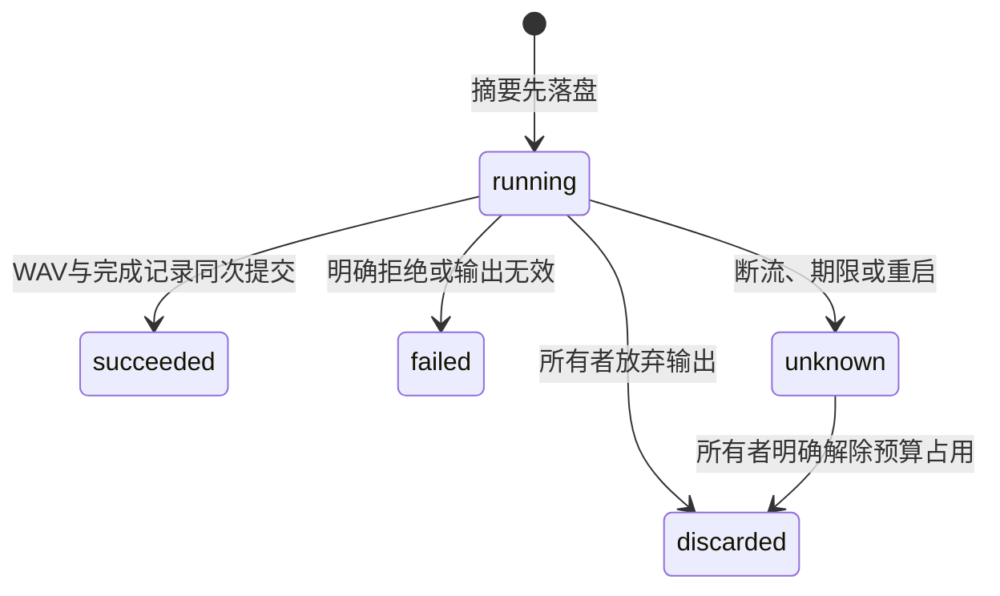

# 本地文字转语音

能力为 `audio.synthesize`，机器输入及任务投影见 [Schema](speech.schema.json)，工具通过 `schema speech-syntheses.create` 发现。当前提供有限片段的API、CLI与家庭网页，不提供连续流、ASR或会话，也不向云端转发此接口。

## 提供方与配置

网关依赖窄接口 `SpeechProvider`，当前装配 `local-http-speech-v1`。推理引擎独立部署，网关不装载模型、启动Shell或替提供方开放设备权限。该适配器要求本地服务接受 `POST /v1/audio/speech`：

```json
{"model":"your-installed-model","input":"你好，青柠。","voice":"your-voice","response_format":"wav","speed":1}
```

返回HTTP 200及 `audio/wav` 或 `audio/x-wav`，正文必须是完整16位PCM RIFF WAV，仅包含fmt与data块。压缩编码、浮点WAV、未知长度的流式WAV和附加块目前拒绝，不自动转码。接口形状相似不证明任意第三方引擎兼容，模型与声音许可、实际格式和质量须在所选部署验证。

同时设置 `LIMEIOT_TTS_URL`、`LIMEIOT_TTS_MODEL`、`LIMEIOT_TTS_VOICES`；声音列表以逗号分隔，最多32项且不重复。HTTPS私有CA使用 `LIMEIOT_TTS_CA_FILE`。还须启用既有媒体服务。三项均未配置时禁用；部分配置或缺少媒体服务则启动失败。

URL只接受无凭据、无查询和无额外路径的HTTP(S) origin。每次调用先验证全部DNS结果为回环、RFC1918或IPv6 ULA，再固定解析地址；禁止代理、重定向和提供方请求重试。此版本不向提供方发送网关凭据，不支持提供方API密钥。网络访问控制和提供方实际本地运行由部署者配置；局域网地址本身不证明服务没有自行外发数据。

`capabilities list`中的 `speech` 区分配置是否启用，提供当前模型、声音、部署修订和硬限制；`configured:true`不代表实时健康或已通过质量验证。任务冻结适配器、模型、配置摘要和本地数据政策，原任务不随配置变化重新执行。

可选独立服务见[sherpa TTS提供方](../providers/sherpa-tts/README.md)。该服务用固定模型摘要和声音映射适配CPU VITS，启动实际加载模型，逐请求隔离计算并返回完整PCM WAV。它不进入网关进程，不取得设备凭据；每次最多80秒、计算并发1且不排队。模型由安装者预置，权重许可与引擎许可分开核对。NAS内部服务使用`compose.sherpa.yaml`，与外部服务覆盖`compose.speech.yaml`二选一。

## 请求与预算

```json
{"text":"你好，青柠。","voice":"your-voice","retain_seconds":600,"expires_at":"2026-11-03T12:00:30.000Z"}
```

期限须由调用方生成，为受理时未来90秒以内。文本最多1000个Unicode标量且UTF-8最多4096字节，拒绝空白正文及除换行、制表以外的控制字符。时间精度最多毫秒；请求摘要将相同时间统一为UTC三位毫秒。保留60–86400秒，成功入库时开始计时。

每网关只允许1个活动语音调用，无等待队列；结果未知的任务继续占用耐久预算。必须查询原任务或明确放弃该任务的输出后才可受理新任务。放弃活动任务后仍持有本进程提供方槽位直至原调用结束或到期，避免同进程叠加请求。放弃未知输出是所有者的明确决定，不保证外部引擎已停止计算；本版本没有费用结算或提供方全局并发保证。

输出逐块限制4MiB、1或2声道、8–48kHz、最长60秒，不信任Content-Length。任务记录最多256条，达到上限拒绝新任务，保留旧键以防重放。媒体对象、总字节、授权和操作记录另受[媒体合同](media.md)限制，入库容量不足会形成明确失败，不能当作可播放音频。

## 操作与状态

以下路径前缀为 `/api/v1/spaces/{space_id}`，使用当前NAS所有者会话或CLI Bearer认证。

| 工具 | HTTP | 行为 |
| --- | --- | --- |
| `speech-syntheses.create` | `POST /speech-syntheses`，正文为输入，`Idempotency-Key`必填 | 首次202，原任务200，输入不同409 |
| `speech-syntheses.resolve` | `GET /speech-syntheses/by-key/{id}` | 读取同一个任务，不调用提供方 |
| `speech-syntheses.discard` | `POST /speech-syntheses/by-key/{id}/discard`，正文为空或`{}` | 耐久放弃running/unknown输出；已经成功返回409 |



提供方4xx为明确拒绝；断流、5xx、跳转或超时无法证明未处理，保留unknown。网关重启将running变为 `unknown/speech_interrupted`，不重新发送文本。放弃操作只禁止此任务以后发布媒体，迟到响应被丢弃；不承诺提供方取消。成功后的删除、撤销和停止播放分别使用原媒体及设备命令合同。

CLI在首次POST前将0600摘要记录耐久保存，同键再次执行只GET；本地摘要保存失败则零POST，404也不自动重新合成。放弃输出同样先保存独立意图，重复时只查询。退出码6表示未知，7表示明确任务失败，4表示冲突。

家庭网页在“音频 → 文字转语音”使用同一合同。发送前通过Web Locks串行保存摘要，浏览器记录按来源和空间隔离，最多128项，每项最多8次明确放弃意图。原摘要不可覆盖，损坏、丢失、回退或无法写入时停止新请求；不支持Web Locks的浏览器不能提交。正文不写入本地存储，切后台、断线或会话变更时清除，旧代次响应不再更新界面。刷新及响应丢失只查询原键；running或unknown保持新生成入口禁用。明确拒绝单独留存，不伪造已受理任务。

合成成功可选中音频，但播放授权确认保持未勾选。查询、放弃、授权和播放分别操作；放弃按钮须再次确认，取消确认不会发送请求。

Swift/Kotlin的`SpeechClient`使用同一输入与任务合同，在独立`origin#speech-syntheses`存储最多128条摘要记录，每条最多8个明确放弃意图。请求前保存并回读；存储损坏、外部移除或改变、写入失败均阻止新请求。保存调用取消或丢失确认时，内存保留该次预期完整字节；后续读取只接受原观测或该预期完整字节，并重新验证领域记录，其他变更继续拒绝。它用于恢复自己已写入的摘要，不授权补发原POST。

相同键须与原摘要一致且只GET，404保留未知；未决、running和unknown阻止同空间新键。明确4xx拒绝保存独立rejected_code，不伪造网关任务；同键不再POST。放弃意图先落盘，同意图再次调用只查询。任务响应核对原摘要、不可变部署/身份与时间，unknown不得变成功，终态不得回退。

SwiftUI/Compose已在“设置 → 音频”接入生成、running自动查询、原键恢复与明确确认放弃。文本及确认在后台、离开页面、离线或会话变化时清除，旧代次不更新界面。成功刷新媒体并选中同一个media_id，授权保持未勾选；仍须独立授权与播放。完整系统界面运行另验。

## 媒体、隐私与恢复

成功返回 `media_id`，WAV对象和succeeded任务在同一份媒体快照原子提交。合成不创建音箱授权或设备命令。必须另行选择当前绑定音箱并创建短时授权，再通过原命令账本执行 `playback.play`。

平台运行时不持久保存文本；调用方的输入文件独立管理。文本用于本次调用内存及提供方请求，平台快照和CLI原记录仅保存摘要、字符数、声音及冻结配置。HTTP正文不进入普通日志；提供方自己的日志和保留政策独立管理。媒体正文按既有到期/删除政策处理，旧任务查询不会复活已删除音频；历史备份仍可能保留原音频。

无语音任务时保持媒体快照v1；首次受理语音任务写v2并保留speech摘要，网关可读两者。NAS备份工具按原字节复制v2，恢复时由领域校验任务与媒体关联。旧程序不能读取v2，不应强行降版本或删除日志重试。

`npm run test:speech`验证确定性提供方、真实HTTP/Rust/SQLite/MQTT、CLI丢回执及软件音箱旅程。此结果不证明真实合成质量、实际发声、完整NAS镜像或原生App的语音界面，实机按用户要求跳过。

`npm run test:speech:web`另验390px网页、原记录保存失败零发送、损坏与身份冲突拒绝、丢回执只查询、明确授权播放、重启unknown及放弃后的迟到输出。可见性事件为注入检查，离线使用浏览器网络切换；不代表手机系统后台调度验收。

`npm run test:speech:provider`验证独立服务的有界进程、输入、文件摘要、HTTP并发和NAS配置；`test:speech:provider:live`要求显式私有Python与本地模型路径，实际验证中文合成、原字节入库/拉取、网页授权播放、CLI原查询和丢响应不重合成。后者仍使用软件音箱，不证明人工听感、权重可分发或NAS容器运行。

`npm run test:speech:native:contract`校对共享Unicode/时区摘要与正式JS和严格Schema，执行Swift 10组及Kotlin 10项宿主检查，包含保存失败零POST、丢回执/404、未知占用、明确放弃、响应漂移、终态回退、存储破坏及保存后取消。恢复存储和HTTP均为夹具，不覆盖真实网关、语音页面、Keychain/Keystore或App运行。

`npm run test:speech:native:state`运行实际Swift/Kotlin状态层和既有媒体回归，另以真实Rust/SQLite/MQTT验证丢回执只查询、独立授权及软件音箱Range拉取、客户端进程与网关重启、unknown占用和明确放弃。提供方和音箱仍为夹具，恢复文件不替代Keychain/Keystore；页面编译/语法与完整App运行分别记录。
