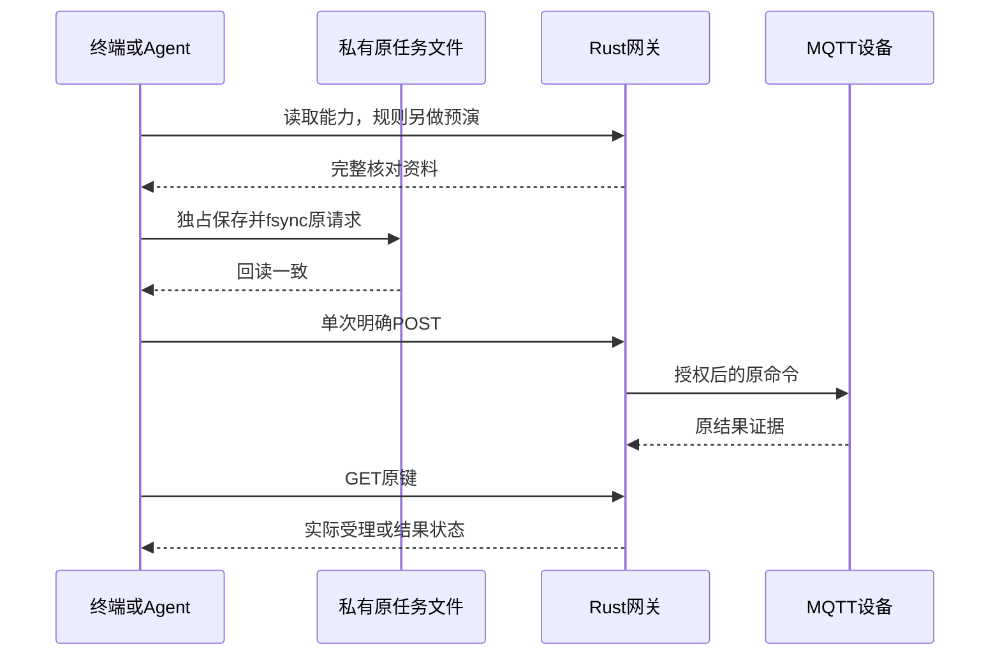

# 本地终端任务

终端菜单和 Agent 的 NDJSON 共用 [task-session.json](tools/task-session.json) 与同一任务状态层。网关操作仍由 [catalog.json](tools/catalog.json) 发现，物模型、授权与执行由 Rust 判断。当前覆盖本地所有者的设备属性、动作、事件规则、属性阈值和每周定时规则。

## 入口

```sh
node packages/cli/src/main.mjs tui schema
node packages/cli/src/main.mjs tui --space-id space-demo
node packages/cli/src/main.mjs tui --snapshot --space-id space-demo
node packages/cli/src/main.mjs tui --stdio --space-id space-demo
```

`schema` 离线输出输入 Schema；`$defs.response` 定义逐行响应，规则引用正式 [rule.schema.json](rule.schema.json)。菜单要求输入和输出均为 TTY。snapshot 输出一份当前 JSON；stdio 每行接收 JSON 并输出 NDJSON。Agent 应直接调用 Node 或安装的 limeiot 入口，避免 npm 日志混入协议。

endpoint 参数或 LIMEIOT_ENDPOINT 指定网关 origin，仅允许 HTTPS 或回环 HTTP，不接受路径、用户信息或重定向。身份沿用 LIMEIOT_TOKEN_FILE，开发实例也可用 LIMEIOT_TOKEN，两者同时配置会拒绝；身份不进入输出或任务文件。参数及结果保存在当前用户私有文件，不属于加密存储。

默认目录为 `~/.local/state/limeiot/tasks`，可用 `--state-dir` 指定；按精确 origin 和空间摘要隔离。目录要求0700，记录要求0600、当前用户所有的无链接普通文件；不自动修改旧目录权限。

## 任务步骤

| action | 输入 | 行为 |
| --- | --- | --- |
| refresh | 可选命令 cursor | 读取设备、模型、当前规则、最多100条命令及运行记录 |
| snapshot | 无 | 返回已有快照、核对和原任务，不请求网关 |
| commands.prepare | device_id/type/path/value | 最新能力与参数检查，冻结原键、模型及30秒期限 |
| rules.prepare | 完整 rule/event_data | 校验、无副作用预演，保存完整旧/新规则及基线 |
| rules.stop.prepare | rule_id | 冻结当前待停用修订 |
| commit | 当前核对的 task_id | 保存并回读完整原请求，明确发送一次 |
| resolve | 已保存 task_id | 查询原命令或当前部署，不再POST |
| cancel | 无 | 清除未提交核对，不取消远端操作 |

每次 prepare 都清除旧核对，包括新输入无效时。commit 必须精确引用当前 task_id；命令核对过期不发送。菜单按Schema输入参数并提供差异、动作风险和完成范围；规则支持1–16个混合步骤的追加、修改、移除和重排，保留毫秒冷却。精确领域边界见 [规则合同](rules.md)。

`state.sources`先返回事件，再返回可作阈值来源的数值属性。事件保留`{device_id,path,schema}`格式；属性增加`kind:"property"`和精确模型`unit`，只列具有read/notify及单位的数值属性。Agent按条目形状区分，不能把属性路径当事件使用。

每周定时不属于设备来源，不往state.sources加入伪设备。菜单在设备来源之后提供“定时”，填写HH:MM、IANA时区与ISO星期（周一=1）；机器流使用正式rule.trigger.schedule和event_data=null。任务层调用rules.validate取得schedule_preview.scheduled_at，再构造精确UTC时刻做零副作用预演，明确commit才部署。时间/时区/星期及其他规则字段变更都重新准备并核对；原修订条件、私有记录、取消和unknown只查询政策保留。DST、耐久游标与漏发跳过政策见[每周定时](rules.md#每周定时)。

菜单选择属性后填写上升/下降方向、阈值与滞回，温度和湿度按常用单位输入并精确转换，不截断超精度。预演构造`source="simulation.tui"`、时刻递增的previous/current示例采样，不读取实际温度或控制设备；网页默认来源仍为simulation.ui。修改须重新预演，`/cancel`保留已部署规则，编辑保留完整多步操作和毫秒冷却。

`state.condition_sources`独立发现全部可read的数值、布尔和文本属性，条目为`{key,device,path,schema,unit?}`；不要求notify或单位，不改变原state.sources的形状与顺序。新增响应字段为可选，保留旧状态的可读性。条件菜单支持比较、all/any嵌套组合、指定父组添加、修改、移除及取消，遵守4层/32节点及每组16项限额；文本以JSON字符串输入，保留空格、空字符串和大小写。未知版本或无法无损回填的原条件拒绝编辑。

条件预演读取网关当前快照。prepare必须核对完整规则摘要、trigger_matched及原条件树和逐节点证据；只有触发样例有效时，当前条件未满足也可进入“启用”明确核对，预计操作必须为空。不能以降低matched检查代替这些校验。菜单展示原观测证据，修改或取消清除原核对；commit、修订冲突及unknown只查询原任务的规则不变。

```json
{"action":"commands.prepare","device_id":"device-lamp","type":"action.invoke","path":"remote.press","value":{"key":"home"}}
```

示例要求实际绑定对应模型。Agent 核对返回的 review 后，依据获准任务显式 commit；准备状态不授予权限。菜单使用“执行”“启用”“停用”逐次确认。



## 持久化与恢复

写入前取得跨进程锁，保存摘要绑定的原请求，回读一致后才发送。每条命令独立随机原键，每次规则准备独立本地 request_key；停用后再次启用不会误返回旧成功。原记录保留，上限256；损坏、符号链接、宽松权限或本进程已见记录消失时停止写入，不自动覆盖或回收。

同设备 accepted/dispatched/unknown 原任务阻止另换原键，同规则未知任务阻止新提交。命令恢复绑定空间、设备、模型、完整参数、原键、期限、摘要和 command_id，confirmed 另核对 [结果证据](commands.md)。submitted 显示“输入已提交”，不宣称物理效果。

规则用 `If-None-Match: *` 创建，或 `If-Match: "sha256:…"` 更新；网关同一耐久更新内核对当前修订，冲突拒绝并保留新版本。停用沿用正文 revision 原子核对。未提供条件头的旧调用者保留原接口行为。

命令丢响应后只GET原键，404仍未知。规则接口没有按原请求查询的耐久决定：丢响应后，即使当前修订相同或部署缺席，也只返回 observation 和 unknown=true，原结果保持null，不推断原POST成功，不重发或关闭未决任务。历史deployed/stopped只表示当次结果，当前状态须refresh。

401/403清缓存与核对；网络故障保留原任务，连接标记未确认。锁不自动清除，因为检查PID后删除存在竞争；异常退出遗留锁需由所有者独立确认无进程写入后处理，保留全部原记录。权限与摘要用于保守恢复，不宣称抵御同一系统账户篡改、整目录删除或备份回退。

## 机器流与验证

每行最多32768字节，每进程最多1024条；拒绝重复JSON键、缺换行、非法UTF-8、过深输入及不安全整数。UTF-8逐步解码，输出遵守背压。每行返回version、从1递增的sequence和ok，错误含稳定code。正常退出0只表示任务流结束，必须检查各行ok和设备状态；致命输入、认证、外部故障、未知沿用2/3/5/6。终端控制字符及方向控制符会转义。

`npm run test:tui` 包含正式Schema、故障与并发边界、真实HTTP/MQTT/SQLite及伪终端菜单旅程。本合同仅适用于本地网关；独立控制面入口为`control tui`，使用另行定义的[控制面终端合同](control-terminal-tasks.md)，两种机器格式不可混用。通用自主Agent和媒体终端任务仍未包含。实机按用户要求跳过，实际结果见 [进度](../docs/24-实施计划与进度.md)。
