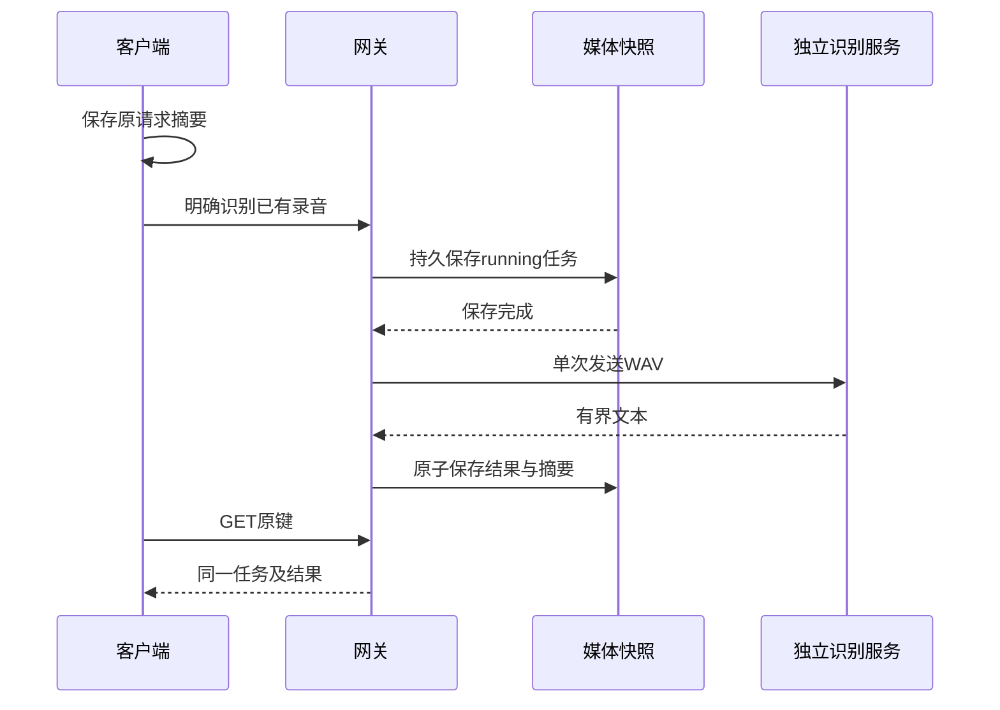

# 本地有限语音识别

能力为`audio.transcribe`。所有者先上传完整PCM WAV，再明确选择录音发起转写。识别只产生文本，不创建设备命令、自动化、播放授权或模型对话。机器合同见[Schema](transcription.schema.json)，通过`limeiot schema audio-transcriptions.create`发现。

## 提供方

网关依赖`TranscriptionProvider`窄接口，首个适配器为`local-http-transcription-v1`。模型在独立服务运行，不取得设备权限。设置`LIMEIOT_ASR_URL`、`LIMEIOT_ASR_MODEL`；私有HTTPS CA使用`LIMEIOT_ASR_CA_FILE`。还须启用[媒体服务](media.md)。两项均未设置时禁用，部分配置或缺少媒体服务时拒绝启动。

每次调用验证全部DNS地址属于回环、RFC1918或IPv6 ULA，再固定解析地址。HTTP出口与TTS共用禁止代理、跳转、自动重试的规则；不向提供方发送网关凭据，不支持提供方API密钥。局域网地址不等同于模型自身不联网，安装者须管理提供方网络。

提供方接受以下接口，其他HTTP形状须另写适配器：

```http
POST /v1/audio/transcriptions
Content-Type: audio/wav
Accept: application/json
X-Limeiot-Model: your-installed-model
X-Limeiot-Language: auto

<完整 WAV 字节>
```

返回HTTP200及`application/json`，正文精确为`{"text":"识别文本"}`。允许空文本表示没有识别到语音；拒绝额外字段、重复JSON键、非法Unicode、控制字符和压缩响应。文本最多2048个Unicode标量、8192个UTF-8字节，响应最多32768字节，不截断超量输出。语言提示为`auto`、`zh`或`en`，不表示所选模型已通过各语言质量验收。提供方需要自行处理其支持的采样率/声道或明确拒绝，不在网关中加载转码器。

`capabilities list`中的`transcription`返回配置、模型/部署修订、语言提示和限制。配置启用不表示实时健康；模型服务离线不阻塞基础控制。可选的[独立sherpa ASR服务](../providers/sherpa-asr/README.md)以Paraformer Small或Whisper Tiny INT8实现本接口，使用固定文件摘要、单计算并发、有界子进程和本地WAV处理。完整输入按最多25秒分段处理，避免引擎静默截断后半段。模型质量、原生应用及NAS实际容器的结果分别见实施进度，不由接口配置推定。

## 请求与恢复

路径前缀为`/api/v1/spaces/{space_id}`，使用NAS所有者会话或CLI Bearer身份。

| 工具 | HTTP | 行为 |
| --- | --- | --- |
| `audio-transcriptions.create` | `POST /audio-transcriptions` | 首次202，原键同参200，不同参数409 |
| `audio-transcriptions.resolve` | `GET /audio-transcriptions/by-key/{id}` | 只读原任务，不发送音频 |
| `audio-transcriptions.discard` | `POST /audio-transcriptions/by-key/{id}/discard` | 明确放弃未完成输出，正文为空或`{}` |

创建必须包含`Idempotency-Key`，输入示例：

```json
{"media_id":"media-EXISTING_ID","media_digest":"sha256:EXACT_AUDIO_DIGEST","language":"auto","expires_at":"2026-11-03T13:00:30.000Z"}
```

实际编号和摘要来自媒体列表，时间由调用方生成为未来90秒以内，精度最多毫秒。摘要固定空间、原键和规范化输入；同键查询不受当前模型配置、录音删除或原请求期限经过的影响。首次受理要求源音频仍存在、未到期且摘要匹配。



状态为running、succeeded、failed、unknown、discarded。每网关单并发、无队列，未知任务继续占用耐久预算；任务记录上限256，旧键不回收后重用。提供方4xx为明确拒绝，断流、5xx、跳转或期限为未知。重启将running恢复为`unknown/transcription_interrupted`，不重发音频。明确放弃阻止迟到输出，本进程仍持有计算槽位直至调用退出或到期，不承诺提供方取消。

成功输出包含`text`、`content_digest`、`expires_at`和`cleared_at`。文本保留期限沿用源录音；录音到期、删除时清除文本，旧任务仍保留身份和结果摘要，查询不复活正文。清除不将原成功状态改成失败，结果`text:null`且`cleared_at`非空。原始结果时间与正文清除时间分别记录。历史备份仍可能含录音和文本。

## 原生客户端

Swift `TranscriptionClient(gateway:store:)` 与 Kotlin `TranscriptionClient(gateway, store)` 共用此合同，提供 `capabilities`、`submit`、`records`、`resolve` 和 `discard`。`TranscriptionRequests.input` 接收媒体编号、摘要、语言和期限，规范为UTC毫秒。安全存储端口必填；独立键为 `origin#audio-transcriptions`，最多128条原任务，每条最多8个放弃意图。创建和放弃均先保存并回读，再发送一次；相同键只查询，404不释放未决记录，unknown继续占用预算。

本机记录的 `observation` 是任务元数据：成功输出只包含 `content_digest,expires_at,cleared_at`，明确省略 `text`。这不是可提交的服务器任务，也不代表服务器已经清除正文。网络响应仍严格要求完整四字段输出，逐字节验证UTF-8文本摘要、Unicode标量/字节数、保留期限、原请求及部署身份；成功状态仅允许正文清除，已清除的结果不能复活。

`records` 只返回去正文记录；`submit/resolve` 的当次返回值可带易失文本。SwiftUI/Compose在“设置 → 音频 → 语音识别”选择已上传音频及语言，明确开始识别；音频来源必须仍可用且未过期。后台、离开、离线或会话切换清除文本和确认；文本或源录音过期时清除页面输出，迟到响应不更新旧页面。前台自动查询未决任务，已完成正文需明确查询原任务后读取，不在进程恢复时从本机记录还原。

`npm run test:transcription:native:contract` 核对共享JS/Schema向量及两端恢复边界；`npm run test:transcription:native:state` 验证实际状态层、Android构建/lint、Swift工程引用与真实Rust/SQLite/MQTT宿主旅程。提供方及安全存储为夹具，不替代真实识别质量、Keychain/Keystore、SwiftUI/Compose完整运行或最新NAS整包。

## CLI、网页与NAS

```sh
limeiot audio-transcriptions create --space-id space-demo --input "transcription.json" --idempotency-key transcription-01
limeiot audio-transcriptions resolve transcription-01 --space-id space-demo
limeiot audio-transcriptions discard transcription-01 --space-id space-demo
```

CLI在首次POST前以0600保存不含音频、转写文本或令牌的原记录。相同键再次创建只GET，404保持未知，不自动补POST。放弃也先保存独立意图，重复意图只查询。退出码6为未知、7为明确任务失败、4为冲突。

家庭网页“音频 → 语音识别”选择已上传录音和语言，显示最近任务。Web Locks串行保存原记录，损坏、外部修改/删除或保存失败时禁止新写入；同一空间有未决或未知任务时不能另建。只有明确开始下一次识别才替换本机最近任务记录，网关保留旧键。文本不写浏览器存储；切后台、断线或会话变化清除页面结果与确认，返回后只查询原键。放弃须确认，取消不发送。

NAS在基础和媒体覆盖后叠加`deploy/nas/compose.transcription.yaml`，指向容器可达的本地提供方；没有语音容器启动依赖。首次转写将媒体快照升为v3，保留v1/v2读取，之后合成不得降回v2。备份工具按原字节复制v3；恢复保留完成文本，未完成转写保持未知，不重新发送录音。旧版本不能读取v3，不能删除账本或降版本重试。

同机提供方改用`deploy/nas/compose.sherpa-asr.yaml`，与外部服务覆盖二选一。模型与配置只读挂载，服务使用独立internal网络，无主机端口、设备凭据或网关目录；可与独立TTS覆盖并存，网关均不等待模型健康。安装者需核对模型来源与第三方许可，不能把运行依赖的许可当作权重许可。

`npm run test:transcription`执行状态存储、正式Schema、真实Rust/SQLite/MQTT、CLI故障恢复、NAS新目录备份恢复及390px网页旅程。提供方与设备为夹具，不代替真实识别质量、完整NAS容器、原生客户端或实机验收。

`npm run test:transcription:provider`检查独立服务边界与TTS/ASR并存的Compose配置；`npm run test:transcription:provider:live`显式指定Python、模型和两条以上外部已知内容WAV，检查真实识别、网页/CLI、重启未知零重放和源删除清文。有限合成语音兼容性不能代替家庭环境识别质量。
