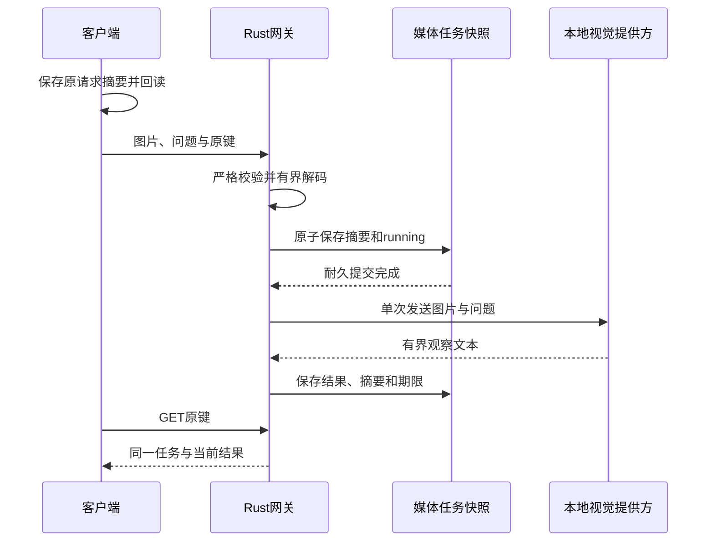

# 本地有限图片观察

能力为 `vision.understand`，接受所有者明确选择的单张静态 PNG/JPEG 和问题，返回有来源信息的观察文本。图片不成为设备事件，结果不创建规则、设备命令或播放授权。[机器合同](vision.schema.json)通过 `limeiot schema vision-observations.create` 发现。

## 提供方与部署

网关依赖 `VisionProvider` 窄接口，首个适配器为 `ollama-vision-v1`。Ollama 在独立进程或容器运行；平台不内嵌模型、不自动下载权重，也不静默切换云模型。

启用[媒体服务](media.md)作为耐久任务存储，再设置 `LIMEIOT_VISION_URL`、`LIMEIOT_VISION_MODEL`。使用精确安装的 Ollama 模型名称及标签；需要私有 HTTPS CA 时设置 `LIMEIOT_VISION_CA_FILE`。两项均未设置时禁用，部分配置或缺少媒体服务时拒绝启动。部署修订绑定适配器、地址、模型名称与 CA 摘要，不是权重内容的证明；管理员替换同名模型属于提供方变更，须重新验证质量。

每次调用检查全部解析地址位于回环、RFC1918 或 IPv6 ULA，固定地址后发送。出口禁止代理、跳转和自动重试，不传网关或设备凭据。内网地址本身不能证明提供方不联网；NAS 同机覆盖使用独立内部网络。

首个适配器调用 Ollama `/api/chat`，使用单张内联图片、固定系统约束、问题、`stream:false`、`num_ctx:4096`、`num_predict:1024` 和 `keep_alive:0`。不提供工具、设备清单或宿主文件访问。要求响应模型名称一致、`done:true`、`done_reason:stop`、assistant 文本；工具调用、截断、重复 JSON 键和异常响应拒绝发布。

## 输入边界

| 项目 | 限制 |
| --- | --- |
| 图片 | 单张静态 PNG/JPEG，最大 2 MiB，宽高各不超过 1024 像素 |
| 解码 | 成熟 PNG/JPEG 库，16 MiB 分配限制；拒绝 APNG 和格式伪装 |
| 问题 | 非空，最多 512 个 Unicode 标量、2048 个 UTF-8 字节 |
| 请求 | 严格 JSON，最大 2804396 字节，不接受 URL 或文件路径 |
| 期限 | 未来 90 秒以内，精度最多毫秒 |
| 输出 | 非空文本，最多 2048 个 Unicode 标量、8192 字节 |
| 提供方响应 | 最大 65536 字节，JSON，不接受压缩响应 |
| 结果保留 | 成功起算 60–3600 秒；家庭网页默认 600 秒 |
| 调度 | 单并发、无队列；最多 128 条原任务，不回收后重用旧键 |

图片按原字节发送给获准的本地提供方，可能含其原有元数据。平台不将图片、问题正文或提供方思考内容写入任务快照；提供方自己的内存、日志与缓存由安装者管理。客户端自行创建的输入文件仍可能含原文。

## 请求、原记录与恢复

路径前缀为 `/api/v1/spaces/{space_id}`，使用 NAS 所有者会话或 CLI Bearer 身份。

| 工具 | HTTP | 行为 |
| --- | --- | --- |
| `vision-observations.create` | `POST /vision-observations` | 首次 202；原键同参 200；冲突 409 |
| `vision-observations.resolve` | `GET /vision-observations/by-key/{id}` | 只查询原任务 |
| `vision-observations.discard` | `POST /vision-observations/by-key/{id}/discard` | 放弃未完成输出，或清除成功文本；正文为空或 `{}` |

创建必须带唯一 `Idempotency-Key`，正文包含 `image_base64,content_type,prompt,retain_seconds,expires_at`。Base64 使用标准带填充形式，不使用 data URL。摘要输入只含图片 SHA-256、图片字节数、类型、问题 SHA-256、保留时间与规范 UTC 毫秒期限；请求摘要绑定空间和原键。



状态为 `running/succeeded/failed/unknown/discarded`。提供方 4xx 为明确拒绝；断流、5xx、跳转和期限经过为未知。未知任务继续占用耐久预算，禁止换键发起新计算。重启把 running 转为 `unknown/vision_interrupted`，不重发图片或问题。

放弃 running/unknown 后保存 discarded，迟到结果不能发布；计算槽位仍保留到当前调用退出或到期，不承诺停止提供方。成功任务清除后仍为 succeeded，输出 `text:null` 且 `cleared_at` 有值；原任务、摘要和原成功时间保留。到期通过媒体维护或查询清除正文。清除不使历史备份中的原文消失。

## 客户端

CLI 在首次 POST 前以 0600 保存摘要原记录，重复创建只 GET；丢响应或 404 保留原键，不补发图片。放弃或清除也先保存独立意图，重复意图只查询。退出码 6 表示未知，7 表示明确失败。

```sh
limeiot vision-observations create --space-id space-demo --input "vision.json" --idempotency-key vision-01
limeiot vision-observations resolve vision-01 --space-id space-demo
limeiot vision-observations discard vision-01 --space-id space-demo
```

家庭网页“视觉”提供文件选择、问题和观察结果。Web Locks 串行保存摘要，记录损坏或写入失败阻止新请求；原图、问题和结果不写浏览器存储。后台、离线、离开或会话切换清除当前输入、结果和确认，迟到响应不更新旧页面。恢复已完成任务时只保留元数据，明确“查询原任务”后才展示正文。成功结果的清除及未知输出的放弃均需确认，取消不提交。

### Swift 与 Kotlin 客户端库

两端提供 `VisionClient`、`VisionRequests`、`VisionCapabilities` 与 `VisionRecord`，复用现有 `GatewayClient` 会话及必填 `SessionStore` 端口。`input` 接图片原字节、类型、问题、保留秒数与可选期限，`submit/resolve/discard` 对应同一正式任务路径。客户端只检查输入大小、格式标记和问题边界；静态图片解码、CRC、动画与实际尺寸由网关最终核对。

```swift
let vision = VisionClient(gateway: gateway, store: vault)
let input = try VisionRequests.input(bytes: image, contentType: "image/png", prompt: "请描述积木的颜色")
let record = try await vision.submit(space: space, input: input)
// record.text 仅在当次返回值中；查询原任务使用 record.id。
```

```kotlin
val vision = VisionClient(gateway, vault)
val input = VisionRequests.input(image, "image/png", "请描述积木的颜色")
val record = vision.submit(space, input)
// record.text 仅在当次返回值中；查询原任务使用 record.key。
```

`origin#vision-observations` 独立保存最多128条原请求摘要、去除 `output.text` 的观测和最多8个清除意图，不保存图片、问题、结果正文或会话凭据。受理与清除意图均先保存、回读，再发送；同键同参和重复清除意图只GET。存储损坏、写入失败或已加载记录被外部修改时禁写；同端多个实例串行访问。未知记录阻止换键，明确失败与原任务身份继续保留。

响应必须核对原摘要、图片尺寸、提供方、时间、结果UTF-8摘要及保留期限。已观察到unknown后拒绝迟到成功；成功清除后拒绝正文复活、身份漂移或状态回退。`records` 只恢复元数据；需要正文时明确调用 `resolve`，调用方负责按 `outputExpiresAt` 以及页面、会话生命周期清除内存正文。调用 `discard` 前的界面确认由调用方负责。

`npm run test:vision:native:contract` 检查共享JS/Schema向量与两端库；`npm run test:vision:native` 运行真实网关的大图、丢回执、独立进程和网关恢复、未知预算及清除旅程。提供方与恢复文件为宿主夹具，不能推定真实模型、Keychain/Keystore或原生页面已通过。

### 原生页面与状态恢复

SwiftUI与Compose在“设置 → 图片观察”提供PNG/JPEG系统文件选择、问题输入、查询原任务、明确放弃与成功结果清除。文件读取和请求构造在后台执行，图片读取最多2 MiB，原有音频读取默认4 MiB；客户端不替代网关完整图片解码。

页面内存只保留当次输入与未到期正文，生成时立即清除图片和问题。后台、离线、离开、退出或切换会话清除输入、正文与确认；旧请求和迟到文件读取不得回填新页面。前台刷新只恢复元数据，已完成正文须明确查询；当前前台的运行任务可轮询展示结果。未知任务继续占用，取消清除或放弃不发送POST，观察不创建命令或播放授权。

`npm run test:vision:native:state` 检查实际状态层、共享读取器与库回归，并通过独立宿主进程连接真实网关恢复。SwiftUI仅作语法和工程装配检查，Compose作编译、APK和lint检查；系统选择器、完整App与Keychain/Keystore运行、真实模型质量、摄像头和连续帧分别验收。当前证据见[实施进度](../docs/24-实施计划与进度.md)。

## NAS

在基础与媒体 Compose 文件后叠加 `compose.vision.yaml`，指向明确配置的局域网提供方。需要同机 Ollama 时改用 `compose.vision-local.yaml`，两者二选一；后者复用现有 Ollama 资源与权限限制，只接独立内部网络，无主机推理端口、网关秘密或启动健康依赖。

首次视觉任务将媒体快照升至 v4，仍读取 v1/v2/v3；随后 TTS/ASR 不得降版本。备份工具复制原字节，恢复已完成结果及原任务身份，未完成调用保持未知。旧程序不能读取 v4，不通过删除账本或降级绕过。

`npm run test:vision` 覆盖解码与状态、真实网关、CLI 丢回执、390px 浏览器、NAS 新目录恢复及两套真实 Nginx 入口。提供方使用夹具，不能据此声明真实视觉质量、具体模型许可、最新 NAS 镜像、容器运行或原生 App 已通过。
