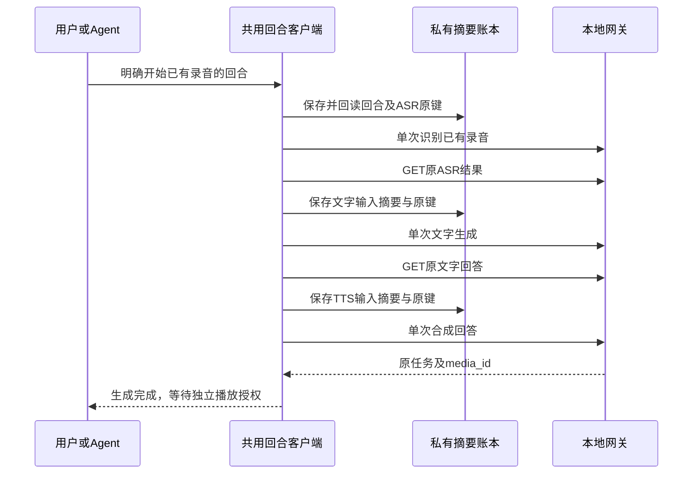

# 本地有限语音回合

本合同定义客户端组合：同一回合依次调用已有的[录音识别](transcription.md)、[文字生成](text.md)和[语音合成](speech.md)，不新增网关HTTP、数据库或模型执行权限。家庭网页和CLI使用`packages/protocol/voice-turns.mjs`，Swift/Kotlin的`VoiceTurnClient`遵循相同v1账本、摘要和状态规则。机器入口为`limeiot voice-turns schema`，输入见[Schema](voice-turns.schema.json)。

## 陪伴会话的上下文扩展

[有限陪伴会话](companion.md)显式启用共享JS客户端的contextual模式。内部v2回合在ASR前固定角色提示与先前交替问答的摘要、历史消息数，文字阶段加入本次转写；正文仅在当前调用方内存。上下文缺失或摘要变化时不能推进；resolve和stop仍可在没有正文时处理原任务。外层会话进一步固定模型、轮数和总期限。

默认构造及解析保持v1；v2只能由显式支持上下文的调用者读取。陪伴CLI使用独立companion账本，现有网页、voice-turns CLI和Swift/Kotlin单回合不因此获得多轮角色会话入口。下文的单回合输入、恢复和独立播放语义保持原范围。

## 使用与调用

先启用媒体存储、ASR、文字和TTS服务，并上传符合媒体合同的WAV。家庭网页可先在“音频 → 上传音频”明确录音，再上传；也可选择已有文件。“音频 → 语音对话”选择已上传录音、语言和声音，明确点击“生成语音回答”。原生客户端在“设置 → 音频 → 语音对话”选择录音和声音后点击“开始语音对话”，页面默认使用中文。

```json
{"turn_id":"turn-UNIQUE_ID","media_id":"media-EXISTING_ID","language":"zh","voice":"YOUR_CONFIGURED_VOICE"}
```

`turn_id`为每回合唯一编号，最多96字符。三阶段原键分别为`{turn_id}-transcription`、`{turn_id}-text`、`{turn_id}-speech`；不能重用历史编号。客户端固定ASR、文字和TTS部署修订，每阶段最多创建一次，无自动重试或换键。文字阶段只携带本次转写，不回填其他对话；平台提示要求简短回答，但仍按实际结果校验。

回合最长5分钟，且不能超过源录音有效期。每阶段独立期限最多85秒，也不能超过回合期限。保留期固定10分钟；识别文本沿用源录音期限，文字与合成音频仍按各自正式合同保留。返回超过TTS的1000字符/4096字节限制时，保留原文字回答并停止向TTS推进，不静默截断或额外调用模型。



## 账本与恢复

账本只保存源录音编号/摘要/期限、语言与声音、部署修订、各阶段原请求摘要、去正文观测及停止事实，不保存录音、转写正文、问题、回答、下载凭据或平台Token。全文只在当前调用/前台内存中流转。SHA-256校验用于发现损坏，不是签名或授权。

新阶段须先保存原请求并读回核对，失败时零POST。原记录存在后无论是否已发送，都只查询该键；保存后暂停但尚未发送的记录仍可能404，不能由404推断未受理并补发。结果身份、摘要、部署、终态、用量或清除状态漂移时拒绝继续。unknown不启动下一阶段；服务端预算及槽位继续按各自合同保持。

| 操作 | 行为 |
| --- | --- |
| `start` | 明确创建一轮，提交首个尚未创建的阶段 |
| `resolve` | 只GET原阶段，不开始下一阶段 |
| `continue` | 明确读取原任务，成功后可创建原先尚未创建的下一阶段 |
| `stop` | 先耐久记录停止，再按原键明确放弃未决输出，并清除成功的文字回答 |

停止决定一旦保存，本轮不能再推进。每阶段的放弃意图也先保存并读回；响应丢失后只查询，不重发。清除尚未生效或未决尚未核实，继续保留原回合，不开始替代回合。需要再次明确放弃时使用对应阶段的正式独立入口，之后查询原回合核实。停止不保证外部模型已停止计算，也不停止已获准的设备播放。

成功的ASR文本随原录音删除/到期清除；成功的TTS音频使用现有媒体删除/到期及授权撤销。结束回合隐藏其正文与音频选择，已生成媒体不会被隐式删除，历史备份按私有数据保管。

## 网页有限录音

“开始录音”是唯一采音入口，要求安全上下文和浏览器麦克风权限。使用本站独立AudioWorklet资源，不放宽CSP；不将采集输入输出到扬声器或网络。录音固定为16 kHz、单声道、PCM16 WAV，最多60秒、960000帧、1920044字节。浏览器不能提供所需AudioContext采样率或工作模块时拒绝采音，可改用已有WAV。

初始化最多等待30秒。“完成录音”或达到60秒后生成内存文件，随后停止全部媒体轨道并关闭AudioContext；完成回执最多等待3秒。设备结束、静音或运行中AudioContext中断均结束本次采音，不自动重录。取消后迟到的授权所取得的轨道立即停止。

录音、上传、模型回合、播放授权和播放分别由用户明确触发。完成录音不会上传或调用模型；尚未上传的录音不写入客户端存储。后台、离线、离页、退出或媒体服务不可用时停止采音并放弃未上传的录音；恢复后须重新录制。文件读取或摘要计算期间发生上述变化，发送前仍校验页面、网络与录音代次，禁止继续上传。已发出的上传沿用媒体原键查询，取消不证明服务端未保存。

录音不提供全双工或自动回声隔离保证，也不接管音箱原厂麦克风；播放时是否再次采音由用户决定。采音模块和WAV编码的检查入口为`npm run test:recording`，真实麦克风、远场准确率和实际发声按独立验收记录。

## 原生有限录音

SwiftUI与Compose在“设置 → 音频 → 上传音频”提供“开始录音”“完成录音”和“取消录音”。仅在用户点击后请求系统麦克风权限，授权等待最长30秒；取消、后台或离页后到达的授权不创建采音资源。Android通过独立AudioRecord适配器读取16 kHz单声道PCM16；Apple通过独立AVAudioEngine/AVAudioConverter适配器转换到相同格式，不创建临时录音文件。iOS工程声明麦克风用途，Android声明运行时权限及可选硬件功能。

两端使用独立采音状态层和有界缓冲，最多60秒、960000帧、1920044字节；实际帧数或时间先到即结束，不补静音。完成先关闭采音，再交给媒体状态层独立拥有的内存选择；取消、离线、后台、离页或输入中断清除资源与未上传录音。停止后的迟到采样、错误与授权不得恢复旧状态。手选同名`recording.wav`不被录音清理误删。

完成录音不上传、不创建模型任务或音箱授权。用户另行明确上传后，复用`origin#media-operations`中的摘要原请求；HTTP回执丢失后只GET原键，新进程或网关重启不重新录音、上传或播放。

`npm run test:recording:native:state`检查实际状态层、共享PCM合同、媒体回归与Android APK/lint；`npm run test:recording:native`另运行两端到真实Rust/SQLite网关的上传和恢复旅程。状态检查注入采音夹具，Swift适配器仅以macOS SDK编译，不调用系统麦克风；完整iOS构建、两端系统权限/采音/安全存储与App运行分别验收，实机按用户要求跳过。

## 原生统一回合

Swift/Kotlin的`VoiceTurnClient`复用已有会话、网络、存储及三类任务校验器。存储键为`origin#voice-turns:space_id`，文档格式与网页/CLI相同；媒体原期限与网关纳秒时间按合同规范化为毫秒后比较，不引入时间容差。每个持久化操作先写后回读；SDK在整个操作期间互斥，并在存储和网络前后检查前台任务取消。

`VoiceTurnStore`和`VoiceTurnController`由家庭会话创建，空间切换或退出时关闭；连接中断、后台、离页时取消当前Task/Job，清空正文和录音选择。仅本次明确开始或继续的在线前台可轮询并衔接下一阶段；恢复页面只读取原任务摘要，点击“查询原回合”才显示仍有效的正文，点击“继续原回合”才允许创建尚未创建的阶段。

停止需要确认。取消确认零请求；确认后先保存停止事实，再提交各阶段单次放弃意图。丢回执后只查询原键，不重新提交。成功只显示生成结果，用户可点击“选作播放音频”交给已有媒体选择流程，再单独授权和播放；SDK与回合状态层不调用授权或设备命令。

`npm run test:voice-turns:native`验证共享JS账本、原生SDK/状态层、Android APK/lint及真实Rust/SQLite/MQTT的跨进程恢复。测试使用三类合成提供方、私有宿主文件和宿主状态层；SwiftUI仅作语法/工程检查，完整iOS构建、生产安全存储、系统采音和完整App运行仍独立验收。

## 原生分步组合

同一“音频”页按上传、语音识别、本地对话、文字转语音及音箱授权排列。识别成功后“带入新对话”读取仍有效的识别文字，校验后清除当前对话上下文并准备新问题；用户点击“发送”才创建文字任务。回答的“带入语音合成”只准备完整语音文本，选择声音并点击“生成音频”才请求TTS；超过1000 Unicode标量或4096 UTF-8字节时保留原回答与原语音草稿，拒绝带入，不截断或再次生成。

两处带入都不发POST、不保存正文、不覆盖未决任务。目标服务未配置、后台/离线/关闭、任务处理中或预算占用时拒绝带入；按钮点击时重新读取当前有效结果。原生仍可在发送前编辑问题或语音草稿，三类任务各自拥有原键、期限、摘要和明确放弃入口，无自动阶段推进或统一回合账本。

生成成功只选择音频，授权保持未勾选。用户明确授权后，再到设备页独立播放。后台、离页或断线暂停各状态层并清除输入和正文；新进程/网关重启先恢复各原任务，明确查询结果不会自动带入、推理或重播。该分步组合不承诺本节网页回合的统一5分钟期限或固定三类部署快照。

`npm run test:voice-handoff:native:state`检查两端实际状态层与Android构建；`npm run test:voice-handoff:native`另以真实Rust/SQLite/MQTT验证模拟采音、三类协议提供方、独立授权与软件音箱Range播放，以及重启后零推理/重播。协议夹具不验证真实模型质量或完整App运行。

## CLI与网页生命周期

将输入保存为当前用户可读的0600普通JSON文件，再调用：

```sh
limeiot voice-turns schema
limeiot voice-turns start --space-id space-demo --input "./voice-turn.json" --wait
limeiot voice-turns resolve --space-id space-demo
limeiot voice-turns continue --space-id space-demo --wait
limeiot voice-turns stop --space-id space-demo
```

`--wait`只用于start/continue，在本次明确批准的进程中有界轮询并推进；退出后不运行后台任务。`resolve`永远不创建下一阶段。CLI输出当次转写、回答及media_id，可含私人内容，调用方管理终端和管道留存。状态目录通过`--state-dir`指定，默认位于CLI私有状态目录的voice-turns子目录；使用空间级独占锁和0600摘要文件。异常退出遗留锁时保守拒绝写入，不自动删除他人锁或重启旧任务。

网页使用安全上下文的Web Locks和同源会话。在当前可见、在线页面的一次批准内自动衔接各阶段；后台、离页、离线、退出和期限经过时清除正文并暂停推进，迟到结果不进入新页面。前台恢复或刷新只查询元数据；“查询原回合”可明确重读仍有效的正文，“继续本轮”才允许创建尚未创建的下一阶段。存储损坏或当前记录被删除时禁止新请求。

## 播放与验收边界

成功仅选择生成的media_id并清除页面授权勾选。生成不创建设备命令、音箱授权或播放请求。使用者须在原播放授权区域核对音箱并明确授权，再到设备页播放；授权/播放的故障、恢复和停止仍按原合同处理。

本入口是单录音、单回复的软件组合，网页与原生页面支持明确开始的有限录音；不提供唤醒词、流式识别或输出、持续多轮、长期记忆、儿童/机构会话政策、原厂音频仲裁或机器人运动。协议夹具与模拟麦克风旅程用于检查链路与恢复，真实ASR/文字/TTS质量、人工听感、完整App、当前NAS镜像和实机分别验收。
