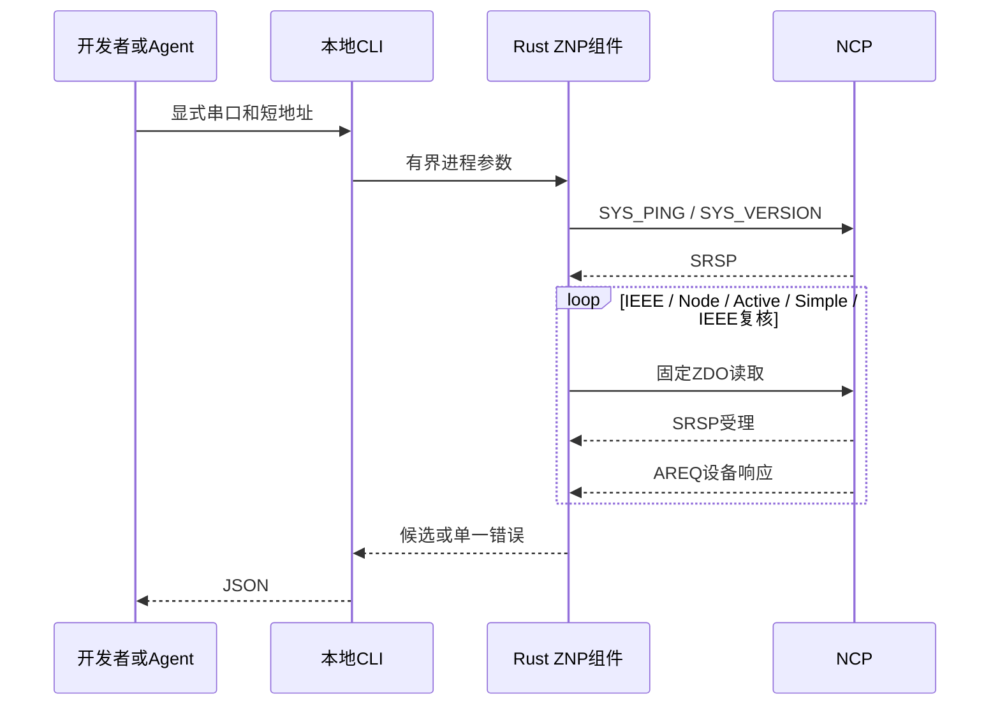

# ZNP诊断与设备访谈

本合同定义第一方Rust组件`limeiot-znp`及本地CLI的固定读取任务。成功结果是未经认证的协议候选证据，不创建平台设备或绑定。正式输出由[Schema](zigbee-diagnostics.schema.json)约束，请求结构位于`$defs.request`。

## 入口

```sh
cargo build --locked -p limeiot-zigbee-znp
node packages/cli/src/main.mjs zigbee schema
node packages/cli/src/main.mjs zigbee probe --serial "/dev/ttyUSB0"
node packages/cli/src/main.mjs zigbee interview --serial "/dev/ttyUSB0" --address 0x1234 --timeout-ms 5000
```

默认使用仓库`target/debug/limeiot-znp`，可在当前进程以`LIMEIOT_ZNP_TOOL`指定组件绝对路径。CLI不自动构建、扫描端口、申请提权或启动网关；调用组件不经过Shell。`schema`离线返回正式合同，无需组件、凭据或串口。

| 参数 | 约束 |
| --- | --- |
| command | `probe`或`interview` |
| serial | 显式绝对路径，UTF-8路径最多1024字节，目标为TTY字符设备 |
| address | interview必填；`0x`及4位十六进制，范围0x0000–0xfff7 |
| timeout_ms | CLI为`--timeout-ms`，十进制100–30000，默认5000；整个操作共用期限 |

重复参数、未知命令/参数和广播地址在打开串口前拒绝。stdout仅输出一份JSON成功回执，错误写stderr。退出0表示读取成功，2表示输入无效，5表示组件、串口或协议失败。失败不输出部分候选。

## 读取范围

probe按顺序发送`SYS_PING`及`SYS_VERSION`；interview先执行probe，再向指定短地址请求IEEE地址、Node Descriptor、Active Endpoints及每个Simple Descriptor，最后重新请求IEEE地址。两次IEEE不同则整个访谈失败。

只发送固定SYS/ZDO读请求。当前没有复位、启动/组建网络、permit-join、NV/密钥读写、绑定、ZCL读写、设备控制、网络备份或自动重连。interview要求NCP已具备可用网络、目标已入网且可响应；休眠设备可能超时。没有型号名称、Basic Cluster manufacturer/model识别或状态上报能力。



## 串口与会话

当前Unix实现固定115200、8N1、无软硬件流控；打开后清理内核输入队列，使用非阻塞IO、协作文件锁与TTY独占。调用者必须确认没有其他现存进程拥有该NCP；TTY独占不能驱逐此前已打开的进程。退出恢复原终端配置、丢弃本会话未消费输入并释放描述符，不等待输出排空，也不主动改变DTR/RTS。USB-NCP的实际打开行为按具体板卡验收。

MT帧为`FE LEN CMD0 CMD1 DATA FCS`，DATA最大250字节，FCS对LEN至DATA做XOR。坏校验、超限长度和错配同步响应关闭会话，不尝试猜测后续边界。全操作最多跳过64个非帧前导字节和32条无关通知；不缓存无关通知，不重置期限。SYS_RESET_IND立即终止。

只允许一个在途请求。ZDO必须同时取得匹配SRSP与目标AREQ，支持AREQ先到；核对命令、源短地址、查询短地址及Simple Descriptor端点。超时、取消、协议或IO失败立即丢弃传输，后续调用返回`znp_session_closed`；没有自动重试或原请求补发。

独立组件处理SIGINT/SIGTERM，通过取消操作未来值释放串口，返回`znp_cancelled`；强制结束进程或设备拔出不保证配置恢复。MT的这些响应不提供可用的主机请求ID，不能据此证明外部遗留响应的来源或设备持有可信平台身份。重新打开端口必须重新诊断；结果不能用于自动认领。

## 输出与上限

成功回执含`schema_version=1`、operation、protocol=znp、`evidence=unauthenticated_protocol`、`device_binding_created=false`、完成时`observed_at_unix_ms`与result。完成时间不是各设备属性的采样时间。

probe保留capabilities及版本前5字节的Transport/Product/Major/Minor/Maintenance；额外0–11字节保留为`version_extension`，不解释为芯片型号、SDK版本或固件制品身份。interview提供数值manufacturer_code、完整Node Descriptor字段、16位短地址、16位小写十六进制IEEE及端点/Cluster清单。

最多16个端点，每个方向最多32个Cluster。重复/非法端点、重复Cluster、计数与长度不符均拒绝，超过本地资源上限不静默截断。Cluster存在不表示相应能力已获平台映射或控制授权。

错误code包括`znp_timeout`、`znp_cancelled`、`znp_invalid_frame`、`znp_invalid_response`、`znp_unexpected_response`、`znp_reset`、`znp_limit_exceeded`、`znp_request_rejected`、`znp_device_rejected`、`znp_capability_missing`、`znp_identity_changed`和`serial_io_failed`。两类拒绝额外保留0–255数值status，不输出串口路径、原始正文或凭据。

## 协议依据与验证

字段依据TI官方`simplelink-lowpower-f2-sdk`固定修订`3615ad5d3f4f271258d18a2f5ce1785064ff9a58`：

- [mt_rpc.h](https://github.com/TexasInstruments/simplelink-lowpower-f2-sdk/blob/3615ad5d3f4f271258d18a2f5ce1785064ff9a58/source/ti/zstack/mt/mt_rpc.h)：MT数据上限与命令类型。
- [mt.h](https://github.com/TexasInstruments/simplelink-lowpower-f2-sdk/blob/3615ad5d3f4f271258d18a2f5ce1785064ff9a58/source/ti/zstack/mt/mt.h)：SYS/ZDO命令及能力位。
- [mt_sys.c](https://github.com/TexasInstruments/simplelink-lowpower-f2-sdk/blob/3615ad5d3f4f271258d18a2f5ce1785064ff9a58/source/ti/zstack/mt/mt_sys.c)、[mt_version.c](https://github.com/TexasInstruments/simplelink-lowpower-f2-sdk/blob/3615ad5d3f4f271258d18a2f5ce1785064ff9a58/source/ti/zstack/mt/mt_version.c)：能力与版本。
- [mt_zdo.c](https://github.com/TexasInstruments/simplelink-lowpower-f2-sdk/blob/3615ad5d3f4f271258d18a2f5ce1785064ff9a58/source/ti/zstack/mt/mt_zdo.c)：请求、直接回调与IEEE响应布局。
- [npi_frame_mt.c](https://github.com/TexasInstruments/simplelink-lowpower-f2-sdk/blob/3615ad5d3f4f271258d18a2f5ce1785064ff9a58/source/ti/zstack/npi/npi_frame_mt.c)：SOF、帧布局和FCS。

上游部分示例默认版本数组与头文件声明长度不同，因此扩展保留原字节；这里没有宣称所有NCP固件兼容。实现未复制TI源文件进入产品，也不依赖HA、ESPHome或zigbee2mqtt。

`npm run test:zigbee`运行Rust会话检查、真实组件/CLI的Unix伪终端软件NCP旅程及严格Schema检查，不访问硬件。网关装配、持久设备绑定、ZCL映射、入网/重连与固定NCP固件/型号验收继续按[协议规范](../docs/07-异构协议与适配器规范.md)交付。
