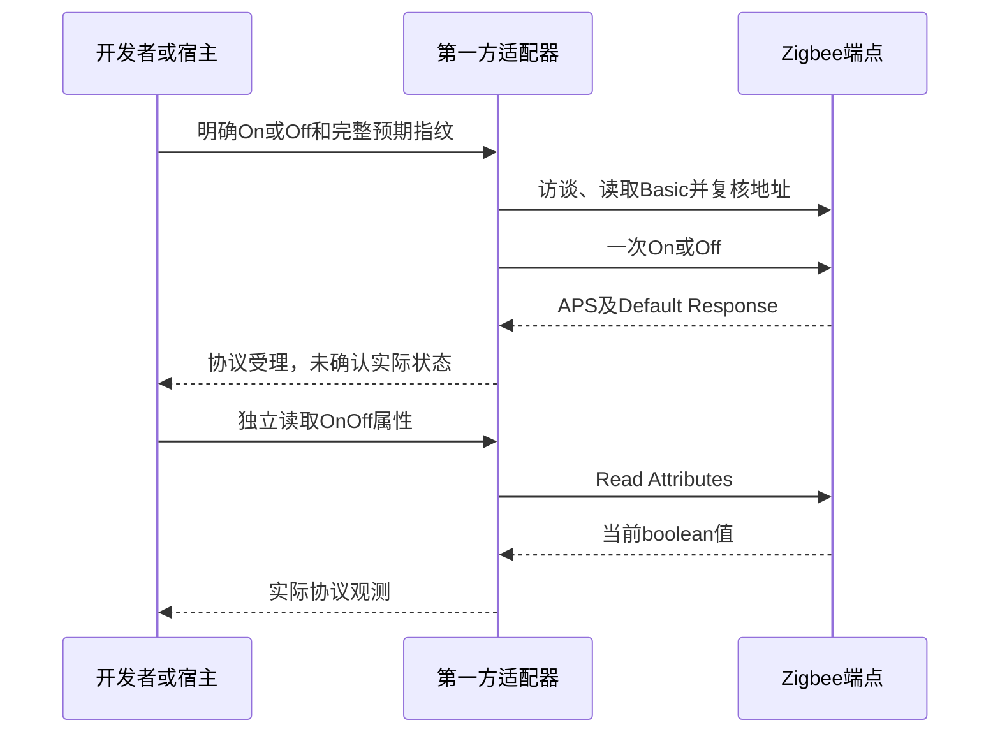
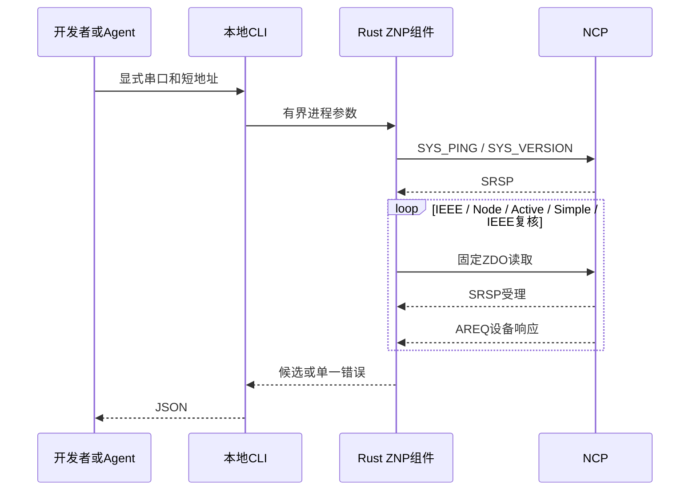

# ZNP诊断、设备发现、固定属性与On/Off

本合同定义第一方Rust组件`limeiot-znp`及本地CLI的固定读取、On/Off与有限协调器入网操作。结果是未经认证的协议证据，不创建平台设备或绑定；`permit-join`改变协调器入网策略，`set-onoff`向指定端点发送一次明确On或Off。正式输出由[Schema](zigbee-diagnostics.schema.json)约束，请求结构位于`$defs.request`。

## 入口

```sh
cargo build --locked -p limeiot-zigbee-znp
node packages/cli/src/main.mjs zigbee schema
node packages/cli/src/main.mjs zigbee config-schema
node packages/cli/src/main.mjs zigbee probe --serial "/dev/ttyUSB0"
node packages/cli/src/main.mjs zigbee neighbors --serial "/dev/ttyUSB0" \
  --coordinator-ieee 0102030405060708
node packages/cli/src/main.mjs zigbee interview --serial "/dev/ttyUSB0" --address 0x1234 --timeout-ms 5000
node packages/cli/src/main.mjs zigbee read-environment --serial "/dev/ttyUSB0" \
  --coordinator-ieee 0102030405060708 --ieee 1122334455667788 --endpoint 1
```

默认使用仓库`target/debug/limeiot-znp`，可在当前进程以`LIMEIOT_ZNP_TOOL`指定组件绝对路径。CLI不自动构建、扫描端口、申请提权或启动网关；调用组件不经过Shell。`schema`离线返回正式合同，无需组件、凭据或串口。

| 参数 | 约束 |
| --- | --- |
| command | `probe`、`neighbors`、`interview`、`read-environment`、`permit-join`、`read-onoff`或`set-onoff` |
| serial | 显式绝对路径，UTF-8路径最多1024字节，目标为TTY字符设备 |
| address | interview必填；`0x`及4位十六进制，范围0x0000–0xfff7 |
| coordinator_ieee / ieee_address | neighbors及permit-join须提供coordinator_ieee；read-environment/read-onoff/set-onoff两者必填。CLI分别为`--coordinator-ieee`、`--ieee`，16位小写十六进制，拒绝全0、全f，设备端点任务还拒绝二者相同 |
| endpoint | read-environment/read-onoff/set-onoff必填；CLI为`--endpoint`，十进制1–240 |
| duration_seconds | permit-join必填；CLI为`--duration-seconds`，0明确关闭，1–120有限允许加入，不接受255永久开放 |
| power / manufacturer_code / signature | set-onoff必填；机器请求为布尔值、uint16及完整Basic指纹。CLI为`--power on/off`、`--manufacturer-code 0x1234`、`--signature-json`，其他任务拒绝这些参数 |
| timeout_ms | CLI为`--timeout-ms`，十进制100–30000，默认5000；整个操作共用期限 |

重复参数、未知命令/参数和广播地址在打开串口前拒绝。stdout仅输出一份JSON成功回执，错误写stderr。退出0表示取得完整成功回执，2表示输入无效，5表示组件、串口或协议失败。失败不输出部分候选。

## 读取范围

probe按顺序发送`SYS_PING`及`SYS_VERSION`；interview先执行probe，再向指定短地址请求IEEE地址、Node Descriptor、Active Endpoints及每个Simple Descriptor，最后重新请求IEEE地址。两次IEEE不同则整个访谈失败。

probe/interview/neighbors只发送固定SYS/ZDO读请求。read-environment另允许固定AF端点注册和三组ZCL Read Attributes；read-onoff/set-onoff仅允许下节的Basic、布尔状态和固定On/Off；permit-join只允许协调器单播。当前没有复位、启动/组建网络、NV/密钥读写、绑定、任意ZCL属性写入、网络备份或自动重连。NCP必须已有可用网络，设备端点任务要求目标已入网且可响应；休眠设备可能超时。

## 固定On/Off端点

`Session.read_on_off`和`read-onoff`读取Basic完整指纹及Cluster `0x0006`的OnOff属性`0x0000`。指定端点必须提供Profile `0x0104`及Basic/OnOff input clusters；属性类型必须为ZCL boolean `0x10`且值为0或1。错误类型、无效布尔值、缺少/重复/额外属性整次拒绝；不以设备类型字段或Cluster存在推断平台品牌支持。返回`power { value, received_at_unix_ms }`，时间是主机收到属性响应的时间。

`Session.set_on_off`和`set-onoff`要求调用者显式提供设备端点、manufacturer_code及全部Basic指纹：manufacturer、model、application_version、hardware_version。组件重新访谈并读取Basic，逐字段精确匹配；字符串最多32个UTF-8字节且无控制字符，版本为uint8。指纹或写前协调器/短地址变化时不发送On/Off命令。指纹为未经认证的协议证据，不能替代设备身份认证。

控制固定使用client-to-server的Cluster-specific命令Off `0x00`或On `0x01`，保留Default Response；没有Toggle、广播、组播、场景或任意Cluster入口。每次最多发送一个控制命令，完整核对MT受理、APS投递、同目标/端点/Cluster/序号的全局server-to-client Default Response及原命令和status。允许三类回执全部六种顺序；外来报文受原通知预算约束。结束后再次复核目标和协调器，失败关闭会话且不重试。

成功只返回`status=protocol_accepted`、`power_requested`、`device_state_confirmed=false`和`accepted_at_unix_ms`，不返回或伪造实际power。实际状态须独立执行read-onoff；即使协议受理，设备属性仍可能保持旧值。控制失败返回`outcome=unknown`和`retry_allowed=false`，包括回执丢失、取消、结束身份复核或坏工具输出；不能用再次调用或自动反向命令处理不确定结果。

On/Off使用固定主机端点239、Profile `0x0104`、device_id 5、无input及Basic/OnOff两个output clusters，与环境读取的240独立注册和精确复核，冲突不删除或覆盖。两端点共用单Session的AF/ZCL编号，0–255不回绕；读状态与控制各消耗两次AF，环境读取保持三次。组件取消或任一失败丢弃传输，成功后可继续环境读取、发现和有限入网。



本合同的独立组件与CLI直接操作串口，不自行创建设备或耐久平台命令。运行网关已通过[属性桥接](property-bridges.md)将固定On/Off接入原命令账本、共享串口、网页控件及阈值自动化；原生控件复用原物模型，完整App仍另验。独立CLI调用前先释放NCP，不能与运行网关争用。`npm run test:zigbee:onoff`验证组件与机器合同，[原阶段证据](../docs/evidence/2026-11-04-znp-onoff.json)仅记录当时范围；平台链路另由`npm run test:zigbee:onoff-gateway`验证。历史NAS及正式云镜像不包含这些新源码，实机按用户要求跳过。



## 协调器邻居表

`neighbors`先执行SYS诊断并核对短地址0的协调器IEEE，再从startIndex 0开始发送固定`ZDO_MGMT_LQI_REQ`，收齐邻居表后重新读取协调器IEEE。命令需要调用者提供预期协调器IEEE，不自动接受当前串口上的其他网络。输入不接受目标地址、端点、广播、任意MT或开放入网参数。

每页请求为`DstAddr=0x0000`和单字节startIndex，匹配SRSP及`0x45/0xb1`异步响应，允许异步先到。响应先核对源地址0、status和对应页索引；其他来源或旧页消耗原32条无关通知预算，不被采用。成功正文是6字节页头及每条22字节记录。全操作沿用同一期限、64字节前导噪声和32条无关通知预算，不按页重置。

最多64条记录，不截断；每页按实际count推进，空表也读取一次。页总数最多64，MT最大250字节限制单页最多11条。长度/数量不符、无进展页、保留短地址、无效IEEE均失败；总数改变、重复短地址/IEEE或混入协调器自身返回`znp_neighbor_table_changed`。协调器前后身份不符返回`znp_identity_changed`。失败关闭会话，stdout没有部分清单，不自动重试。

结果为`scope=coordinator_neighbors`、协调器IEEE、network_address 0、table_entries、page_count及items。每条包含extended_pan_id、ieee_address、network_address、device_type、rx_on_when_idle、relationship、flags、permit_joining、depth和link_quality。flags与permit_joining保留原字节，类型、接收模式、关系分别从flags低2位、2–3位、4–6位解码；未知值不推导为设备能力或安全策略。LQI是邻居表证据，不作实时信号质量保证。

这是协调器邻居表，不是全网扫描、在线清单、原子网络快照或设备认证。分页期间同数量的记录变化不一定能检出，可能包含旧邻居，也可能遗漏路由器下的设备；不声称所有记录处于同一时点。取得短地址后可显式interview，核对端点、型号和实际属性，再走原来源候选/绑定流程。邻居发现本身不访问目标属性，不注册AF端点，不创建设备或来源，不修改配置/SQLite。独立CLI必须在网关等服务释放串口后运行；运行中网关的发现与客户端入口见[观测来源合同](observation-sources.md)。

## 有限协调器入网窗口

先释放NCP串口并核对已有网络的协调器IEEE，再明确运行：

```sh
node packages/cli/src/main.mjs zigbee permit-join --serial "/dev/ttyUSB0" \
  --coordinator-ieee 0102030405060708 --duration-seconds 60
```

相同入口使用`--duration-seconds 0`明确关闭。本命令不是读取，会改变指定协调器的入网策略。每次调用只发送一次固定`ZDO_MGMT_PERMIT_JOIN_REQ`，不自动延长、重发或补发关闭；永久开放、广播、路由器地址及任意MT参数拒绝。独立命令要求已有网关先释放串口；运行中改用[网关耐久入网工具](zigbee-operations.md)，网页和原生入网确认入口仍待接入。

全操作共用一个传输、期限与通知预算：SYS诊断 → 短地址0的IEEE核对 → Node Descriptor确认`logical_type=0` → 固定请求 → IEEE复核。请求MT为`0x25/0x36`，正文严格为`02 00 00 <duration> 01`，即16位单播、目标0、请求秒数、Trust Center Significance 1。响应要求单字节成功SRSP及源地址0的`0x45/0xb6`三字节`srcAddr/status`，允许AREQ先到；其他来源只消耗通知预算。NCP非协调器返回`znp_coordinator_required`，写前拒绝，不按版本或芯片名称猜测角色。

成功回执增加`network_write_requested=true`；result含`ncp`、`coordinator_ieee`、`network_address=0`、`scope=coordinator`、`duration_seconds`、`trust_center_significance=1`及`status=protocol_accepted`。它确认相关协议响应，不证明设备已加入、当前窗口仍开放或空口效果；NCP从处理请求起计时，回执完成时间不是准确起点或剩余秒数。

执行阶段失败均保守返回`outcome=unknown`与`retry_allowed=false`，即使最终IEEE复核失败也不声称没有写入。超时、取消、坏帧或丢响应后不输出成功正文、不自动重发；独立CLI没有耐久幂等键，每次新的显式调用都是一次新请求。若需要关闭，重新核对同一协调器后显式发送0；关闭也只取得协议受理证据。CLI将SIGINT/SIGTERM转给子组件并等待退出，不在父进程取消后继续执行后台子任务。

操作不注册AF、不改变其编号、不创建网络或写入NV/密钥。已有设备可能在这个有限窗口加入网络，之后仍须发现、访谈、查询完整候选并明确添加到平台。协调器窗口不表示全网路由器都允许加入，也不提供设备认证、安装码配网、平台身份或OTA权限。窗口计时、实际入网和型号支持仍须独立空口验收；实机按用户要求跳过。

## 固定环境属性读取

read-environment先核对协调器IEEE，再由目标IEEE查询当前短地址并完整访谈。指定端点必须使用Zigbee Home Automation应用Profile `0x0104`，并声明Basic `0x0000`、温度 `0x0402`、湿度 `0x0405`三个input cluster。这里的HA是Zigbee Profile名称。

本地主机使用端点240，profile `0x0104`、device ID `0x0005`、version 0、无input cluster、output clusters为上述三项。不存在时执行一次AF_REGISTER并读回Simple Descriptor；已存在时必须匹配，不匹配返回`znp_endpoint_conflict`。注册会改变NCP本次运行的端点表；退出不删除端点，也不写NV、复位或开放入网。连续复用同一Rust会话时缓存已核对的端点。

| Cluster与属性 | 返回字段 | 类型和边界 |
| --- | --- | --- |
| Basic 0x0001 / 0x0003 | signature.application_version / hardware_version | uint8 |
| Basic 0x0004 / 0x0005 | signature.manufacturer / model | UTF-8字符串，各1–32字节，拒绝控制字符及纯空白 |
| Temperature 0x0000 | temperature_celsius_x100.value | int16，-4500至13000；2356表示23.56°C |
| Relative Humidity 0x0000 | humidity_percent_x100.value | uint16，0至10000；4567表示45.67% |

每次AF_DATA_REQUEST必须同时取得匹配SRSP、AF_DATA_CONFIRM和AF_INCOMING_MSG，允许三者任意先后。属性响应核对短地址、源/目标端点、Cluster和ZCL sequence，投递回执核对端点与transaction ID；无关帧消耗全操作原有32条通知预算。仅接受标准全局server-to-client Read Attributes Response；字段必须完整、唯一且类型正确。Default Response、属性错误、APS投递失败、无效测量和畸形长度均使整次读取失败，不钳制、不返回部分结果。

结果还含协调器/设备IEEE、当前短地址、端点和数值manufacturer_code。两个测量分别携带`received_at_unix_ms`，表示主机收到该属性响应的时间，**不是设备采样时钟，也不证明设备刚刚采样**。温湿度由两个独立请求取得，不是原子快照。结束前再次核对IEEE到短地址及协调器身份，变化时丢弃整份结果。

同一会话的AF transaction ID与ZCL sequence使用0–255且不回绕；每次完整读取消耗3个编号，耗尽返回`znp_limit_exceeded`。新会话重新从0开始，因此跨会话的迟到回包、网络重放和Zigbee共享网络身份不由该编号认证；结果保持`evidence=unauthenticated_protocol`与`device_binding_created=false`。该读取不声明设备已被平台支持，也不授权命令或OTA。正式Schema约束形状和范围，IEEE不相等、字符串字节数及跨字段时间关系由组件执行检查。

## 串口与会话

当前Unix实现固定115200、8N1、无软硬件流控；打开后清理内核输入队列，使用非阻塞IO、协作文件锁与TTY独占。调用者必须确认没有其他现存进程拥有该NCP；TTY独占不能驱逐此前已打开的进程。退出恢复原终端配置、丢弃本会话未消费输入并释放描述符，不等待输出排空，也不主动改变DTR/RTS。USB-NCP的实际打开行为按具体板卡验收。

MT帧为`FE LEN CMD0 CMD1 DATA FCS`，DATA最大250字节，FCS对LEN至DATA做XOR。坏校验、超限长度和错配同步响应关闭会话，不尝试猜测后续边界。全操作最多跳过64个非帧前导字节和32条无关通知；不缓存无关通知，不重置期限。SYS_RESET_IND立即终止。

只允许一个在途请求。ZDO必须同时取得匹配SRSP与目标AREQ，支持AREQ先到；核对命令、源短地址、查询短地址及Simple Descriptor端点。超时、取消、协议或IO失败立即丢弃传输，后续调用返回`znp_session_closed`；没有自动重试或原请求补发。

独立组件处理SIGINT/SIGTERM，通过取消在途任务释放串口，返回`znp_cancelled`；强制结束进程或设备拔出不保证配置恢复。MT的这些响应不提供可用的主机请求ID，不能据此证明外部遗留响应的来源或设备持有可信平台身份。重新打开端口必须重新诊断；结果不能用于自动认领。

## 输出与上限

成功回执含`schema_version=1`、operation、protocol=znp、`evidence=unauthenticated_protocol`、`device_binding_created=false`、完成时`observed_at_unix_ms`与result。完成时间不是各设备属性的采样时间。

probe保留capabilities及版本前5字节的Transport/Product/Major/Minor/Maintenance；额外0–11字节保留为`version_extension`，不解释为芯片型号、SDK版本或固件制品身份。interview提供数值manufacturer_code、完整Node Descriptor字段、16位短地址、16位小写十六进制IEEE及端点/Cluster清单。

最多16个端点，每个方向最多32个Cluster。重复/非法端点、重复Cluster、计数与长度不符均拒绝，超过本地资源上限不静默截断。Cluster存在不表示相应能力已获平台映射或控制授权。

错误code包括`znp_timeout`、`znp_cancelled`、`znp_invalid_frame`、`znp_invalid_response`、`znp_unexpected_response`、`znp_reset`、`znp_limit_exceeded`、`znp_request_rejected`、`znp_device_rejected`、`znp_capability_missing`、`znp_identity_changed`和`serial_io_failed`。入网另含`znp_coordinator_required`；邻居表另含`znp_neighbor_table_changed`；环境读取另含`znp_endpoint_conflict`、`znp_profile_unsupported`、`znp_zcl_rejected`与`znp_delivery_failed`。请求/设备/ZCL拒绝与投递失败保留0–255数值status，不输出串口路径、原始正文或凭据。

## 协议依据与验证

字段依据TI官方`simplelink-lowpower-f2-sdk`固定修订`3615ad5d3f4f271258d18a2f5ce1785064ff9a58`：

- [zd_profile.c](https://github.com/TexasInstruments/simplelink-lowpower-f2-sdk/blob/3615ad5d3f4f271258d18a2f5ce1785064ff9a58/source/ti/zstack/stack/zdo/zd_profile.c)、[zd_profile.h](https://github.com/TexasInstruments/simplelink-lowpower-f2-sdk/blob/3615ad5d3f4f271258d18a2f5ce1785064ff9a58/source/ti/zstack/stack/zdo/zd_profile.h)：Mgmt LQI页头、22字节邻居记录及标志位布局。

- [mt_rpc.h](https://github.com/TexasInstruments/simplelink-lowpower-f2-sdk/blob/3615ad5d3f4f271258d18a2f5ce1785064ff9a58/source/ti/zstack/mt/mt_rpc.h)：MT数据上限与命令类型。
- [mt.h](https://github.com/TexasInstruments/simplelink-lowpower-f2-sdk/blob/3615ad5d3f4f271258d18a2f5ce1785064ff9a58/source/ti/zstack/mt/mt.h)：SYS/ZDO命令及能力位。
- [mt_sys.c](https://github.com/TexasInstruments/simplelink-lowpower-f2-sdk/blob/3615ad5d3f4f271258d18a2f5ce1785064ff9a58/source/ti/zstack/mt/mt_sys.c)、[mt_version.c](https://github.com/TexasInstruments/simplelink-lowpower-f2-sdk/blob/3615ad5d3f4f271258d18a2f5ce1785064ff9a58/source/ti/zstack/mt/mt_version.c)：能力与版本。
- [mt_zdo.c](https://github.com/TexasInstruments/simplelink-lowpower-f2-sdk/blob/3615ad5d3f4f271258d18a2f5ce1785064ff9a58/source/ti/zstack/mt/mt_zdo.c)：请求、直接回调与IEEE响应布局。
- [mt.c](https://github.com/TexasInstruments/simplelink-lowpower-f2-sdk/blob/3615ad5d3f4f271258d18a2f5ce1785064ff9a58/source/ti/zstack/mt/mt.c)和[mt_af.c](https://github.com/TexasInstruments/simplelink-lowpower-f2-sdk/blob/3615ad5d3f4f271258d18a2f5ce1785064ff9a58/source/ti/zstack/mt/mt_af.c)：端点描述、AF注册、发送、投递回执及含3字节尾部的普通接收消息。
- [zcl.h](https://github.com/TexasInstruments/simplelink-lowpower-f2-sdk/blob/3615ad5d3f4f271258d18a2f5ce1785064ff9a58/source/ti/zstack/stack/zcl/zcl.h)、[zcl_general.h](https://github.com/TexasInstruments/simplelink-lowpower-f2-sdk/blob/3615ad5d3f4f271258d18a2f5ce1785064ff9a58/source/ti/zstack/stack/zcl/zcl_general.h)和[zcl_ms.h](https://github.com/TexasInstruments/simplelink-lowpower-f2-sdk/blob/3615ad5d3f4f271258d18a2f5ce1785064ff9a58/source/ti/zstack/stack/zcl/zcl_ms.h)：标准属性、数据类型和字符串上限。
- [npi_frame_mt.c](https://github.com/TexasInstruments/simplelink-lowpower-f2-sdk/blob/3615ad5d3f4f271258d18a2f5ce1785064ff9a58/source/ti/zstack/npi/npi_frame_mt.c)：SOF、帧布局和FCS。

上游部分示例默认版本数组与头文件声明长度不同，因此扩展保留原字节；这里没有宣称所有NCP固件兼容。实现未复制TI源文件进入产品，也不依赖HA、ESPHome或zigbee2mqtt。

`npm run test:zigbee`运行Rust会话检查、诊断、AF/ZCL、邻居、On/Off与有限入网的Unix伪终端软件NCP旅程及严格Schema检查，不访问硬件。`npm run test:zigbee:commissioning`单独运行有限入网检查，覆盖精确单播、关闭、0/1/120边界、角色与身份、丢响应、CLI/组件取消、零重发和严格回执。网关固定环境观测见[观测来源合同](observation-sources.md)，运行中入网的耐久意图、HTTP与CLI恢复见[入网管理](zigbee-operations.md)。单次读取或入网不创建平台绑定。标准On/Off的静态配置、网页与原命令闭环见[属性桥接](property-bridges.md)；动态开关接入、原生完整App、网络创建及固定NCP固件/型号仍待交付。
