# LimeIoT AI-first 智能物联平台产品需求 PRD

更新日期：2026-11-01。版本：产品设计基线。产品实现与验收状态统一见 [实施计划](24-实施计划与进度.md)。本文可独立用于产品评审，专项合同在对应设计文档中展开。

## 1. 产品摘要

LimeIoT（青柠物联）是 AI-first 的开源智能物联与能力组合平台，连接多模态智能、真实设备和场景应用。核心能力首先面向 AI 开发与 Agent 调用设计，支持发现、理解、组合、生成、执行、验证和恢复；开发者和商家以此创造产品，用户通过任务界面、语音、玩具、机器人等入口获得体验。

开发者用同一份设备能力定义完成模拟、固件接入、控制界面、规则和 Agent 工具投影；硬件适配者用可复现的采样、映射与验证流程增加型号；最终用户通过本地控制台及获准的 Apple Home、Google Home、小米、华为、百度等生态入口使用设备。

平台统一提供文字推理、视觉理解、图像生成、语音识别与合成等模型服务，经适配器调用本地或云端提供方；再与设备能力、内容、规则和交互组合成应用。家庭与可组合智能玩具是首批示范，企业、教室、健身等场景通过空间与应用扩展。开发套件、能力组合包和经过验证的设备套件是首批产品形态。

平台位于设备操作系统与开发框架之上：复用 Vela/openvela、OpenHarmony、Linux 等系统以及 ESP-IDF 等框架的基础能力，首期原生 SDK 选择 ESP-IDF。自研范围是物联网应用平台与接入组件，系统分工和后续适配范围见 [03](03-总体技术架构.md)。

## 2. 背景：为什么在 AI 时代建设新的开放平台

### 2.1 AI-first 开发与意图驱动的物理世界交互

用户可以表达“有人经过走廊且光照不足时开灯”“解释昨晚设备掉线的原因”，由 AI 查找设备、理解能力、提出方案并调用工具。要可靠完成这些任务，平台需要准确的能力语义、当前状态、授权、操作期限和结果证据。只有对话框或自然语言转 MQTT，无法形成可维护的产品。

平台以开发者通过 AI 完成开发为设计基线：Agent 是首要开发工具与程序化调用方，开发者描述目标、约束、预算并审核结果。Agent 生成驱动、分析日志、组合能力、组织规则和调试适配。产品必须向这些工具提供结构化合同、可运行样例、模拟设备、诊断和回放，使生成结果能够被验证，而非依赖开发者反复解释私有接口。

### 2.2 低成本硬件供给与软件适配之间仍有工作缺口

华强北等供应链提供丰富模组、传感器、控制板和网关主机，但相似外观或相同商品名可能对应不同芯片、PCB 与固件。设备到手后仍需完成烧录、配网、数据转换、状态处理、升级、界面和售后诊断。

机会在于把一次性硬件实验沉淀为可复用的板卡支持、物模型、适配器和证据，让后续设备接入成本下降。现有协议与设备项目已有丰富成果，平台应通过独立接口和合规复用协作，同时保有自身核心的演进能力。

### 2.3 设备生态与控制入口持续并存

用户可能已有米家传感器、Apple Home 入口、Google Home 音箱或华为/小度设备。要求替换全部既有设备会提高采用成本。多生态互通应成为产品能力，同时区分本地标准、开放 API、云账号授权和厂商合作认证等不同路径。

统一物模型负责平台内部语义；生态适配器负责对外投影或接入。适配器无法凭空开放闭源协议，标准名称也不能代替具体型号、地区、账号和控制器版本的兼容验证。

硬件封闭可能发生在应用报文、身份密钥、厂商云、固件或商业准入等不同环节。平台首先服务可开发硬件和明确允许接入的设备，按标准与官方路径扩展存量生态；不将破解其他平台云接口作为产品成立的前提。相关证据与接入成本分析见 [02](02-参考项目与技术调研.md)。

### 2.4 本地计算具备可行的分工

轻量 Linux 网关可承担确定性控制、规则和持久状态，N100 等主机可选运行本地推理。平台将实时控制与推理解耦，使家庭基础能力独立于互联网和模型服务；具体推理能力取决于模型、量化、内存与实测结果。

### 2.5 已有方案也在积极建设 AI

Home Assistant 已提供 LLM API、MCP Server 和 Ollama 集成；ThingsBoard 官方文档也已列出 AI、CLI、MCP 与本地模型能力。因此，本项目的机会不能建立在“现有平台没有 AI”这一假设上。

LimeIoT 要验证的差异是：能否把从硬件到多生态产品交付的完整链路做得更一致，让人和 Agent 使用相同合同，让硬件接入结果可复现，并保持本地运行与核心自主演进。研究来源与限制见 [02](02-参考项目与技术调研.md)。

### 2.6 场景和品类正在从单设备扩展为能力组合

家庭中的灯光、清洁、陪伴、教育和玩具，教室中的交互教具，企业中的空间与服务设备，健身中的感知和运动反馈，都可以复用感知、推理、动作、任务和交互能力。平台采用 Space 表示空间边界，以应用政策描述角色、数据与动作，首期实现家庭单空间，逐步验证其他场景。

组合玩具是代表性机会：孩子将底盘、飞行模块、传感器、语音和角色内容组合成新玩法；开发者和商家发布经过验证的模块与行为包。能力组合需要同时校验语义、接口、供电、机械兼容、运行预算和使用者权限。软件只能编排硬件真实拥有的能力。

## 3. 调研结果与方案比较

### 3.1 比较口径

下表比较产品重心与可采用经验，不是性能排名。公开文档确认功能入口，源码确认可见实现或许可；没有真实环境测试的项目不标为已验收。LimeIoT 一列为建设目标。

| 方案 | 主要重心与优势 | 对本项目的启示 | LimeIoT 的建设重点 |
| --- | --- | --- | --- |
| Home Assistant | 本地家庭自动化、集成生态、仪表盘，已有 LLM/MCP/Ollama | 本地优先、能力暴露和生态经验值得学习 | 自研固件到网关的产品链、合同一致性和型号适配交付 |
| ESPHome | 配置驱动固件、多种硬件组件，同时提供 Native API/MQTT | 硬件配置与组件复用能降低入门成本 | 自研 ESP-IDF SDK、设备身份、模型和产品级生命周期 |
| Blinker / 点灯科技 | 设备 SDK、手机 App、组件布局及局域网/云端控制；2026改版公告计划提供MIT自部署版、AI编程与界面编辑 | 借鉴板卡到界面的短路径；按已交付功能、改版计划和下线公告分别比较 | Agent 优先合同、自研本地网关、完整离线生命周期与能力组合；以真实开发与实机证据验证差异 |
| zigbee2mqtt | Zigbee 设备桥接、MQTT 和大量转换器经验 | quirks、设备访谈与型号支持需要长期积累 | 协议适配作为独立能力，核心模型和规则自主维护 |
| openHAB | Things/Items、跨技术集成、规则和生态连接 | 语义模型和协议映射是持久价值 | 面向人和 Agent 的合同、固件 SDK 与硬件证据链 |
| ThingsBoard | 设备管理、数据处理、规则、可视化与边缘产品，已有 AI 开发入口 | 物联网工程平台已具备丰富产品能力 | 聚焦家庭本地自治、硬件开发链和消费者生态互通 |
| OpenRemote | 资产模型、协议 Agent、规则、边缘和应用开发 | 资产模型、适配与应用可形成统一产品 | 提供轻量网关与 MCU 原生开发体验 |
| 小米 MIoT / 澎湃智联 | 物模型、模组/SDK、模型驱动界面、认证及运营闭环 | 学习产品全生命周期；厂商接入与控制其他厂商设备的权限分开 | 自有模型与获准适配；云对云目前邀请准入，不承诺任意米家资产接入 |
| Vela/openvela、OpenHarmony | 设备操作系统、系统框架及开发基础 | 作为可承载接入组件的基础系统；生态资格单独取得 | 维护系统之上的接入合同，首期ESP-IDF，后续按需求适配 |
| 华为全屋方案 | 家庭计算/连接中枢、本地智能与成套交付 | 自治、可靠性和交付质量同样重要 | 开放核心、双档网关、可验证设备套件 |
| 组态王 KingView | 工业设备采集、监控画面、报警、历史趋势与工程复用 | 驱动资产、调试、稳定运行和交付服务已有长期价值 | 验证AI开发合同与家庭/玩具能力组合的收益，避免仅重做采集看板 |
| Matter/WoT | 跨平台互操作标准和能力描述规范 | 标准是重要接入路径 | 自有模型独立，按能力生成标准投影 |

许可按当前具体版本核查。尤其 ThingsBoard 当前主线 LICENSE 对 4.4.0+ 指定 Business Source License，不能沿用旧版本许可印象；ESPHome 各部分许可不同，OpenRemote 有 AGPL 要求。平台原创代码采用 Apache-2.0，第三方保持原许可。

### 3.2 选择自研核心的理由与成本

自研模型、网关、规则和固件 SDK，使平台能够自行决定能力语义、执行语义、版本和交付节奏，避免深度依赖某一家庭自动化项目。外部库和标准栈经接口使用，减少替换时对核心业务的影响。

代价是重建设备管理、开发工具、安全与长期适配维护。平台不以短期覆盖设备总量为目标，先证明指定硬件上的开发效率、可靠性和交付体验。Rust 本身不是用户收益，只有资源表现、稳定性和维护效果得到验证后才形成收益。

## 4. 用户问题、机会假设与验证

| 编号 | 用户问题与机会假设 | 产品响应 | 验证方法 |
| --- | --- | --- | --- |
| H1 | 从开发板到可用产品重复编写连接、模型、控制和更新逻辑 | 原生 SDK、示例产品、合同生成与模拟器 | 对同一设备接入任务记录基线与耗时 |
| H2 | AI 生成的驱动和配置难以判断是否正确 | 类型合同、正负向量、回放、实机夹具 | 对比无夹具与有夹具时的缺陷发现和返工 |
| H3 | 设备适配成果散落，型号差异和后续维护昂贵 | 型号档案、映射修订、支持矩阵和诊断 | 第二名开发者独立复现适配任务 |
| H4 | 多生态重复接入、映射与认证准备增加产品成本 | 独立生态适配器和共享模型投影 | 同一灯光模型在两个目标生态完成验收 |
| H5 | 用户希望本地控制，同时保留熟悉生态入口 | 本地内核、可选云及标准桥接 | 断网与跨入口连续任务测试 |
| H6 | 小型团队需要可交付套件而非零散演示 | 固定 BOM、签名固件、交付清单和服务委托 | 试点交付耗时、返修、故障恢复和支持成本 |

以上为待验证产品假设。公开资料不足以证明用户愿意迁移、付费或贡献；不据此推导市场份额、收入和未经调查的 TAM。

第一轮建议访谈独立开发者、硬件团队、适配贡献者和安装服务人员各 3–5 名，观察其最近一次真实任务。先收集时间、失败、工具链和采购版本差异，再确定优先级与预算。访谈不是当前已完成结果。

## 5. 目标用户与价值

| 优先级 | 用户 | 核心任务 | 期望收益 |
| --- | --- | --- | --- |
| P0 | 使用 AI 开发的独立开发者与创客 | 将低成本板卡做成稳定联网产品 | 缩短接入与调试时间，拥有可理解的完整源码 |
| P0 | 硬件适配开发者 | 将指定型号映射到统一模型 | 复用协议基础，保留样本和可复现验证 |
| P1 | 小型硬件/OEM 团队 | 开发、量产与维护联网套件 | 减少重复工程，获得清晰身份和升级路径 |
| P1 | 集成与安装服务人员 | 混合设备部署、交付与售后 | 固定支持矩阵、可诊断故障、有限授权 |
| P1 | 进阶家庭用户 | 本地控制并保留已有生态入口 | 减少入口割裂，断网保留基础自动化 |
| P1 | LimeIoT平台运营与维护人员 | 管理官方云、制品发布、接入与审计 | 以最小权限维护平台，不取得家庭的默认控制权 |
| P1 | 玩具、机器人和内容商家 | 组合硬件、多模态智能与角色内容并发布产品 | 复用平台能力，形成差异化玩法与服务 |
| P1 | 家长、儿童与家庭成员 | 拼装、对话、探索、学习与共同游戏 | 低门槛创造、寓教于乐、可理解的控制边界 |
| P2 | 教师、企业和健身服务人员 | 配置教具、服务机器人及场景应用 | 使用同一平台完成场景配置与维护 |
| P2 | 一般消费者 | 直接使用经过验证的套件 | 配网简单、行为可信、升级与服务明确 |

首期优先服务开发者与可控样机，家庭场景用于验证完整链路；规模消费市场依赖套件成熟度、认证、供应链和售后能力。

## 6. 产品目标、收益与衡量

### 6.1 核心目标

G1：一份能力定义贯通模拟、固件、网关、API、客户端、规则与 Agent。

G2：一个硬件适配结果可由另一名开发者复现，并长期维护到型号和版本。

G3：家庭本地自治可被故障测试证明，云和模型故障不影响基础执行。

G4：同一设备可通过获准的多个生态入口使用，映射、权限与回执可追踪。

G5：以开放核心形成开发套件、能力组合包、设备套件和技术服务的可持续交付。

G6：将多模态服务、设备能力和应用流程组合成可发布、可授权、可验证的体验。

G7：在家庭验证后，用同一核心合同支持教室、企业、健身等独立空间的场景扩展。

### 6.2 验证指标

下列数字是试点目标，尚无实测基线。时间从具备工具和可用样板硬件开始计算，不能把采购、账号审核和生态认证时间排除后宣传为全部交付时间。

| 指标 | 定义 | 初期目标/门槛 |
| --- | --- | --- |
| 首次成功时间 | 新开发者从文档到模拟设备上报与控制 | 30 分钟内，记录环境与失败步骤 |
| 样板接入时间 | 支持的 ESP 板卡加载示例到实机控制 | 2 小时内，排除硬件损坏后独立测量 |
| 适配复现率 | 他人按档案重现的适配 / 试验适配 | 首批固定型号全部可复现 |
| 语义复用 | 无核心修改可复用的同能力映射 | 灯光能力至少两种实现 |
| 生态互通 | 同模型在目标生态的独立验收 | 优先 Apple Home 与 Google Home 指定环境 |
| 本地自治 | 断互联网和模型后的连续基本任务 | 指定套件 72 小时实验，无错误自动执行 |
| 命令完整性 | 所有副作用均有原命令与状态证据 | 不出现静默丢失和伪成功 |
| 产品稳定性 | 固定版本与 BOM 的长期运行 | 套件交付前完成 7 天以上 soak，另测重启故障 |
| 维护成本 | 每次交付调试和后续支持工时 | 先建立基线，再逐批比较 |

## 7. 多生态兼容产品定义

### 7.1 两个方向

接入方向：将其他生态允许访问的设备或能力纳入 LimeIoT。输出方向：让 LimeIoT 原生或桥接设备被其他生态发现和控制。两者分别授权、映射和验收。

| 生态 | 接入 LimeIoT 的候选路径 | LimeIoT 输出的候选路径 | 条件与验证 |
| --- | --- | --- | --- |
| Apple Home | 支持 Multi-Admin 的 Matter 设备经用户授权加入本平台 Fabric | Matter Bridge；按实际能力映射 | 不由此获得 Apple Home 全屋资产或任意 HomeKit 设备读取权 |
| Google Home | 获准的 Matter 设备；Home APIs 类能力需单独验证资格与范围 | Matter Bridge；后续 Cloud-to-cloud | 支持类型、控制器、地区、OAuth 和认证分别确认 |
| 小米/米家 | 官方允许的账号/云能力、指定中枢本地路径或实际支持标准的型号 | 官方产品/网关接入合作；Matter 路径仅用于实际支持环境 | 官方HA集成及相关API限非商业HA用途；独立平台需单独授权，不能移植其实现 |
| 华为 | HarmonyOS Connect 等官方合作或明确开放接口 | 按官方设备接入与认证流程 | 不假定 PLC、私有 BLE 或闭源主机可直接通用桥接 |
| 百度/小度 | 当前开放平台允许的设备/技能能力，需确认现行接口 | 智能家居技能或厂商合作路线，先验证开放性 | 当前公开页面不足以确定完整接入合同，立项前完成资格和接口验证 |
| 其他平台 | 标准协议或官方授权连接 | 独立生态适配器 | 按相同模型、授权与证据规则扩展 |

### 7.2 兼容级别

C0：研究候选；C1：发现/配对；C2：状态读取；C3：控制及结果核对；C4：规则与重连恢复；C5：达到对应认证和商业交付要求。级别按方向、生态、型号、地区、固件、控制器和能力逐项登记，不能用一个笼统的“兼容”标签代替。

### 7.3 产品行为

用户可预览向某生态暴露的设备与属性、授权范围和限制，显式启用或撤销。跨生态控制最终进入同一网关命令用例；订阅回声必须带来源和关联身份，避免循环控制。平台无法表达的能力显示为未映射，不能伪装成其他设备类型以获得不对应的控制权限。

详细映射、认证与验收见 [31](31-多生态兼容与开放接入.md)。

## 8. 产品范围与功能需求

| ID | 功能 | 用户可见结果 | 验收重点 |
| --- | --- | --- | --- |
| FR-01 | 自研物模型 | 稳定属性、动作、事件与扩展 | 类型、单位、发布修订与兼容性 |
| FR-02 | 自研 MQTT 应用协议 | 原生设备稳定接入 | 身份、会话、期限、去重、乱序 |
| FR-03 | ESP-IDF IoT Core | 组件化开发与示例产品 | 从驱动到身份、模型、控制和更新 |
| FR-04 | Rust 网关与独立事件总线 | 统一、本地可运行的内核 | 背压、关键事件持久化和恢复 |
| FR-05 | 状态与命令生命周期 | 用户知道状态及执行进展 | 实际/期望分离、来源、未知恢复 |
| FR-06 | 自研自动化 DSL | 可模拟、部署的本地规则 | 类型校验、冷却、恢复和限额 |
| FR-07 | Zigbee/BLE/433/Matter | 指定异构型号进入统一能力 | 映射准确与协议专项故障 |
| FR-08 | 本地优先 | NAS内独立打开页面、控制和运行规则 | 无云、无模型、无外部DNS及必需CDN实验 |
| FR-09 | 双档网关与NAS部署 | NAS、轻量与N100共用内核 | x86_64/ARM64分开验证、持久化与资源隔离 |
| FR-10 | 身份与权限 | 认领、授权、撤销和转移 | 跨空间隔离、物理证明、旧权失效 |
| FR-11 | OTA | 有证据的升级与恢复 | 签名、型号、断电、回滚和启动确认 |
| FR-12 | 家庭原生客户端与PWA | iOS使用Swift/SwiftUI，Android使用Kotlin/Jetpack Compose，NAS提供本地PWA；配网、设备、规则与诊断 | 原生工程独立构建、共享合同、安全会话、无权/离线/stale/未知恢复 |
| FR-13 | API/CLI/SDK | 人和机器使用相同业务能力 | 合同生成、幂等与回执查询 |
| FR-14 | 本地 Agent | 自然语言发现、解释和获准操作 | 工具限权、预算、确认、结果核对 |
| FR-15 | AI 辅助适配 | 可复现的协议分析成果 | 接口来源与用途、假设、样本、回放和实机分离 |
| FR-16 | 双版本与LimeCloud接入 | NAS私有化版或LimeIoT官方云服务版；可选平台登录/模型服务 | 共用合同、账号/家庭权分离、本地执行权、过期请求和撤销 |
| FR-17 | 开源与套件 | 可二次开发与明确交付范围 | Apache-2.0、依赖清单和固定 BOM |
| FR-18 | 国际化与产品知识 | 人和 Agent 可读的同源指南 | 稳定标识、语言回退和准确能力状态 |
| FR-19 | 运维与可靠性 | 诊断、备份、审计和恢复 | 磁盘满、重启、恢复不复活旧授权 |
| FR-20 | 生态设备接入 | 获准的既有设备进入平台 | 方向、型号、账号、地区和当前能力 |
| FR-21 | 生态设备输出 | 在目标生态使用 LimeIoT 设备 | 映射、撤销、回声抑制和认证 |
| FR-22 | 开发者工作流 | 模型→模拟→固件→控制→发布贯通 | 新开发者独立完成连续任务 |
| FR-23 | 硬件支持包 | 板卡引脚、驱动、BOM、烧录和夹具可复用 | 精确修订、替代料与可复现实验 |
| FR-24 | 空间与场景模型 | 家庭、教室、企业、健身等使用同一核心 | 场景政策、主体和资源隔离 |
| FR-25 | 统一多模态服务 | 文字、视觉、图片、语音能力可发现与调用 | 提供方适配、流式/异步、数据授权、预算与结果引用 |
| FR-26 | 能力组合与产品包 | 商家/开发者组合设备、模型、内容与行为 | 清单、依赖、约束、签名、模拟和部署 |
| FR-27 | 可组合智能玩具 | 拼装与交互创造多种玩法 | 真实硬件能力、组合兼容、监护授权和运行限制 |
| FR-28 | 机器人与长任务 | 清洁、移动、陪伴等有进度、暂停和接管 | 任务与命令分层、状态、取消竞态、本地安全停止 |
| FR-29 | 交互与应用会话 | 教育、陪伴、情绪支持等隔离业务会话 | 主体、记忆范围、媒体权限和留存政策 |
| FR-30 | AI-first GUI/TUI | 当前宿主内完成完整任务 | 选择、输入、校验、差异、确认、进度与恢复 |
| FR-31 | 官方Web平台与管理后台 | 官网、开发文档、用户/开发者控制台、平台运营后台 | 匿名站与身份站分离、Agent可读资料、后台权限和NAS本地界面独立 |

产品交付为NAS私有化版和LimeIoT官方云服务版。官方云用户使用托管控制台、账号和分发能力，首期家庭执行仍由轻量网关/常开Linux主机承担，也可复用NAS；无需用户自行部署Go/MySQL。NAS私有化用户可在内网独立运行本地家庭能力，并按需要部署同一控制面。LimeCloud是可替换的公共能力接入，不是第三个产品版本。

开源核心monorepo包含完整自部署所需能力、通用Console/Admin、NAS界面、iOS/Android原生客户端和工程规范。官网与文档站源码使用独立私有iotweb仓库；官方商业运营扩展及生产配置在私有侧管理。产品入口划分与源码开放范围分别定义，许可和仓库边界以 [25](25-开源许可生态与商业化.md)、[21](21-Monorepo与开发规范.md) 为准。

## 9. 产品与技术架构

### 9.1 四层职责

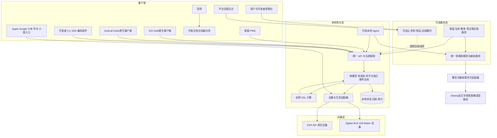

云服务与生态云入口失效时，本地控制仍按已验证授权运行。连接协议、用户入口和推理服务各有独立适配器，平台内部以同一设备模型和命令语义协作。

### 9.2 开发者交付链

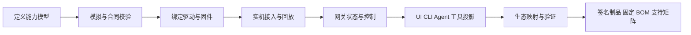

模型定义一次，经生成器和合同测试约束多端语义；每个生成物仍需验证消费者行为。第三方栈和密码库通过边界使用，不承诺芯片无线组件全部开放。

## 10. 用户故事

| ID | 角色与故事 | 价值 | 验收条件 |
| --- | --- | --- | --- |
| US-01 | 作为新开发者，我希望先用模拟设备跑通平台 | 无硬件也能评估与学习 | 按指南完成上报、控制、规则和结果查询 |
| US-02 | 作为固件开发者，我希望复用连接与生命周期组件 | 专注设备驱动与产品能力 | 新样板产品复用核心，设备身份不硬编码 |
| US-03 | 作为模型开发者，我希望一份定义贯通各端 | 减少多份字段与单位不一致 | 相同模型修订生成绑定，并通过共同向量 |
| US-04 | 作为适配者，我希望分析陌生硬件并保存证据 | 避免一次性猜测无法维护 | 型号、样本、映射、负例和实机结果齐全 |
| US-05 | 作为贡献者，我希望独立复现别人适配的型号 | 降低合作和维护成本 | 在记录的硬件/固件上重放并核对实物 |
| US-06 | 作为家庭所有者，我希望本地认领并配置设备 | 获得明确控制权 | 未绑定设备有物理证明，旧所有者权被撤销 |
| US-07 | 作为成员，我希望看到可信状态并控制获准设备 | 判断命令是否生效 | 实际、期望、过期、未知有区别，不能访问无权设备 |
| US-08 | 作为用户，我希望通过自然语言建立规则 | 减少查找语法与重复设置 | AI 生成草案，校验和模拟通过后明确部署 |
| US-09 | 作为用户，我希望断网时基础自动化照常运行 | 家庭自治 | 互联网、云和模型故障不影响已部署本地规则 |
| US-10 | 作为 Apple/Google 用户，我希望保留原入口 | 降低迁移成本 | 指定 Matter 映射完成发现、控制、回读与撤销 |
| US-11 | 作为米家等生态用户，我希望复用获准设备 | 保护已有投入 | 当前授权、地区、型号和接口可用性明确，失效可诊断 |
| US-12 | 作为安装人员，我希望获得临时维护权 | 完成交付而不永久接管家庭 | 权限有范围和期限，任务、审计和撤销可核对 |
| US-13 | 作为维护者，我希望安全更新设备并处理断电 | 降低升级造成的损失 | 签名和型号校验、启动确认、回滚与结果查询 |
| US-14 | 作为硬件团队，我希望形成可重复交付的套件 | 控制返工和售后成本 | BOM、测试、烧录、身份注入、包装与支持范围一致 |
| US-15 | 作为服务开发者，我希望 API/CLI 能恢复未知操作 | 避免重试造成重复副作用 | 原键和操作引用保留，恢复不创建新命令 |
| US-16 | 作为所有者，我希望随时撤销生态或 Agent 的访问 | 保持控制权 | 新请求被拒绝，订阅停止，凭据清理且审计可见 |
| US-17 | 作为孩子，我希望拼装模块创造会飞的玩具或对话萌宠 | 探索、创造与学习 | 在兼容实物和允许场地内运行，非法组合能解释并修正 |
| US-18 | 作为玩具商家，我希望组合硬件、角色、多模态服务和玩法 | 快速创造不同产品 | 组合包能被Agent理解、校验、模拟并形成明确交付范围 |
| US-19 | 作为家长，我希望配置孩子可用的能力、时长和内容 | 陪伴孩子并保留控制权 | 可查看、暂停和撤销会话，敏感媒体按政策处理 |
| US-20 | 作为机器人应用开发者，我希望复用感知、对话与长任务 | 专注产品行为 | 可查询进度、取消、暂停和人工接管，安全停止本地独立 |
| US-21 | 作为Agent，我希望从目标找到准确合同和证据 | 有界、可靠地推进开发任务 | 机器索引可定位Schema、样例、验证与原操作恢复 |
| US-22 | 作为教师或健身应用开发者，我希望复用平台构建场景 | 减少重复模型和设备工作 | 空间政策、媒体与主体隔离，复用同一能力合同 |
| US-23 | 作为开发者或Agent，我希望从官网和文档进入正确版本及控制台 | 减少发现、学习与开通断点 | 匿名阅读、机器原文、版本选择、模拟任务及云/NAS接入可连续完成 |
| US-24 | 作为平台运营人员，我希望通过独立后台维护官方云 | 管理接入和发布，保留家庭自治 | 当前运营权限、强认证、制品与审计可用；未获委托不能控制家庭设备 |

## 11. 完整用户用例

### UC-01：开发者首次运行模拟设备

参与者：开发者、CLI、模拟器、网关、本地控制台。关联 US-01/03，FR-01/04/13/22。

前置：支持的开发环境、独立实验家庭、示例模型；无真实设备和云账号要求。

主流程：阅读能力模型；启动实验环境；模拟设备握手和上报；控制台显示值、来源和时间；CLI 设置灯光属性；查询同一命令回执；加载一条规则并触发模拟事件。

异常：模型不匹配拒绝进入 ready；端口占用或身份缺失给出可定位诊断；模拟器数据标为模拟，不能混入实际家庭或真实设备支持结论。

后置：用户可解释模型、设备、状态、命令与规则的关系，并取得完整任务证据。

### UC-02：ESP 板卡接入为自有设备

参与者：固件开发者、烧录工具、ESP SDK、网关。关联 US-02/03/06，FR-02/03/10/23。

前置：明确板卡修订、引脚和供电，独立设备身份，示例物模型与驱动。

主流程：选择 BSP；绑定能力到驱动；构建并烧录；设备进入物理配网窗口；用户核对并认领；网关验证设备身份和模型；设备上报完整快照；完成属性读取、写入和重启恢复。

异常：不支持芯片或引脚冲突在构建/初始化时失败；重复身份拒绝；网络配置失败保留恢复入口；未认领设备不能控制家庭其他资源。

后置：身份与型号绑定可追踪，固件不持有全家庭管理凭据，接入结果进入型号档案。

### UC-03：适配一个 Zigbee/BLE/433 型号

参与者：适配者、实验设备、采集工具、AI 分析工具、协议适配器。关联 US-04/05，FR-07/15/23。

前置：合法持有并获准分析的设备，明确接入路径、接口来源、允许操作和用途；型号/PCB/固件登记，原始样本安全存储。

主流程：核对标准或厂商资料并确定映射范围；对需要分析的部分采集多个可控状态及边界样本；记录协议假设；AI 提出字段与编码候选；编写解析器和映射；以未参与分析的样本验证；接入网关；实机验证状态、控制、掉线和重连；由第二名开发者复现。

异常：接口或用途条件不足时记录缺口，允许继续的研究与交付范围分别说明；缺密钥、滚动码或无法解释字段时标记限制；单向协议没有确认则只记录发送证据；不把解析成功自动升级为完整控制支持。

后置：提交适配代码、映射修订、脱敏夹具、依赖许可和明确支持范围。

### UC-04：家庭成员控制设备并核对未知结果

参与者：成员、PWA/CLI、网关、适配器、设备。关联 US-07/15，FR-05/12/13。

前置：成员有当前设备动作权，型号支持该能力，网关可持久化命令。

主流程：用户查看当前观测；提交有期限的目标状态和幂等键；网关验证并保存命令；适配器发送；设备返回结果或网关受控回读；客户端显示阶段、证据和实际状态。

异常：超时后显示结果未知并保留 command_id；先查询原命令，不换键盲发；能力不支持、撤权、过期和修订冲突分别返回原因；非幂等动作不自动重放。

后置：期望状态与实际观测分别可查询；所有入口看到相同命令事实。

### UC-05：自然语言创建并部署规则

参与者：用户、Agent、Ollama、规则引擎、设备。关联 US-08/09，FR-06/14。

前置：用户可读相关设备且可管理规则，模型服务可用或允许手动编辑。

主流程：用户表达“走廊有人且亮度低时开灯”；Agent 获取有权限的设备能力；模型生成 DSL 草案；平台校验类型、引用、预算和循环；以夹具模拟；展示触发、动作和影响；用户部署固定版本；后续事件由本地引擎执行。

异常：设备含糊时请求用户选择；生成了不存在的能力则校验失败；推理超时保留草稿并可手动继续；规则部署后 Ollama 关闭不影响执行。

后置：规则版本、部署主体、模拟结果和每次运行的命令引用可追踪。

### UC-06：通过 Apple Home / Google Home 使用设备

参与者：所有者、目标生态控制器、Matter Bridge、网关、设备。关联 US-10/16，FR-21。

前置：指定控制器、地区、设备类型及桥接实现通过测试；家庭开启有期限的 commissioning 窗口。

主流程：用户选择可暴露设备和映射；确认可见范围；目标生态扫描配对；Bridge 绑定 Fabric 与获准设备；用户在生态入口控制；操作进入网关统一命令用例；实际状态通过订阅同步；撤销时删除对应访问与映射。

异常：未支持类型明确显示；过期配对码拒绝；已在其他 Fabric 中的设备按标准和用户授权处理；映射删除后旧订阅不能继续访问；状态回声不能再次触发相同动作。

后置：平台与生态入口显示一致的能力和观测来源，不承诺该生态全部类型和版本兼容。

### UC-07：接入既有小米、华为或小度生态能力

参与者：所有者、生态适配器、厂商授权服务或本地接口、网关。关联 US-11/16，FR-20。

前置：实际存在并允许本客户端使用的接口、申请资格和授权；记录型号、地区、固件与能力范围。

主流程：用户选择连接及范围；按官方流程授权或配对；平台保存受控凭据引用；发现允许读取的设备；映射能力与限制；用户选定导入；读取并控制实际允许的能力；展示云/本地依赖与状态时效。

异常：平台未开放、账号不符合或接口合同未知时保持研究候选；Token 失效后停止请求并引导原账号重新授权；第三方云断开时该适配能力降级，本平台原生设备继续自治。

后置：导入、控制、撤销和日志有证据；任何一个厂商路径成功都不扩大为其他厂商的兼容证明。

### UC-08：升级设备并从失败恢复

参与者：维护者、家庭所有者、OTA 服务、固件。关联 US-13/14，FR-11。

前置：可信签名制品、型号/分区/模型兼容、当前升级权，设备电量和空间满足政策。

主流程：核对版本与影响；创建升级任务；设备验证清单和镜像；写入备用分区；重启自检；确认新版本；网关保存结果并继续后续批次。

异常：签名或型号不符立即拒绝；下载中断可按支持策略恢复；启动未确认则回滚；连接丢失保留升级任务状态；不以“下载完成”展示“升级完成”。

后置：制品、签名、设备、版本和启动确认关联，失败样机有明确恢复路径。

### UC-09：安装人员交付并撤销委托

参与者：所有者、安装人员、家庭网关。关联 US-12/14/16，FR-10/17/19。

前置：套件 BOM 与支持范围明确；所有者本人建立家庭信任。

主流程：所有者授予指定设备和期限的安装委托；安装人员配网、测试和诊断；生成交付报告；所有者验收并撤销；安装人员的连接、会话和凭据停止获取新权限。

异常：委托过期或被撤销后立即阻断新动作；执行中的副作用按原操作核对；失联不自动延长委托；诊断包不包含家庭密钥和全屋私有数据。

后置：交付证据和支持信息保留，服务方不拥有永久家庭后门。

### UC-10：断网、重启与本地恢复

参与者：家庭用户、网关、设备、规则引擎。关联 US-09/15，FR-08/19。

前置：已部署规则和已配对设备，具备有效本地身份与必要时钟。

主流程：断开互联网、云和模型；设备仍向网关上报；本地规则触发并留回执；重启网关；加载状态与规则版本；恢复允许恢复的任务；重新核对设备快照。

异常：旧状态标 stale；过期控制与历史按键事件不补发；非幂等任务未知时不重试；磁盘不可写时停止可靠受理新控制并给出故障状态。

后置：本地自治与故障范围可由连续证据证明，重连云后只同步状态与原操作结果。

## 12. 业务流程图

### 12.1 硬件开发与适配发布

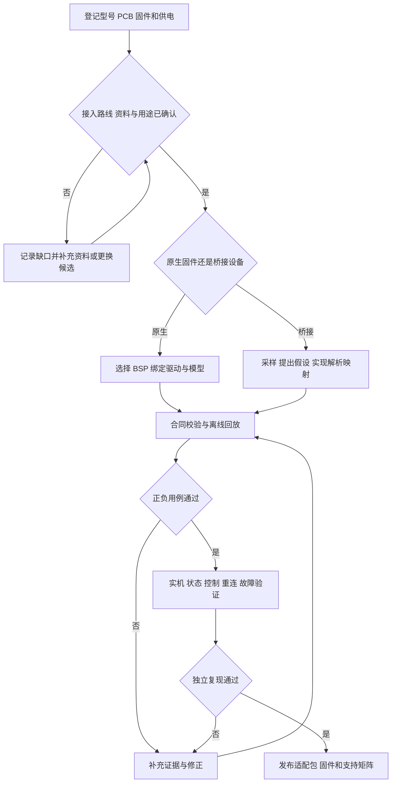

### 12.2 自然语言规则与确定性执行

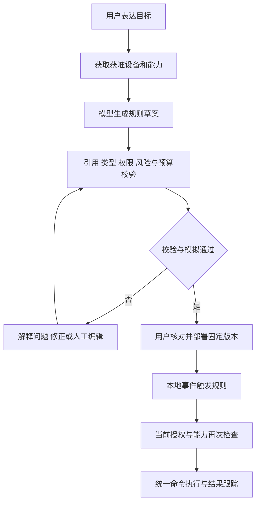

### 12.3 生态连接与撤销

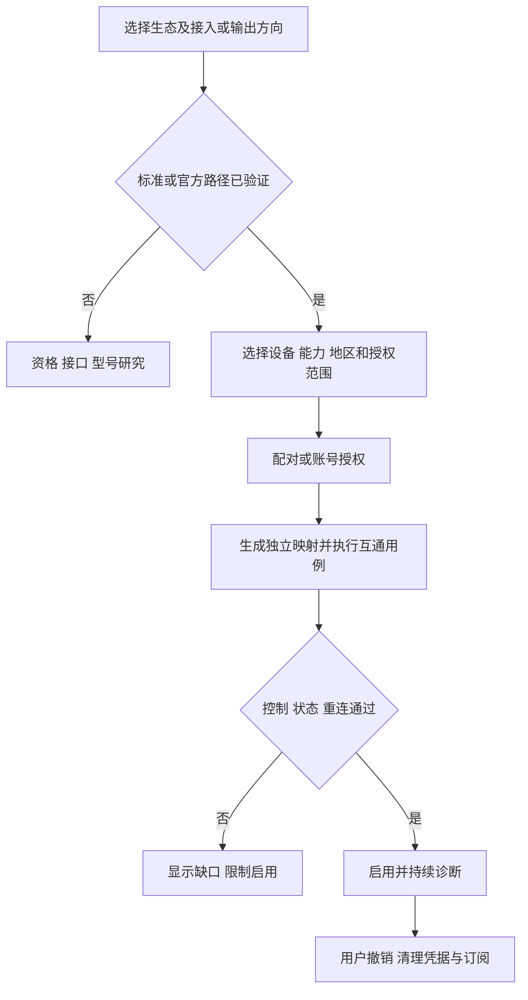

## 13. 关键时序图

### 13.1 原生设备认领与接入

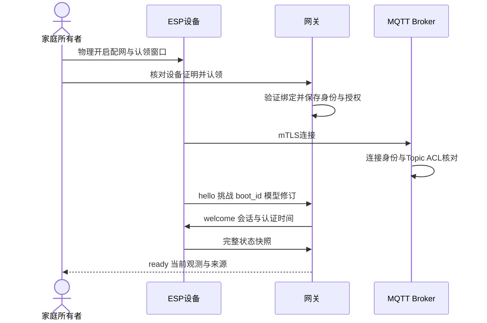

### 13.2 控制、超时与原操作核对

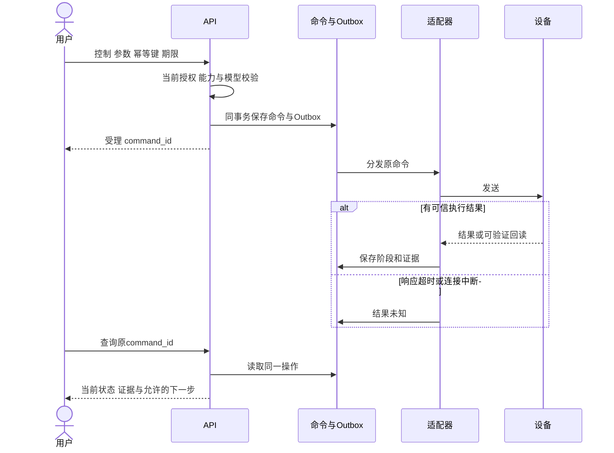

### 13.3 AI 规则生成与部署

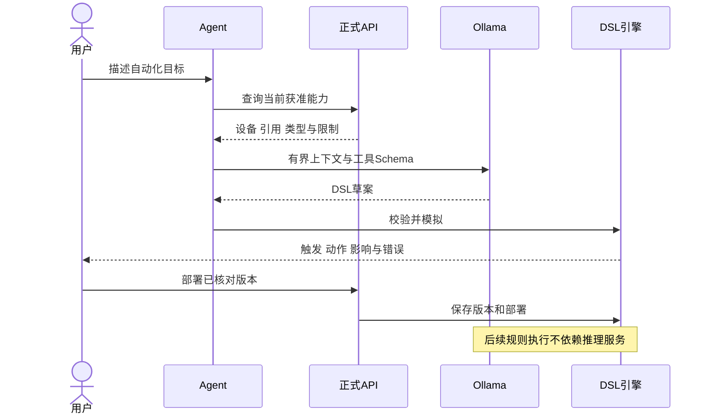

### 13.4 目标生态控制桥接设备

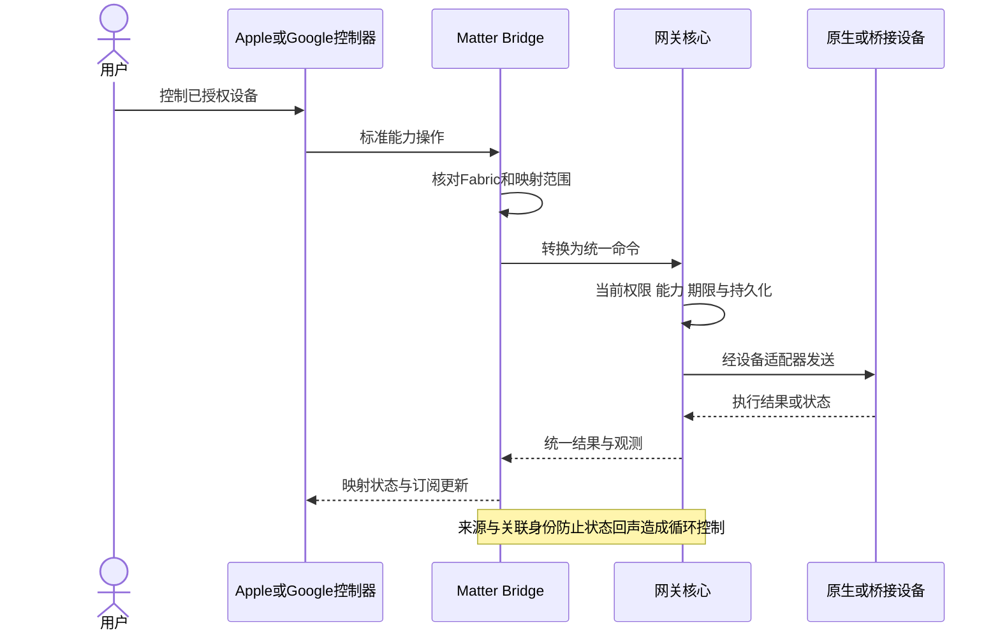

## 14. 非功能与安全要求

| ID | 要求 | 验证 |
| --- | --- | --- |
| NFR-01 | 核心独立，外部实现不泄漏类型 | 依赖检查、假适配器与替换实验 |
| NFR-02 | 关键状态和回执持久可恢复 | 事务、发送、执行和回执边界崩溃注入 |
| NFR-03 | 所有资源消耗有界 | 消息洪峰、慢消费者、推理超时和磁盘满 |
| NFR-04 | 最小权限和当前授权 | 跨空间、假设备、过期委托、撤销与生态越权 |
| NFR-05 | 隐私最小化 | 日志、上下文、诊断包及导出的敏感字段检查 |
| NFR-06 | 可重复交付与供应链可追溯 | 锁定工具链、摘要、SBOM、签名及固定BOM |
| NFR-07 | 版本和生态兼容可解释 | 模型、协议、映射、固件和控制器版本矩阵 |

设备唯一身份、标准密码库、有限入网窗口、签名升级、密钥轮换和撤销是首批可交付产品的基础。原生设备与弱身份桥接设备明确区分，不能向用户展示不存在的安全保证。

## 15. 分期与产品门槛

| 阶段 | 产品范围 | 进入下一阶段的条件 |
| --- | --- | --- |
| M0 设计 | 产品、规范、机器入口与设计夹具 | 需求、图示、索引与例子一致 |
| M1 AI开发底座 | 正式合同、CLI/工具、模拟设备与最小任务GUI/TUI | Agent独立完成发现、输入、模拟、查询与恢复 |
| M2 原生闭环 | 单空间单网关、三类低压样机、SDK、规则、身份和OTA；NAS版、官方云版、官网/文档/控制台/后台及文字AI | 原生任务、断网本地页面、升级恢复、双版本与Web入口授权分别通过 |
| M3 智能组合 | 多模态服务、会话、组合包、对话萌宠或互动教具 | 真实能力、预算、数据政策、停止与降级通过 |
| M4 协议与标准互通 | 指定Zigbee/BLE、Matter Bridge与Apple/Google；433/Controller分批 | 同模型跨实现、生态发现/控制/撤销通过 |
| M5 套件交付 | 双档独立网关、长任务、商家套件及具备资格的生态项目 | BOM、长稳、认证、安全、供货与售后满足 |
| 后续场景 | 教室、企业、健身和更多机器人应用 | 核心复用及场景专业门槛通过 |

实际排期、依赖与当前状态只在 [24](24-实施计划与进度.md) 维护。某生态资格受阻时保留主线开发，不以非官方身份或未验证接口替代该生态的交付条件。

首个产品切片为“桌面互动环境灯”：三块可采购C3板组成温湿度、按钮和灯光节点，分别验证NAS私有化版及Cloudflare + Railway上的LimeIoT官方云服务版。文字AI生成经过校验/模拟的规则草案；官方平台包含官网、开发文档、用户/开发者控制台和运营后台，并通过适配器接入LimeCloud账号与实际开放的模型服务。首期不实现语音/视觉全模态、飞行或多生态全接入。硬件/预算见 [19](19-硬件选型采购与BOM.md)，Web入口见 [15](15-客户端与交互设计.md)，完整范围、演示与退出门槛见 [29](29-MVP端到端落地蓝图.md)。

## 16. 商业模式与收益实现

开放核心采用 Apache-2.0。商业交付以开发套件、经过验证的场景套件、能力组合包、硬件适配、定制开发、部署和维护服务为主。可选云提供远程接入、托管分发或运维增值，不剥夺基础离线控制。

用户收益以节省接入、联调、交付和维护工时衡量；平台收益以套件毛利、项目服务、维护续约及社区复用衡量。成本包含样机、损耗、适配工时、认证、制造、售后、云资源和安全维护；开源下载量不等同于付费需求。

首批试点先验证开发者能独立跑通、适配可复现、用户愿意采用固定套件，再决定扩展产品品类。厂商官方标识和认证能力仅在实际获准后使用。

## 17. 范围边界与主要风险

本阶段不建设通用视频平台、任意脚本运行器、开放插件市场、多主网关或全品类消费设备。门锁、燃气等高后果执行器不作为首批自动控制样板。

关键风险包括：自研维护面过大、型号变更、封闭生态资格、密钥与升级安全、AI错误、供应链波动和售后成本。对应措施为小闭环、固定型号、分级兼容、成熟安全基础、确定性执行、替代料验证和交付门禁。

平台不承诺无线PHY/BootROM全部开源、不承诺所有现有设备可刷机、不承诺全部生态无条件互通、不承诺跨物理设备exactly-once。工程判断与决策在 [26](26-架构决策记录与风险.md) 维护。

## 18. 评审与验收入口

产品评审检查背景、目标用户、问题证据、机会假设、收益、范围与优先级；技术评审检查模型、权限、协议、适配器、状态与恢复；交付评审检查真实型号、版本、认证、供货、升级与售后。

验收按 FR/NFR → 用户故事 → 用例 → 合同 → 自动化检查/实机证据追踪。本文故事和用例是产品层基线，专项补充见 [17](17-用户故事与用例.md)；完整故障时序见 [18](18-关键时序与故障流程.md)，测试矩阵见 [23](23-测试策略与验收矩阵.md)。

## 19. 家庭、玩具、机器人与场景应用

### 19.1 品类地图与平台边界

| 品类 | 代表体验 | 复用的平台能力 | 应用负责的专业逻辑 |
| --- | --- | --- | --- |
| 智能家居 | 灯光、环境、门磁、本地联动 | 设备模型、规则、生态桥接 | 家居场景配置 |
| 组合玩具 | 会飞的角色玩具、会飞的汽车、对话萌宠 | 模块发现、组合约束、行为包、语音和视觉 | 游戏玩法、角色、故事、年龄适配 |
| 移动/服务机器人 | 清洁、巡游、取物、陪伴 | 设备能力、长任务、感知、媒体、状态和接管 | 路径规划、地图、动作控制及产品行为 |
| 教育与课堂 | 互动教具、实验、故事与探索 | 多模态、会话、设备反馈、空间和身份 | 教学设计、内容、学习评价 |
| 陪伴与心理支持 | 对话、情绪表达、家庭沟通 | 会话、语音、授权、有限记忆、服务转介接口 | 内容与服务质量、专业人员流程；专业咨询另按适用要求提供 |
| 健身 | 运动交互、动作反馈、设备联动 | 视觉/传感器、模型、任务、隐私与空间 | 运动指导、安全与专业判断 |
| 企业与其他空间 | 设施联动、服务机器人、交互终端 | 空间、角色、设备、任务和应用接口 | 企业业务、现场流程与行业约束 |

应用部署可在设备、网关或可选服务侧。平台提供稳定能力和接口，具体产品应用拥有自己的行为、内容与专业业务，避免把所有品类逻辑塞进网关内核。

### 19.2 组合玩具完整用例 UC-11

参与者：孩子、监护人、组合应用、模型服务、模块和网关。关联 US-17/18/19，FR-25/26/27。

前置：模块身份、机械与电气规格、实际能力和允许组合已登记；监护人设置使用者、场地、时长和动作范围。飞行体验使用具备真实飞行能力并通过相应测试的模块。

主流程：孩子拼装模块并表达“让汽车飞起来，听我说话”；应用发现模块与能力；Agent生成候选组合与玩法；平台校验供电、接口、机械、资源和动作限制；模拟展示行为；监护人按政策批准；发布有版本的行为包；玩具运行并通过语音/灯光解释状态；孩子继续修改或选择新玩法。

异常：没有飞行模块时解释所缺能力并提供当前可执行玩法；电量、场地、连接或监护策略不满足时限制相关动作；暂停和停止经本地控制实现，模型服务不可用时进入已定义的本地降级行为。

后置：组合、行为版本、会话和执行记录可查询；角色内容使用自有或已获授权资源，适龄内容与媒体政策随产品包发布。

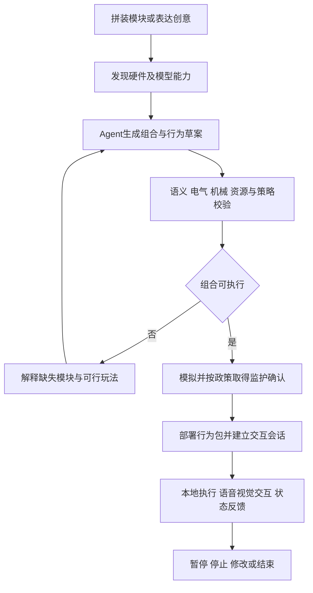

### 19.3 清洁与陪伴机器人用例 UC-12

参与者：空间成员、场景应用、任务服务、机器人本地控制器、播报服务。关联 US-20，FR-28。

前置：设备声明可用任务、地图/房间修订、暂停/取消能力和本地安全机制；当前用户获准发起任务，应用有对应设备与播报委托。

主流程：用户表达“孩子午睡后清洁客厅，完成后播报”；应用在当前空间查询设备和授权，生成有期限的任务计划，核对房间、时间与行为范围后提交；返回原 task_id；到时重验条件并启动；机器人本地执行运动和安全控制；网关跟踪任务进度、暂停、取消和设备结果；应用仅在核实完成后组合播报或后续互动。

异常：时间或完成条件不明确时补充输入；任务过期、地图变化、授权撤销或电量不足时拒绝/暂停并说明；断连与取消竞态保留原任务状态，不将“取消请求已受理”显示为“机器人已停止”。急停、避障和电机保护由设备本地实现，不能依赖云、网关推理或自然语言响应。

后置：任务终态、逐步命令、真实设备观测和播报结果分别可查询；未知任务按原引用恢复，不重建可能已执行的清洁任务。平台提供任务与接管接口，设备厂商/应用实现具体运动算法。

### 19.4 多场景空间模型

核心使用 Space、Actor、Device、Capability、Task、InteractionSession 和 Application。家庭是首个 Space 类型；企业、教室和健身空间以独立政策与应用扩展，避免将家庭关系硬编码进所有设备和API。首期一个主网关服务一个空间，跨空间与多租户扩展另行验收。

## 20. 多模态模型服务与 AI-first 交互

### 20.1 平台模型服务

统一模型目录声明能力类型、输入输出Schema、提供方、模型版本、部署位置、流式/异步支持、数据范围、资源与费用政策。平台按明确政策路由到独立提供方，Ollama负责其支持的推理类型，ASR、TTS、视觉和图像等采用各自适配器。

| 能力 | 输入与输出 | 组合示例 |
| --- | --- | --- |
| 文字推理与结构化生成 | 文本/上下文→文本、结构化结果、工具请求 | 玩具行为草案、设备诊断、规则生成 |
| 视觉理解 | 授权图片或有界片段→识别与解释 | 玩具识物、教具互动、场景理解 |
| 图像生成与处理 | 文本/图像→受控媒体引用 | 角色外观、故事配图、互动作品 |
| 语音识别 | 音频流/片段→文本与时间信息 | 玩具指令、无屏设备、课堂互动 |
| 语音合成 | 文本/声音配置→音频或流 | 萌宠对话、故事、任务播报 |
| 多模态组合 | 媒体、上下文和设备事件→有界任务结果 | 看图讲故事并联动灯光与玩具动作 |

图片、音频和视频通过媒体服务传递有权限的引用和受控流，MQTT只传事件、控制和引用。模型输出工具请求后，由当前空间的正式业务用例核验并执行；模型生成内容不自动成为设备命令。

### 20.2 能力组合包

开发者/商家发布的包包含用途、版本、设备与模型依赖、输入输出、行为流程、资源预算、媒体与内容政策、用户角色、年龄/场景限制、失败降级和测试夹具。Agent可发现、比较和组合这些能力；安装和部署分别核对依赖、授权、签名与实际可执行性。

第一版先支持同仓审核的包和明确发布者，再开放第三方分发。包的安装不授予摄像头、麦克风、机器人运动或家庭设备权限；新增权限与模型外发需明确政策与授权。

### 20.3 AI-first 开发用例 UC-13

参与者：开发者、编码 Agent、合同/模拟工具、构建系统和实机夹具。关联 US-01/18/21，FR-22/26/30。

前置：明确目标产品、任务范围、硬件/预算约束及允许使用的开发工具；工具发现只返回当前真正可用的能力，文档计划不算可执行工具。

主流程：开发者描述目标；Agent读取机器索引、需求与Schema；发现支持板卡、能力和组合包；生成模型、固件绑定、应用流程和测试；在隔离模拟环境执行验证；请求必要实物接线或授权；采集实机证据；在当前宿主呈现可审核差异、失败列表和交付包。

异常：Schema不匹配先修正再执行；缺少硬件、资格、依赖或密钥时精确报告缺口；中断后恢复原任务与构建输入；不得编造实测结果或把模拟通过当成实机支持。

后置：形成对应需求和固定输入的代码/合同差异、验证结果、失败/跳过和制品引用，发布动作遵守当前权限。交付依据是可执行合同与证据，不是生成代码数量。

### 20.4 GUI/TUI 与当前宿主内完整任务

参考 Lime Cloud 的任务交互：第一层在用户当前Agent宿主内完成发现、范围选择、输入/校验、差异、确认、执行、进度、结果和恢复；宿主支持时提供端内任务UI。未适配或不适合的步骤可由实际可用的内置浏览器接管，再回退可信资源URL。专用认证由本人按协议完成。

CLI提供稳定JSON/NDJSON、退出码、Schema、原操作引用和非交互模式；TUI用列表、文本差异和分步输入呈现同一任务；GUI用表单、时间线、媒体与可视化组合界面。表现层不维护第二套模型、权限、状态和命令。对于需要多步交互的任务，仅有JSON或链接不足以证明完整适配。

### 20.5 多模态陪伴用例 UC-14

参与者：孩子、监护人、萌宠设备、应用会话、平台多模态服务与模型提供方。关联 US-17/19，FR-25/27/29。

前置：设备具备实际摄录/播放能力；已确定参与者、监护政策、允许模态、提供方位置、预算和留存；摄像头、麦克风与生成内容分别有当前授权。

主流程：孩子向萌宠展示画作并讲述故事；应用按当前会话取得图片和语音使用权；平台执行识别、文字生成和语音合成；玩具以获准的表情、灯光或动作回应；可选生成故事插图并存入受控作品空间。

异常：媒体无权、预算不足或识别失败时说明并提供允许的文本/预置互动；模型断连按原调用查询或标未知，不静默切云；会话结束或用户切换后丢弃迟到工具请求，禁止串入另一人的记忆。模型故障不影响设备本地停止。

后置：调用、媒体、用量与设备结果关联同一有效会话；监护人能查看政策、暂停和删除允许删除的资料；云模型外发、长期记忆和内容留存均采用明确政策。

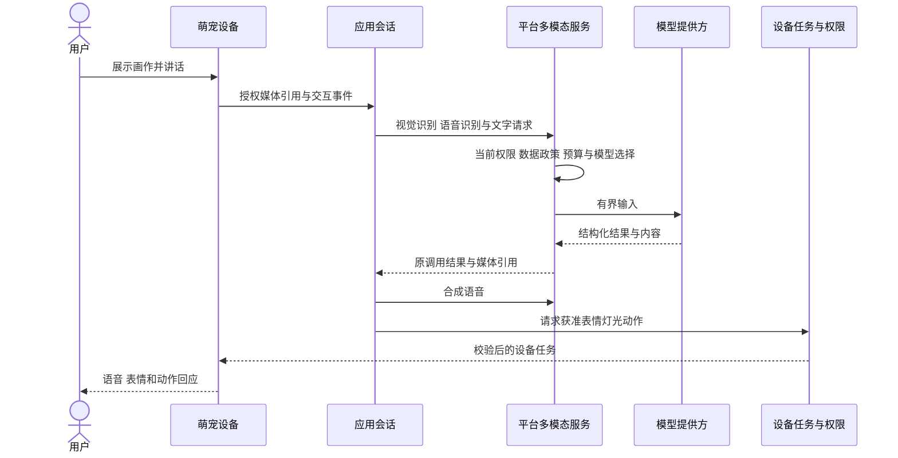
