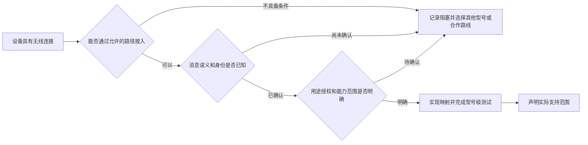

# 参考项目与技术调研

更新日期：2026-11-01。状态：只读研究记录。公开资料确认可见协议与许可语义，不代表平台实现、兼容或安全已经验证。

## 1. Lime Cloud 研究基线

参考项目为 Lime Cloud（`limecloud/cloud`），定位基线为提交 `2211899ead5a7a2d9ba0327bde567dfd419120ff`。研究范围包括 README、工程文档、CLI 动作合同和领域接口；下表为研究时工作树的设计观察，不作为该提交的逐字快照。

| 观察位置 | 已观察事实 | 采用方式 |
| --- | --- | --- |
| `docs/README.md` | 编号文档、唯一事实归属与阅读路径 | 建立本套目录与变更规则 |
| `docs/03-总体技术架构.md` | 模块化单体、部署与领域边界分开 | Rust 网关和可选云各自内聚 |
| `domains/application/api.go` | 消费方的小接口、领域门面 | 核心定义 Port，适配器实现 |
| `packages/cli/src/action-contracts.mjs` | 动作合同、Schema 投影和修订摘要 | API/CLI/Agent 共用语义合同 |
| `docs/26-开放文档与CLI.md` | 准备、确认、原操作与未知恢复 | IoT 控制命令及升级任务保留原引用 |
| `docs/33-平台产品知识与Agent读取.md` | 知识、Schema、方法和业务事实分离 | Agent 按需读取，不复制设备状态与授权 |
| `go.mod`、`package.json`、`apps/developer-console/package.json` | Go/Gin/MySQL驱动，React/TypeScript/Vite、pnpm工作区 | 沿用技术栈与模块化单体，IoT独立锁定依赖 |
| `railway.json`、`deploy/Dockerfile`、`docs/12-部署开发与交付.md` | Railway容器、显式迁移、ready检查；Cloudflare静态入口与受控代理 | 按当前需求采用Cloudflare + Railway，并额外支持NAS |
| `domains/identity/oauth_http.go`、`internal/bootstrap/models_api.go` | OIDC路由存在；Models依赖OAuth、Credits、提供方绑定及用户业务授权 | 先登录后按真实开通接模型，不能把应用Secret当作用户资源权 |

2026-11-01重新核对工作树及HEAD，定位提交仍为上述SHA；工作树中的设计/实现不等于该提交快照。已读其仓库规则和相关公开合同，未修改Cloud、读取生产凭据或执行生产调用。

沿用其后端/前端栈和用户指定的部署平台。IoT按官网、开发文档、Console、Admin和NAS本地家庭任务组织入口，复用组件与合同；微前端、财务领域及本地禁止Docker等项目专属限制不作为IoT依赖。NAS交付使用容器，LimeCloud通过公共协议集成。借鉴方法并重新撰写IoT文档，代码复用另行核对Apache-2.0声明和依赖。

## 2. 公开依据

| 来源 | 已确认内容 | 采用与限制 |
| --- | --- | --- |
| [MIoT 服务目录](https://miot-spec.org/miot-spec-v2/spec/services) | 服务有属性、动作和事件分类 | 借鉴语义结构，不继承小米标识及云依赖 |
| [MIoT 灯光服务](https://miot-spec.org/miot-spec-v2/spec/service?type=urn:miot-spec-v2:service:light:00007802) | 开关、亮度、色温等可选能力 | 标准能力需要按设备实际暴露 |
| [WoT TD 1.1](https://www.w3.org/TR/wot-thing-description11/) | 机器可读交互描述、数据与协议绑定 | 自有模型可生成 WoT 投影，暂不承诺完整符合性 |
| [华为全屋方案](https://consumer.huawei.com/cn/wholehome/wholehome-solution/) | 家庭计算/连接中枢及本地模型承载方向 | 不从产品宣传推断其内部总线、数据库或一致性 |
| [MQTT 5.0](https://docs.oasis-open.org/mqtt/mqtt/v5.0/os/mqtt-v5.0-os.html) | 会话、QoS、Will、消息期限等传输机制 | 应用命令身份和物理执行恢复由平台补足 |
| [ESP-IDF OTA](https://docs.espressif.com/projects/esp-idf/en/stable/esp32/api-reference/system/ota.html) | 多分区、启动确认、回滚及反回滚 | 具体芯片、版本与安全配置实施时固定 |
| [TI ZNP](https://software-dl.ti.com/simplelink/esd/simplelink_cc13xx_cc26xx_sdk/latest/exports/docs/zigbee/html/zigbee/znp_interface.html) | 外部主机经 UART 调用 NCP，Z-Stack 在芯片运行 | 自研主机驱动不等于自研全部 Zigbee 栈 |
| [connectedhomeip](https://github.com/project-chip/connectedhomeip) | Matter 标准 SDK，主仓 Apache-2.0 | 分离 Controller、Bridge 和 Thread 边界路由 |
| [Ollama tool calling](https://docs.ollama.com/capabilities/tool-calling) | 模型返回工具请求，宿主可回填结果 | 平台验证并执行工具；模型不直接连设备 |

以上依据为官方网页、规格服务或仓库。公开资料研究不包含这些系统的完整运行测试、华为闭源主机内部实现或本平台实物验收。

## 3. 许可与替换性

ESP-IDF 主体为 Apache-2.0，仓库内组件、子模块及无线二进制仍需逐项清点。Mosquitto 主仓提供 EPL-2.0 或 EDL-1.0/BSD-3-Clause 选择；最终按选定版本和发行物核对。

[zigbee2mqtt](https://github.com/Koenkk/zigbee2mqtt) 与 [zigpy](https://github.com/zigpy/zigpy) 主仓采用 GPL 系列；[rtl_433](https://github.com/merbanan/rtl_433) 主仓也有 GPL 义务。[zigbee-herdsman](https://github.com/Koenkk/zigbee-herdsman) 的主仓许可为 MIT，但仍是独立项目，其运行时与附属依赖需另核对。适配器或进程隔离不自动解除许可义务。

核心不依赖 HA 的实体模型、ESPHome 的固件编译流程或 zigbee2mqtt 的设备转换器。它们可用于公开行为研究与后续互操作，不把源码复制并改名作为自研。

## 4. 家庭平台与AI开发工具比较

| 对象与来源 | 本次确认 | 对平台的结论 |
| --- | --- | --- |
| [HA LLM API](https://developers.home-assistant.io/docs/core/llm/) | 提供工具定义、调用和自定义API，存在MCP接入路径 | 现有家庭平台已经支持结构化AI工具 |
| [HA MCP Server](https://www.home-assistant.io/integrations/mcp_server/) | 外部Agent可读取家庭状态并控制获准能力 | “提供MCP”本身不足以构成独特价值 |
| [HA Ollama](https://www.home-assistant.io/integrations/ollama/) | 外部本地Ollama支持会话，工具控制有模型与暴露范围要求 | 本地推理与受限设备工具是已存在路线 |
| [Open Home Foundation](https://www.openhomefoundation.org/) | 强调隐私、选择、可持续、本地工作和可选云 | 本地自治已有明确用户价值主张 |
| [ESPHome MQTT](https://esphome.io/components/mqtt/) | 固件可使用MQTT，另有Native API | 不能将ESPHome简单描述为只能依赖HA运行 |
| [openHAB文档](https://www.openhab.org/docs/) | Things/Items、规则、多协议及Apple/Google等生态入口 | 跨设备语义和互操作已是成熟竞争维度 |
| [ThingsBoard架构](https://thingsboard.io/docs/reference/architecture/) | 具备单体和微服务架构，设备与数据处理能力丰富 | 不以“现有IoT平台只能部署很重”作为机会依据 |
| [ThingsBoard MCP](https://thingsboard.io/docs/user-guide/mcp-server/) | 可通过工具访问设备、遥测、告警等平台资源 | 通用IoT平台也正在采用Agent工具 |
| [ThingsBoard CLI](https://thingsboard.io/docs/user-guide/cli/) | 支持Agent驱动构建设备/告警/看板；页面说明Cloud及PE版本条件 | 比较需明确产品版本，不能推断所有发行版均有此能力 |
| [OpenRemote](https://github.com/openremote/core) | 资产、协议Agent、规则、多租户、边缘与应用开发 | 模型、适配器与应用组合有成熟参考 |

因此机会假设聚焦：从板卡/陌生硬件到可验证产品的开发链、AI优先的合同与证据、模型与媒体和真实设备的组合、多生态及场景交付。是否优于既有方案仍需真实开发任务与用户试点验证。

### 4.1 Blinker / 点灯科技专项调研

核对日期：2026-11-01。范围为官网公开文档、官方 GitHub 组织、设备 SDK、App 源码、服务介绍及已登录开发者管理台；未购买服务、编译这些项目或执行实机测试。官网的首页、语音助手、专属设备、自动化和服务类型等5份正文与官方文档仓库内容一致。下列结论按具体组件、服务及版本区分，管理台逐页观察见4.2。

**采用结论：作为硬件快速接入、设备界面及AI辅助开发的对标项目；LimeIoT继续自研核心。** 它已形成较直接的“添加设备→获得密钥→刷入示例→App 控制”路径，有设备 SDK、App 源码及商业部署说明。管理台2026改版公告还计划提供MIT开源自部署版、AI编程与AI界面编辑；这些方向与LimeIoT存在重合，应列入持续比较。目前尚未获得足够的新版制品和运行证据，将“已宣布”视为“已交付”会夸大其现状，将旧版材料视为整个项目的最终边界同样不准确。

| 维度 | 已核实事实 | 对 LimeIoT 的意义 |
| --- | --- | --- |
| 定位与接入 | [官方首页](https://diandeng.tech/docs/000-首页.md)与[ESP32快速开始](https://diandeng.tech/docs/001-快速开始/01-esp32-WiFi接入.md)描述 SDK、App、云服务及设备组件布局，提供 WiFi/BLE 和 MQTT 等路径 | 学习最短可用路径、明确板卡要求、即开即用的界面和排错指引 |
| 设备 SDK | [blinker-library](https://github.com/blinker-iot/blinker-library) 根 LICENSE 为 MIT；有 Arduino、Python、JavaScript 等设备侧实现 | 设备接入已有实质代码；最终复用仍需逐项核对内置第三方组件许可 |
| ESP-IDF | [blinker-esp-idf](https://github.com/blinker-iot/blinker-esp-idf)公开提供组件；README列出 ESP-IDF 4.3/4.4，且有替换 HTTP Server 组件的集成要求 | 可学习移植和配网方式；不能据此声称当前 ESP-IDF 新版已可直接编译使用 |
| App源码 | [blinker-app README](https://github.com/blinker-iot/blinker-app/blob/master/readme.md)描述2.8.0-alpha重构版及 Ionic 7 / Angular 17 / Capacitor 5，说明部分功能仍在重构 | 有可研究的真实 App 实现，不能把测试源码等同稳定发行版 |
| App许可 | 同一README同时写“GPL v3”和“不可用于商业用途”，并限制图片、音频等资源用于其他项目 | GPLv3本身允许商业使用；额外限制与该表述存在冲突。未经澄清，不把App及资源作为可直接商用复用的代码包 |
| 后端与部署 | [商业部署说明](https://diandeng.tech/docs/070-独立部署与使用/002-商业版安装部署.md)提供自有服务器路线；核对时[blinker-broker](https://github.com/blinker-iot/blinker-broker)只有三份说明类文件；管理台公告计划新增MIT开源的 `diandeng-lite` | 商业部署和新版开源计划均有官方依据；新版源码、许可文件、部署入口及完整性尚待取得和验证 |
| 局域网 | 首页明确同LAN设备走局域网，其余走MQTT；Arduino MQTT适配器可见mDNS与WebSocket实现 | 应承认其具有局域网控制路径，同时单独验证离线启动、认证、重启和规则生命周期 |
| 自动化 | [自动化页](https://diandeng.tech/docs/005-功能/11-智动化.md)标注“本功能处于测试阶段，暂不提供”；保留的接口说明还涉及向服务器上报触发 | 不列为已验证的可交付本地自动化引擎 |
| 语音生态 | [语音助手接入页](https://diandeng.tech/docs/007-语音助手接入/00-接入说明.md)顶部明确“该服务于2025年7月1日已下线”，下方仍保留天猫精灵、小度、小爱及商业模块的历史列表 | 不把历史SDK宏、示例或名单宣传成当前小米/Apple/Google等生态可用性 |
| 产品化服务 | [专属设备页](https://diandeng.tech/docs/009-专属设备开发/00-开发说明.md)及授权额度页标注自2024年1月1日起下线 | 历史产品发布、批量授权与配网流程可研究；当前能否新开通商业同类服务须另确认 |
| 价格 | [服务表](https://diandeng.tech/docs/099-服务与授权/00-服务类型.md)仍列99元/年与企业版9万元起；管理台改版公告写新版预计2元/月/设备，含AI编程及其他服务 | 旧版页面价格与新版预计价格分开记录，均不充当本次未核对的当前成交报价 |
| AI-first | 管理台公告计划AI编程服务、AI界面编辑器及Blockly教育库；本次未查看到这些新版工具的实际任务入口或完整合同 | AI辅助研发已有官方方向；平台级Agent CLI、MCP、恢复和运行时多模态服务分别验证，不把AI编程服务等同设备智能运行体系 |

**局域网与本地自治的证据边界。** 观察设备库 `c73abe1a091733c62152ddb3c6ff7b1820705b18` 的 [`src/Adapters/BlinkerMQTT.h`](https://github.com/blinker-iot/blinker-library/blob/c73abe1a091733c62152ddb3c6ff7b1820705b18/src/Adapters/BlinkerMQTT.h)：默认Arduino MQTT路径在 `connectServer()` 成功后调用 `mDNSInit()` 启用局域网服务，鉴权路径使用 `/api/v1/user/device/diy/auth`。这证明该路径有云鉴权引导依赖，不能用“同LAN走WebSocket”证明它支持断公网冷启动。BLE、自定义服务器及其他SDK路径分别评估，源码观察不替代实机故障实验。

**通信与运行合同。** 官方[MQTT通信说明](https://github.com/blinker-iot/blinker-doc/blob/master/docs/020-相关接口/001-设备上线与通信%28MQTT%29.md)公开了鉴权、Topic、消息转发、组隔离及限流：适用其自有Broker的文档上限为每秒1条、每条不大于1024；不能外推到BLE或全部商业部署。可学习简单的组件Key与收发接口，但高频遥测、媒体、命令期限、会话、去重和完成证据需要按LimeIoT自己的合同实现。

**维护与版本。** 核对时设备库 `library.properties` 为0.3.12，而[GitHub Latest Release](https://github.com/blinker-iot/blinker-library/releases/tag/0.3.9)为2022年发布的0.3.9。组织元数据的 `pushed_at`、默认分支提交、包内版本和Release分别记录，不能用某一个日期代表所有组件与托管服务的活跃程度。公开App、服务列表和功能公告存在不同版本口径，选型时优先核对具体功能页、可获取制品和实际行为。

对LimeIoT的具体输入：第一阶段就提供可模拟的板卡到控制界面路径；从正式物模型生成工具和基础设备面板；将首次接入诊断作为产品能力；保留通用组件与商家定制界面入口；本地身份、认领、控制、规则、重启恢复和升级均做无公网验收；生态能力按当前资格和型号提供证据，历史兼容名单不作为交付依据。以上细化既有FR-08/12/13/20/21/22/23/30，不新增一套平行需求。

### 4.2 开发者管理台交互调研

观察日期：2026-11-01。使用Computer Use在已登录的普通用户会话中逐页查看可见导航、列表分类、菜单及表单。仅进行导航、筛选与打开/关闭表单，未创建资源、修改账户、发送验证码、读取密钥、下单或执行设备动作。报告不保存账号、手机号、订单明细或会话凭据。

本节的“已观察”表示对应页面或表单实际可见；空列表不能验证详情功能或后台写入结果。“公告计划”表示官方已宣布的方向，不等于已上线；“待核实”表示账号数据、权限、制品或实机条件不足。分析范围是该账号可见入口，不将菜单缺失外推为整个平台不具备相关能力。

#### 4.2.1 全部可见导航与覆盖范围

| 页面/入口 | 已查看的功能、字段与表现 | 观察范围 |
| --- | --- | --- |
| [首页 `/index`](https://admin.diandeng.tech/index) | 用户组/有效期/关联账号区域、改版公告、服务状态、资讯、存储可用性及API额度 | 普通用户角色；额度与状态是该会话的页面显示，未测后台服务 |
| [设备管理 `/device`](https://admin.diandeng.tech/device) | 所有设备、自有设备、专属设备三个页签均切换；按设备id检索入口；表格含设备id、类型、名称、接入模式、用户、地址、添加时间 | 三类列表均为空；未见当前页添加设备入口，详情和设备操作待有样本时核实 |
| [数据管理 `/data`](https://admin.diandeng.tech/data) | 按设备id检索；字段为设备id、存储key、数据点、存储时长（天）、添加与更新时间 | 空列表；图表、数据内容、导出、保留修改及分页行为未获验证 |
| [产品开发 `/product`](https://admin.diandeng.tech/product) | 产品名称/产品类型搜索；表格含产品名称、类型、接入模式、接入数量、开发者、创建时间；可打开新建产品表单 | 空列表；表单可打开，不表示创建或正式上线成功 |
| 新建产品表单 | 弹窗标题“新建设备类型”；必填接入模式、设备名称、设备类型，描述可选；模式下拉实际展开后只见 `mqtt`；有“添加”按钮 | 未输入或提交；设备类型为文本输入，未见该表单中的物模型定义或能力校验 |
| [订单管理 `/order`](https://admin.diandeng.tech/order) | 序号、订单号、产品、数量、金额、创建者、创建时间及可用操作列 | 空列表；该页未见创建订单或购买入口，不推断完整结算流程 |
| [账户信息 `/profile`](https://admin.diandeng.tech/profile) | 由头像菜单进入；显示用户信息/用户组；提供修改密码与修改手机号入口 | 只记录结构，不保存个人标识 |
| 修改密码表单 | 旧密码、新密码、重复输入以及修改按钮 | 仅打开后关闭，无凭据输入或变更 |
| 修改手机号表单 | 原手机号及验证码、新手机号及验证码，两处获取验证码按钮和修改按钮 | 仅打开后关闭，未发送验证码或修改绑定 |
| 全局菜单 | 头像菜单含账户信息、退出；语言菜单可展开English选项，当前为简体中文 | 未退出或切换设置，英文覆盖与翻译质量未测 |
| 外部入口 | 开发文档、官方GitHub、资讯“更多”；公告含旧服务退费/迁移登记链接 | 识别入口；额外通过管理台给出的官方GitHub入口核对新版仓库，未提交登记表 |

#### 4.2.2 2026改版公告与竞争定位

首页公告标题为“关于点灯物联网服务全面改版的通知”，落款2026-01-23，正文使用计划、预计等措辞。主要内容如下：

| 公告事项 | 观察到的内容 | 当前证据等级 |
| --- | --- | --- |
| 运营主体 | 宣布新主体为深圳一语深成科技有限公司 | 官方公告；本次不核验工商或实际迁移状态 |
| 订阅 | 免费版继续服务；收费版计划按月订阅，预计2元/月/设备，附带AI编程等服务 | 预计方案，不是已完成购买验证的现价 |
| 旧版退出 | 新服务上线后停止旧版销售，计划2026-12-30完全停止老版本服务，并给出旧用户转换/退费安排 | 迁移计划；未验证执行进度或办理流程 |
| 开源服务端 | 宣布MIT协议的 `diandeng-lite`，可独立部署并使用点灯App | 已宣布；未获得该项目的可验证源码、许可正文及部署结果 |
| App自部署 | 计划允许用户自由配置URL、接入自有服务器 | 已宣布；本次管理台中没有实际App安装与连接验证 |
| AI交互开发 | 计划提供结合AI的新版界面编辑器 | 已宣布；未观察到编辑器或生成、预览、发布的实际任务 |
| 设备库 | 计划完全更新 `diandeng-library`，兼容已有API并降低Flash/RAM占用 | 已宣布；资源收益和兼容性未实测 |
| 教育开发 | 宣布提供 `aily blockly` 图形化开发库 | 已宣布；未验证编辑、代码生成、烧录及教育硬件支持 |

通过管理台链接进入 `blinker-iot` 官方组织，使用仓库筛选框检索 `diandeng`，页面只返回 `diandeng-config-editor`，没有返回上述新版服务端或设备库。同名项目可能位于其他主体或尚未公开，此结果只限定该组织及本次检索，不证明项目在所有位置均不存在。

因此点灯应同时作为传统接入体验和“开源自部署＋AI辅助研发”方向的对标对象。LimeIoT的机会必须通过完整开发任务、自有核心、真实硬件和运行时多模态组合验证，不能建立在“点灯没有AI或没有开源计划”的断言上。

#### 4.2.3 页面与资料的一致性

| 对象 | 当前看到的信号 | 分析结论 |
| --- | --- | --- |
| 语音助手 | 首页对天猫精灵、小爱、小度显示绿色状态；公开接入文档顶部写2025-07-01下线 | 服务健康标记、商业开通资格、具体设备兼容和真实调用必须分开。绿灯不能推翻下线公告，也不足以证明任一生态可用 |
| 产品化 | 公开专属设备文档写2024-01-01下线；管理台仍能打开新建产品表单，当前专属设备额度为0 | 页面入口存在与允许创建、授权额度和可上线是不同事实；不能据其中一个信号认定整条产品化链路可用或不可用 |
| 收费 | 公开服务表保留年费与企业版价格，首页公告另给新版按设备月费预期 | 必须带版本、阶段和当前可购买范围解释价格，避免将旧套餐与未来方案拼成一份报价 |
| 开源许可 | 当前App README有限制和冲突表述，公告另称服务端lite版采用MIT | 两者是不同组件和阶段；新版服务端的MIT计划不自动改变旧App或素材的许可 |
| 服务状态 | 主服务为红色标记，API/Broker/中介/订单为绿色；页面仍能加载 | 只记录状态显示。本次没有检查时间、故障原因或独立探测结果，不能宣称服务中断或可用性已验收 |
| 存储与额度 | 实时、文本时序、地理时序显示不可用标记，页面另列设备、气象、时序及通知额度 | 区分服务能力、套餐权利、已用配额和数据实际存在；缺少业务记录不能验证其读写 |

#### 4.2.4 产品结构与使用体验

可见信息架构围绕产品类型、设备实例、存储记录、订单和账号展开，适合管理已有资源。产品类型与设备实例分开、按存储key管理记录、显示配额和服务状态，都是值得保留的工程概念；是否有更完整的领域模型或内部服务边界不能仅由这些页面推断。

| 观察 | 对使用者及Agent的影响 | LimeIoT对应改进 |
| --- | --- | --- |
| 多个首访列表只显示“暂无数据”，缺少内嵌下一步 | 新开发者需要到App或外部文档寻找接入起点 | 空状态直接提供模拟设备、选板卡、读取Schema、运行首个任务及诊断路径 |
| “新建产品”“新建设备类型”“设备名称”混用 | 产品定义与实际设备实例的关系不够清楚 | 产品模型、产品发布、设备实例、空间绑定使用一致名称和独立合同 |
| 公告位于固定高度内容区，首屏裁切重要迁移文字 | 用户可能先看到旧版入口和服务绿灯，遗漏迁移条件 | 用版本化能力状态和有明确日期的产品通知展示生效范围，相关入口同时解释限制 |
| 服务状态缺少可见的探测时间、原因与能力范围 | 人和Agent难以据此决定重试、开通或执行 | 健康、权限、支持矩阵、业务结果分别返回时间、来源、原因和下一步 |
| 搜索按钮无可读名称，头像为未命名图像，接入模式为只读输入式自定义控件 | 可访问性与Computer Use定位成本增加；直接点击输入框不能展开选项 | 保留正式CLI/API/工具入口，GUI/TUI补全标签、控件语义和键盘操作 |
| 中文界面保留Development、Services、Others等英文组名 | 语言体验不一致，机器名称与显示名称的职责也不明确 | 固定operation_id与字段码，显示文字经统一资源管理；语言选项存在不等于翻译已验收 |

本次未观察到内嵌Agent工作台、模型媒体调用、组合包、规则模拟、原命令恢复、网关诊断等入口。这是普通账号可见页面的范围描述，不据此否定其其他产品、App、私有模块或后续版本。

#### 4.2.5 对LimeIoT的实施输入与未覆盖项

| 对标任务 | 关联既有需求 | 工程与验收归属 |
| --- | --- | --- |
| Agent从空仓/空空间到模拟设备控制与原结果查询 | FR-13/22/30 | 16/21/29，M1先实现合同、工具及最小任务UI |
| 正式能力定义生成基础面板，产品定义和设备实例分离 | FR-01/12/23 | 04/05/08/15/16，CLI与GUI消费同一合同 |
| 从板卡、BOM、驱动到配网与故障诊断连续完成 | FR-03/15/19/22/23 | 08/19/20/28/29，模拟与实机分别举证 |
| 本地运行不依赖运营方套餐、云鉴权引导或服务迁移 | FR-08/10/16/19 | 12/14/22/23，断公网认领、重启、规则、控制与恢复分别验证 |
| 当前可用能力准确反映资格、型号、地区、角色和证据 | FR-18/20/21 | 16/27/30/31，公告和计划不进入可执行工具目录 |
| AI研发辅助与设备运行时智能各有完整任务和恢复 | FR-14/25/26/27/29/30 | 11/15/32/33，模型提供方、媒体和会话独立治理 |

未覆盖：有资源后的产品/设备详情、物模型编辑、密钥生命周期、固件与OTA、日志、设备影子、图表/导出/分页、订单付款/退款、其他角色权限、跨账号隔离、实际MQTT与设备控制、新版自部署、App及AI编辑器。这些项目需要相应测试资源、权限、制品或实物；不能通过猜测路由、创建生产资源或将按钮存在当作成功来补齐证据。

当前交付是可见界面与资料的一致性分析。没有产品创建成功、设备接入、付费服务或新版开源程序部署的完成声明。

### 4.3 小米 IoT、MIoT Spec 与 Vela/openvela

核对日期：2026-11-01。通过 Computer Use 查看用户指定的 [Vela](https://iot.mi.com/vela)、[IoT 首页](https://iot.mi.com/)和[文档中心](https://iot.mi.com/v2/new/doc/home)，并阅读官方 openvela 概览、开放能力、接入方式、企业开发者、Spec、标准扩展程序、固件配置、产品上线及日志查询正文。未注册企业、签署协议、申请资源或测试设备；Linux OT SDK 正文受到企业组门槛限制。

#### 4.3.1 产品层次与采用范围

| 对象 | 官方资料确认的定位 | LimeIoT 的关系 |
| --- | --- | --- |
| Vela/openvela | [官方概览](https://doc.openvela.com/document?id=198&version=trunk&language=cn)明确基于 Apache NuttX，提供设备内核、驱动、连接、图形、多媒体、系统服务及工具；Vela 页面还展示端侧 AI 与异构多核能力 | 属于设备基础系统。LimeIoT 在这些系统之上提供 IoT 接入与应用能力，首期仍选 ESP-IDF，后续按产品需求适配 |
| 小米 IoT / 澎湃智联 | [开放能力](https://iot.mi.com/v2/new/doc/introduction/openness)面向消费硬件企业和服务商，提供米家、小爱、互联、开发、认证与运营服务 | 研究物模型和产品化闭环；商业生态连接通过独立适配器与当前资格实现 |
| MIoT Spec | [协议详解](https://iot.mi.com/v2/new/doc/introduction/knowledge/spec)定义设备、服务、属性、方法和事件，以及实例标识和交互约束 | 借鉴能力语义与版本治理；自有模型保持独立，MIoT 标识只用于适配映射 |

openvela 概览声明整体以 Apache-2.0 为主，各仓库以根 LICENSE 为准，vendor 和第三方组件保留独立许可。其模拟器、可追溯发布版本和调试工具是开发体验参考。采用开源设备 OS，与取得米家或其他商业生态的账号、API、认证及品牌使用资格是独立事项。平台系统分工唯一规范见 [03](03-总体技术架构.md)，本调研不新增设备 OS 建设任务。

#### 4.3.2 官方文档中的产品工程闭环

| 主题与来源 | 已确认内容 | 对 LimeIoT 的输入 |
| --- | --- | --- |
| [Spec](https://iot.mi.com/v2/new/doc/introduction/knowledge/spec) | Property 的类型、读/写/通知、范围、枚举、单位；Action 输入输出；Event 参数；Device 聚合 Service。实例有 debug/preview/released 状态，上线后要求兼容演进 | 能力合同同时服务固件、工具、规则与界面；发布修订需要兼容检查与设备证据，不能只存自由文本 |
| [标准扩展程序](https://iot.mi.com/v2/new/doc/plugin/standard-plugin/standard-plugin) | 标准 Spec 与平台配置驱动功能/UI生成，支持参数、文案多语言及定制；文档明确未覆盖全部标准功能 | 从同一模型生成基础设备面板；复杂玩具/机器人保留场景交互，明确未映射能力 |
| [固件配置](https://iot.mi.com/v2/new/doc/configuration/firmware/firmware) | 区分模组+MCU、SDK、独立模块等开发方式；关联功能版本；固件版本、签名、HTTPS、测试范围、必经升级和正式发布分别管理 | 制品、模型兼容、设备升级任务分开；借鉴版本与测试闭环，具体安全机制按本平台合同验证 |
| [企业开发者](https://iot.mi.com/v2/new/doc/configuration/signin/create-enterprise) | 当前文档要求企业资料、实名认证、合作协议和审核，并写明仅向中国大陆注册成立的公司开放；账号可加入不同企业组并分配角色 | 这是商业厂商接入条件，不能把有小米账号当作具备产品开发权限；LimeIoT 原生开发主链独立运行 |
| [产品上线](https://iot.mi.com/v2/new/doc/configuration/publish-product) | 服务器/地区、配置检查、质量资料、固件/扩展程序版本、服务单、自测、样机、功能与安全审核；新地区需要对应上线流程 | 将可开发、可调试、可上线和可商业交付分别验收，能力清单记录地区与资格 |
| [日志查询](https://iot.mi.com/v2/new/doc/configuration/others/log) | 通信、上下线、绑定、配网、扩展程序崩溃、消息和场景执行等诊断；限制当前企业与产品权限，页面说明仅查近7天 | 建立认领到执行的关联诊断和按权读取；保留期由本平台用途与资源确定，不照搬固定天数 |
| [Linux OT SDK](https://iot.mi.com/v2/new/doc/embedded-dev/linux-ot/quickstart) | 当前会话显示“暂不支持该文档开放，需先注册企业组” | 未取得 SDK 合同与实现，不能将其宣传为已验证的任意米家设备本地网关接口 |

#### 4.3.3 接入方向与实质性限制

[选择接入方式](https://iot.mi.com/v2/new/doc/introduction/preparation/access_mode)给出直连接入和云对云两条产品接入路线。直连通过小米模组/SDK；云对云由开发者自有云承担配网、绑定与控制。页面明确写道：开发者自建 App 只能控制自己的硬件产品，无法控制接入平台的其他产品；云对云目前采用限制性准入，仅对受邀伙伴开放。

文档同时区分云对云1.0与2.0：1.0主要提供小爱语控，2.0增加米家展示和扩展程序控制；能力表仍将云对云的设备互联互通列为不支持。接入路线应按版本、能力与伙伴协议判断，不能将“提供OAuth”解释为公开任意设备控制API。

当前直连文档列 Wi-Fi、BLE、BLE Mesh，并说明平台不再推广 Zigbee 接入方案，传感器推荐 BLE。这是该平台的新增接入路线说明，不等于市场 Zigbee 设备全部停用或不再值得适配。

结论是学习其“定义产品→实现固件/UI→测试→认证→上线→运营”的闭环，同时分别核对“让自有产品进入米家”和“将其他厂商米家设备导入LimeIoT”的权利与接口。详细兼容路线维护在 [31](31-多生态兼容与开放接入.md)。

### 4.4 组态王 KingView 与工业组态经验

核对日期：2026-11-01。[亚控官方产品页](https://www.kingview.com/pro_info.php?num=1002019)将 KingView 定位为工业生产现场可视化与控制软件，列出设备采集驱动、图形控件、报警、报表、趋势、历史数据、脚本、模板、多端和对外接口，包括 MQTT、HTTP/Web Service 等。页面还展示权限、冗余、诊断与服务能力。本次未安装软件或验证厂商宣传的规模与性能。

“组态”可理解为通过配置设备、变量、画面和规则搭建应用；SCADA 是工业数据采集与监控系统。与家庭 IoT 在设备抽象、适配、事件、画面和规则上有共同基础，但目标用户、产品交付、实时约束和设备生态不同。KingView 的存在说明设备平台与低代码组态有长期积累，不能据此推断家庭/玩具平台已无机会，也不能仅凭加入对话或看板证明新平台具有差异。

LimeIoT 应学习驱动资产、模板复用、可诊断执行及长期交付；其 AI-first 合同、原生产品开发链、多模态和模块组合的实际收益，仍需通过试点任务证明。首期不扩展为通用工业控制或 SCADA 替代项目。

## 5. 生态接入调查

| 来源 | 已观察事实 | 证据限制 |
| --- | --- | --- |
| [Apple Matter](https://developer.apple.com/apple-home/matter/) | iOS具备Matter支持与跨生态配对相关机制 | 不证明可读取Apple Home全部资产或本平台已认证 |
| [Google支持类型](https://developers.home.google.com/matter/supported-devices) | 页面明确描述Matter Bridge中的设备及类型限制 | 指定控制器、地区和类型仍需实测 |
| [Google Cloud-to-cloud](https://developers.home.google.com/cloud-to-cloud) | 官方设备云接入、账号关联与OAuth授权码流程 | 需要开发项目、资格、测试和认证 |
| [小米官方HA集成](https://github.com/XiaoMi/ha_xiaomi_home) | 指定中枢本地模式和部分LAN路径，有地区/版本/类别限制 | 不代表所有小米设备均可本地接入 |
| [小米集成许可](https://github.com/XiaoMi/ha_xiaomi_home/blob/main/LICENSE.md) | 集成及相关API限定非商业Home Assistant用途，其他用途不在授权内 | 只能作公开行为研究；平台需独立获准路径 |
| [HarmonyOS设备平台](https://device.harmonyos.com/cn/) | Connect伙伴、开发工具及认证路线公开可见 | OpenHarmony开放不等于商业生态API开放 |
| [小度入口](https://dueros.baidu.com/) | 官方页面可访问 | 本次未取得完整现行智能家居技能/API合同，不据此推断可用性 |

多生态具体路线、方向与分级统一见 [31](31-多生态兼容与开放接入.md)。

### 5.1 “生态封闭”的工程含义

设备能联网、第三方能理解消息、第三方能通过鉴权，以及平台有权将其用于产品，是不同条件。Wi-Fi、BLE、Zigbee 或 MQTT 的名称本身无法证明后面几项。

| 环节 | 可能遇到的限制 | 项目应核对的事实 |
| --- | --- | --- |
| 硬件与固件 | 烧录口未开放、安全启动、Flash加密、板卡版本变化 | 芯片/PCB/BOM、可用SDK、驱动文档、官方烧录与恢复能力 |
| 设备应用协议 | 私有GATT、厂商Cluster/数据点、专有报文与校准 | 型号实际服务、字段、单位、命令及状态回执 |
| 身份与所有权 | 配对、绑定密钥、证书、设备认领 | 用户当前授权及允许的密钥获取/配对流程；加密本身是必要安全能力 |
| 云与账号 | 只连厂商云、限流、地区、接口更新与Token失效 | 公开API或伙伴协议、账号关联与撤销、离线边界 |
| 产品与商业权限 | 企业准入、认证、SDK许可、专用客户端用途限制 | 对应产品、主体、地区和发行方式是否获准 |

例如，同为 Zigbee 的两个灯可能都使用标准开关 Cluster，其中一个仍有私有属性与配对行为；同为 BLE 的传感器可能分别使用公开广播和带绑定密钥的加密广播。需逐型号判定，不能笼统地将整个品牌定义为开放或封闭。

厂商维护身份、签名、认证和权限，具有安全、质量与责任方面的合理需求；生态也可能通过模组、云服务、渠道和服务合同形成商业绑定。它们是需要逐项验证的不同原因，不能把全部鉴权视为恶意封锁，也不能把“开放合作平台”理解为任何人可任意控制全部资产。

### 5.2 逆向、研究与长期产品路线

公开协议开发、授权合作、合法取得样品的行为研究、复制他人程序，以及越权访问服务是不同活动。仅凭平台存在第三方适配，无法判断其是否依赖破解或已经获得授权；市场与个案结论需要具体公司、型号、协议和行为证据。

最高人民法院知识产权法庭发布的[《计算机软件保护条例》](https://ipc.court.gov.cn/zh-cn/news/view-407.html)第6条区分软件表达与思想/操作方法，第17条规定特定学习研究用途；第24条也规定未经许可复制、传播及故意避开或破坏软件著作权保护技术措施等行为的责任。这些条款不能单独推出任意逆向、绕过设备/云鉴权或商业分发均被允许。实际还涉及合同、专利、商业秘密、数据及网络安全，结论取决于对象、行为与用途；本记录不作具体项目合法性认定。

技术上，依赖未授权或不稳定接口会叠加限流、固件变化、封禁、凭据和持续回归成本。个人实验的一次成功不能证明可持续套件交付。AI 可帮助阅读允许使用的资料、整理样本、生成映射和测试，但不会赋予接口使用权，也无法替代真实硬件与更新回归。

### 5.3 对原生产品与存量设备分别建设

原生路线面向开发板、模组及愿意合作的OEM：在现有OS/SDK之上运行IoT Core，用自有模型与本地网关支撑产品、AI能力及组合应用。无需以控制其他厂商的封闭存量设备为前提，但仍要承担硬件设计、供电、声学/射频、BOM、认证和售后成本。

存量设备路线优先选择标准协议、本地公开接口或官方授权。例如 [CSA Matter多管理员说明](https://csa-iot.org/zh-CN/developer-resource/matter-multi-admin-chinese/)确认标准支持设备同时连接多个本地应用/生态；这不是读取任意生态全部家庭资产的授权，也不代表所有高级功能均有统一映射。产品仍需按设备类型、控制器、地区和认证状态验收。

先验证“ESP-IDF样板→本地网关→模型与Agent→可组合应用”，随后增加具体开放设备与标准桥接；需要厂商资格的接入单独推进。能否成立取决于开发效率、组合体验、可靠交付和维护成本，单纯开源、使用Rust、提供MCP或拼接多个厂商API都不能独立证明商业机会。

## 6. 许可观察

| 发行物/来源 | 本次读取结果 |
| --- | --- |
| [Home Assistant core](https://github.com/home-assistant/core) | 主仓Apache-2.0 |
| [ESPHome LICENSE](https://github.com/esphome/esphome/blob/dev/LICENSE) | Python等部分MIT，C/C++运行时GPLv3 |
| [ThingsBoard LICENSE](https://github.com/thingsboard/thingsboard/blob/master/LICENSE) | 当前主线4.4.0+为BSL，含生产使用条件及未来转换条款 |
| [OpenRemote LICENSE](https://github.com/openremote/core/blob/main/LICENSE.txt) | AGPLv3或更高版本声明 |
| [openHAB core](https://github.com/openhab/openhab-core) | 主仓EPL-2.0 |
| [小米集成 LICENSE](https://github.com/XiaoMi/ha_xiaomi_home/blob/main/LICENSE.md) | 特定用途的自定义许可，不是通用Apache/MIT授权 |

许可证按最终固定版本、子模块和分发方式审核。源码可见、GitHub托管、API可调用和开源商用是不同维度，比较表不将它们混为一类。

### 6.1 设备系统许可与产品独立性

核对日期：2026-11-01。以下为官方文档与许可观察，未完成具体板卡/BSP、最终固件和商业SDK的逐项审核，也不表示平台已经适配这些系统。

| 基础与来源 | 已确认的开放范围 | 对运行于其上的产品的实际影响 |
| --- | --- | --- |
| [ESP-IDF版权说明](https://docs.espressif.com/projects/esp-idf/en/stable/esp32/COPYRIGHT.html) | 原创代码Apache-2.0；第三方、文件头和示例中的外部组件分别适用其许可 | 可用于自有产品和商业分发；保留适用声明，固定芯片、SDK和组件版本。ESP-IDF是芯片开发框架，迁移其他芯片仍需要平台适配 |
| [乐鑫Wi-Fi库](https://github.com/espressif/esp32-wifi-lib)及其[LICENSE](https://github.com/espressif/esp32-wifi-lib/blob/master/LICENSE) | README明确为RF子系统二进制库，以Apache-2.0的Object形式提供 | 有分发许可不等于具有全部源码与自行修复能力；无线问题的定位、更新和其他芯片迁移仍可能依赖原厂，不能笼统称二进制库禁止商用 |
| [openvela概览](https://doc.openvela.com/document?id=198&version=trunk&language=cn) | 主许可Apache-2.0，各仓库、vendor和第三方组件分别核对 | 可作为自有产品设备基础；选择具体芯片/BSP后验证功能与制品条件。商业Vela方案或单独提供的SDK、服务按其实际条款处理；采用openvela不自动取得小米生态资格 |
| [OpenHarmony官方概览](https://docs.openharmony.cn/pages/v6.1/zh-cn/OpenHarmony-Overview_zh.md) | 主要遵循Apache-2.0，以各代码仓LICENSE为准；存在Linux/LiteOS等不同内核与组件裁剪 | 可构建自有产品；具体内核、驱动、BSP与第三方依赖分别核对，Linux等组件的分发义务不能由项目主许可覆盖；也不自动获得华为商业生态权限 |

Apache-2.0本身允许商业使用、修改与分发，不要求仅因采用它就公开全部自有应用源码或改用上游品牌；分发时仍需履行许可证、版权、修改说明和适用NOTICE义务。采用GPL等其他组件时，应按实际组合、修改和发行方式判断义务，不能从“系统使用Linux”直接推断所有上层应用必须开源。

[OpenHarmony品牌入口](https://www.openharmony.cn/Dictionary)指向[开放原子品牌使用指南](https://www.openatom.org/brand-guide)。核对时指南为2.2版：允许按指定形式以文字如实说明“基于某项目”的产品；其他品牌使用按规定取得授权，兼容性标识针对签署协议并通过测评的相应型号。自有产品名称、界面与品牌，与第三方代码归属和官方认证标识分别管理；产品更换品牌不改变底层组件版权，也不能将其改称全部自研。

这些开源基础本身不等于强制绑定厂商云或商业生态。具体发行版、板卡、固件和SDK是否存在额外依赖仍需验证；源码许可、硬件可维护性、平台账号与品牌使用不能互相替代。依赖取舍见 [26](26-架构决策记录与风险.md)，产品品牌与发行政策见 [25](25-开源许可生态与商业化.md)。

## 7. 多模态依据与产品假设

[Ollama视觉文档](https://docs.ollama.com/capabilities/vision)和[结构化输出文档](https://docs.ollama.com/capabilities/structured-outputs)为其对应能力的候选依据，具体模型与版本需实测。语音识别、合成和图像生成采用独立能力及提供方，不假定Ollama包办所有模态。

模块玩具、机器人、教育、陪伴与健身的组合机会是本项目产品假设，当前没有用户访谈、教育效果、心理服务效果、付费意愿或市场规模的实证数据。验证任务在PRD和实施计划中定义，不能把想象场景写成已获市场证明。

## 8. MVP硬件、云与私有化部署调研

核对日期：2026-11-01。下表区分官方资料、采购线索和设计选择；没有进行采购、通电或部署验收。

| 来源 | 本次确认 | 采用方式与限制 |
| --- | --- | --- |
| [微雪C3-Zero产品页](https://www.waveshare.net/shop/ESP32-C3-Zero.htm)、[Wiki](https://www.waveshare.com/wiki/ESP32-C3-Zero) | C3FH4、4MB Flash、USB-C；Zero-M为排针版；板载WS2812使用GPIO10，原生USB烧录 | 选为三节点候选；ESP-IDF产品绑定、双槽固件体积和采购批次仍须验证 |
| [乐鑫C3-DevKitM-1指南](https://docs.espressif.com/projects/esp-dev-kits/en/latest/esp32c3/esp32-c3-devkitm-1/user_guide.html) | 当前表列旧ESP32-C3-DevKitM-1为EOL，并列N4X料号；均为4MB档 | 不用泛称“C3开发板”冻结BOM，也不把电商旧板标题当作持续供货证明 |
| [Sensirion SHT30](https://sensirion.com/products/catalog/SHT30-DIS-B/) | 官方温湿度传感器、I2C及电气资料 | 采购带资料的3.3V模块；芯片规格不能替代商家模块原理图与真伪检查 |
| [TI SN74AHCT125](https://www.ti.com/product/SN74AHCT125) | 4.5–5.5V工作、TTL兼容输入、三态输出 | 作为C3到5V灯环数据电平候选；实际模块使能与供电要复核 |
| [Seeed XIAO ESP32-S3系列](https://wiki.seeedstudio.com/xiao_esp32s3_getting_started/) | Sense系列提供摄像头/数字麦克风，系列内存与扩展规格有区别 | 支持后续音视频终端选型，不能假设带摄像头就有喇叭输出或完整语音服务 |
| 京东/淘宝公开搜索；[京东C3搜索入口](https://search.jd.com/Search?keyword=ESP32-C3&enc=utf-8) | 存在C3与S3开发板采购线索；本次京东详情触发登录验证 | 未验证所选Zero-M库存、商家、售价或到货期；19中的价格是预算假设 |
| [Workers Static Assets](https://developers.cloudflare.com/workers/static-assets/)、[Pages框架入口](https://developers.cloudflare.com/pages/framework-guides/) | Worker可分发静态资源并配置SPA处理；Pages入口建议新项目优先使用Workers | 采用一个Worker静态资源/固定代理入口，不额外建设Pages部署链 |
| [Cloudflare WebSockets](https://developers.cloudflare.com/network/websockets/)、[代理端口](https://developers.cloudflare.com/fundamentals/reference/network-ports/) | 支持WebSocket；边缘更新会断连接，普通代理只覆盖列明的HTTP/HTTPS端口 | 网关走出站WSS并恢复游标；原生MQTT留在局域网 |
| [R2预签名URL](https://developers.cloudflare.com/r2/api/s3/presigned-urls/) | 预签名URL是Bearer权限，只能用S3 API域名，不能用于自定义域名 | 固件受控下载并另做发布签名/摘要验证；不能简单替换签名URL主机 |
| [Railway公网入口](https://docs.railway.com/guides/public-networking)、[规格与限制](https://docs.railway.com/networking/public-networking/specs-and-limits) | HTTP/HTTPS入口、域名与平台连接限制有独立合同 | Go处理API/WSS，固定`PORT`/健康检查；部署时复核长连接限制 |
| [Railway MySQL](https://docs.railway.com/guides/mysql)、[持久卷](https://docs.railway.com/reference/volumes) | MySQL私网连接、持久卷与备份需配置；持久卷存在副本/重部署限制 | 单副本应用和独立持久数据库；不把容器临时盘或平台模板当作已验证恢复能力 |
| [Railway pre-deploy](https://docs.railway.com/guides/pre-deploy-command) | 部署前命令用于迁移，失败阻断部署；执行环境与服务卷有边界 | 只在其中迁移MySQL；NAS文件迁移独立执行 |
| [SQLite WAL](https://sqlite.org/wal.html) | WAL要求同主机共享内存，不适用网络文件系统 | NAS本机持久卷工作库，SMB/NFS不作为SQLite工作目录 |

调研结论为“3个低压Wi-Fi节点＋本地网关＋两版共用Go控制面”：交付NAS私有化与LimeIoT官方云两个版本，官方平台包含独立任务边界的官网/文档/Console/Admin。精确采购/BOM由19拥有，Web入口由15拥有，MVP范围与演示由29拥有，两版操作合同由22拥有，LimeCloud接入边界由14拥有；本页不维护第二份报价或部署配置。

## 9. 待完成研究

待固定 ESP-IDF、Rust、Go、Node、NCP 固件和 Matter SDK 版本；待测 Zigbee 备份恢复、BLE 多连接、433 编码稳定性、Matter 委托与移除；待对 N100 本地模型测试延迟和资源消耗。

研究记录区分：官方规范、源码观察、抓包观测、推断、实机验证。推断保留为待验证假设；具体设备支持结论须有对应型号的回放、实机及适用生态测试证据，品牌与协议名称不能代替型号级验收。
