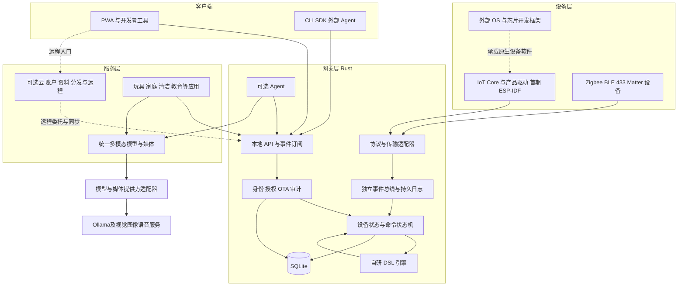

# 总体技术架构

更新日期：2026-11-01。状态：目标设计，尚无运行时实现。领域归属见 [04](04-领域模型与数据设计.md)，目录见 [21](21-Monorepo与开发规范.md)。

## 1. 架构决定

按设备、网关、服务、客户端四层划分职责，核心能力以Agent发现、组合、执行和验证为先。网关是当前空间的本地授权和设备执行入口；服务层包含模型/媒体与场景应用，可本地/边缘部署，云控制面可选。本地API是网关提供的应用服务。

核心模型、状态、规则、身份生命周期和 OTA 编排由平台实现。ESP-IDF、操作系统、无线栈、Broker、密码库和模型服务经有边界的接口使用；禁止第三方设备 DTO、数据库句柄或推理 SDK 类型流入领域核心。

### 1.1 与设备系统的分工

LimeIoT 建设在设备操作系统和开发框架之上。Vela/openvela、OpenHarmony、Linux 等系统提供各自的内核、驱动、联网与系统服务；ESP-IDF 是首期采用的芯片开发框架。平台复用这些基础，由 IoT Core SDK、产品驱动或协议适配器连接统一物模型、网关和应用。

本文的“Rust 网关内核”指 Linux 用户态的物联网应用核心。设备调度器、内存管理、通用文件系统、无线标准栈和通用图形/音视频系统属于外部基础；已有系统的实时控制与本地保护继续在设备侧承担。OTA 的签名策略、制品、发布与任务由平台管理，分区写入、安全启动和回滚机制调用设备系统提供的能力。

ESP-IDF 为首期唯一原生固件目标；Vela/openvela、OpenHarmony 等为后续按产品需要评估的适配目标，当前没有支持完成声明。对每个平台实现实际需要的小接口与合同测试，出现第二个真实目标后再提取共享实现；设备 OS 开源许可与米家、HarmonyOS Connect 等商业生态资格分别核对。

### 1.2 NAS私有化版、官方云服务版与LimeCloud

产品提供NAS私有化版与LimeIoT官方云服务版。NAS内同一Rust核心运行于x86_64/ARM64 Linux容器，随包提供本地家庭PWA；默认使用SQLite和本地制品存储。集中控制面是同一Go/Gin + MySQL服务，可在NAS内部私有部署；官方云由Railway托管，Cloudflare分别发布私有官网与开源开发文档/Console/Admin，平台Worker代理固定API/WSS路径，R2分发制品。

源码范围与产品入口分开：通用Docs/Console/Admin/Home及服务端在开源monorepo，官网在独立私有网站仓库和Cloudflare项目；官方专有商业运营扩展按需私有。自部署所需管理能力保留开源，生产配置与客户数据独立于源码发布。官网与平台发布分别记录源修订。

LimeCloud是可选外部平台，不是第三个产品版本，通过身份、模型及后续权益适配器接入。它拥有平台账号和公共服务，LimeIoT拥有家庭设备与执行事实。NAS本地认领、控制、规则及已缓存制品升级无需LimeCloud、公有云或模型；云主体与家庭所有权的关联须由本地所有者批准。具体边云及平台接入合同见 [14](14-云端服务与边云协同.md)，Web入口见 [15](15-客户端与交互设计.md)，部署见 [22](22-本地开发部署与运维.md)。

## 2. 四层图

## 3. 运行单元

| 单元 | 职责 | 初期策略 |
| --- | --- | --- |
| 原生设备固件 | 采集、驱动、执行、身份和更新 | 每产品独立固件制品 |
| Rust 网关 | API、领域用例、规则、后台任务 | 单进程模块化内核 |
| MQTT Broker | 标准传输与 Topic ACL | 独立可替换组件 |
| 协议辅助进程 | 隔离重依赖和故障 | Matter 等按实际需要启用 |
| Ollama | 推理与模型装载 | 独立部署、独立限额 |
| 可选控制面 | 账户映射、产品、分发、远程请求 | Go/Gin模块化单体、MySQL；NAS或Railway共用 |
| 场景应用 | 玩具、陪伴、教育、清洁及其他空间业务 | 经模型、媒体、任务和设备合同组合 |
| 模型/媒体服务 | 能力目录、调用、流、预算与媒体引用 | 本地/边缘优先，提供方可替换 |
| PWA/CLI/宿主GUI与TUI | Agent任务及人机交互 | 共用API、工具和生成合同 |

同一 Rust 核心编译到 ARM64 与 x86_64。轻量版默认不承载模型；算力版可在同机部署 Ollama，但必须以进程、CPU、内存和磁盘预算隔离。

MVP不把Broker迁到云端。家庭设备通过本地MQTT接入NAS或轻量Linux网关，网关主动出站WSS连接官方云控制面；Cloudflare只处理HTTP/WSS入口，不能承担原生MQTT TCP代理或常驻推理。两版共用领域合同、网关/控制面实现及组件；官网/文档/Console/Admin和NAS本地家庭界面按任务独立构建，身份/存储通过适配器切换。

## 4. 依赖与数据流

入站：原始帧 → 适配器校验/映射 → 核心观测 → 设备状态事务 → 持久事件 → 规则/订阅。

出站：用户/规则/Agent 意图 → 当前授权与型号能力 → 命令持久化/Outbox → 适配器发送 → 回执或回读 → 命令状态更新。

核心依赖消费方定义的小接口：`DeviceTransport`、`StateStore`、`Clock`、`IdentityVerifier`、`ArtifactStore`、`InferenceProvider`。基础库按风险和替换边界封装，避免为每个普通函数增加无意义接口。

## 5. 一致性与故障

SQLite 保存空间、设备、命令、规则版本、执行、Outbox 与审计；关键状态与待发布事件同事务提交。内存事件总线只负责进程内分发，不能作为耐久性的证据。

云同步空间状态的只读投影；设备命令最终由当前主网关处理。断网时拒绝远程新请求，重连不补发过期命令。首次范围为一空间一主网关，后续主备需独立实现执行租约与 fencing，不能用普通数据库复制假称高可用。

适配器失败只影响相关协议；模型失败只影响自然语言协助；存储不可写时停止接受需要耐久保证的新操作，显式展示降级，不能继续返回已可靠受理。

## 6. 工程原则

KISS：先一个网关内核和一个云进程；YAGNI：没有消费者前不建设插件市场、多主和分布式总线；DRY：物模型和动作合同生成多端绑定；SOLID：设备状态、规则、身份和制品各持自身事实，经窄接口组合。

## 7. 场景与能力组合

核心原语为Space、Actor、Device、Capability、Command、Task、InteractionSession与Package。家庭与玩具先验证，企业、教室、健身经场景政策与应用扩展。短联动走DSL，机器人长任务走Task，感知/生成走模型媒体服务，所有物理动作回到统一命令和本地安全边界。

组合包与多模态服务见 [32](32-能力组合与场景应用.md)、[33](33-多模态模型与媒体服务.md)。GUI/TUI与MCP是正式任务表现和接入适配，不产生第二套权限或业务事实。
