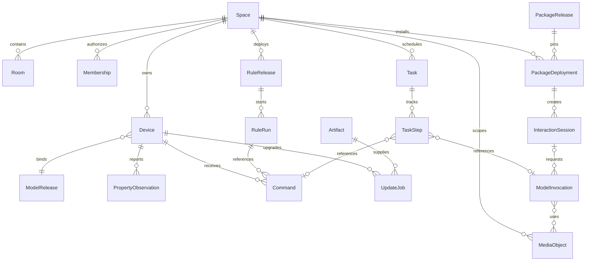

# 领域模型与数据设计

更新日期：2026-11-02。状态：设计草案；表名为逻辑设计，Migration 尚未实现。

## 1. 事实归属

| 领域 | 拥有的事实 | 不拥有 |
| --- | --- | --- |
| Space/Access | 空间、房间、成员、委托、当前授权 | 云账号认证证明的生成 |
| Device | 设备实例、模型绑定、连接与实际观测 | 模型标准定义、厂商无线栈 |
| Command | 请求、期限、状态、执行证据、幂等回执 | 猜测的物理世界结果 |
| Model | 不可变模型及能力映射版本 | 在线设备当前值 |
| Automation | 规则版本、运行、定时任务与动作引用 | 第二套设备状态或命令队列 |
| Identity | 原生设备身份、配对、证书/密钥生命周期 | 433 设备不存在的硬件身份 |
| OTA | 制品、升级策略、批次、任务与结果 | 制造商未开放的第三方升级能力 |
| Audit | 安全与业务审计引用 | 密钥、Token 和全部原始流量 |
| ModelInvocation/Media | 模型目录、调用、用量、媒体引用与数据政策 | 设备控制权和应用专业结论 |
| Application/Session | 组合包、部署、应用委托与交互会话 | 第二套设备状态与模型账本 |
| Task | 长任务进度、取消/暂停请求和原操作关联 | 猜测的机械停止状态 |
| 云 Control Plane | 云账户、发布资料、远程授权登记和同步游标 | 本地控制权和最新设备实际状态 |

## 2. 实体与关系

空间、设备、房间、主体、规则、命令、事件与升级任务使用不透明稳定 ID；显示名称、MAC、短地址、IP 和 USB 路径不得作为主键。Zigbee 短地址等映射由适配器维护，变更不创建新逻辑设备。

图中会话调用和任务步骤是可选关联；诊断模型调用可不属于交互会话，原生命令可不属于长任务。部署固定不可变包版本，媒体可关联多个获准调用，访问权仍由当前空间、主体、应用和用途决定。

### 2.1 多执行路径的单设备归属

目标设计允许电视 Agent 与 ADB 适配器服务同一逻辑 Device，分别保存设备身份或受控连接绑定；不能因 IP、名称或型号一致而自动合并。归并须有当前所有者批准和设备侧证明。能力映射明确执行端与修订，Command 固定本次路径和授权，观测保留真实来源；超时不切换另一条路径重发。具体电视设计见 [34](34-电视终端与AndroidTV接入.md)。

当前正式合同区分完整外部绑定 `bindings.bind` 与显式组合 `bindings.compose`：组合将原生native_paths与外部动作构成完整分区，要求相同逻辑模型、当前原生会话及覆盖所选路径的能力声明；每条Command仍固定一个执行端，FIFO跨端成立。组合计划及撤销耐久保存，会话/能力证明重建，不能因一端离线自动回退。正式结构见 [执行合同](../contracts/execution-routes.md)，协议夹具与假ADB软件证据见 [24 第4.14节](24-实施计划与进度.md#414-显式能力组合与文档同步)。TV Agent已实现受控逻辑模型及保留原记录的单向迁移，真实JVM组合旅程仍未通过，见 [第4.15节](24-实施计划与进度.md#415-tv-agent模型配置与日志迁移文档同步)。本机材料/日志迁移由设备消费者负责，网关Device模型绑定和ExecutionBinding组合决定仍各自管理；已有网关设备跨模型完整路线及物理归属另验。

### 2.2 多品牌、型号与组件的领域边界

以事实、不变量和变更频率划分模块，不按品牌或设备品类划分业务后端。以下是逻辑职责细化，不代表新增微服务、已存在的数据库表或当前 Schema 字段；研究依据见 [35](35-多品牌设备接入与升级架构调研.md)。

| 概念 | Owner 与职责 | 不变量 |
| --- | --- | --- |
| 能力语义与模型发布 | Model 管理服务、属性、动作、事件及不可变模型版本 | 同一能力可被多个品牌复用，协议数据点不成为核心语义 |
| 产品与硬件定义 | Model 管理产品能力与硬件适用范围；接入层记录外部标识及匹配依据 | 市场型号、产品 ID、板卡修订、芯片架构与固件版本不能相互替代 |
| 型号兼容档案与映射 | 接入层维护指纹、固件限制、组件/端点、映射及 quirks；固定引用 Model 的模型修订 | 一份协议实现可服务多个档案；模糊匹配不自动取得写权限或升级权限 |
| 设备实例 | Device 管理稳定设备 ID、认领、生命周期、当前模型/档案绑定及实际组件 | 连接地址和固件变化不改变实例身份；同名设备不自动合并 |
| 接入配置与连接绑定 | 接入模块管理一个账户/网桥/协议会话及其设备路由；Identity/Access 提供凭据引用与授权 | 一个接入配置可发现多设备，一设备可有多个获准绑定；插件不自建主设备账本 |
| 组件与外部端点 | Device 持有实际组件及稳定能力实例关系；适配器维护协议端点映射 | 多路插排/多通道控制器不是多个型号；可独立认领、移动的实体按身份建独立设备 |
| 软件清单与升级目标 | Device 提供已观测的部件版本与来源；OTA 固定目标、制品、策略与结果 | Agent APK、无线模组、业务 MCU、OS 等分别标识，不用单个 firmware_version 代替全部软件 |

产品模型定义“允许表达的能力”，型号档案定义“已知如何适配”，设备观测描述“当前实际支持”，Access 决定“当前主体可执行”。有效能力取这些约束及连接状态的交集；插件不得通过声明新能力绕过模型校验和授权。暂时离线与能力删除分别呈现，不因断连静默修改模型绑定。

同一设备可含多个服务实例，例如 `socket_1`、`socket_2`；外部 Zigbee/Matter 端点编号只在映射中保存。组件身份不能靠发现顺序分配；重新访谈遇到端点变化，必须核对稳定身份或登记待确认变更，不能把旧规则静默指向另一物理通道。当前正式模型沿用 [05](05-自研物模型规范.md)，本节不引入可直接提交的 `endpoint` 或软件清单字段。

### 2.3 接入变更与升级的协作

Command 持久固定设备、能力实例、模型/映射修订和本次执行路径。接入进程只返回发送阶段与证据；命令状态机、幂等和当前授权归核心。更新映射或重启插件不赋予重发未知物理动作的权利。

设备升级或映射升级前核对目标版本、依赖和受影响能力；安装后由接入层重新描述/访谈，Model 验证兼容，Device 更新已确认绑定。不可把“新固件版本上报”直接等同于模型迁移成功；失败时保留实际软件状态，对受影响能力降级并进入恢复流程。

模型发布、设备绑定和外部固件安装不处于一个数据库事务。通过持久任务和各自修订检查推进，失败按目标机制恢复，不承诺跨设备或多部件原子升级。统一批次与不同执行提供方的边界见 [13](13-OTA与制品交付规范.md)。

当前本地执行绑定由接入模块的 `execution_registry` 管理，独立于模型发布/安装账本；它固定设备、候选route、可选native_paths、绑定generation和原决定，不拥有第二份Device或Command。宿主准备和验证适配配置；核心核对候选、模型权限、预期修订及命令/OTA占用，组合另核对当前原生能力证明，将变更、原请求和决定同事务提交。模型安装不自动改变执行端，宿主候选更新也不自动覆盖已存路由。

撤销保留 route=null 的持久记录，阻止后续控制及清路由后的原生 MQTT 回退；重放旧 applied 只读，不能复活绑定。应用发现属于按当前绑定修订保存的临时观测，应用授权属于宿主配置，二者不能相互替代。正式结构及本地用例见[执行合同](../contracts/execution-routes.md)，软件验证与实机缺口见[24第4.7节](24-实施计划与进度.md#47-适配绑定完整性与已有空间软件验收)。这些具体记录不表示通用连接管理、插件宿主或全部升级提供方已经实现。

## 3. 网关逻辑表与约束

| 表 | 关键字段与约束 |
| --- | --- |
| `spaces` / `memberships` | 空间 ID；成员主体、角色、状态、修订；保护最后所有者 |
| `devices` | 空间、设备 ID、型号修订、适配器绑定、生命周期、修订；绑定唯一 |
| `property_observations` | 设备、属性、类型化值、来源、观测时间、接收时间、质量、序列 |
| `commands` | 空间、主体、幂等键、规范化请求摘要、期限、状态、证据、修订 |
| `model_releases` | 模型 ID、语义版本、不可变正文摘要；发布后不可覆盖 |
| `rule_releases` / `rule_runs` | 不可变规则版本、部署修订、触发事件、运行身份、阶段 |
| `scheduled_jobs` | 任务 ID、到期依据、恢复政策、租约与执行引用 |
| `outbox` / `inbox_dedup` | 事件 ID、聚合版本、发送状态；消费者和事件联合唯一 |
| `device_identities` | 公钥/证书引用、状态、密钥代次；私钥不入普通表 |
| `update_jobs` | 设备、制品摘要、策略与阶段；防止互斥升级并行 |
| `tasks` / `task_steps` | 任务、步骤、原命令/模型调用、进度与恢复政策 |
| `model_invocations` | 原键、模型/路由政策、输入引用、预算、状态、结果与真实用量 |
| `media_objects` | 空间/应用/主体、用途、内容摘要、访问与留存 |
| `package_releases` | 发布者、包标识、版本、不可变正文/制品摘要和签名引用 |
| `package_deployments` / `interaction_sessions` | 不可变包、权限快照、当前授权代次、参与者与会话代次 |
| `audit_records` | 主体、范围、动作、结果、操作引用；追加记录 |

唯一约束 `(space_id, actor_id, operation_id, idempotency_key)`；同键不同请求摘要返回冲突。状态更新使用聚合修订做乐观并发控制，不能由客户端直接覆盖整个设备对象。

## 4. 观测、期望与历史

`reported` 是设备或适配器实际提供的观测；`desired` 是获准命令的目标。发送成功不修改 `reported`。每个属性独立携带 `observed_at`、`received_at`、`quality`、`source`；历史值过期转为 stale，不补零或强制 false。

原生上报使用设备身份、boot_id 和单调 seq 做去重；不同重启代次的包不做简单数值比较。历史 telemetry 可聚合和限额，控制回执、安全审计和升级结果按保留策略耐久保存。

### 4.1 控制回执的保留与安全回收

网关 Command 拥有原请求、持久受理顺序和执行结果；设备侧尝试/回执记录只保护本机副作用，不另建业务命令账本。原结果正文、审计历史和阻止旧请求再次执行的依据具有不同生命周期，压缩结果正文不能同时丢失必要的去重与冲突判定能力。

回收前须证明被移除的旧请求在重连、进程重启、换证、程序更新及所支持的备份恢复路径下仍无法重新执行。时间到期、连接会话变化、MQTT PUBACK或网关收到回执均不能单独完成这一证明；用户客户端仍将command_id/message_id视为不透明值，设备仅按正式合同解析绑定序号，不能按ID字典顺序比较退休边界。未知或可能已开始的操作继续保留，确认收到 unknown 不等于确认未执行。

当前TV Agent已按 [回执确认合同](../contracts/command-receipts.md) 复用原网关账本的受理序号，使用与ID绑定的耐久边界及提交后确认。应用配置日志v2、遥控配置v3均保存拒绝边界并保留unknown/未决；迁移不改历史Envelope的模型、会话或结果，容量不足继续拒绝新动作。网关与设备同时回退旧备份仍需独立恢复依据，不能由两个旧副本证明边界未倒退。设计准入与故障验证见 [34 第5.4节](34-电视终端与AndroidTV接入.md#54-耐久回执容量与安全回收的设计门槛)，本节不新增可发送的报文字段或清理接口。

## 5. 事务和恢复

接受命令的当前授权、期限、幂等记录、命令与 Outbox 在同一数据库事务内提交。设备外部副作用不在 SQL 事务中，不能宣称跨设备原子或物理执行 exactly-once。

规则运行通过原命令 ID 跟踪动作；恢复时先读回执。备份恢复后检查密钥代次、撤销账本和外部执行水位，不直接复活旧授权、重放旧 Outbox 或重置已完成操作。

## 6. 隔离与生命周期

空间 ID 从已验证上下文确定，不能相信正文或 MQTT Topic 自报。数据库访问、列表、订阅和导出均先按当前空间与动作过滤。云数据还需账号/组织隔离，开发环境不得共享正式空间密钥。

删除设备是退役与凭据撤销流程；审计和命令历史按政策脱敏保留。所有权转移创建新的空间信任绑定，设备历史、备份和厂商身份分别处理，不把更改显示名称等同于转移。

## 7. 应用与媒体数据

空间类型不改变设备主键。家庭关系、课堂名册、学习/运动记录、角色故事和专业服务数据由场景应用持有，以受控引用关联平台主体与会话；模型推断保存来源和置信/不确定性，不直接覆盖可信设备事实。会话代次、用途与当前权限共同阻止跨主体迟到结果。
