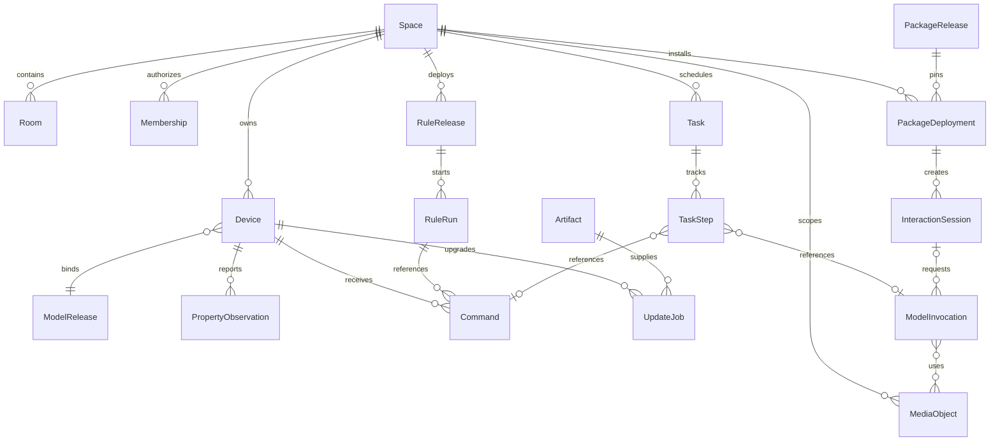

# 领域模型与数据设计

更新日期：2026-11-01。状态：设计草案；表名为逻辑设计，Migration 尚未实现。

## 1. 事实归属

| 领域 | 拥有的事实 | 不拥有 |
| --- | --- | --- |
| Space/Access | 空间、房间、成员、委托、当前授权 | 云账号认证证明的生成 |
| Device | 设备实例、模型绑定、连接与实际观测 | 模型标准定义、厂商无线栈 |
| Command | 请求、期限、状态、执行证据、幂等回执 | 猜测的物理世界结果 |
| Model | 不可变模型及能力映射版本 | 在线设备当前值 |
| Automation | 规则版本、运行、定时任务与动作引用 | 第二套设备状态或命令队列 |
| Identity | 原生设备身份、配对、证书/密钥生命周期 | 433 设备不存在的硬件身份 |
| OTA | 制品、升级策略、批次、任务与结果 | 制造商未开放的第三方升级能力 |
| Audit | 安全与业务审计引用 | 密钥、Token 和全部原始流量 |
| ModelInvocation/Media | 模型目录、调用、用量、媒体引用与数据政策 | 设备控制权和应用专业结论 |
| Application/Session | 组合包、部署、应用委托与交互会话 | 第二套设备状态与模型账本 |
| Task | 长任务进度、取消/暂停请求和原操作关联 | 猜测的机械停止状态 |
| 云 Control Plane | 云账户、发布资料、远程授权登记和同步游标 | 本地控制权和最新设备实际状态 |

## 2. 实体与关系

空间、设备、房间、主体、规则、命令、事件与升级任务使用不透明稳定 ID；显示名称、MAC、短地址、IP 和 USB 路径不得作为主键。Zigbee 短地址等映射由适配器维护，变更不创建新逻辑设备。

图中会话调用和任务步骤是可选关联；诊断模型调用可不属于交互会话，原生命令可不属于长任务。部署固定不可变包版本，媒体可关联多个获准调用，访问权仍由当前空间、主体、应用和用途决定。

## 3. 网关逻辑表与约束

| 表 | 关键字段与约束 |
| --- | --- |
| `spaces` / `memberships` | 空间 ID；成员主体、角色、状态、修订；保护最后所有者 |
| `devices` | 空间、设备 ID、型号修订、适配器绑定、生命周期、修订；绑定唯一 |
| `property_observations` | 设备、属性、类型化值、来源、观测时间、接收时间、质量、序列 |
| `commands` | 空间、主体、幂等键、规范化请求摘要、期限、状态、证据、修订 |
| `model_releases` | 模型 ID、语义版本、不可变正文摘要；发布后不可覆盖 |
| `rule_releases` / `rule_runs` | 不可变规则版本、部署修订、触发事件、运行身份、阶段 |
| `scheduled_jobs` | 任务 ID、到期依据、恢复政策、租约与执行引用 |
| `outbox` / `inbox_dedup` | 事件 ID、聚合版本、发送状态；消费者和事件联合唯一 |
| `device_identities` | 公钥/证书引用、状态、密钥代次；私钥不入普通表 |
| `update_jobs` | 设备、制品摘要、策略与阶段；防止互斥升级并行 |
| `tasks` / `task_steps` | 任务、步骤、原命令/模型调用、进度与恢复政策 |
| `model_invocations` | 原键、模型/路由政策、输入引用、预算、状态、结果与真实用量 |
| `media_objects` | 空间/应用/主体、用途、内容摘要、访问与留存 |
| `package_releases` | 发布者、包标识、版本、不可变正文/制品摘要和签名引用 |
| `package_deployments` / `interaction_sessions` | 不可变包、权限快照、当前授权代次、参与者与会话代次 |
| `audit_records` | 主体、范围、动作、结果、操作引用；追加记录 |

唯一约束 `(space_id, actor_id, operation_id, idempotency_key)`；同键不同请求摘要返回冲突。状态更新使用聚合修订做乐观并发控制，不能由客户端直接覆盖整个设备对象。

## 4. 观测、期望与历史

`reported` 是设备或适配器实际提供的观测；`desired` 是获准命令的目标。发送成功不修改 `reported`。每个属性独立携带 `observed_at`、`received_at`、`quality`、`source`；历史值过期转为 stale，不补零或强制 false。

原生上报使用设备身份、boot_id 和单调 seq 做去重；不同重启代次的包不做简单数值比较。历史 telemetry 可聚合和限额，控制回执、安全审计和升级结果按保留策略耐久保存。

## 5. 事务和恢复

接受命令的当前授权、期限、幂等记录、命令与 Outbox 在同一数据库事务内提交。设备外部副作用不在 SQL 事务中，不能宣称跨设备原子或物理执行 exactly-once。

规则运行通过原命令 ID 跟踪动作；恢复时先读回执。备份恢复后检查密钥代次、撤销账本和外部执行水位，不直接复活旧授权、重放旧 Outbox 或重置已完成操作。

## 6. 隔离与生命周期

空间 ID 从已验证上下文确定，不能相信正文或 MQTT Topic 自报。数据库访问、列表、订阅和导出均先按当前空间与动作过滤。云数据还需账号/组织隔离，开发环境不得共享正式空间密钥。

删除设备是退役与凭据撤销流程；审计和命令历史按政策脱敏保留。所有权转移创建新的空间信任绑定，设备历史、备份和厂商身份分别处理，不把更改显示名称等同于转移。

## 7. 应用与媒体数据

空间类型不改变设备主键。家庭关系、课堂名册、学习/运动记录、角色故事和专业服务数据由场景应用持有，以受控引用关联平台主体与会话；模型推断保存来源和置信/不确定性，不直接覆盖可信设备事实。会话代次、用途与当前权限共同阻止跨主体迟到结果。
