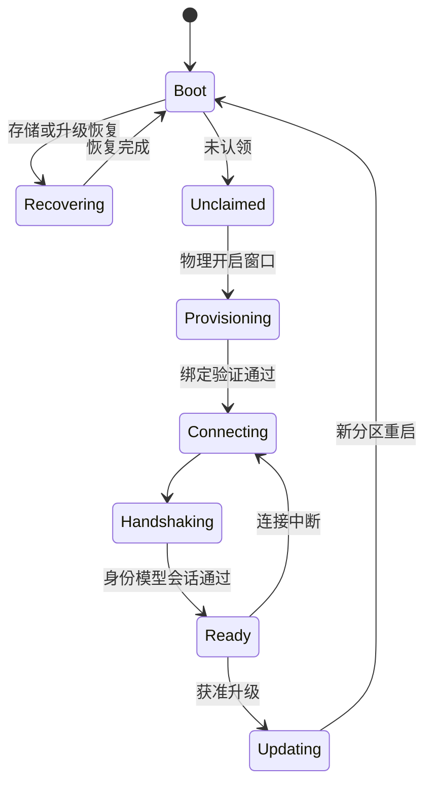

# ESP-IDF 固件 SDK 设计

更新日期：2026-11-03。状态：设计基线及已实现子集。C核心已通过宿主/真实Broker验证；ESP-IDF适配器及灯/按钮均已通过C3目标编译，实机按用户要求跳过。运行入口见 [固件](../firmware/README.md)。设备通信见 [06](06-MQTT报文与设备通信规范.md)，安全与升级分别见 [12](12-身份认证与安全体系.md)、[13](13-OTA与制品交付规范.md)。

## 1. 目标与模块

当前静态存储提供默认开发与显式HMAC两档。`li_espidf_storage_init_partition`统一配置/日志初始化，HMAC档位在打开NVS前验证已保护硬件键和认证绑定，配置读取后再核对空间/设备；不自动生成硬件键或降级。离线生成器和两档灯/按钮构建已经接线，正式格式及软件验证见[设备存储合同](../contracts/device-storage.md)和24。

HMAC档位增加可选`limeiot_device_identity.h`，通过固定PSA/Mbed TLS生成本机P-256私钥和单CN CSR。密钥先单Blob耐久保存、关闭重开并验证硬件HMAC，才导出公开请求；证书导入核对固定CA、设备/公钥、精确用途及日期。pending复用原键，ready拒绝不同证书隐式续期；写入结果不明冻结对象，重开恢复实际状态。产品在可信时间和Wi-Fi/IP就绪后处理USB初始化，内部TLS凭据不导出。12组软件检查和CA-only实际加密配置见[身份合同](../contracts/device-enrollment.md#c3本机密钥与证书导入)。有限物理窗口/随机挑战、动态归属与自动续期仍未实现，静态MAC不检测同设备旧备份回退。

受控轮换新增status、rotate_request、rotate_import和rotation_proof接口。新键暂存期间仍提供旧凭据，导入匹配证书后单Blob切换并增加代次；NAS独立验证新键激活证明才撤销冻结的旧证书和刷新CRL。v1初始记录只读兼容，首次轮换写v2，代次不作为硬件防回退锚。产品`--identity-maintenance`显式启用USB维护入口，普通镜像仍直接恢复身份；维护/普通HMAC/默认开发两角色共6份目标构建通过。步骤、5331字节记录及恢复规则见[轮换合同](../contracts/device-enrollment.md#保留旧身份的密钥轮换)；USB运行及Flash旧页擦除均没有验证保证，实机用户要求跳过。

IoT Core 为原生产品提供身份、配网、连接、模型绑定、状态、命令与升级基础。产品开发者和编码 Agent 只需理解明确的组件接口与板卡合同，设备驱动和产品行为不与云平台或某个家庭自动化项目绑定。

本 SDK 是建立在 ESP-IDF 之上的产品接入组件，复用其任务、网络、存储、安全和升级基础。其他设备系统按实际产品需求新增平台适配，范围与分工统一见 [03](03-总体技术架构.md)；本文件不定义通用操作系统或要求设备改装系统。

| 组件 | 职责 | 边界 |
| --- | --- | --- |
| `core` | 生命周期、组件装配、错误与资源预算 | 不依赖产品 GPIO 编号 |
| `identity` | 设备证明、凭据引用、认领与轮换 | 私钥不进入日志和模型 |
| `provisioning` | 有期限配网及所有权绑定 | 物理窗口，不永久开放配置端口 |
| `transport` | MQTT 客户端、会话、退避和上行 | 通过 Port 使用 ESP-IDF 网络能力 |
| `model` | 生成绑定、类型与能力校验 | 固件使用模型受限子集 |
| `command` | 期限、去重、执行与回执 | 不将 PUBACK 当作执行成功 |
| `state` | 快照、变化和属性观测 | 期望与实际分开 |
| `ota` | 清单验证、下载、分区与启动确认 | 产品升级策略由平台合同约束 |
| `storage` / `clock` | NVS、密钥区、认证时间与单调计时 | 厂商类型在实现层隔离 |
| BSP / driver | 引脚、电源、外设和具体硬件读写 | 不拥有家庭权限或模型路由 |

首个目标芯片为 ESP32-C3，后续在实际需求和实测基础上增加 C6/S3 等 BSP。不同芯片的无线、安全启动与内存能力须单独登记。

## 2. 产品绑定

目标产品描述包含板卡修订、引脚、驱动、模型修订、属性/动作处理器、采样与上报策略、资源限制和安全默认值。生成器输出 C 类型和绑定骨架，产品驱动实现读写，不在生成文件中手工增改业务逻辑。

示意接口为 `register_property_handler`、`report_observation`、`complete_command`、`request_update`，名称与 ABI 在实现阶段冻结。异步处理必须关联原 command_id 和取消/期限上下文；驱动返回已排队不代表硬件已完成。

板卡支持包应向 Agent 提供引脚约束、供电、允许外设组合、构建命令、恢复步骤和测试夹具。未知接线或电压不能由生成模型猜测后直接驱动。

## 3. 启动状态

驱动自检先于 Ready。未获得可信时间、当前会话或模型绑定时，只开放恢复必需能力。网络重连使用有上限的指数退避与抖动，不阻塞本地硬件保护。

## 4. 调度与资源

网络、采样、执行和更新任务分责；队列有上限，禁止在 MQTT 回调中阻塞读传感器或执行耗时动作。高频采样与上报频率独立，过载时可合并普通观测，不丢弃关键执行结果。

每产品记录镜像大小、静态/峰值堆、任务栈、队列、NVS 写入和功耗预算。关键缓冲区预分配；字符串与二进制负载有长度限制。看门狗和断电恢复纳入实机测试。

## 5. 命令与耐久性

校验顺序：当前会话 → 身份/绑定 → 模型与能力 → 期限与值 → 去重 → 本地安全条件 → 驱动执行 → 回执。相同命令和摘要返回原结果，不同摘要冲突。

按动作语义选择必要持久日志，避免对每个遥测值写闪存。设备在保存意图与产生物理副作用之间崩溃，仍可能结果未知；SDK 不承诺物理 exactly-once。非幂等操作未知时等待核对，不自动重放。

## 6. 玩具和机器人扩展

低层运动控制、急停、限位、电池和温度保护在设备本地完成。网关发送受限目标或任务，不能将实时电机闭环和碰撞保护交给 LLM。组合玩具的模块描述与兼容校验见 [32](32-能力组合与场景应用.md)。

音视频采用媒体通道；MQTT 只承载会话、事件、控制及媒体引用。设备断网或推理失效的灯光、语音和运动降级由产品明确配置并测试。

## 7. 验收

在固定板卡和固件版本验证首次烧录、认领、重连、重复/过期命令、坏 NVS、掉电、看门狗、错误签名、升级回滚和长稳。仿真/宿主测试不能代替电源、外设和无线实机证据。

## 8. 当前实现

`firmware/components/limeiot_core` 通过窄 Port 使用随机数、SHA-256、单调钟、耐久存储、传输和驱动。公共接口不暴露ESP-IDF、MQTT或cJSON类型。当前合同限布尔/整数属性与单整数字段事件，模型绑定从`contracts/models`生成并校验漂移，不声称覆盖完整物模型/JCS类型。

执行前耐久写意图，再检查写入耗时是否已越过期限；驱动和结果提交无法确认时返回unknown。32槽回执只回收已报告且过期记录，容量不足拒绝新命令；重启恢复意图不重放。宿主ASan/UBSan核心检查现为13组，新增意图/终态提交前后故障；4组SHT3x及真实MQTT/Rust联调按各自冻结报告引用，覆盖当前设备信息、原采样时刻及UTC毫秒/日历进位。

控制回执提交返回失败后，当前核心锁住新意图写入，重连不解除；允许只读核对已知原结果，但失败的终态提交只保留已有意图对应的unknown。失败可能已落盘，须关闭并重新读取实际日志后才能接受明确新命令，不能继续以旧内存覆盖持久事实。该边界与OTA日志故障分别维护，恢复时保留原记录与会话归属。

`limeiot_espidf`封装MQTT5 mTLS、分片装帧、有界队列、连接代次、NVS提交和密码库。`products/desk-node`提供灯、按钮、环境角色、候选引脚、开发USB时钟和90秒待验证镜像回滚检查；后者包含配网和时钟等待时间。离线NVS工具验证设备CN、clientAuth、证书/私钥匹配及权限，默认生成未加密的开发配置；NAS设备CA与HTTPS CA独立。HMAC加密存储及设备本机身份为显式档位，步骤见[固件说明](../firmware/README.md)。

工程使用ESP-IDF v6.1及固定组件锁。2026-11-02通过官方完整发布包取得SDK，核对发布摘要、固定修订和递归子模块，在项目内安装C3工具链及Python环境。统一入口 `npm run build:firmware` 已分别构建灯/按钮，生成双OTA分区表、引导程序及应用镜像；esptool镜像校验通过。编译修复使用标准时间格式化并检查长度，未关闭编译诊断。运行内存/无线资源预算、实机、安全存储、物理认领、自动轮换和签名OTA仍待验收。

设备固件签名真实性由 `limeiot_ota.h` 提供，字节端口隔离SHA-256/Ed25519；ESP端固定官方libsodium 1.0.22~1并保留ISC许可。初始化公钥和指纹须独立确认，设备不接受报文公钥自举。真实性检查不单独授予安装权限，完整配置和健康门禁见 [固件说明](../firmware/README.md#独立ota传输配置与镜像健康)。

设备安装前策略已新增 `li_ota_preflight`，重新验签、严格校验完整statement并从本机端口读取当前事实与可信时间。独立策略约束产品、来源、撤销、有效期、安全代次和电量；精确检查硬件、版本路径、模型、引导程序、容量及忙碌状态，失败清空候选。`li_espidf_ota_preflight` 绑定启动时的完整策略、已配置公钥和现有驱动/时钟，公共头不暴露ESP类型。7组策略检查与真实性/配置检查通过，使用ASan/UBSan并与正式Rust工具交叉核对；下载来源覆盖NAS端口和规范IPv4/IPv6。SDK预检不会保存执行意图、下载、写分区或重启；可选安装器已接SDK，开发产品须完整策略、独立CA及本次镜像健康确认才声明可升级。接口和限制见 [固件说明](../firmware/README.md#设备安装前校验)。

离线初始化支持完整 `ota_policy`，以版本1二进制块和标记保存于原24KiB NVS；启动严格解码并匹配独立公钥。`li_ota_trust_t` 拥有策略内容，ESP预检不能按下行替换撤销或来源。独立传输配置为 `ota_transport.ca`，写入 `ota_https_ca/ota_ca_ver=1`，无配置不继承MQTT CA。5份实际NVS镜像经官方解析器检查CRC、策略及CA字节，并将恢复策略交给C预检；含完整128条撤销与CA共存。

独立设备执行日志由 `limeiot_ota_log.h` 提供，保存完整原Envelope/JCS摘要、基线、启动凭据、阶段及结果。版本2只读兼容版本1；恢复未决不重装，提交错误冻结对象。同设备仅一个未决任务，成功/回滚须有新boot及精确本机证据。原journal分区的独立ota命名空间最多4条/32KiB，空间不足拒绝且不擦除控制回执。12组真实文件/进程检查覆盖提交故障、恢复、配额和版本兼容，接口见 [执行日志](../firmware/README.md#设备执行日志)。

C设备消费者通过 `limeiot_ota_device.h` 接入 `li_receive`，本地配置与本机事实执行会话/签名/策略校验；重复原请求只读，原查询在策略撤销后仍能恢复有本机证据支持的历史结果。无提供方时耐久拒绝，恢复未决不发伪终态。ESP运行镜像image_len基线与安装结果按原声明长度的摘要分别校验。11组核心与11条MQTT旅程覆盖C消费者及Rust/SQLite恢复，设备为宿主夹具。

有界传输通过 `limeiot_ota_transfer.h` 的source/sink/hash/guard窄端口实现，1KiB缓冲、单次HTTPS、原生镜像校验及原声明范围完整回读。每个IO前后检查授权、单调钟和30秒预算，单次阻塞由端口限时。ESP使用独立CA、主机名验证及非运行备用区；6组真实宿主HTTPS/文件检查和双C3构建通过，接口见 [有界传输](../firmware/README.md#有界传输与备用区校验)。

`li_ota_device_set_installer` 接通耐久installing、暂存/精确回读、完整再预检/基线、耐久awaiting_boot、启动选择及凭据提交，再请求重启。ESP选择前核对版本、安全代次、项目名及摘要；结果不明保持未决，不重放。开发产品从独立NVS CA接线，完整策略与本次镜像健康确认后才报告可升级。`li_espidf_confirm_running_image` 只确认当前运行/选择一致且原生镜像有效的PENDING_VERIFY或VALID，不修补未知元数据。37项专项与双C3构建通过；健康检查原生调用为宿主夹具。

## SHT30环境节点

`products/desk-node`现有灯、按钮、环境三种角色。环境角色消费正式的[环境模型](../contracts/models/environment.json)及生成绑定，自研纯C的`limeiot_sht3x`通过读、写、延时、单调钟四个端口隔离I2C。ESP适配使用官方I2C master API，默认SDA GPIO4、SCL GPIO5、地址0x44和100kHz；模块上拉须接3.3V，实际板级接线仍须独立验证。

驱动每10秒最多发起一次单次测量，等待至少16ms，校验温湿度各自CRC后转换为定点整数。温度与湿度模型单位分别为`celsius_x100`、`percent_x100`，只读/通知，不提供写入动作。模型范围覆盖转换公式，不表示传感器额定工作范围或精度保证；命令、CRC与公式依据见[固件说明](../firmware/README.md#sht30环境节点)。

可选`read_observation`端口携带原单调采样时刻。核心用握手UTC锚转换观测时间，重复发送缓存不刷新采样时间；失败不填零、不返回旧样本。网关15秒未获得新样本时标记stale，恢复后须有新采样才回到confirmed。旧产品的`read_property`端口继续兼容。环境产品只有成功采样后才满足本次镜像的驱动健康条件。

目标构建、真实MQTT及多端读取的软件证据统一见[当前实施状态](24-实施计划与进度.md)。宿主I2C字节为显式夹具，实机按用户要求跳过；网关已有[属性阈值边沿](../contracts/rules.md#属性阈值边沿)，运行在设备SDK之外。

## 启动凭据与结果恢复

新增本机启动凭据耐久绑定与只读观察器，版本2日志兼容读取版本1；按原清单完整长度及确认状态恢复成功/回滚，旧凭据、待确认或仅版本相同保持未知。33项专项、11条MQTT旅程及双C3构建/镜像校验通过，宿主启动为显式夹具。接口与ESP凭据校验见 [固件启动恢复](../firmware/README.md#启动结果恢复)。
