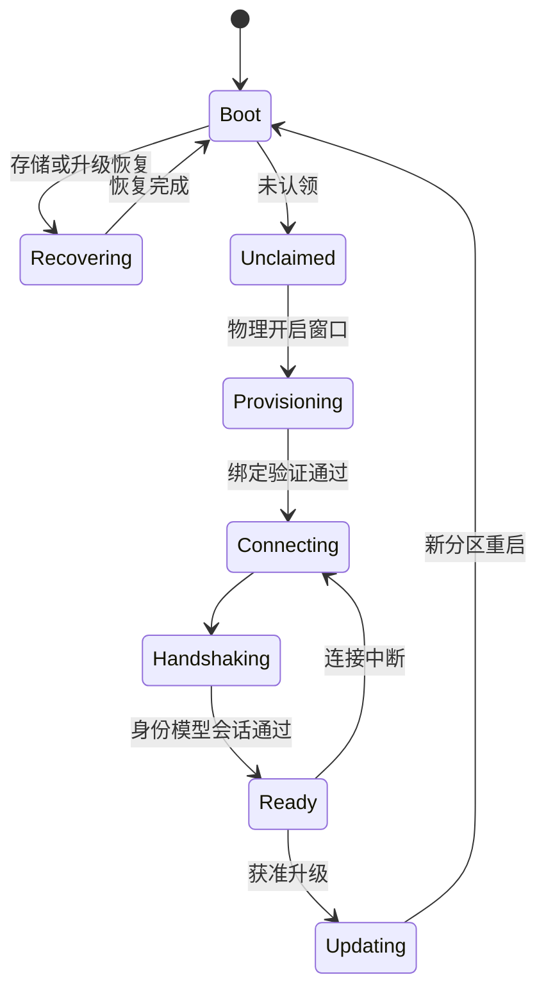

# ESP-IDF 固件 SDK 设计

更新日期：2026-11-01。状态：设计基线及已实现子集。C核心已通过宿主/真实Broker验证；ESP-IDF适配器与产品源码已建立，芯片编译和实机未验收。运行入口见 [固件](../firmware/README.md)。设备通信见 [06](06-MQTT报文与设备通信规范.md)，安全与升级分别见 [12](12-身份认证与安全体系.md)、[13](13-OTA与制品交付规范.md)。

## 1. 目标与模块

IoT Core 为原生产品提供身份、配网、连接、模型绑定、状态、命令与升级基础。产品开发者和编码 Agent 只需理解明确的组件接口与板卡合同，设备驱动和产品行为不与云平台或某个家庭自动化项目绑定。

本 SDK 是建立在 ESP-IDF 之上的产品接入组件，复用其任务、网络、存储、安全和升级基础。其他设备系统按实际产品需求新增平台适配，范围与分工统一见 [03](03-总体技术架构.md)；本文件不定义通用操作系统或要求设备改装系统。

| 组件 | 职责 | 边界 |
| --- | --- | --- |
| `core` | 生命周期、组件装配、错误与资源预算 | 不依赖产品 GPIO 编号 |
| `identity` | 设备证明、凭据引用、认领与轮换 | 私钥不进入日志和模型 |
| `provisioning` | 有期限配网及所有权绑定 | 物理窗口，不永久开放配置端口 |
| `transport` | MQTT 客户端、会话、退避和上行 | 通过 Port 使用 ESP-IDF 网络能力 |
| `model` | 生成绑定、类型与能力校验 | 固件使用模型受限子集 |
| `command` | 期限、去重、执行与回执 | 不将 PUBACK 当作执行成功 |
| `state` | 快照、变化和属性观测 | 期望与实际分开 |
| `ota` | 清单验证、下载、分区与启动确认 | 产品升级策略由平台合同约束 |
| `storage` / `clock` | NVS、密钥区、认证时间与单调计时 | 厂商类型在实现层隔离 |
| BSP / driver | 引脚、电源、外设和具体硬件读写 | 不拥有家庭权限或模型路由 |

首个目标芯片为 ESP32-C3，后续在实际需求和实测基础上增加 C6/S3 等 BSP。不同芯片的无线、安全启动与内存能力须单独登记。

## 2. 产品绑定

目标产品描述包含板卡修订、引脚、驱动、模型修订、属性/动作处理器、采样与上报策略、资源限制和安全默认值。生成器输出 C 类型和绑定骨架，产品驱动实现读写，不在生成文件中手工增改业务逻辑。

示意接口为 `register_property_handler`、`report_observation`、`complete_command`、`request_update`，名称与 ABI 在实现阶段冻结。异步处理必须关联原 command_id 和取消/期限上下文；驱动返回已排队不代表硬件已完成。

板卡支持包应向 Agent 提供引脚约束、供电、允许外设组合、构建命令、恢复步骤和测试夹具。未知接线或电压不能由生成模型猜测后直接驱动。

## 3. 启动状态

驱动自检先于 Ready。未获得可信时间、当前会话或模型绑定时，只开放恢复必需能力。网络重连使用有上限的指数退避与抖动，不阻塞本地硬件保护。

## 4. 调度与资源

网络、采样、执行和更新任务分责；队列有上限，禁止在 MQTT 回调中阻塞读传感器或执行耗时动作。高频采样与上报频率独立，过载时可合并普通观测，不丢弃关键执行结果。

每产品记录镜像大小、静态/峰值堆、任务栈、队列、NVS 写入和功耗预算。关键缓冲区预分配；字符串与二进制负载有长度限制。看门狗和断电恢复纳入实机测试。

## 5. 命令与耐久性

校验顺序：当前会话 → 身份/绑定 → 模型与能力 → 期限与值 → 去重 → 本地安全条件 → 驱动执行 → 回执。相同命令和摘要返回原结果，不同摘要冲突。

按动作语义选择必要持久日志，避免对每个遥测值写闪存。设备在保存意图与产生物理副作用之间崩溃，仍可能结果未知；SDK 不承诺物理 exactly-once。非幂等操作未知时等待核对，不自动重放。

## 6. 玩具和机器人扩展

低层运动控制、急停、限位、电池和温度保护在设备本地完成。网关发送受限目标或任务，不能将实时电机闭环和碰撞保护交给 LLM。组合玩具的模块描述与兼容校验见 [32](32-能力组合与场景应用.md)。

音视频采用媒体通道；MQTT 只承载会话、事件、控制及媒体引用。设备断网或推理失效的灯光、语音和运动降级由产品明确配置并测试。

## 7. 验收

在固定板卡和固件版本验证首次烧录、认领、重连、重复/过期命令、坏 NVS、掉电、看门狗、错误签名、升级回滚和长稳。仿真/宿主测试不能代替电源、外设和无线实机证据。

## 8. 当前实现

`firmware/components/limeiot_core` 通过窄 Port 使用随机数、SHA-256、单调钟、耐久存储、传输和驱动。公共接口不暴露ESP-IDF、MQTT或cJSON类型。当前合同限布尔/整数属性与单整数字段事件，模型绑定从`contracts/models`生成并校验漂移，不声称覆盖完整物模型/JCS类型。

执行前耐久写意图，再检查写入耗时是否已越过期限；驱动和结果提交无法确认时返回unknown。32槽回执只回收已报告且过期记录，容量不足拒绝新命令；重启恢复意图不重放。宿主ASan/UBSan 9组检查和2项真实MQTT/Rust联调已验证这些边界。

`limeiot_espidf`封装MQTT5 mTLS、分片装帧、有界队列、连接代次、NVS提交和密码库。`products/desk-node`提供灯/按钮角色、候选引脚、开发USB时钟和90秒待验证镜像回滚检查；后者包含配网和时钟等待时间。离线NVS工具验证设备CN、clientAuth、证书/私钥匹配及权限，生成未加密的开发配置；NAS设备CA与HTTPS CA独立。

工程声明ESP-IDF v6.1及固定组件版本。本次官方Git获取断流、归档下载超时，SDK与工具链未完整取得；达到两轮修复验证上限后停止重试，芯片构建被阻塞。产品工程尚未编译；无线资源预算、实机、安全存储、物理认领、自动轮换和签名OTA仍待验收。
