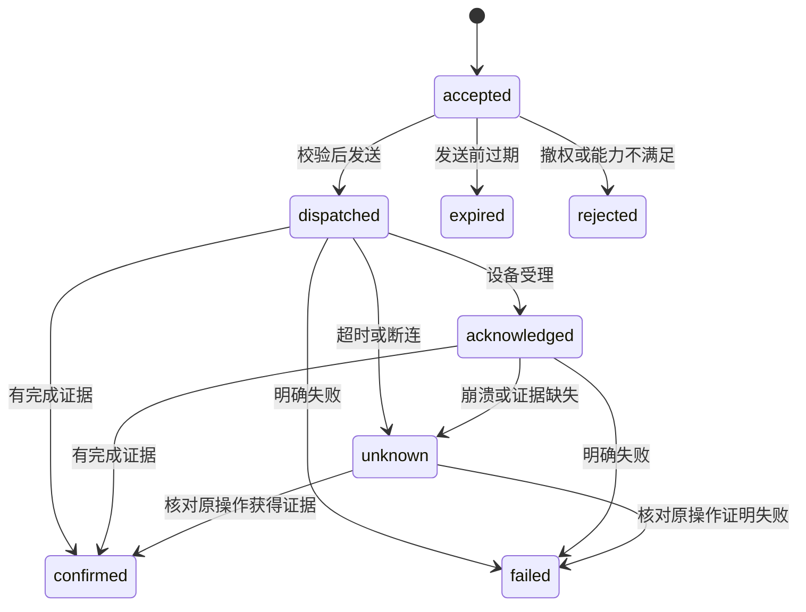

# Rust 网关内核设计

更新日期：2026-11-01。状态：设计基线。核心为模块化单进程，辅助协议与模型服务按隔离需求独立运行。

本文件中的内核是运行在Linux用户态的物联网应用核心，负责设备、命令、事件和规则；设备系统与平台的分工统一见 [03](03-总体技术架构.md)。

## 1. 组成与依赖

组合根负责加载配置、迁移检查、存储、身份、适配器和应用服务，领域模块不自行读取环境或创建全局连接。Rust 核心通过自己的数据类型协作，外部框架留在 HTTP、存储、串口、推理等实现层。

| 模块 | 唯一职责 |
| --- | --- |
| Space/Access | 当前空间、主体和授权 |
| Device | 身份绑定、能力、连接与观测 |
| Command | 命令校验、幂等、期限和证据 |
| Event Bus | 有界分发、订阅和背压 |
| Automation | DSL 编译、部署与规则运行 |
| Task | 跨步骤长任务、进度、暂停、取消与原命令关联 |
| Identity / OTA | 信任与制品生命周期 |
| Application | 组合包登记、部署引用和应用委托 |
| API/Tools | 认证、协议转换与用例调用 |

模型和媒体应用服务见 [33](33-多模态模型与媒体服务.md)，可与核心同机部署，但不占用控制链路的关键线程与资源配额。

## 2. 独立事件总线

总线使用有界队列和订阅策略，不依赖 MQTT Broker、Redis 或外部分布式 MQ。事件定义 ID、空间、聚合、聚合修订、发生/接收时间、来源、关联与因果引用。

状态更新、关键事件和 Outbox 同 SQLite 事务提交。内存通知只提示消费者读取已持久记录；关键消费者保存游标或 Inbox 去重。进程崩溃后从日志恢复，不能仅重建内存订阅即宣称恢复完成。

普通 telemetry 可在限额内合并；命令回执、安全事件和升级结果不能静默丢弃。慢消费者限制积压、返回明确断流和恢复游标，不无限占用内存。

## 3. 设备状态

连接、生命周期、观测质量分别表示。连接可为 disconnected/connecting/ready；设备生命周期可为 unclaimed/active/retired；属性质量见 [05](05-自研物模型规范.md)。BLE 广播设备和休眠电池设备按协议健康规则判定，不能只根据 MQTT 连接推断所有设备在线。

每设备按顺序串行应用有效观测；不同设备并发。旧会话和乱序数据可保留为历史证据，但不能覆盖当前快照。主线程不等待无线访谈或模型推理。

## 4. 命令状态机

unknown 不等于未执行，expired 只有在明确尚未产生副作用时才适用。命令结果携带证据类型 `device_result`、`state_readback`、`sent_only` 等；平台说明证据能证明的范围。

## 5. 长任务与会话

清洁、巡游、组合包安装、模型处理等长任务有独立 task_id，可关联多个命令或外部操作。任务受理、进度、暂停请求、取消请求、设备停止和完成是不同事实；客户端查询同一任务，不以新任务重做未知步骤。

急停走设备本地安全能力及独立高优先路径。平台 API 的取消是请求，不能保证立即撤回已发生动作。任务和交互会话分别建模，对话结束不必然停止机器人，停止机器人也不删除对话记录。

## 6. 持久任务与并发

SQLite 初期采用 WAL、短事务与受控写入口，异步任务不能跨数据库事务长时间等待。Outbox Worker 保存租约、重试预算与下一次时间，重试前检查期限和当前权；外部副作用保持原操作身份。

一个主网关服务一个空间为首期范围。多主与主备需引入执行代次和 fencing 后单独验收，不借通用租约暗示已实现多主安全。

## 7. 启停与故障

启动顺序：配置 → 密钥与存储 → Schema/模型一致性 → 回执与任务恢复 → 适配器 → API ready。恢复未知副作用先核对，不先发队列。关闭时停止受理、记录游标、受限排空，再释放设备资源。

数据库不可写时停止耐久控制受理；磁盘不足时按政策清理普通历史，保留关键记录并报告。适配器异常按协议隔离；重复重启有预算；推理故障不拖垮设备和规则模块。

## 8. 验收

测试时钟回拨、任务竞争、旧会话、重复事件、数据库锁等待、事务提交后崩溃、发送后失联、磁盘满、慢订阅及优雅退出。资源与可靠性目标见 [28](28-可观测性与可靠性.md)。
