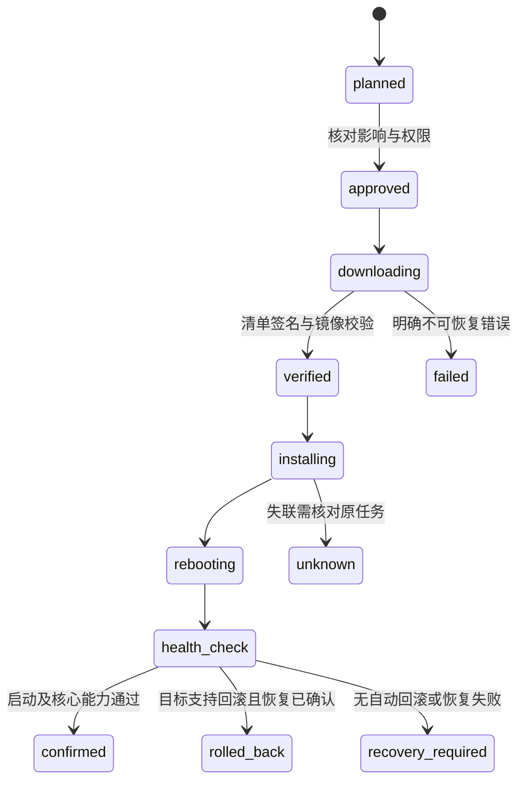

# OTA 与制品交付规范

更新日期：2026-11-02。状态：离线验签/预检、受控下载、本地耐久计划/明确批准、网关执行与设备证据恢复已实现；C3 SDK和产品已接独立策略/HTTPS CA、备用区安装、本次镜像健康确认及新启动结果恢复。另已实现离线密钥/签名包、本地不可覆盖制品仓库和NAS只读HTTPS适配，版本与安全代次进入实际目标镜像；正式托管未发布，实机回滚验收按用户要求跳过。当前合同见 [固件签名与发布](../contracts/ota-release.md)、[固件制品校验与下载](../contracts/ota.md) 和 [本地升级任务](../contracts/ota-tasks.md)。平台负责信任、策略及任务恢复，底层使用目标系统支持的启动与更新机制。

`ota publish` 仅在重验配方/清单/回执、独立trust及实际C3镜像后，独占写入制品身份目录并原子提交标记。NAS只读挂载，仅提供已提交的镜像和清单；未提交目录、内部元数据、写请求拒绝。入库不安装、不修改信任，也不改变网关外连策略。版本构建配置、eFuse防降级的显式选择及实际镜像核对见 [固件构建](../firmware/README.md#esp32-c3-目标构建)。NAS备份包含制品，期间须暂停所有发布写入；旧备份无制品时从独立保留的签名包明确导入。

设备日志保存完整原Envelope及JCS摘要，开始安装前耐久记录；重启恢复的未决记录冻结，只可查询或凭新的本机证据收敛，不自动续装。成功/回滚要求新boot、精确目标/基线镜像、版本及安全代次和已确认启动。存储返回失败后当前对象拒绝继续使用，须重开读取实际状态。独立NVS命名空间与原控制回执共用分区，最多4条/32KiB，空间不足拒绝且不擦除控制回执。10组真实文件/进程故障检查已通过，不能据此推断实机NVS断电或安装已完成；具体接口见 [固件执行日志](../firmware/README.md#设备执行日志)。

C消费者已接入安装/原查询报文和ota_result；严格核对当前会话，查询只返回当前本机证据支持的原结果。缺记录或恢复未决保持未知，撤销不触发重装。无提供方时预检通过也耐久拒绝ota_installer_unavailable；开发产品通过独立CA配置及本次镜像健康门禁连接可选提供方，不隐式授予新安装权限。

低层 `li_ota_transfer_run` 只负责单次HTTPS、有界写入、原生镜像校验及按原清单声明长度完整回读SHA-256；各IO前后核对授权和30秒预算，单次阻塞仍由端口限时。ESP适配只使用非运行备用区、独立CA及主机名验证，不选择启动分区或重启。6组新增真实宿主HTTPS/文件故障检查与原25项共31项通过，两份C3目标编译/镜像校验通过。宿主finish为文件夹具，ESP TLS、Flash和原生镜像校验没有板上证据；低层接口通过独立安装提供方连接消费者，不据此宣称完整设备升级已交付。见 [设备传输合同](../contracts/ota.md#设备有界传输端口)。

可选安装器在写备用区前提交installing，暂存验证、完整再预检及运行基线通过后先提交awaiting_boot，再选择启动、提交本机凭据并请求重启。选择/提交错误可能已经生效，保留未知且不重放。11条真实MQTT旅程包含Rust计划批准执行、HTTPS、故障恢复及新启动终态；宿主启动为文件夹具。产品初始化与健康门禁见 [独立OTA传输配置与镜像健康](../firmware/README.md#独立ota传输配置与镜像健康)。

## 1. 制品分类

设备固件、网关程序、辅助协议进程、应用/组合包、模型映射和模型文件分别有版本、摘要、来源与兼容条件。它们不必同步升级，发布兼容矩阵决定组合是否受支持。

第三方桥接设备仅在厂商接口、授权和实测允许时支持升级。发现型号不等于有 OTA 权，不能对未知设备套用原生固件更新。

当前 [正式 OTA 合同](../contracts/ota.md) 的 `kind` 仅支持 `device-firmware`，用于已定义硬件目标的固件验签、预检与受控下载。以下分类和提供方是架构设计；APK、网关、协议进程、模型映射及厂商更新不能伪装成该固件类别复用信任和校验结论。

## 2. 签名清单

| 字段 | 规则 |
| --- | --- |
| schema/version/artifact_id | 清单格式及不可变制品身份 |
| target / hardware_revisions | 精确产品、架构、板卡及芯片范围 |
| version / compatibility | 当前目标版本、最低引导程序、协议与模型条件 |
| size / sha256 | 实际镜像长度与内容摘要 |
| security_epoch | 安全升级代次，防止被禁止的降级 |
| download | 受控来源、传输和恢复能力，不接受任意重定向 |
| signing_key_id / signature | 明确签名用途与可信发布链 |

摘要校验一致性，签名校验可信来源，两者不能互相替代。平台清单签名和 ESP Secure Boot 镜像签名是不同层次，分别选用目标芯片支持的成熟算法与工具。

## 3. 升级过程

升级任务绑定设备、当前版本、目标制品摘要、发起主体、期限和策略；实际执行前再验型号、电量、空间、当前任务和授权。运动或清洁设备进入产品定义的可升级状态后再执行，不能在关键动作中强制重启。

当前已接通 [设备信息上报](../contracts/device-info.md)：C核心读取产品端口，Rust绑定模型、boot/session并计算独立5秒有效期，本地HTTP提供报告和fresh。本地计划/批准保存历史观测，恢复或新会话要求重新批准。C3产品仅在独立完整策略/CA、本次健康确认、原生VALID和运行/选择一致时声明safe_to_update=true；未知或损坏元数据不允许升级，执行仍需实时完整预检。

## 4. 原生设备

采用 ESP-IDF 支持的备用 OTA 分区与启动确认；分区布局和最小 Flash 在 BSP 中固定。写入备用区后验证并切换，首次启动通过必要自检后确认；未确认按实际引导配置回滚。

下载中断、掉电、镜像损坏、错误板卡、证书失效、版本被撤销和分区不足分别返回可定位结果。反回滚与 eFuse 等不可逆硬件设置在量产方案中单独审定，不能通过普通远程任务随意写入。

## 5. 网关与数据库

网关发布为目标架构的签名包或受控镜像，由更新管理器安装并完成健康验证。应用程序回滚不等于数据库可回滚；Migration 必须说明前后版本兼容、备份与恢复要求。

先完成预检与备份验证，再停机迁移和切换；迁移账本与校验和可追踪。遇到不兼容迁移，不提供虚假的“一键无损回退”。操作系统与网关应用升级分开管理。

## 6. 批次与发布

开发设备 → 内部样机 → 小批试点 → 固定型号逐批扩大。每批设置确认窗口、失败阈值和暂停政策，异常时停止后续批次，不能以平均成功率忽略特定硬件修订故障。

发布制品包含源提交、工具链、依赖锁、SBOM、构建参数、摘要、签名、兼容矩阵、升级说明和恢复入口。签名密钥不放入仓库或普通 CI 环境；测试密钥与生产发布密钥隔离。

## 7. 验收

逐硬件/架构验证下载、写入、切换和首次启动各阶段断电；验证安全启动、坏签名、撤销制品、错误型号、空间不足、回滚和恢复。下载成功、重启成功、版本自报和健康确认分别记录。

## 8. 统一治理与按目标执行

平台统一制品来源、授权、目标匹配、兼容策略、批次、原任务和审计；具体更新交由按目标分类的提供方执行。协议适配器可以承载提供方，但控制能力不自动包含更新能力。共同接口只表达各机制确实支持的检查、准备、开始、查询和可选取消/回滚，不要求未知设备实现完整生命周期。

| 更新目标 | 执行机制与匹配依据 | 恢复边界 |
| --- | --- | --- |
| 自有 MCU 固件 | 产品、芯片、板卡/硬件修订、Bootloader、分区与模型条件；首期 ESP-IDF | 依配置使用备用槽和启动确认，实测回滚；其他 MCU 单独适配 |
| TV Agent / Android 应用 | 包名、签名证书、版本码、最低系统/API、ABI 及安装来源政策 | APK 更新不同于电视 OS 更新；普通应用可能需要系统安装交互，不能承诺静默安装或降级 |
| Linux 网关/辅助适配进程 | OS/架构、应用包或镜像、配置与数据格式 | 程序切换与数据库恢复分开；更新管理器需要独立恢复入口 |
| 自有 Linux 设备 OS | 板卡、Bootloader、分区布局、安全启动及供应链；可评估 RAUC 等成熟方案 | 须具备相应 slot/启动器集成；不能用应用插件更新任意接管 NAS 宿主 OS |
| 型号映射/模型/应用组合 | 不可变资料、当前模型/映射及消费者兼容报告 | 回退定义不等于撤销已发生的物理动作；不能静默改变绑定与单位 |
| 第三方 Zigbee/Matter 等设备固件 | 厂商/产品、镜像类型、硬件/固件适用范围、信任及接口资格 | 固件来源和目标校验由该机制验证；协议可传输不表示厂商允许安装或降级 |
| 厂商云管理的更新 | 获准接口、厂商任务 ID、设备与地区、当前权限和实际状态 | 可以只支持查询或转交厂商流程；厂商无回滚/取消时如实呈现 |

设备可有无线模组、业务 MCU、Agent、OS 等多个更新目标。目标清单分别记录已观测版本、当前来源与时间、更新提供方及可用操作；未知硬件、未知当前版本或未知升级能力不能按支持处理。外部版本格式保留其原始值和提供方比较规则，不强制把 Android versionCode、Matter SoftwareVersion 等转换成平台三段语义版本。现行原生固件合同仍严格执行自身版本规则。

厂商制品保留原签名和信任要求；平台对来源/策略的签名不能替代厂商或 Bootloader 验证。固件、模型、插件与 APK 使用各自用途和授权范围，不共用一个无限制发布密钥。CRC/摘要校验、来源签名、安全启动及健康确认分别验收，依据见 [35](35-多品牌设备接入与升级架构调研.md)。

## 9. 任务恢复、兼容与回滚能力

每个任务固定逻辑设备及部件、提供方/映射版本、当前版本证据、目标制品或厂商不可变发布标识、当前授权和兼容计划。厂商不暴露镜像摘要时记录明确限制，不编造摘要。执行前重新读取可信且足够新的设备状态，核对电量、空闲/安全状态、空间、依赖和撤销；离线快照预检成功不自动授权执行。

按升级目标及共享升级域互斥，避免同时更新共享同一模组/Bootloader 的部件。暂停会冲突的控制命令与自动化；不默认将无关设备全部停用。组合升级先验证可接受的中间版本与更新顺序；断电后按已确认阶段查询恢复，不承诺多个部件同时成功。

安装请求先耐久记录原操作和提供方任务引用；响应丢失或重启后查询原任务和目标状态，不以新请求代替未知结果。提供方没有查询能力时进入待核对/人工恢复；不以超时推断未安装，也不自动换通道刷写。取消下载、取消安装和回滚是不同能力，实际进入不可中断阶段后不得虚报已取消。

更新后核对实际版本、启动健康与关键能力，必要时重新访谈并验证模型/映射兼容。健康失败根据提供方能力选择自动回滚、人工恢复或继续保持隔离；无回滚能力的设备不能显示“一键还原”。反回滚安全代次、厂商降级限制、数据迁移和密钥状态可能阻止旧版本恢复，恢复计划在发布前明确。

每个提供方分别验证错误型号、错误部件、坏签名/摘要、旧状态、依赖不满足、休眠、断网、进程重启、传输/安装/首次启动中断、恢复与能力变化；只验证支持的操作，并把不支持项登记为限制。统一升级界面不得把下载完成、厂商请求已接受、设备版本自报或进度 100% 单独作为全部健康确认。

## 10. 升级能力声明与提供方准入

升级能力按“设备部件 + 当前系统/引导配置 + 提供方版本”登记，不能只给整台设备设置一个“支持 OTA”开关。以下为逻辑能力与验收要求，尚未增加通用提供方 Schema、API 或新的制品 kind；现有正式合同继续按其已定义范围执行。

| 能力 | 发布前须明确 | 缺失时的行为 |
| --- | --- | --- |
| 检查与目标匹配 | 当前版本来源、适用硬件/部件、版本比较与依赖规则、制品来源及信任 | 未知或不匹配时拒绝安装；仅能查询的设备只展示信息 |
| 安装 | 安装主体、所需交互/权限、可接受中间版本、不可中断阶段与互斥范围 | 不展示执行入口；可转交明确的厂商或人工流程 |
| 查询与恢复 | 原任务标识、可查询阶段、重启后恢复依据及状态新鲜度 | 丢响应保持未知并人工核对，不自动重新安装 |
| 取消 | 下载与安装分别支持到哪个阶段，如何确认停止 | 不承诺中止；批次暂停只阻止后续任务，不代表在途写入停止 |
| 回滚或人工恢复 | 可恢复的精确版本组合、槽位/Bootloader、反回滚、数据兼容及恢复入口 | 明示无法自动回滚；无可行恢复方案时不扩大试点 |
| 健康确认 | 实际版本、启动确认与关键能力的证据来源和期限 | 保持待确认/待恢复，不以请求受理或下载完成代替成功 |

能力声明固定证据及其有效范围，不把“尚未测试”“明确不支持”和“暂时不可用”合并。APK 更新须校验安装身份与签名连续性，是否需要用户交互以实际系统政策为准；OS、Bootloader 和 MCU 固件分别使用各自的安装与恢复机制。

新增提供方先通过隔离合同测试，再用精确硬件/系统目标验证正常安装和故障恢复。第二种真实更新机制出现后，再据共同语义固化通用提供方合同；统一入口可以先提供一致的任务展示，不为接口整齐而虚构取消或回滚能力。当前实现与下一项验收只在 [24](24-实施计划与进度.md) 维护。

### 10.1 TV Agent 更新与设备记录连续性

TV Agent 的 APK 更新属于独立提供方设计，当前应用已有调试APK及宿主检查，不包含安装器或更新能力，也未安装到真实电视。Android应用的完整门槛见 [34 第5.3节](34-电视终端与AndroidTV接入.md#53-android-应用的交付门槛)；APK构建通过不等于更新链路通过。

更新前固定包名、签名身份、版本码、最低 API/ABI、设备身份及存储格式兼容范围，明确安装交互和恢复入口。切换前停止接收新动作，核对在途原命令；更新后保留设备凭据、本机授权和耐久回执，再创建新的启动/连接会话。存储迁移失败时阻断控制，原未决动作保持未知；不能用卸载重装、换设备 ID、清空日志或恢复旧备份绕过记录与撤销。

程序回退必须同时验证日志/配置可读、签名和系统降级政策；无法证明兼容时转人工恢复，不承诺无损降级。设备退役或所有权转移另走身份撤销与重新认领流程，不能作为普通更新步骤。APK 安装与重启后连接、实际版本、能力和原操作恢复分别验收；更新成功不增加普通应用的系统权限，也不授予电视 OS 更新权。

TV Agent已实现两种固定逻辑模型配置，材料v2显式选择并在本机核对。旧应用模型日志v1/v2可单向迁入遥控配置v3：完整保留原请求/结果、unknown、未决及high_watermark，不改写历史模型/会话。Android在同一SQLite事务更新加密材料及迁移日志，失败一起回滚，授权保留；禁止退回旧模型或清空记录。直接设备核心须先耐久迁移再发hello，正式格式见 [设备合同](../contracts/tv-agent.md)。这些是材料/记录兼容能力，不是APK安装器或更新提供方。

模型配置、网关Device模型绑定、执行compose及APK更新分别管理。本机迁移不会变更网关绑定；已有网关设备跨内置模型的完整迁移路线尚未验证。真实JVM Agent/假ADB组合当前未通过，当前源码最终构建/宿主复验也待完成，状态见 [24第4.15节](24-实施计划与进度.md#415-tv-agent模型配置与日志迁移文档同步)。历史协议夹具和本机事务检查不计APK更新或设备固件升级通过。

回执退休边界也属于更新兼容状态。TV Agent日志v2/v3与 [回执确认合同](../contracts/command-receipts.md) 已实现有序ID拒绝边界、旧日志加载及提交后回收；旧程序无法理解新日志时应拒绝控制。设备单边旧快照从原网关完整账本恢复边界；同时回退两端不能证明历史完整，须有独立恢复依据。APK更新提供方及真实升级连续性仍待实现/验收，要求见 [34 第5.4节](34-电视终端与AndroidTV接入.md#54-耐久回执容量与安全回收的设计门槛)。

## 当前启动恢复接口

启动选择后必须耐久绑定本机凭据，再请求重启；新启动按原清单完整长度及独立确认状态恢复结果，先保存后发布。旧日志不补凭据，原查询复查当前事实且不安装。33项专项、11条MQTT旅程及双C3构建/镜像校验通过，ESP原生行为只有编译证据。具体校验与限制见 [固件启动恢复](../firmware/README.md#启动结果恢复)。

## 离线签名包

使用 [正式签名合同](../contracts/ota-release.md) 和 `ota keygen/sign`，从实际C3镜像生成长度/摘要、不可变身份、签名清单与ready回执，复用现有验签/信任规则；原生格式留在工具适配器。Node独立验签、Rust验证、C验签/预检及真实HTTPS下载通过。签名不读取或授权设备，HTTPS托管/发布仍需独立适配。
