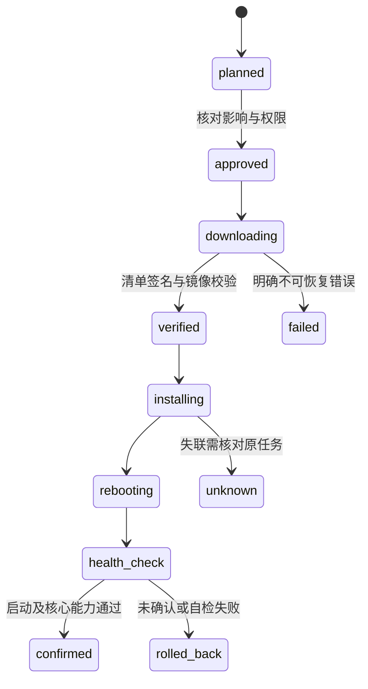

# OTA 与制品交付规范

更新日期：2026-11-01。状态：设计基线。平台负责制品信任、升级策略和任务恢复，底层使用目标系统支持的安全启动与更新机制。

## 1. 制品分类

设备固件、网关程序、辅助协议进程、应用/组合包、模型映射和模型文件分别有版本、摘要、来源与兼容条件。它们不必同步升级，发布兼容矩阵决定组合是否受支持。

第三方桥接设备仅在厂商接口、授权和实测允许时支持升级。发现型号不等于有 OTA 权，不能对未知设备套用原生固件更新。

## 2. 签名清单

| 字段 | 规则 |
| --- | --- |
| schema/version/artifact_id | 清单格式及不可变制品身份 |
| target / hardware_revisions | 精确产品、架构、板卡及芯片范围 |
| version / compatibility | 当前目标版本、最低引导程序、协议与模型条件 |
| size / sha256 | 实际镜像长度与内容摘要 |
| security_epoch | 安全升级代次，防止被禁止的降级 |
| download | 受控来源、传输和恢复能力，不接受任意重定向 |
| signing_key_id / signature | 明确签名用途与可信发布链 |

摘要校验一致性，签名校验可信来源，两者不能互相替代。平台清单签名和 ESP Secure Boot 镜像签名是不同层次，分别选用目标芯片支持的成熟算法与工具。

## 3. 升级过程

升级任务绑定设备、当前版本、目标制品摘要、发起主体、期限和策略；实际执行前再验型号、电量、空间、当前任务和授权。运动或清洁设备进入产品定义的可升级状态后再执行，不能在关键动作中强制重启。

## 4. 原生设备

采用 ESP-IDF 支持的备用 OTA 分区与启动确认；分区布局和最小 Flash 在 BSP 中固定。写入备用区后验证并切换，首次启动通过必要自检后确认；未确认按实际引导配置回滚。

下载中断、掉电、镜像损坏、错误板卡、证书失效、版本被撤销和分区不足分别返回可定位结果。反回滚与 eFuse 等不可逆硬件设置在量产方案中单独审定，不能通过普通远程任务随意写入。

## 5. 网关与数据库

网关发布为目标架构的签名包或受控镜像，由更新管理器安装并完成健康验证。应用程序回滚不等于数据库可回滚；Migration 必须说明前后版本兼容、备份与恢复要求。

先完成预检与备份验证，再停机迁移和切换；迁移账本与校验和可追踪。遇到不兼容迁移，不提供虚假的“一键无损回退”。操作系统与网关应用升级分开管理。

## 6. 批次与发布

开发设备 → 内部样机 → 小批试点 → 固定型号逐批扩大。每批设置确认窗口、失败阈值和暂停政策，异常时停止后续批次，不能以平均成功率忽略特定硬件修订故障。

发布制品包含源提交、工具链、依赖锁、SBOM、构建参数、摘要、签名、兼容矩阵、升级说明和恢复入口。签名密钥不放入仓库或普通 CI 环境；测试密钥与生产发布密钥隔离。

## 7. 验收

逐硬件/架构验证下载、写入、切换和首次启动各阶段断电；验证安全启动、坏签名、撤销制品、错误型号、空间不足、回滚和恢复。下载成功、重启成功、版本自报和健康确认分别记录。
