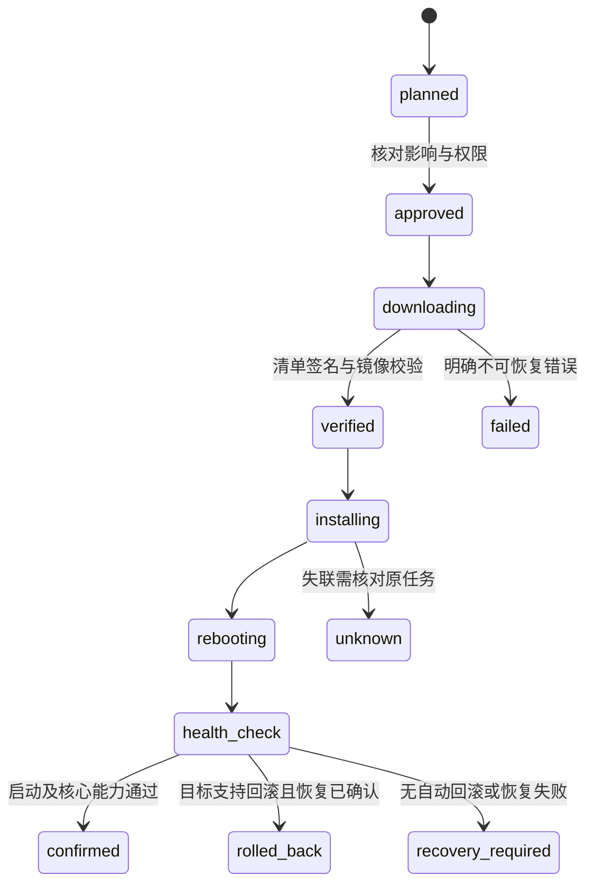

# OTA 与制品交付规范

更新日期：2026-11-03。状态：离线验签/预检、受控下载、本地耐久计划/明确批准、网关执行与设备证据恢复已实现；C3 SDK和产品已接独立策略/HTTPS CA、备用区安装、本次镜像健康确认及新启动结果恢复。另已实现离线密钥/签名包、本地不可覆盖制品仓库和NAS只读HTTPS适配，版本与安全代次进入实际目标镜像；正式托管未发布，实机回滚验收按用户要求跳过。当前合同见 [固件签名与发布](../contracts/ota-release.md)、[固件制品校验与下载](../contracts/ota.md) 和 [本地升级任务](../contracts/ota-tasks.md)。平台负责信任、策略及任务恢复，底层使用目标系统支持的启动与更新机制。

`ota publish` 仅在重验配方/清单/回执、独立trust及实际C3镜像后，独占写入制品身份目录并原子提交标记。NAS只读挂载，仅提供已提交的镜像和清单；未提交目录、内部元数据、写请求拒绝。入库不安装、不修改信任，也不改变网关外连策略。版本构建配置、eFuse防降级的显式选择及实际镜像核对见 [固件构建](../firmware/README.md#esp32-c3-目标构建)。NAS备份包含制品，期间须暂停所有发布写入；旧备份无制品时从独立保留的签名包明确导入。

设备日志保存完整原Envelope及JCS摘要，开始安装前耐久记录；重启恢复的未决记录冻结，只可查询或凭新的本机证据收敛，不自动续装。成功/回滚要求新boot、精确目标/基线镜像、版本及安全代次和已确认启动。存储返回失败后当前对象拒绝继续使用，须重开读取实际状态。独立NVS命名空间与原控制回执共用分区，最多4条/32KiB，空间不足拒绝且不擦除控制回执。10组真实文件/进程故障检查已通过，不能据此推断实机NVS断电或安装已完成；具体接口见 [固件执行日志](../firmware/README.md#设备执行日志)。

C消费者已接入安装/原查询报文和ota_result；严格核对当前会话，查询只返回当前本机证据支持的原结果。缺记录或恢复未决保持未知，撤销不触发重装。无提供方时预检通过也耐久拒绝ota_installer_unavailable；开发产品通过独立CA配置及本次镜像健康门禁连接可选提供方，不隐式授予新安装权限。

低层 `li_ota_transfer_run` 只负责单次HTTPS、有界写入、原生镜像校验及按原清单声明长度完整回读SHA-256；各IO前后核对授权和30秒预算，单次阻塞仍由端口限时。ESP适配只使用非运行备用区、独立CA及主机名验证，不选择启动分区或重启。6组新增真实宿主HTTPS/文件故障检查与原25项共31项通过，两份C3目标编译/镜像校验通过。宿主finish为文件夹具，ESP TLS、Flash和原生镜像校验没有板上证据；低层接口通过独立安装提供方连接消费者，不据此宣称完整设备升级已交付。见 [设备传输合同](../contracts/ota.md#设备有界传输端口)。

可选安装器在写备用区前提交installing，暂存验证、完整再预检及运行基线通过后先提交awaiting_boot，再选择启动、提交本机凭据并请求重启。选择/提交错误可能已经生效，保留未知且不重放。11条真实MQTT旅程包含Rust计划批准执行、HTTPS、故障恢复及新启动终态；宿主启动为文件夹具。产品初始化与健康门禁见 [独立OTA传输配置与镜像健康](../firmware/README.md#独立ota传输配置与镜像健康)。

## 1. 制品分类

设备固件、网关程序、辅助协议进程、应用/组合包、模型映射和模型文件分别有版本、摘要、来源与兼容条件。它们不必同步升级，发布兼容矩阵决定组合是否受支持。

第三方桥接设备仅在厂商接口、授权和实测允许时支持升级。发现型号不等于有 OTA 权，不能对未知设备套用原生固件更新。

当前 [正式 OTA 合同](../contracts/ota.md) 的 `kind` 仅支持 `device-firmware`，用于已定义硬件目标的固件验签、预检与受控下载。以下分类和提供方是架构设计；APK、网关、协议进程、模型映射及厂商更新不能伪装成该固件类别复用信任和校验结论。

## 2. 签名清单

| 字段 | 规则 |
| --- | --- |
| schema/version/artifact_id | 清单格式及不可变制品身份 |
| target / hardware_revisions | 精确产品、架构、板卡及芯片范围 |
| version / compatibility | 当前目标版本、最低引导程序、协议与模型条件 |
| size / sha256 | 实际镜像长度与内容摘要 |
| security_epoch | 安全升级代次，防止被禁止的降级 |
| download | 受控来源、传输和恢复能力，不接受任意重定向 |
| signing_key_id / signature | 明确签名用途与可信发布链 |

摘要校验一致性，签名校验可信来源，两者不能互相替代。平台清单签名和 ESP Secure Boot 镜像签名是不同层次，分别选用目标芯片支持的成熟算法与工具。

## 3. 升级过程

升级任务绑定设备、当前版本、目标制品摘要、发起主体、期限和策略；实际执行前再验型号、电量、空间、当前任务和授权。运动或清洁设备进入产品定义的可升级状态后再执行，不能在关键动作中强制重启。

当前已接通 [设备信息上报](../contracts/device-info.md)：C核心读取产品端口，Rust绑定模型、boot/session并计算独立5秒有效期，本地HTTP提供报告和fresh。本地计划/批准保存历史观测，恢复或新会话要求重新批准。C3产品仅在独立完整策略/CA、本次健康确认、原生VALID和运行/选择一致时声明safe_to_update=true；未知或损坏元数据不允许升级，执行仍需实时完整预检。

## 4. 原生设备

采用 ESP-IDF 支持的备用 OTA 分区与启动确认；分区布局和最小 Flash 在 BSP 中固定。写入备用区后验证并切换，首次启动通过必要自检后确认；未确认按实际引导配置回滚。

下载中断、掉电、镜像损坏、错误板卡、证书失效、版本被撤销和分区不足分别返回可定位结果。反回滚与 eFuse 等不可逆硬件设置在量产方案中单独审定，不能通过普通远程任务随意写入。

## 5. 网关与数据库

网关发布为目标架构的签名包或受控镜像，由更新管理器安装并完成健康验证。应用程序回滚不等于数据库可回滚；Migration 必须说明前后版本兼容、备份与恢复要求。

先完成预检与备份验证，再停机迁移和切换；迁移账本与校验和可追踪。遇到不兼容迁移，不提供虚假的“一键无损回退”。操作系统与网关应用升级分开管理。

## 6. 批次与发布

开发设备 → 内部样机 → 小批试点 → 固定型号逐批扩大。每批设置确认窗口、失败阈值和暂停政策，异常时停止后续批次，不能以平均成功率忽略特定硬件修订故障。

发布制品包含源提交、工具链、依赖锁、SBOM、构建参数、摘要、签名、兼容矩阵、升级说明和恢复入口。签名密钥不放入仓库或普通 CI 环境；测试密钥与生产发布密钥隔离。

## 7. 验收

逐硬件/架构验证下载、写入、切换和首次启动各阶段断电；验证安全启动、坏签名、撤销制品、错误型号、空间不足、回滚和恢复。下载成功、重启成功、版本自报和健康确认分别记录。

## 8. 统一治理与按目标执行

平台统一制品来源、授权、目标匹配、兼容策略、批次、原任务和审计；具体更新交由按目标分类的提供方执行。协议适配器可以承载提供方，但控制能力不自动包含更新能力。共同接口只表达各机制确实支持的检查、准备、开始、查询和可选取消/回滚，不要求未知设备实现完整生命周期。

| 更新目标 | 执行机制与匹配依据 | 恢复边界 |
| --- | --- | --- |
| 自有 MCU 固件 | 产品、芯片、板卡/硬件修订、Bootloader、分区与模型条件；首期 ESP-IDF | 依配置使用备用槽和启动确认，实测回滚；其他 MCU 单独适配 |
| TV Agent / Android 应用 | 包名、签名证书、版本码、最低系统/API、ABI 及安装来源政策 | APK 更新不同于电视 OS 更新；普通应用可能需要系统安装交互，不能承诺静默安装或降级 |
| Linux 网关/辅助适配进程 | OS/架构、应用包或镜像、配置与数据格式 | 程序切换与数据库恢复分开；更新管理器需要独立恢复入口 |
| 自有 Linux 设备 OS | 板卡、Bootloader、分区布局、安全启动及供应链；可评估 RAUC 等成熟方案 | 须具备相应 slot/启动器集成；不能用应用插件更新任意接管 NAS 宿主 OS |
| 型号映射/模型/应用组合 | 不可变资料、当前模型/映射及消费者兼容报告 | 回退定义不等于撤销已发生的物理动作；不能静默改变绑定与单位 |
| 第三方 Zigbee/Matter 等设备固件 | 厂商/产品、镜像类型、硬件/固件适用范围、信任及接口资格 | 固件来源和目标校验由该机制验证；协议可传输不表示厂商允许安装或降级 |
| 厂商云管理的更新 | 获准接口、厂商任务 ID、设备与地区、当前权限和实际状态 | 可以只支持查询或转交厂商流程；厂商无回滚/取消时如实呈现 |

设备可有无线模组、业务 MCU、Agent、OS 等多个更新目标。目标清单分别记录已观测版本、当前来源与时间、更新提供方及可用操作；未知硬件、未知当前版本或未知升级能力不能按支持处理。外部版本格式保留其原始值和提供方比较规则，不强制把 Android versionCode、Matter SoftwareVersion 等转换成平台三段语义版本。现行原生固件合同仍严格执行自身版本规则。

厂商制品保留原签名和信任要求；平台对来源/策略的签名不能替代厂商或 Bootloader 验证。固件、模型、插件与 APK 使用各自用途和授权范围，不共用一个无限制发布密钥。CRC/摘要校验、来源签名、安全启动及健康确认分别验收，依据见 [35](35-多品牌设备接入与升级架构调研.md)。

## 9. 任务恢复、兼容与回滚能力

每个任务固定逻辑设备及部件、提供方/映射版本、当前版本证据、目标制品或厂商不可变发布标识、当前授权和兼容计划。厂商不暴露镜像摘要时记录明确限制，不编造摘要。执行前重新读取可信且足够新的设备状态，核对电量、空闲/安全状态、空间、依赖和撤销；离线快照预检成功不自动授权执行。

按升级目标及共享升级域互斥，避免同时更新共享同一模组/Bootloader 的部件。暂停会冲突的控制命令与自动化；不默认将无关设备全部停用。组合升级先验证可接受的中间版本与更新顺序；断电后按已确认阶段查询恢复，不承诺多个部件同时成功。

安装请求先耐久记录原操作和提供方任务引用；响应丢失或重启后查询原任务和目标状态，不以新请求代替未知结果。提供方没有查询能力时进入待核对/人工恢复；不以超时推断未安装，也不自动换通道刷写。取消下载、取消安装和回滚是不同能力，实际进入不可中断阶段后不得虚报已取消。

更新后核对实际版本、启动健康与关键能力，必要时重新访谈并验证模型/映射兼容。健康失败根据提供方能力选择自动回滚、人工恢复或继续保持隔离；无回滚能力的设备不能显示“一键还原”。反回滚安全代次、厂商降级限制、数据迁移和密钥状态可能阻止旧版本恢复，恢复计划在发布前明确。

每个提供方分别验证错误型号、错误部件、坏签名/摘要、旧状态、依赖不满足、休眠、断网、进程重启、传输/安装/首次启动中断、恢复与能力变化；只验证支持的操作，并把不支持项登记为限制。统一升级界面不得把下载完成、厂商请求已接受、设备版本自报或进度 100% 单独作为全部健康确认。

### 9.1 发布兼容组合与中间状态

多部件设备使用按目标拆分的兼容组合，不设一个全局版本号推断所有部件兼容。发布前至少核对以下维度；它们是发布设计要求，当前`device-firmware`合同的字段与规则保持原范围。

| 维度 | 发布计划固定的依据 | 不满足时 |
| --- | --- | --- |
| 物理目标与安装身份 | 产品/板卡/硬件修订、部件、架构；APK另固定包名和签名身份 | 拒绝安装，不以营销型号或协议名称替代匹配 |
| 运行组合 | 固件/Agent、协议、模型、映射及适配器版本的已验组合 | 未验证组合留在试点或待核对，不自动选择各自最新版本 |
| 存储与身份连续性 | 数据/日志格式可读范围、迁移方向、密钥引用及当前撤销状态 | 阻断不兼容切换；程序回退不能同时回退安全与命令边界 |
| 恢复路径 | 各目标可恢复版本、安装权限、反回滚限制与人工入口 | 明示恢复限制，无可行路径时不扩大批次 |

有依赖的更新必须同时列出基线、每个允许停留的中间组合与最终组合，并为每一步绑定原任务和健康证据。先更新哪一部件由该兼容计划决定，不固定为“先网关”或“先固件”。某一步失败或结果未知时暂停后续步骤，查询原任务及实际版本；只有证明兼容后才继续或按该目标机制恢复。

固件或映射变化导致执行入口、能力或权限不同，应重新描述并走明确绑定/授权用例，不能借升级自动接管执行权。更新管理器保留必要恢复入口，与正在更新的业务进程分别考虑；多设备批次只负责顺序、阈值和暂停，不提供跨目标原子提交。

### 9.2 设备日志提交失败的恢复语义

当前 MCU 的 [OTA日志接口](../firmware/components/limeiot_core/include/limeiot_ota_log.h) 约定：写端口返回失败时，完整快照可能已经耐久提交，调用方不能推断为“尚未写入”。日志进入故障状态后，合法的准备、推进、启动绑定、终态提交及原记录查询均返回 `LI_STORAGE`，`blocked` 保持为真；同对象重连或换证不能解除。它与控制回执仍可只读核对已知原结果的边界不同，调用方不能复用控制回执的故障查询行为。

明确关闭重开后，重新验证实际快照及其版本、校验和、原请求，不根据失败前的内存状态修补日志。恢复出的未决记录保留占用，禁止继续推进安装或首次补写启动绑定；原查询不触发传输、安装、启动选择或重启。缺记录也不能单独证明外部安装未发生，更不能据此自动重建安装请求。

已保存终态与可对外发布的终态仍需区分。提交失败的当前对象不能公布成功或释放占用；重开读到终态后，发布仍须按原任务核对当前运行镜像、启动绑定及相应本机证据。读到未决时，只能查询，或以合同允许的独立本机证据耐久收敛；不能用证书有效、重启完成或进度值替代安装结果。

上述边界现有 [24第4.42节](24-实施计划与进度.md#442-ota日志跨身份维护与进程恢复的提交故障) 的16项软件故障证据，执行矩阵见 [23第5.3节](23-测试策略与验收矩阵.md#53-ota日志跨恢复提交故障矩阵)。同轮实际NAS维护身份进入生产worker，真实MQTT原查询、重连和设备进程重开均不新增安装；所有被核对的报文须先由worker消费、队列排空。运行基线、成功/回滚终态及安装端口为明确夹具，不证明实际镜像或启动健康。其他升级机制按自己的提供方合同分别验证，不直接继承 MCU 的状态或返回码。

## 10. 升级能力声明与提供方准入

升级能力按“设备部件 + 当前系统/引导配置 + 提供方版本”登记，不能只给整台设备设置一个“支持 OTA”开关。以下为逻辑能力与验收要求，尚未增加通用提供方 Schema、API 或新的制品 kind；现有正式合同继续按其已定义范围执行。

| 能力 | 发布前须明确 | 缺失时的行为 |
| --- | --- | --- |
| 检查与目标匹配 | 当前版本来源、适用硬件/部件、版本比较与依赖规则、制品来源及信任 | 未知或不匹配时拒绝安装；仅能查询的设备只展示信息 |
| 安装 | 安装主体、所需交互/权限、可接受中间版本、不可中断阶段与互斥范围 | 不展示执行入口；可转交明确的厂商或人工流程 |
| 查询与恢复 | 原任务标识、可查询阶段、重启后恢复依据及状态新鲜度 | 丢响应保持未知并人工核对，不自动重新安装 |
| 取消 | 下载与安装分别支持到哪个阶段，如何确认停止 | 不承诺中止；批次暂停只阻止后续任务，不代表在途写入停止 |
| 回滚或人工恢复 | 可恢复的精确版本组合、槽位/Bootloader、反回滚、数据兼容及恢复入口 | 明示无法自动回滚；无可行恢复方案时不扩大试点 |
| 健康确认 | 实际版本、启动确认与关键能力的证据来源和期限 | 保持待确认/待恢复，不以请求受理或下载完成代替成功 |

能力声明固定证据及其有效范围，不把“尚未测试”“明确不支持”和“暂时不可用”合并。APK 更新须校验安装身份与签名连续性，是否需要用户交互以实际系统政策为准；OS、Bootloader 和 MCU 固件分别使用各自的安装与恢复机制。

新增提供方先通过隔离合同测试，再用精确硬件/系统目标验证正常安装和故障恢复。第二种真实更新机制出现后，再据共同语义固化通用提供方合同；统一入口可以先提供一致的任务展示，不为接口整齐而虚构取消或回滚能力。当前实现与下一项验收只在 [24](24-实施计划与进度.md) 维护。

### 10.1 TV Agent 更新与设备记录连续性

TV Agent 的 APK 更新属于独立提供方设计，当前应用已有调试APK、宿主检查和独立端上测试入口，不包含安装器或更新能力，也未安装到真实电视。最新端上诊断与剩余阻塞见 [24第4.24节](24-实施计划与进度.md#424-独立启动诊断与android安全组端上验证)，后续依赖见 [第4.21节](24-实施计划与进度.md#421-电视与多品牌文档复核及后续交付顺序)。Android应用的完整门槛见 [34 第5.3节](34-电视终端与AndroidTV接入.md#53-android-应用的交付门槛)；APK构建、测试APK安装和Keystore单项通过均不等于更新链路通过。

更新前固定包名、签名身份、版本码、最低 API/ABI、设备身份及存储格式兼容范围，明确安装交互和恢复入口。切换前停止接收新动作，核对在途原命令；更新后保留设备凭据、本机授权和耐久回执，再创建新的启动/连接会话。存储迁移失败时阻断控制，原未决动作保持未知；不能用卸载重装、换设备 ID、清空日志或恢复旧备份绕过记录与撤销。

当前身份兼容范围还须区分旧PEM材料v1/v2、本机引用材料v3、SQLite数据库v3、内部身份记录v1、内部轮换记录v1/v2/v3与命令日志v2/v3；版本号相同不表示格式相同。内部轮换v3增加恢复原因与来源，普通新轮换仍写v2。更新后核对原请求、证书、实际KeyStore公钥及完整授权/日志，不能只检查数据库能否打开。仅备份SQLite无法恢复不可导出身份键，不能把卸载重装视为恢复路径。受控旧键清理的历史证据见 [24第4.30节](24-实施计划与进度.md#430-tv已撤销旧密钥的受控清理与文档同步)，当前过期维护软件及端上缺口见 [第4.33节](24-实施计划与进度.md#433-tv过期身份维护与持续有效期软件闭环)，精确恢复规则见 [设备合同](../contracts/tv-agent.md#过期身份的受控维护)；APK更新仍独立交付，不能继承身份检查的验收结果。

APK迁移必须保留原清理意图、CRL、批准时刻及完成记录；恢复`deleting`只沿原决定继续，不能因更新替换证明或自动再批准删除。旧内部轮换v1保持可读但无法定位旧alias，不得补猜引用；不理解v2的旧程序不能通过清数据回退。清理后的历史私钥不再可用，更新或恢复备份不能让它重新成为当前身份；精确边界见 [清理合同](../contracts/tv-agent.md#已撤销旧密钥的受控清理)，不据此承诺系统防降级、旧备份防回退或安全擦除。

程序回退必须同时验证日志/配置可读、签名和系统降级政策；无法证明兼容时转人工恢复，不承诺无损降级。设备退役或所有权转移另走身份撤销与重新认领流程，不能作为普通更新步骤。APK 安装与重启后连接、实际版本、能力和原操作恢复分别验收；更新成功不增加普通应用的系统权限，也不授予电视 OS 更新权。

APK提供方的首个验收切片须固定旧包/新包及签名摘要，并覆盖签名或API/ABI不匹配时零安装、用户取消或安装中断后的原任务核对，以及更新后设备身份、授权、confirmed/unknown记录与回收边界连续。安装受理后未取得系统结果时保留未知，先查询原安装会话或核对实际安装包；不能把版本号变化单独当作完整健康证明，也不能自动重建安装任务。只有取得第二种实际更新机制的安装与恢复证据后，再提取通用提供方合同。

TV Agent已实现两种固定逻辑模型配置，材料v2显式选择并在本机核对。旧应用模型日志v1/v2可单向迁入遥控配置v3：完整保留原请求/结果、unknown、未决及high_watermark，不改写历史模型/会话。Android在同一SQLite事务更新加密材料及迁移日志，失败一起回滚，授权保留；禁止退回旧模型或清空记录。直接设备核心须先耐久迁移再发hello，正式格式见 [设备合同](../contracts/tv-agent.md)。这些是材料/记录兼容能力，不是APK安装器或更新提供方。

模型配置、网关Device模型绑定、执行compose及APK更新分别管理。本机迁移不会变更网关绑定；已有网关设备跨内置模型的独立JVM软件迁移已通过，实际电视另验。独立Java回收、Android宿主/调试APK/lint的软件复验已有 [24第4.17节](24-实施计划与进度.md#417-tv-agent独立jvm回收与android软件复验) 的冻结结果，实际JVM Agent/假ADB组合的软件结果见 [24第4.22节](24-实施计划与进度.md#422-adb身份预检合并与实际jvm组合软件验收)；后续内置模型绑定与跨模型软件闭环见 [第4.19节](24-实施计划与进度.md#419-内置模型绑定与跨模型软件闭环)。历史协议夹具、本机事务和软件构建不计APK更新或设备固件升级通过。

内置模型目录随网关程序交付，新增目录版本不自动换绑设备，也不更新Agent APK或电视OS。程序升级/回退须验证已引用模型来源、历史原决定与快照格式仍可恢复；设备本机日志版本和网关快照版本独立演进。内置绑定来源由快照v8引入，当前读取/写入版本由 [执行合同](../contracts/execution-routes.md#快照与验证) 维护；旧版本夹带新来源拒绝，不支持当前格式的程序不能继续控制新库。模型来源归属见 [04第2.4节](04-领域模型与数据设计.md#24-内置模型来源与明确换绑)，已有设备跨模型软件结果见 [24第4.19节](24-实施计划与进度.md#419-内置模型绑定与跨模型软件闭环)。

回执退休边界也属于更新兼容状态。TV Agent日志v2/v3与 [回执确认合同](../contracts/command-receipts.md) 已实现有序ID拒绝边界、旧日志加载及提交后回收；旧程序无法理解新日志时应拒绝控制。设备单边旧快照从原网关完整账本恢复边界；同时回退两端不能证明历史完整，须有独立恢复依据。APK更新提供方及真实升级连续性仍待实现/验收，要求见 [34 第5.4节](34-电视终端与AndroidTV接入.md#54-耐久回执容量与安全回收的设计门槛)。

### 10.2 身份维护与软件更新分别推进

更新计划须核对执行路径所需凭据的当前有效期，以及预计传输、安装和健康确认窗口；窗口不足时先按该身份机制完成维护，或暂停计划，不由更新提供方自行延长证书、切换CA或恢复撤销凭据。更新过程中身份失效，按目标系统的安全阶段停止新请求并查询原任务；已进入不可中断安装阶段时，依其恢复机制处理，不把断开连接等同于取消安装。

对TV而言，升级前后的维护视图、原CSR/换钥请求、恢复用途及未知结果也属于存储兼容范围。新包不能将未完成普通轮换改成另一次恢复申请，旧包不理解后续记录格式时须拒绝控制。当前内部轮换v3固定恢复原因与来源，旧v1/v2保持可读；材料和SQLite仍分别为v3，内部身份仍v1，日志仍v2/v3，精确兼容见 [设备合同](../contracts/tv-agent.md#过期身份的受控维护)。维护读取不能创建可绕过日期检查的TLS工厂，身份恢复完成也不证明APK已安装或更新健康。身份与执行资格见 [12第3.1节](12-身份认证与安全体系.md#31-维护读取与当前执行资格)，TV原请求边界见 [34第5.5.8节](34-电视终端与AndroidTV接入.md#558-过期身份维护与原请求连续性)。APK提供方仍按第10.1节独立交付。

凭据有效期的验收须覆盖实际使用它的执行链路，分层标准见 [23第5.1节](23-测试策略与验收矩阵.md#51-身份到期与执行链路的分层验收)。C3身份维护、窗口模块、生产适配器宿主旅程及确定性worker边界已有各自软件证据，当前范围统一见 [24总览](24-实施计划与进度.md#当前接入与恢复状态)。宿主旅程覆盖真实mTLS、队列和灯驱动夹具的到期保护；生产传输与凭据窗口组合的独立软件证据见第10.3节，完整安装提供方、激活和不可中断阶段的失效仍分别验收。

重新签发身份后仍沿原升级任务核对，不能据新连接推断旧安装未执行或重新发送安装请求。C3新实例须加载原OTA日志及完整请求/摘要/基线；恢复出的未决记录保持占用，不能因换证继续推进安装。原任务查询只读取执行事实，终态依实际运行镜像、启动绑定与确认状态收敛，身份有效本身不能释放占用。命令回执与OTA日志分别保留，不以清空任一账本恢复可控状态。

同进程身份存储/TLS与常规跨进程恢复现有 [24第4.38节](24-实施计划与进度.md#438-c3同进程身份与跨进程执行记录恢复) 的独立软件证据：未决OTA经生产日志API形成，换证重开后原安装Envelope、日志字节及占用保留；安装推进被拒绝，API和真实MQTT原查询均不写日志或安装。[第4.39节](24-实施计划与进度.md#439-c3恢复读取与控制回执提交故障) 补充损坏/未来版本OTA日志及长度/正文读取失败时的启动拒绝，原字节保持，MQTT初始化和驱动效果均为0。后续 [第4.42节](24-实施计划与进度.md#442-ota日志跨身份维护与进程恢复的提交故障) 用同轮维护身份覆盖8个提交点的提交前/耐久后报错、同对象重连与设备进程重开，共16项。该矩阵不再重开网关SQLite，设备消费以端侧计数和队列排空证明；前述常规旅程独立覆盖网关重开。日志基线、文件NVS和终态观察仍为夹具；传输层失效另见第10.3节，完整安装提供方、目标系统及芯片掉电继续按 [23第5.2节](23-测试策略与验收矩阵.md#52-换证后新进程与已有执行记录的连续性) 分别取证。

### 10.3 传输期间凭据失效

下载HTTPS的独立CA验证来源，设备身份窗口验证当前执行资格，两者分别有效才可继续；HTTPS连接仍可读不能替代设备资格检查。提供方应将当前凭据窗口连同本次日志、会话/策略和设备事实绑定到传输guard，保持生产代码每个I/O前后的核对，不以开始下载时的一次检查代替。

`npm run test:firmware:ota-credentials`组合生产`ota_transfer.c`、`credential_window.c`及固定SDK密码库，9项独立软件检查通过，结果见 [24第4.43节](24-实施计划与进度.md#443-ota传输期间凭据失效的软件验证)，矩阵见 [23第5.4节](23-测试策略与验收矩阵.md#54-ota传输期间的凭据保护)。叶证书/CA分别在实际HTTPS读取和备用文件完整回读期间跨过真实有效期；可信时钟失效另覆盖首次I/O前、读取、写入和回读。失效后的新I/O为0，不返回镜像验证证明，同一窗口恢复可信时钟后重试仍无新请求。CA到期时叶证书自身仍有效，下载CA始终独立。

失败可能留下已写入的全部或部分备用内容。`abort`负责端口收尾，不证明内容已擦除；文件存在、接收长度完整或曾执行finish都不能替代完整回读与当前资格。明确重新打开凭据窗口也不授权恢复安装，仍须遵循第9.2节的原日志与占用规则。

该专项使用262,145字节合成内容、宿主OpenSSL HTTPS、备用文件和finish夹具，未进入安装消费者、MQTT/worker、NVS、启动选择或重启。它不提升真实ESP TLS、原生镜像校验、Flash及不可中断安装阶段的验收；这些仍须沿完整提供方分别取得证据。

### 10.4 完整安装提供方的失权与激活边界

现有C安装消费者已实现暂存、重新预检、耐久`awaiting_boot`、启动选择、启动绑定保存及重启顺序，生产ESP提供方已有对应端口。实现入口为 [ota_device.c](../firmware/components/limeiot_core/src/ota_device.c) 和 [ota_transfer.c](../firmware/components/limeiot_espidf/src/ota_transfer.c)。生产worker/消费者与凭据窗口的12项组合软件结果见 [24第4.45节](24-实施计划与进度.md#445-安装消费者跨凭据失效与原任务恢复的软件验证)；本节维护行为约束，原生ESP安装端口和目标系统仍独立验收。

| 失权或错误发生的位置 | 原任务与本机收尾 | 恢复及结果边界 |
| --- | --- | --- |
| 下载/暂存，尚未保存`awaiting_boot` | guard阻止新增I/O；只有当前运行镜像与原基线精确一致、失败日志耐久保存时，才可形成`failed` | 不能核实基线或提交失败时保留未决/存储故障；本地保存结果不等于可发布，失效身份不能借收尾继续网络操作 |
| `awaiting_boot`已保存，启动选择尚未调用 | 选择前guard拒绝时不调用激活，保留原日志及占用 | 当前实现从该阶段起不生成`failed`；即使本次已知未调用选择，也不能据此自动回退日志、释放占用或重装 |
| 启动选择已调用，但返回失败或无法核实选择结果 | 保留实际选择及原`awaiting_boot`；不能补造启动绑定 | 选择端口报错不证明未生效；只按原任务与可取得的本机事实查询，缺少证据继续未决 |
| 激活已返回经核实的启动绑定，随后凭据失效 | 当前C消费者继续保存该绑定；保存成功后请求本机重启，结果发布仍受当前身份门禁约束 | 这是已发生选择的本机收尾，不恢复下载或再次选择的权限；不能机械添加网络资格检查而遗失实际绑定 |
| 启动绑定提交失败或提交后报错 | 当前故障对象停止，不请求重启；重开读取实际耐久快照 | 区分绑定是否真正保存，保持第9.2节的存储故障与原查询语义，不依据端口返回值猜测持久状态 |

恢复当前身份和明确重开实例不授予旧请求重新安装的权限。恢复流程保留原Envelope、执行ID、摘要、基线与实际已有绑定，查询不触发下载、写入、启动选择或重启；成功/回滚由独立启动观察和健康证据确认。绑定缺失或事实不足时继续未决，不能由“仍在运行旧版本”推定安装失败。

完整提供方的待验收矩阵见 [23第5.5节](23-测试策略与验收矩阵.md#55-完整安装提供方的待验收矩阵)。4.42日志故障与4.43传输保护的独立通过结果不能相加成上述组合已通过；APK、Linux及厂商更新提供方也须按自己的不可逆操作和可观测证据分别实现，不照搬ESP分区或启动绑定格式。

`npm run test:firmware:ota-install-credentials`在同一进程运行生产`espidf.c`/worker、C安装消费者、凭据窗口与传输核心，通过真实mTLS/Broker/Rust/SQLite及独立CA的HTTPS。12项分3/4/5三个进程组，分别覆盖有效正例、叶证书读中到期、CA回读中到期、可信时钟在读/写/回读/暂存结束/awaiting_boot/选择后/返回绑定后失效，以及绑定提交前与耐久后报错。每项45秒、每组120秒；同一实例恢复可信时钟仍冻结。重开使用同一设备的有效原凭据，只查询旧任务及拒绝旧会话重投，不执行NAS换证或CSR维护。

运行基线、备用文件/finish、启动选择/绑定、重启请求和不可用启动观察器为显式宿主端口；原生`espidf/src/ota_transfer.c`没有由本专项执行。结果证明消费者的本机收尾和网络门禁，不能提升为有效ESP镜像、Flash、真实启动/健康、芯片掉电或自动身份恢复通过。成功正例在此仅达到`awaiting_boot`并记录重启请求。

### 10.5 ESP原生提供方的证据边界

必须区分两个同名实现：[核心传输](../firmware/components/limeiot_core/src/ota_transfer.c)负责通用传输、摘要、回读与guard顺序；[ESP原生提供方](../firmware/components/limeiot_espidf/src/ota_transfer.c)将其接入ESP HTTP、OTA分区及启动元数据，并实现激活与结果观察。4.43和4.45运行了前者，未直接运行后者；已有目标编译及独立`image_health.c`检查也不能代替后者的运行证据。

后续`npm run test:firmware:native-ota`已直接运行ESP提供方的三个生产入口，99项宿主场景通过，范围见 [24第4.47节](24-实施计划与进度.md#447-esp原生ota提供方宿主软件验证)。HTTPS由OpenSSL端口连接真实回环TLS，PSA与CRC使用固定SDK实现，app描述和otadata使用SDK原始结构；文件分区、镜像结构验证及预设启动选择仍为夹具。它不运行worker、安装消费者或耐久日志，不能与4.45相加为完整原生安装链路通过。

| 原生入口 | 生产职责 | 行为与验证关注点 |
| --- | --- | --- |
| `li_espidf_ota_stage` | 使用独立下载CA，经ESP HTTP API读取；向备用分区begin/write/end，并回读校验 | 实际执行该入口，覆盖HTTP响应约束、分区容量、各I/O及finish失败、失权和资源收尾；有部分备用内容不代表安装完成 |
| `li_esp_ota_activate` | 核对目标描述与完整摘要，读取选择前后两份otadata及实际boot分区，返回本次选择的绑定 | 选择前拒绝、选择可能生效后报错、唯一有效序号/槽位及绑定匹配；元数据CRC只用于结构核对，不替代制品签名 |
| `li_esp_ota_observe` | 按原绑定核对目标、选择、镜像及运行事实，确认成功或回滚 | pending、损坏/歧义/变化的选择保持未决；成功须目标运行且VALID，回滚须目标失败状态及原基线版本/安全代次/摘要一致 |

验证分三层推进：先直接运行生产原生提供方，再接回生产worker、消费者和耐久日志验证原任务收敛，最后单列ESP目标系统与硬件证据。若宿主替换底层HTTP、分区、otadata或重启API，逐项记录替换范围、输入和副作用计数，不替换上述三个入口来声称原生提供方通过。后续集成不得从独立提供方报告继承worker、凭据维护或日志恢复结论。

分层矩阵及尚未执行的消费者集成、目标系统验收见 [23第5.6节](23-测试策略与验收矩阵.md#56-esp原生提供方的分层待验收矩阵)。本入口只补现有MCU提供方的软件证据，不增加正式制品类型或通用提供方合同；APK、Linux及厂商更新仍各自交付。

#### 10.5.1 原生组合与报告有效期

组合验证须在同一旅程连接正式网关OTA用例、生产worker、安装消费者、三个原生入口与耐久日志。网关通过计划、批准及执行创建原任务；设备保存原Envelope、执行ID、请求摘要、基线和实际启动绑定。新设备进程按原绑定观察成功、回滚或未决，确定结果须先耐久再发布；重开网关SQLite后仍能关联同一原任务。恢复后查询和重投旧会话安装包不得增加下载、写入、启动选择或重启，未决继续保留占用。具体场景与退出条件由 [23第5.6.1节](23-测试策略与验收矩阵.md#561-原生组合草稿与待执行场景)维护。

工作区已有[组合宿主](../firmware/tests/esp_native_install_host.c)、[场景草稿](../tests/firmware-native-install.test.mjs)和`npm run test:firmware:native-install`入口，当前尚无编译或运行通过证据，状态见 [24第4.48节](24-实施计划与进度.md#448-原生组合草稿与冻结证据文档同步)。宿主计划复用生产实现，只在边界记录调用及注入故障；文件分区/NVS、镜像验证、启动元数据与重启请求仍须逐项披露为夹具，新进程模拟启动不等于真实Bootloader运行。恢复有效原凭据也不构成换证、自动续期或CA迁移证明。

4.47的99场景只对其冻结源码、依赖和二进制有效。组合草稿已修改共享原生宿主及构建入口，旧报告保持历史有效，不能证明当前工作区通过；后续须重新冻结全部实际输入并复验独立提供方及受影响的运行期入口，再单独登记组合结果。源文件、递归包含的头文件、SDK/库、二进制或场景变更时均重新核对证据适用范围，不把构建清单中的能力标志当作执行报告。

## 当前启动恢复接口

启动选择后必须耐久绑定本机凭据，再请求重启；新启动按原清单完整长度及独立确认状态恢复结果，先保存后发布。旧日志不补凭据，原查询复查当前事实且不安装。早期专项和MQTT旅程使用显式启动夹具，目标构建不构成原生运行证据；后续4.47另有冻结版本的原生提供方直接宿主结果，当前组合仍待验收，范围见第10.5节。具体接口与早期验证限制见 [固件启动恢复](../firmware/README.md#启动结果恢复)。

## 离线签名包

使用 [正式签名合同](../contracts/ota-release.md) 和 `ota keygen/sign`，从实际C3镜像生成长度/摘要、不可变身份、签名清单与ready回执，复用现有验签/信任规则；原生格式留在工具适配器。Node独立验签、Rust验证、C验签/预检及真实HTTPS下载通过。签名不读取或授权设备，HTTPS托管/发布仍需独立适配。
