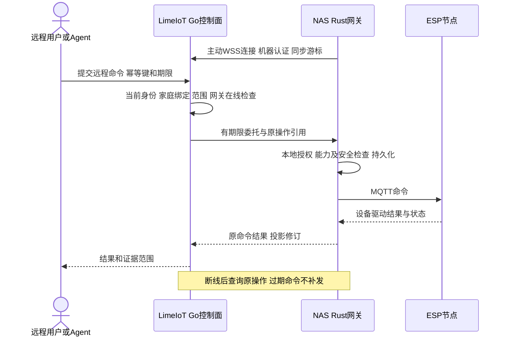

# 云端服务与边云协同

更新日期：2026-11-02。状态：目标设计与已实现子集并存。Go/MySQL账户、空间及配对与Rust本地审核/批准/原绑定恢复已接通；远程中继、Console/Admin页面仍待实现。运行见 [控制面](../server/README.md)，正式接口见 [OpenAPI](../contracts/control.openapi.yaml) 与 [本地配对合同](../contracts/control-pairing.md)。产品为NAS私有化版与LimeIoT官方云服务版；LimeCloud是可选公共能力提供方，云不是设备实时控制的前置依赖。

## 1. 服务归属

| 服务 | 本地/边缘 | 可选云 |
| --- | --- | --- |
| 空间、设备、命令与规则 | 主网关拥有当前执行事实 | 经授权保存投影与原操作引用 |
| 产品模型与组合包 | 可缓存并离线安装受信制品 | 发布目录、签名制品和分发 |
| 多模态能力 | 本地提供方与边缘路由 | 明确允许的数据与模型调用 |
| 应用业务 | 玩具、陪伴、教育、清洁等可按应用部署 | 可选内容、协作或专业服务 |
| 账户与远程接入 | 本地身份独立可用 | 云账号、设备登记和受控中继 |

官方云采用Go/Gin模块化单体和MySQL；同一服务可在NAS私有化部署，不按站点或领域新增常驻微服务。官网/开发文档匿名发布，Console/Admin分别提供用户开发任务和平台运营任务，本地家庭PWA由NAS/网关提供。入口合同见 [15](15-客户端与交互设计.md)。模型Worker、媒体处理等确有隔离或资源需求时独立部署，以任务与事件合同协作。

当前 `server` 是独立公开Go模块，通过消费方接口隔离OIDC和MySQL。私有实例使用独立的所有者/管理员随机凭据，官方云要求两个独立OIDC客户端和显式运营主体允许列表。空间/配对保留原请求键，Ed25519证明绑定控制面、主体、云/本地空间及期限，撤销保留原revision历史。Admin只有脱敏绑定摘要，不拥有家庭成员权。上述行为已通过隔离真实MySQL及HTTP/OIDC夹具；尚未登记或联调真实LimeCloud应用，也未验证网关出站连接。

`npm run test:pairing` 已通过真实Go/MySQL、Rust/CLI、家庭PWA浏览器和NAS备份恢复：先审核再明确批准；响应丢失及重启只查询原status，不重发claim；本地撤销不会被迟到响应恢复。绑定active只表示配对建立，与传输连接状态分开，不等于远程设备控制可用。

出站机器连接现已由 `npm run test:relay` 独立验证真实WSS认证、心跳、当前绑定复核、重连和两侧撤销。默认关闭，安装者显式启用；connected与配对active分别投影。尚不转发远程动作或同步家庭状态，下面的完整远程时序仍为后续目标。

### 1.1 LimeIoT与LimeCloud各自拥有的事实

| LimeIoT | LimeCloud按授权提供 | 明确分界 |
| --- | --- | --- |
| 家庭空间、设备认领、密钥、模型绑定和执行权 | 账号登录、可选组织资料 | `(issuer, subject)`映射到IoT主体；平台组织成员不自动成为家庭所有者 |
| 设备状态机、命令、规则、任务和本地审计 | 获准的Models、Media、Credits等公共服务 | 模型只返回文本/草案，物理执行仍走IoT用例；不把设备数据库交给模型 |
| 网关/固件签名链、OTA和本地恢复 | 后续可选权益、订单、邮件/服务消息 | 付费事实不产生设备控制权；固件签名私钥不交给平台账号服务 |
| 家庭产品和组合应用 | 商业运营基础能力 | 核心运行不依赖Commerce、CRM或平台管理门户 |

MVP的LimeCloud适配先建设账号与文字模型调用，不复制平台账号库、支付或额度账本。平台接口缺少必要能力时回到LimeCloud原领域补齐，不能在IoT私有代码中伪造平台授权。

## 2. 远程访问

网关发起对可信中继的出站连接；不要求家庭设备直接暴露 MQTT 或数据库端口。远程用户身份、空间绑定、当前委托和操作范围分别验证，中继不持有所有设备的长期执行权。

远程命令携带原操作身份、参数摘要、空间、主体、权限证明与期限，网关再次决定是否接受。云端“请求已收取”、网关“已受理”、设备“已执行”分阶段展示，不能合并为成功。

首期远程中继与Go控制面同进程，仅一副本；网关使用已配对的独立机器身份建立出站WSS。MVP在网关离线时拒绝新控制，不建设离线待执行控制队列。发送后连接中断保留原操作未知状态，重连查询原结果，不换ID重新执行。扩为多副本前须解决连接路由和执行权，不能直接增加副本宣称可扩展。

## 3. 同步规则

核心事实由网关拥有，云同步聚合修订、事件和游标。断点续传按 ID 去重、按聚合版本处理，发现缺口重取快照；不按墙上时钟做无条件最后写入覆盖。

云编辑规则或组合部署时提交基于原修订的变更意图，由网关校验并建立新部署记录；冲突返回当前版本供重新准备。离线编辑保持草稿，不显示为已在设备生效。

模型、制品等发布资料由其发布者拥有不可变版本；网关只接受受信发布链。云账号资料与本地空间所有权分开，云账号恢复不能自动接管离线家庭。

## 4. 断网与恢复

断网保留当前有效本地身份、设备控制与规则。第三方云依赖能力标记不可用；不把它们的状态补成 false。重连时先同步撤销、安全代次与原操作结果，再处理仍有效的新请求；旧命令与历史实时事件不补发。

网关损坏恢复使用备份、密钥和所有者证明，恢复后按 [12](12-身份认证与安全体系.md) 重新核对信任。多主和无损迁移不是普通云同步自然提供的能力。

## 5. 云集成与商业边界

LimeCloud作为独立服务接入。LimeIoT通过`IdentityProvider`、`InferenceProvider`、后续需要时的`EntitlementProvider`等消费方窄接口使用；适配器只传公共合同，不导入相邻仓库Go模块、共享数据表或直接查询其数据库。`limecloud/cloud`继续独立仓储和发布，`limecloud/iot`的固件/网关/云/客户端组成一个monorepo。

### 5.1 接入顺序与状态

| 顺序 | 目标 | 实施前必须确认 |
| --- | --- | --- |
| 1 登录 | 官方Console/Admin分别登记，标准OIDC Code+PKCE、独立本站BFF会话 | 精确客户端/回调、issuer/discovery、签名/nonce/state、应用环境、安装与本人同意；官网/文档匿名 |
| 2 家庭绑定 | 本地所有者在物理/本地可信流程中批准关联云主体 | 云登录成功不能直接接管网关；本地主体与平台主体可解除关联 |
| 3 文字模型 | 用真实开放的Models合同生成规则草案 | 模型/提供方已绑定、独立资源授权、用户委托、额度/费用与外发政策 |
| 后续 | Media/通知/权益/商业服务 | 逐项查当前合同和实际开通，不从平台能力地图推断接口已可用 |

2026-11-01源码观察：LimeCloud已有OIDC协议路由；Models注册依赖提供方绑定、OAuth与Credits，当前执行授权解析用户业务Token。因此，登录Token、App ID/Secret取得的应用Token、用户资源Token不能混用；不能把一个应用Secret当作全屋通用模型权限。IoT尚无实际应用登记、Token或联调证据，不在文档预填平台Scope和业务URL。

Web外部Token保存在Go BFF受控会话中，静态前端/固件不嵌入Secret。NAS独立部署使用自己的本地身份；可选OIDC登录失败不取消已有本地所有者的权限。公网控制面的外部账号登录不等于支持首次离线云登录。

### 5.2 模型调用

网关应用层选择已允许的Ollama或LimeCloud提供方。LimeCloud路径经LimeIoT控制面代为调用，只传最少必要设备能力与文本；每次模型调用保留IoT调用ID、平台原调用引用、预算及期限。付费调用结果未知时先查原结果；未取得数据外发和费用许可时，不从本地模型静默切到云端。

设备控制权不由购买记录直接推导，订阅也不覆盖设备本地安全条件。基础本地能力保持完整；付费云、内容和技术服务的授权、费用与退款按商业合同处理。

## 6. 同一服务的部署目标

| 目标 | 前端/API | 存储与提供方 |
| --- | --- | --- |
| NAS家庭私有化 | 网关提供本地PWA与API；无需Go进程即可完成家庭MVP | SQLite、本地制品目录、可选Ollama |
| NAS集中控制面 | 同一Go/Gin服务提供控制面API/BFF和静态资源，局域网反代 | 私有MySQL、文件制品存储适配器；OIDC可选，不必连接任何公有云 |
| LimeIoT官方云服务版 | 官网/文档/Console/Admin由Cloudflare发布；固定API/WSS回源到Railway同一Go/Gin服务 | Railway私网MySQL、R2制品、可选LimeCloud |

NAS集中控制面通过12定义的本地配对和当前授权建立管理员/网关身份，使用受众隔离的短期委托；不把另一个服务的本地Cookie直接当作身份凭据。首期限制单家庭及已配对管理员，不在NAS模式另造面向公网的密码/注册平台。

前两行是NAS私有化版的可选安装范围，不是另外两种产品。完整私有实例需要的Console/Admin复用相同前端制品，身份及存储适配到该私有实例；其管理员只能管理自己的实例。LimeIoT官方运营后台不因同源代码而获得私有NAS的数据或控制权。

官方云用户使用托管服务，不需要自行部署MySQL或拥有NAS。首期家庭仍有轻量网关/常开Linux主机承担本地执行；关联NAS是可选边缘运行方式。设备直接连官方云且不部署家庭网关属于后续运行配置，不能宣称自然拥有本地规则自治。

部署差异限于配置、入口和存储适配器，核心业务保持一套实现。详细容器、TLS、持久化、备份与费用预算见 [22](22-本地开发部署与运维.md)。

## 7. 验收

验证断网、本地授权、延迟/重复同步、同修订冲突、云受理后失联、过期远程命令、撤销和凭据轮换。使用两个独立空间证明中继、列表、订阅和恢复均不会串范围。
