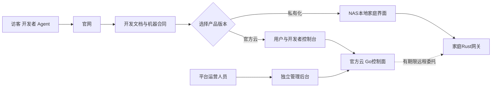
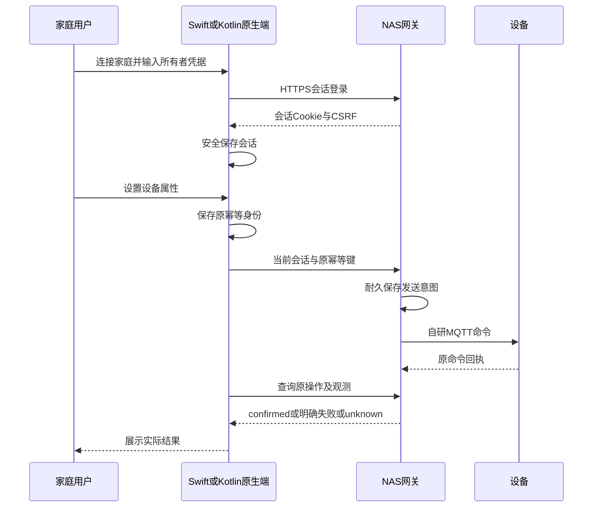

# 客户端与交互设计

更新日期：2026-11-01。状态：设计基线与本地家庭实现并存，验收范围见24。交互以 Agent 可完成的业务任务为先，各界面共用任务合同。

## 1. 任务与显示端

平台提供两个产品版本：**NAS私有化版**与**LimeIoT官方云服务版**。官方云具有官网、开发文档站、用户/开发者控制台和运营管理后台；NAS具有自己的本地家庭界面。LimeCloud是底层公共能力提供方，不是第三个产品版本。

| 入口 | 主要任务 | 完成标准 |
| --- | --- | --- |
| 外部 Agent GUI/TUI | 开发、诊断、配置、部署和任务跟进 | 当前宿主内完成适用步骤及恢复 |
| CLI/脚本 | 非交互开发与运维 | Schema、稳定输出、退出码、原操作引用 |
| 官网 | 理解产品、选择版本、取得下载/开源入口 | 匿名可访问，产品状态与支持证据准确 |
| 开发文档站 | 快速开始、模型/协议/SDK/API/CLI/NAS指南 | 人和Agent读取同源资料及版本，明确设计/已实现状态 |
| 用户/开发者控制台 | 自己的空间、网关、产品模型、设备与制品 | 当前授权、原操作和设备投影准确 |
| 平台运营后台 | 平台健康、制品发布、接入治理、授权审计 | 独立运营身份、最小权限和审计；不自动取得家庭控制权 |
| NAS本地家庭PWA | 本地配对、控制、规则、权限和维护 | 无公网可用，准确展示当前事实 |
| iOS原生客户端 | 连接NAS/获准云入口、家庭控制、联动和记录 | Swift/SwiftUI；当前身份、原操作恢复、局域网和前后台语义 |
| Android原生客户端 | 与iOS相同的家庭任务 | Kotlin/Jetpack Compose；相同合同与执行证据，独立原生界面 |
| 玩具/语音/机器人 | 无屏多模态互动和任务反馈 | 通过应用会话与获准能力执行 |
| 商家发布界面 | 产品包、依赖和交付范围 | 生成可检验包与支持说明 |

Web交互使用React/TypeScript/Vite；iOS使用Swift/SwiftUI，Android使用Kotlin/Jetpack Compose，不以WebView替代原生客户端。各端共享物模型、API、命令、规则与错误合同，分别实现原生表现和系统能力适配。官网与文档中心在 `iotweb` 统一构建，文档位于同源 `/docs/`。Console/Admin 保持各自的认证与受众边界，初期共用一个Go控制面，不按页面数量拆业务服务。

### 1.1 五个Web入口与首期范围

| 入口/目标应用 | 主要用户 | MVP页面及任务 | 部署 |
| --- | --- | --- | --- |
| 官网，独立私有网站仓库 | 访客、开发者、商家 | 平台介绍、家庭/玩具场景、NAS/官方云选择、开源与下载、开始使用 | Cloudflare独立项目，匿名访问、源码私有 |
| 文档中心 `iotweb/src/docs` | Agent、开发者、安装人员 | 模型/MQTT/SDK/CLI/API、NAS与官方云指南；原始Markdown、机器索引和版本信息 | 官网同域 `/docs/`；一个构建与部署 |
| 控制台 `apps/console` | 家庭用户、开发者、商家 | 空间/网关绑定、设备投影/远程命令、产品模型草案校验、签名固件目录和OTA原任务 | Cloudflare前端＋Go本站BFF |
| 管理后台 `apps/admin` | LimeIoT运营、审核和维护人员 | 服务健康、网关连接摘要、制品版本/发布状态、接入/授权记录、脱敏审计及撤销 | Cloudflare独立入口＋Go独立BFF/授权路由 |
| 本地家庭 `apps/home` | NAS所有者与家庭成员 | 本地初始化/认领、设备控制、规则草案/模拟、模型连接、升级与诊断 | NAS网关随包提供，局域网同源访问 |

表中的应用名是工程目标，域名在部署前固定，不表示已经注册或上线。控制台中的开发者/商家任务按角色展开；普通家庭用户不必理解模型编辑或产品发布流程。

表格描述Web入口。通用Console/Admin、Home及`apps/ios`、`apps/android`原生客户端保留在开源核心，完整自部署用户可以管理自己的实例；官方云复用基础能力，专有商业运营扩展按需私有维护。官网与文档站页面、主题和指南源码在`iotweb`，具体范围以 [25](25-开源许可生态与商业化.md) 为准。

官网不显示虚构兼容设备或预告功能为已上线。控制台首期用3类样板模型和一个产品模板验证编辑/校验/版本，固件由受信构建工具生成后导入签名制品；在线云编译、应用市场、交易结算和大规模运营报表后续按需求建设。

### 1.2 身份、会话与执行权

官网和开发文档匿名访问，不创建OIDC客户端。官方Console/Admin分别登记精确OIDC客户端/回调，使用独立BFF会话和受众/权限边界；LimeCloud的实际应用/客户端登记方式在联调时核对。私有实例复用同一界面，通过本地身份适配并保持会话/受众隔离。管理员入口采用适用强认证，不以隐藏菜单作为授权。

平台运营员能够看到获准的服务健康和连接摘要，不自动成为家庭成员，不能读取全屋媒体、下发设备命令或取得固件签名私钥。临时支持必须由空间所有者授予精确范围和期限，执行仍经网关当前授权。NAS本地身份与官方云身份关联遵守12/14，云账号恢复不能接管NAS。

## 2. 当前宿主内完整交互

### 2.1 原生家庭客户端

原生客户端直接通过HTTPS连接当前NAS网关；正式远程入口以后经授权中继接入相同用例。首个实现覆盖所有者登录、设备属性控制、规则校验/预演/启用/停用和关联运行。认领、成员权限、OTA和媒体属于后续独立工作包。

iOS会话保存在Keychain，Android通过Keystore的AES-GCM密钥加密后保存；不长期保存所有者原始凭据。应用恢复先向网关验证会话，注销撤销服务器会话并清理当前家庭信息。私有CA由用户安装并信任，保持证书与主机名验证。

控制前先耐久保存原幂等身份，存储失败时不发送。超时、代理5xx、408、幂等冲突或无法识别的响应均保持待查询状态，会话失效及退出不删除这份身份；重新登录同一网关后继续查询原操作。Android显式排除云备份和设备迁移数据。原生端当前展示最近100条设备操作，API/CLI可分页读取。

前台活动时刷新快照，进入后台停止轮询；重新前台先恢复当前事实。断网禁用控制、不排队隐式补发。发送前保留原幂等身份，响应丢失后按原身份查询，`unknown`不能显示为成功。Web PWA仅缓存静态资源，不缓存身份和家庭API。

### 2.2 Agent与GUI/TUI任务

按任务组合发现、选择、输入、校验、差异、确认、执行、进度、结果和恢复。一次读取可能一条文本即可完成；组合包部署、规则编辑和批量更新必须覆盖其必要步骤，不能以 JSON 或链接代替完整任务适配。

GUI 使用端内表单、媒体、差异、图与时间线；TUI 使用列表、分步文本输入和同义差异。宿主支持时提供端内任务 UI；缺失步骤再使用实际可用内置浏览器，随后可信 URL。独立认证和监护/所有者确认由正式流程承担。

## 3. 状态表现

显示当前观测、更新时间与适度来源信息；期望状态可作为待执行目标，不能覆盖实际状态。用户可区分处理中、已发送、已确认、明确失败、过期、部分完成和未知；技术细节放按需展开区。

按钮提交后关联原操作并允许查询；停止等待和取消远端任务分别表达。离线时展示缓存时间，不伪造在线；无权时清理旧详情与订阅，迟到响应必须验证原空间和主体。

## 4. 组合与寓教于乐

组合界面展示模块能做什么、哪些接口兼容、缺少什么以及模拟结果。孩子可以通过语音或图形提出创意；平台将计划与真正可执行动作区分，明确解释不可执行组合并提供可行选择。

监护视图管理使用时间、内容、媒体、运动和云调用范围。角色和故事是产品内容，平台提供会话与行为接口。清洁/移动机器人始终提供任务进度、暂停、人工接管和本地停止入口。

## 5. 媒体和多模态

录音、拍摄和播放状态可感知；流式文本、语音、图片和动作进度属于同一应用会话但各有操作引用。媒体访问使用当前权限，不在公开链接中附带凭据。生成未完成、部分输出、内容不可用和提供方失败均有可恢复状态。

## 6. 语义与可访问性

所有控件具有语义名称、标签、键盘路径和明确状态；表格支持分页和有界筛选，长标识可复制，窄屏局部滚动。字段错误定位原输入；确认展示实际差异与影响，不让 Agent 按颜色或坐标猜测业务状态。

机器资源 ID、operation_id 和错误码不随语言变化。模型显示资料、用户内容与系统文案分开，国际化见 [27](27-国际化与文档治理.md)。

## 7. 验收

逐角色、任务、宿主版本及视口验证范围选择、字段错误、差异、当前授权、执行与原操作恢复。补充网络迟到、切空间、媒体权限撤销、语音中断、孩子/监护切换和无模型降级。视觉检查不替代领域与实机验收。

五个Web入口分别验收：官网/文档匿名及深链、机器原文/版本可读取、Console/Admin会话隔离、普通成员访问管理API被拒、运营员无家庭控制权、NAS无公网仍能打开本地任务。站点跳转保留任务和原操作，不能把“已跳到后台”视为产品任务完成。
