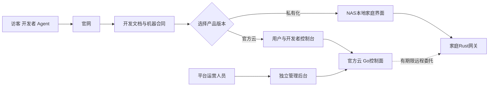
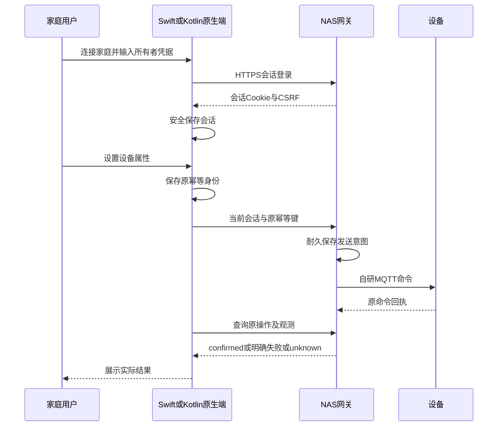

# 客户端与交互设计

更新日期：2026-11-04。状态：Web统一工作台已实现，NAS完整安装与轻量入口并存，验收范围见本文及24。交互以 Agent 可完成的业务任务为先，各界面共用任务合同。

## 1. 任务与显示端

平台提供两个产品版本：**NAS私有化版**与**LimeIoT官方云服务版**。官方云具有官网、开发文档站、用户/开发者控制台和运营管理后台；NAS具有统一的本地工作台和独立维护入口，也可在普通Linux主机安装。LimeCloud是底层公共能力提供方，不是第三个产品版本。

| 入口 | 主要任务 | 完成标准 |
| --- | --- | --- |
| 外部 Agent GUI/TUI | 开发、诊断、配置、部署和任务跟进 | 当前宿主内完成适用步骤及恢复 |
| CLI/脚本 | 非交互开发与运维 | Schema、稳定输出、退出码、原操作引用 |
| 官网 | 理解产品、选择版本、取得下载/开源入口 | 匿名可访问，产品状态与支持证据准确 |
| 开发文档站 | 快速开始、模型/协议/SDK/API/CLI/NAS指南 | 人和Agent读取同源资料及版本，明确设计/已实现状态 |
| 用户/开发者控制台 | 自己的空间、网关、产品模型、设备与制品 | 当前授权、原操作和设备投影准确 |
| 平台运营后台 | 平台健康、制品发布、接入治理、授权审计 | 独立运营身份、最小权限和审计；不自动取得家庭控制权 |
| NAS本地家庭PWA | 本地配对、控制、规则、权限和维护 | 无公网可用，准确展示当前事实 |
| iOS原生客户端 | 连接NAS/获准云入口、家庭控制、联动和记录 | Swift/SwiftUI；当前身份、原操作恢复、局域网和前后台语义 |
| Android原生客户端 | 与iOS相同的家庭任务 | Kotlin/Jetpack Compose；相同合同与执行证据，独立原生界面 |
| 玩具/语音/机器人 | 无屏多模态互动和任务反馈 | 通过应用会话与获准能力执行 |
| 商家发布界面 | 产品包、依赖和交付范围 | 生成可检验包与支持说明 |

Web交互使用React/TypeScript/Vite；iOS使用Swift/SwiftUI，Android使用Kotlin/Jetpack Compose，不以WebView替代原生客户端。各端共享物模型、API、命令、规则与错误合同，分别实现原生表现和系统能力适配。官网与文档中心在 `iotweb` 统一构建，文档位于同源 `/docs/`。Console/Admin 保持各自的认证与受众边界，初期共用一个Go控制面，不按页面数量拆业务服务。

本地自动化的三端源码均提供单操作规则及完整比较/all/any条件树的创建、回填、编辑、取消和启停。条件属性只要求read，文本保持完整值及大小写；数值按模型单位精确换算，冷却以秒输入并保留整数毫秒。未知版本、多操作和无法无损回填的规则不由简化表单覆盖，多操作使用TUI或CLI/API。预演核对完整规则与条件证据，当前条件不满足时可明确启用等待新触发；修改后旧预演失效。运行显示当时的条件和原观测，不用实时状态替代历史。云设备入口不因此取得NAS规则权限；原生宿主、APK与实际界面运行的证据分别见24。

SwiftUI与Compose在本地“设置 → 本地对话”提供有限文字多轮、原任务查询和明确清除。独立文字客户端复用网关会话与存储接口，保存并回读摘要后才提交；输入和回答不写入原生任务记录。后台、离页、离线、退出或最早回答期限经过时清除本页上下文，前台只恢复元数据，明确查询完成回答不隐式恢复历史上下文。文字模型不能创建设备命令或播放授权，合同见[本地文字生成](../contracts/text.md)。宿主状态与真实网关联调分别记录，完整原生App和真实模型效果独立验收。

家庭网页及完整私有工作台的“陪伴”提供固定角色、有限多轮语音和自定义角色，复用[会话合同](../contracts/companion.md#家庭网页)、既有录音上传及播放授权。四轮十分钟的网页默认值来自积木小狗政策；只有每轮明确发送才开始ASR、文字和TTS，模型没有设备执行权。角色与历史仅在页面内存，重载或离页后只查询原任务或结束；临时后台清屏、返回只查询、明确继续。浏览器摘要账本和Web Locks与旧v1回合隔离，云控制台不新增家庭调用入口。SwiftUI/Compose的本地“设置 → 音频 → 陪伴”已接同一合同与独立摘要账本，默认四轮十分钟；后台、离页和离线清除上下文，返回只查询，停止无需正文。原生宿主状态层与真实网关组合通过不代表完整手机界面或生产安全存储运行，见[原生合同](../contracts/companion.md#原生客户端)。

### Web视觉与体验一致性

NAS本地家庭界面和官方云工作台采用同一视觉基线，参考用户指定的飞书开放平台管理布局：固定导航、靠左对齐的内容面、紧凑工具栏、清晰表头、就近操作。保留 LimeIoT 品牌，不引入未实现的菜单。NAS仍使用本地所有者凭据，网关审批仍须核对账号和权限后明确批准。

Web统一使用原始MiSans字体及随附许可、Radix slate/teal/red/amber官方浅深色阶，背景1/2、交互表面3/4、边界6/7、文本11/12。字号12/14/20px三档，边框0.5px、面板和控件圆角4px，不使用阴影或卡片彩色左边线。配色与字体由`packages/control-ui/src/tokens.css`集中提供，NAS和通用Console/Admin直接复用；官方站点保存可独立构建的同规则快照，不依赖私有仓库。字体随本地包提供，不通过公网加载。

NAS本地家庭入口覆盖设备、自动化、对话、陪伴、音频、视觉、AI服务、执行记录、网关配对、设备接入和固件升级，保留既有控制和恢复语义。主题可选跟随系统、浅色、深色；手机使用可关闭抽屉，菜单选择后自动收起。页面位置写入`?view=`并响应浏览器前进后退，导航不重新验证身份。全程不增加装饰眉题、中点分隔或重复说明；原操作未知、预演未执行及授权影响等会影响用户决定的提示继续保留。视觉与交互回归结果另行记录，源码改造不代表NAS镜像或实机已升级。

2026-11-02 视觉基线阶段：Home 与通用 Console/Admin 构建通过。NAS 浏览器覆盖五任务 × 浅深主题 × 1440/390px 共20个视图、手机抽屉、字号、横向溢出、前进后退及刷新，均通过；已有7条真实网关/MQTT模拟业务回归通过，另3条真实Go/MySQL与Rust配对、明确批准、断流恢复及备份检查通过。证据在`.dev/platform-ui/{home-build,control-build,browser,visual-browser-final,pairing-final}.log`。该阶段未生成或发布用户NAS镜像，未升级用户设备，未执行硬件验收；完整本地安装见下节本轮记录。

#### 完整本地工作台与轻量网关

NAS 基础包 `deploy/nas/compose.yaml` 保留轻量网关和独立 Home。完整本地版叠加 `compose.platform.yaml`，在同一 HTTPS origin 安装 Go/MySQL 和统一工作台，不要求官方云账号或云服务。`compose.control.yaml` 仍仅用于将轻量网关连接获准的集中控制面，不能代替完整安装。

公共工作台源码位于 `packages/control-ui/src/workspace`，核心可独立构建。完整入口包含概览、设备、自动化、操作记录、产品开发、设备接入、空间、网关、开发连接和账号。Home 复用本地设备、规则、模型安装和执行记录组件；Console/Admin 复用同一工作台。NAS 完整入口使用简体中文，独立 Console/Admin 支持中英文。设备控制不强制先创建产品或配对。

Console 与本地网关分别保留 HttpOnly 会话和 CSRF，所有者一次提交建立两类会话，退出时分别撤销；Admin 仍独立登录。配对需要核对目标账号和权限后明确批准。`/local/` 使用原本地所有者认证，管理服务不可用时仍可运行；轻量页面按需加载公共工作台资源，避免样式和主题控件相互影响。

公开首页允许从外站链接进行顶层 GET 导航，避免把打开登录页面误判为跨站家庭访问；精确 Host、Origin、家庭 API、iframe 与写入校验继续生效。2026-11-02 该入口修复通过3项真实 MQTT/会话回归及 Rust fmt/clippy；本机开发预览已在用户 Chrome 核验登录、模拟设备回执和刷新恢复。开发预览仅使用字面回环 HTTP 和独立数据，不替代完整安装的 HTTPS、WSS 或 NAS 实机验收。

完整安装独立生成运行、迁移与只读备份账号，运行账号无 DDL 权限。迁移显式执行；备份须停止写入服务，包含 SQLite、MySQL SQL 快照、签名密钥、机器身份和证书，恢复仅导入空数据库。具体命令和验收限制见 [NAS 安装](../deploy/nas/README.md)。

产品草稿、模型校验/兼容性、签名发布和本地安装另通过7项真实Go/MySQL、浏览器及CLI回归，包含升级、丢响应只读恢复、冲突、验签、撤销和SQLite恢复。CLI发布升级复用正式合同的版本常量，避免将当前版本报告误判为结果未知；当前/历史版本及未知版本拒绝另有4项边界检查。回执为 `.dev/model-validation-test/report.json`，日志为 `.dev/nas-workspace/models-fixed.log` 和 `publication-versions.log`。

2026-11-02 本轮：Home/Console/Admin 构建通过，8项浏览器回归通过（包含20个界面视图）；5项网关、NAS备份与模型接入检查通过，8项边界检查通过；Go race/vet 与10项真实 MySQL、WSS、MQTT 和工作台检查通过。Linux ARM64 验收镜像另通过完整 Compose 安装、显式迁移、双会话登录、10个同页菜单、MQTT控制、产品签名发布、明确配对/WSS、管理服务故障维护和新目录恢复；恢复后产品、规则、命令和机器身份保持一致。回执为 `.dev/nas-platform-6939c2d0e130e891/result.json`；设备使用软件模拟器，未发布正式 NAS 镜像或升级用户实机。

云版客户不需要NAS控制面板：使用官方iotweb管理，通过现场Rust网关、本地MQTT和SQLite完成设备接入与执行。网关可运行在NAS容器或独立常开Linux主机。此要求不是取消网关，也不引入设备直连云的新协议；无NAS的验收应使用独立网关进程与云控制面完成原有WSS/MQTT链路，并将隔离模拟、正式服务和实机分别记录。

### 1.1 五个Web入口与首期范围

| 入口/目标应用 | 主要用户 | MVP页面及任务 | 部署 |
| --- | --- | --- | --- |
| 官网，独立私有网站仓库 | 访客、开发者、商家 | 平台介绍、家庭/玩具场景、NAS/官方云选择、开源与下载、开始使用 | Cloudflare独立项目，匿名访问、源码私有 |
| 文档中心 `iotweb/src/docs` | Agent、开发者、安装人员 | 模型/MQTT/SDK/CLI/API、NAS与官方云指南；原始Markdown、机器索引和版本信息 | 官网同域 `/docs/`；一个构建与部署 |
| 控制台 `apps/console` | 家庭用户、开发者、商家 | 空间/网关绑定、设备投影/远程命令、产品模型草案校验、签名固件目录和OTA原任务 | Cloudflare前端＋Go本站BFF |
| 管理后台 `apps/admin` | LimeIoT运营、审核和维护人员 | 服务健康、网关连接摘要、制品版本/发布状态、接入/授权记录、脱敏审计及撤销 | Cloudflare独立入口＋Go独立BFF/授权路由 |
| 本地家庭 `apps/home` | NAS所有者与家庭成员 | 本地初始化/认领、设备控制、规则草案/模拟、模型连接、升级与诊断 | NAS网关随包提供，局域网同源访问 |

表中的应用名是工程目标，域名在部署前固定，不表示已经注册或上线。控制台中的开发者/商家任务按角色展开；普通家庭用户不必理解模型编辑或产品发布流程。

表格描述Web入口。通用Console/Admin、Home及`apps/ios`、`apps/android`原生客户端保留在开源核心，完整自部署用户可以管理自己的实例；官方云复用基础能力，专有商业运营扩展按需私有维护。官网与文档站页面、主题和指南源码在`iotweb`，具体范围以 [25](25-开源许可生态与商业化.md) 为准。

官网不显示虚构兼容设备或预告功能为已上线。控制台首期用3类样板模型和一个产品模板验证编辑/校验/版本，固件由受信构建工具生成后导入签名制品；在线云编译、应用市场、交易结算和大规模运营报表后续按需求建设。

### Zigbee只读来源接入

本地家庭网页的设备接入页提供已知IEEE/端点查询、候选核对、新设备明确添加、撤销、重新接入及原请求查询。默认设备编号可在查询前修改，来源、型号与精确模型由网关候选决定。核对不自动提交；候选过期、输入修改、事件变化、离线或进入后台会使当前核对失效。静态来源只显示配置接入，不提供接管或迁移。

浏览器使用同空间Web Lock、原请求先保存回读及严格结果校验；保存失败零POST，未知请求阻止同设备/来源换键重发，历史applied不改变当前撤销状态。原请求按origin/空间保留，最多128项，不自动删除。来源面板复用家庭页面已有SSE，减少双标签页连接占用。字段与恢复边界见[网页合同](../contracts/observation-sources.md#家庭网页接入与恢复)。

SwiftUI与Compose在本地“设置 → Zigbee 设备”提供同一明确接入流程。两端复用当前GatewayClient与生产安全存储，独立保存最多128条完整原请求；跨实例互斥、保存回读后唯一POST、未知同设备/来源阻止换键，旧键只GET并严格核对原决定。查询单独使用35秒预算。候选与撤销核对只在内存，输入变化、家庭快照中的模型/来源变化、过期、后台、离线或离页后失效；确认前重新读取绑定与候选。状态层取消旧任务，保存期间暂停不再发送，迟到响应不恢复核对。历史结果显示与当前绑定分开，详见[原生合同](../contracts/observation-sources.md#原生客户端接入与恢复)。宿主状态检查与Android目标构建不代表完整App运行、Zigbee空口入网或品牌型号适配。

同页的入网区使用独立ZigbeeClient与最多256条原请求，开放1–120秒与关闭分别明确核对；确认前重读协调器完整视图，保存回读后唯一POST。未知窗口内禁止换键开放，旧键只读查询；已完成回执不可变化，其他客户端的历史查询不创建本机原请求。核对60秒过期及页面生命周期取消规则同样适用，入网协议受理后仍须单独发现、查询候选并明确添加，详见[入网合同](../contracts/zigbee-operations.md#原生客户端)。

### 1.2 身份、会话与执行权

官网和开发文档匿名访问，不创建OIDC客户端。官方Console/Admin分别登记精确OIDC客户端/回调，使用独立BFF会话和受众/权限边界；LimeCloud的实际应用/客户端登记方式在联调时核对。私有实例复用同一界面，通过本地身份适配并保持会话/受众隔离。管理员入口采用适用强认证，不以隐藏菜单作为授权。

平台运营员能够看到获准的服务健康和连接摘要，不自动成为家庭成员，不能读取全屋媒体、下发设备命令或取得固件签名私钥。临时支持必须由空间所有者授予精确范围和期限，执行仍经网关当前授权。NAS本地身份与官方云身份关联遵守12/14，云账号恢复不能接管NAS。

### 1.3 电视终端与遥控面板

Android TV Agent 是设备端应用，与本节手机控制客户端分别构建和授权；电视可额外显示用户身份下的家庭大屏。电脑/手机网页通过现有网关 API 控制电视，异地访问复用控制面 WSS 委托，不由浏览器直连 ADB。架构、低版本系统与权限限制见 [34](34-电视终端与AndroidTV接入.md)。

家庭网页及SwiftUI/Compose已按实际绑定模型提供方向、确认、返回、主页、音量、静音、应用启动和通用参数控件。每次按键产生独立动作；离线禁用、不补发旧按键，未确认的原操作先查询。状态观测、输入提交和界面结果分别显示；软件旅程不证明真实电视型号已适配。

自动化表单可选模型动作，JSON输入经网关预演后明确启用；修改参数使旧预演失效。三端支持单操作创建/编辑，完整展示多操作规则并可停用，多操作编辑使用CLI/API，避免丢弃后续步骤。网页保留布尔/数值属性控件，原生规则表单保留布尔属性；原生整数秒表单不编辑非整秒冷却。AI草案仍只生成属性设置，云入口不增加规则部署权限，正式语义见[规则合同](../contracts/rules.md)。

## 2. 当前宿主内完整交互

### 2.0 Console与Admin当前范围

Console已接通当前主体的空间、网关配对/撤销、受限设备控制与原操作查询。`?space=<id>&view=devices|gateways|operations`保存当前任务位置，切换空间重新读取授权与投影；401卸载任务视图。前台每5秒刷新设备，隐藏时暂停，断网禁控制且不排队。布尔/数值属性按当前物模型生成控件，命令结果与当前设备观测分开显示。

写入前先保存本人完整原请求；保存失败不发送。空间与配对恢复沿用原键，命令恢复只GET原记录或显式reconcile。退出、刷新或重新登录保留原记录；配对码不写入浏览器存储。操作列表只代表当前浏览器保存的本人原操作，尚无全云操作历史页面。

Admin独立登录，只显示实例存储状态、当前机器连接数/容量及最近1000条脱敏绑定摘要。没有家庭设备控制入口。两端共用认证/API/样式组件，但Cookie、CSRF和权限保持独立；不安装Service Worker，不缓存身份或家庭API。原操作恢复、会话隔离与桌面/手机视口通过真实浏览器和MQTT模拟链路检查；安装入口见 [控制面交付](../deploy/control/README.md)。Console另提供“产品开发”导航和未校验JSON草稿编辑：完整原请求先保存，旧请求只查询，冲突保留输入，明确采用最新修订后再保存。该草稿操作不直接变更设备绑定。模型校验与签名发布使用独立操作；安装和设备绑定仍需本地明确执行，OTA 与完整治理按各自验收记录判断。

### 本地固件升级入口

NAS基础包新增“固件升级”任务，完整私有工作台通过本机视图嵌入同一组件；当前源码为11个工作台菜单，历史10菜单冻结镜像不包含本次新增页面。独立固件信任、10分钟计划、当前任务核对、明确批准、执行/取消及原设备结果查询沿用 [OTA任务合同](../contracts/ota-tasks.md)，不新增云端升级权限。

计划和批准均不安装，明确执行后才创建安装意图。任务展示区分待批准、已批准但未安装、处理中、未知及设备证据确认的成功/失败；计划时版本明确标为历史基线。信任公钥指纹由所有者独立填写，不从上传材料自动确认。原请求先保存，损坏或保存失败阻止新写入，丢响应后只读恢复；未知计划/任务不能通过新键绕过，撤销信任仍可明确执行。

当前两项真实浏览器/Rust/SQLite/MQTT旅程与六任务×两主题×两尺寸的24视图检查通过，含取消零安装、单次安装/原查询、网关重启恢复、错绑响应和损坏材料拒绝。报告索引 `.dev/ota-web-report.json`；新NAS整包、官方云升级页分别待验收或实现，实机按当前范围跳过。原生本地OTA由下节的独立入口消费相同合同。

### 2.1 原生家庭客户端

原生客户端提供NAS与云服务入口。NAS通过HTTPS直连网关，覆盖所有者登录、设备属性控制、规则校验/预演/启用/停用和关联运行；云入口经独立授权和当前网关绑定读取设备与物模型、远程控制及原操作。认领、成员权限和媒体属于后续独立工作包。

家庭网关“设置 → 固件升级”已接入SwiftUI/Compose源码，覆盖独立固件信任、10分钟计划、逐次读取/批准/安装、取消及原操作/原设备结果查询。必填安全存储使用独立origin键保存完整请求，再单次发送；退出、响应丢失、404或网关重启不能触发重装，重新登录只查询原决定。同设备未知操作阻止新键绕过，明确撤销仍可进行；批准和任意变更后清除任务核对状态，unknown只提供原查询。页面与库分开验证，源码、宿主状态、Android构建、实际App运行分别记录在 [当前进度](24-实施计划与进度.md)。这些入口不增加云端升级权限。

云入口的Go后端、Console确认页和Swift/Kotlin独立库已接通；SwiftUI/Compose云页面已接入源码，Android APK构建通过，iOS整包及两端运行待验收。手机保存原随机键/PKCE后展示授权码，由用户点击系统浏览器按钮登录本人Console、输入码明确批准。确认页只展示当前账号、平台、期限和决定，不加载设备；Swift前台Task和Android STARTED生命周期内每3秒查询，后台/离开云入口取消，网络/授权错误暂停。取消和父退出均使原子会话失效；不能以网页授权通过推断手机运行验收完成。完整流程图及恢复语义见 [原生授权合同](../contracts/control-native.md)。

独立`ControlClient`要求安全存储，云身份与NAS本地键隔离；Token不返回界面。库支持原请求恢复、当前会话核实、取消/独立退出、空间/网关/设备分页/模型读取及远程原操作，不自行打开浏览器或后台轮询。App沿用Keychain/Keystore适配器，先核实原会话；有持久证明时恢复原授权，没有证明时等待用户登录，503保留并提供重查入口。空间选择逐页核对当前有效网关revision，切换清空旧投影；云界面只显示已提供的布尔/数值控制和记录，不调用NAS规则API。

控制先保存完整原请求与发送标记，再唯一一次提交；旧键只查询，显式reconcile核实原设备证据，退出保留操作，未知不可清理。网关离线时先恢复本机记录，允许查询原操作。两端库真实HTTPS/WSS、Go/MySQL、Rust/MQTT模拟设备联调通过，含未受信CA拒绝、丢响应/重启恢复和每端一条设备命令；另有两端各3组宿主状态检查、Android APK/lint、Swift状态与Keychain源码类型检查及App语法检查。系统浏览器、实际安全存储、Compose/SwiftUI布局与手机前后台仍待端上验收，iOS完整SDK尚缺。

iOS会话保存在Keychain，Android通过Keystore的AES-GCM密钥加密后保存；不长期保存所有者原始凭据。应用恢复先向网关验证会话，注销撤销服务器会话并清理当前家庭信息。私有CA由用户安装并信任，保持证书与主机名验证。

控制前先耐久保存原幂等身份，存储失败时不发送。超时、代理5xx、408、幂等冲突或无法识别的响应均保持待查询状态，会话失效及退出不删除这份身份；重新登录同一网关后继续查询原操作。Android显式排除云备份和设备迁移数据。原生端当前展示最近100条设备操作，API/CLI可分页读取。

前台活动时刷新快照，进入后台停止轮询；重新前台先恢复当前事实。断网禁用控制、不排队隐式补发。发送前保留原幂等身份，响应丢失后按原身份查询，`unknown`不能显示为成功。Web PWA仅缓存静态资源，不缓存身份和家庭API。

### 2.2 Agent与GUI/TUI任务

本地终端已提供 `npm run cli -- tui --space-id ID`。按模型选择设备/能力、表单输入、差异核对、明确提交、记录及原查询共用状态层；规则向导支持完整1–16步混合操作的追加、编辑、删除、重排、预演和启用/停用。Agent通过`tui --stdio`逐行JSON/NDJSON调用同一流程，离线`tui schema`发现输入和输出。正式范围、存储、并发和未知限制见[终端任务合同](../contracts/terminal-tasks.md)，实际软件结果见24；云TUI、媒体和通用自主Agent仍需独立实现。

按任务组合发现、选择、输入、校验、差异、确认、执行、进度、结果和恢复。一次读取可能一条文本即可完成；组合包部署、规则编辑和批量更新必须覆盖其必要步骤，不能以 JSON 或链接代替完整任务适配。

GUI 使用端内表单、媒体、差异、图与时间线；TUI 使用列表、分步文本输入和同义差异。宿主支持时提供端内任务 UI；缺失步骤再使用实际可用内置浏览器，随后可信 URL。独立认证和监护/所有者确认由正式流程承担。

## 3. 状态表现

显示当前观测、更新时间与适度来源信息；期望状态可作为待执行目标，不能覆盖实际状态。用户可区分处理中、已发送、已确认、明确失败、过期、部分完成和未知；技术细节放按需展开区。

按钮提交后关联原操作并允许查询；停止等待和取消远端任务分别表达。离线时展示缓存时间，不伪造在线；无权时清理旧详情与订阅，迟到响应必须验证原空间和主体。

## 4. 组合与寓教于乐

组合界面展示模块能做什么、哪些接口兼容、缺少什么以及模拟结果。孩子可以通过语音或图形提出创意；平台将计划与真正可执行动作区分，明确解释不可执行组合并提供可行选择。

监护视图管理使用时间、内容、媒体、运动和云调用范围。角色和故事是产品内容，平台提供会话与行为接口。清洁/移动机器人始终提供任务进度、暂停、人工接管和本地停止入口。

## 5. 媒体和多模态

当前本地有限音频工作台已提供“音频”页，含PCM WAV文件上传、保留时间、已绑定托管音箱选择、明确播放授权、撤销/删除和原操作恢复。NAS完整工作台只在本地模式增加该菜单，官方云远程入口不因此增加媒体权限；原生页面与状态层结果见下一段，系统界面运行仍单列验收。CLI/AI机器目录与网页共用[正式媒体合同](../contracts/media.md)，原记录只保留摘要，下载凭证不返回客户端。当前状态、视觉与软件证据统一见[24](24-实施计划与进度.md#有限音频客户端与nas集成软件阶段)。

Swift/Kotlin的`MediaClient`已接列表、上传、目标授权、撤销、删除及原操作恢复，必填安全存储，原记录不保留正文。“设置 → 音频”已接系统WAV选择、保留时间、已绑定音箱选择、明确授权、撤销、删除确认及原查询；文件最多读4MiB+1字节，正文仅存内存，不自动上传或播放。更换音频、音箱、期限或刷新会清除批准；离线、后台、离开页面还清除内存文件与删除意图，取消自有任务。未知原记录继续保留，只查询恢复。软件状态层和文件读取证据见[原生媒体页面阶段](24-实施计划与进度.md#原生有限音频页面与状态恢复软件阶段)，不替代系统选择器、SwiftUI/Compose、Keychain/Keystore或完整App验收。

录音、拍摄和播放状态可感知；流式文本、语音、图片和动作进度属于同一应用会话但各有操作引用。媒体访问使用当前权限，不在公开链接中附带凭据。生成未完成、部分输出、内容不可用和提供方失败均有可恢复状态。

## 6. 语义与可访问性

所有控件具有语义名称、标签、键盘路径和明确状态；表格支持分页和有界筛选，长标识可复制，窄屏局部滚动。字段错误定位原输入；确认展示实际差异与影响，不让 Agent 按颜色或坐标猜测业务状态。

机器资源 ID、operation_id 和错误码不随语言变化。模型显示资料、用户内容与系统文案分开，国际化见 [27](27-国际化与文档治理.md)。

## 7. 验收

逐角色、任务、宿主版本及视口验证范围选择、字段错误、差异、当前授权、执行与原操作恢复。补充网络迟到、切空间、媒体权限撤销、语音中断、孩子/监护切换和无模型降级。视觉检查不替代领域与实机验收。

五个Web入口分别验收：官网/文档匿名及深链、机器原文/版本可读取、Console/Admin会话隔离、普通成员访问管理API被拒、运营员无家庭控制权、NAS无公网仍能打开本地任务。站点跳转保留任务和原操作，不能把“已跳到后台”视为产品任务完成。
