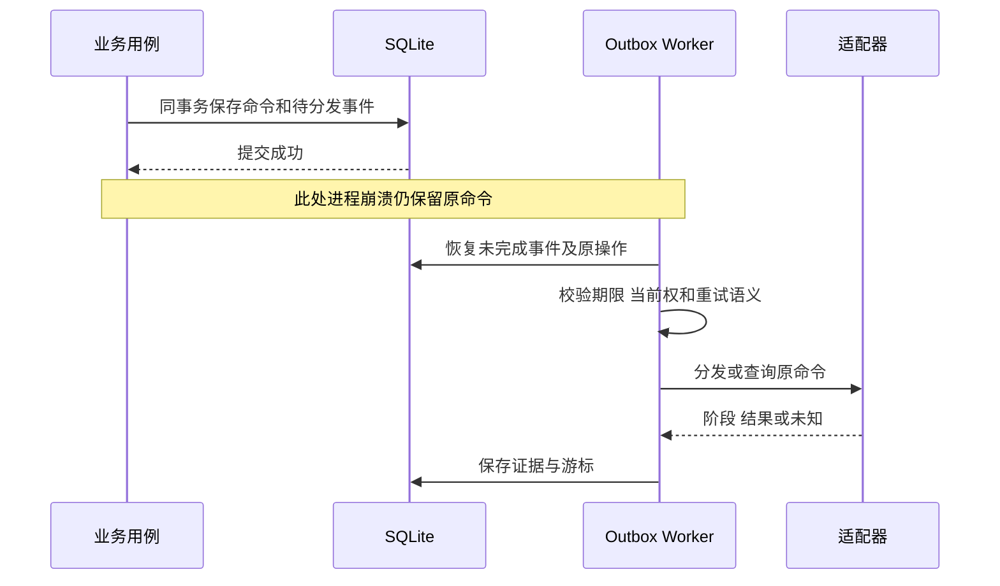
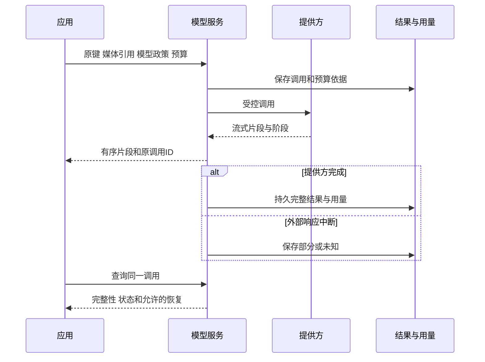
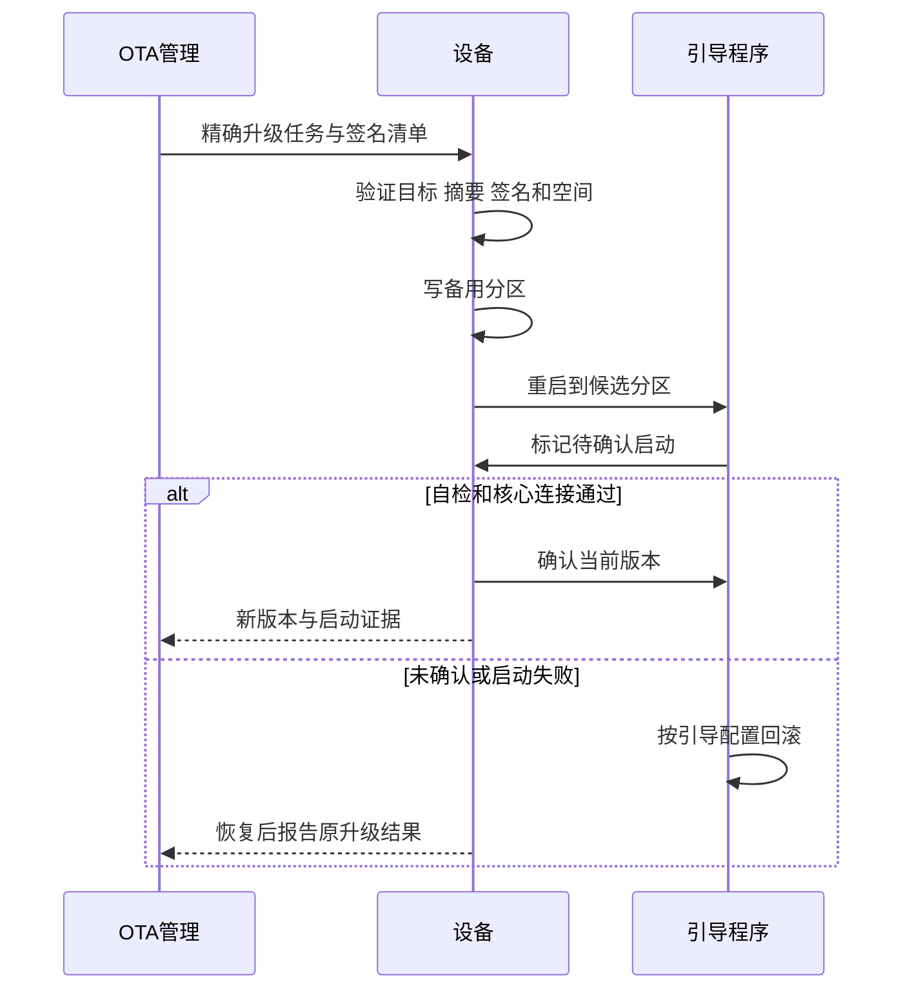
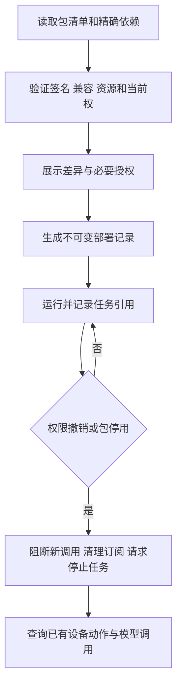

# 关键时序与故障流程

更新日期：2026-11-01。状态：设计基线。认领、控制、Agent规则、生态桥接和多模态陪伴时序在 [PRD](01-产品需求PRD.md)；本文补充恢复和故障边界。

## 1. 写入与事件恢复

事务提交后响应丢失由原幂等键回读；发送后崩溃由适配器和设备支持的原操作查询恢复。无法证明未执行时不能将 Outbox 简单重置成未发送。

## 2. 多模态异步与断流

客户端断开只结束当前传输；取消提供方任务需其支持的正式合同。已展示片段不等于完整结果，部分音频或内容不默认可继续驱动动作。

## 3. 升级启动确认

## 4. 组合包部署与撤权

停止应用进程不保证物理设备已停止，包卸载不承诺抹除已经外发的数据；对已有副作用核对原结果并执行产品定义的恢复。

## 5. 故障决策表

| 故障点 | 已知事实 | 正确处理 |
| --- | --- | --- |
| 事务前失败 | 未提交可证明 | 修正后按原政策重试 |
| 已提交、响应丢失 | 原操作可能受理 | 原键/原ID查询 |
| 已发送、设备失联 | 副作用未知 | 保留 unknown，不换键盲发 |
| 433 单向发送 | 只有发射证据 | 不显示设备已确认 |
| 旧模型/映射 | 能力含义可能变化 | 拒绝或重新准备并告知差异 |
| 模型服务失败 | 无有效生成结果 | 按已授权降级，不扩大数据外发 |
| 原生态云故障 | 相关设备路径不可用 | 标记该适配器降级，原生本地继续 |
| 网关磁盘满 | 无耐久受理保证 | 停止新控制受理，保留诊断 |
| 重启后旧定时/指令 | 可能已过期 | 按规则恢复政策，不自动补发 |
| 取消与完成并发 | 终态可能已发生 | 读取原终态与证据，不强写 cancelled |

## 6. 场景可靠性界限

家庭和玩具以本地可用与有限降级为基线；飞行、机器人和健身设备的实时保护由本地控制器实现。教室和企业的会话切换必须清理旧主体与媒体引用，不能把迟到结果写进新的使用者任务。
