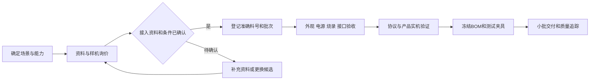

# 硬件选型、采购与 BOM

更新日期：2026-11-01。状态：采购方案，尚无已采购或已验证型号。支持证据只在 [30](30-设备支持矩阵与证据台账.md) 登记。

## 1. 采购原则

先形成可复现样板套件，再扩大品类。每种硬件记录准确型号、PCB 修订、芯片/模组、固件、供应方料号、接口、供电、认证材料和可替代性；不能以外观和商品标题建立支持结论。

华强北适合采购样机、模组、传感器和调试工具；量产前需稳定料号、批次追踪、变更通知和来料抽检。价格以实际询价、税费、损耗和交付条件记录，本文不提供未经询价的实时报价。

### 1.1 采购前确认接入路线

| 路线 | 采购前核对 | 当前安排 |
| --- | --- | --- |
| 原生开发板/模组与合作OEM | 芯片与板卡修订、现有OS/SDK、资料许可、可用驱动、烧录与恢复、接口和供电 | 首批优先，支撑ESP-IDF样板和后续组合模块 |
| 标准或公开接口的存量设备 | 具体型号/固件、标准能力、配对方式、允许获取的密钥、接口条款和本地/云依赖 | 随协议验证逐批采购，先少量独立样本 |
| 厂商合作产品 | 申请主体、SDK/API用途、地区、测试资格、认证与持续服务条件 | 先确认资格，再决定该路线的采购与交付投入 |

供应商能够出售成品、产品标注Wi-Fi/BLE/Zigbee/Matter或设备系统开源，均不能代替可开发、可接入和可商业交付的证据。缺少必要资料或接口条件时，保留候选并比较其他型号；专项研究样品单列实验目的、预算与预期证据，不作为已支持套件采购。

## 2. 两档网关

| 项目 | 轻量版 | N100 算力版 |
| --- | --- | --- |
| 计算 | ARM64 Linux，优先主流长期支持板卡 | x86_64 N100 系列主机 |
| 内存 | 1–2GB 起步，按实测裁剪 | 16–32GB，依模型和媒体工作负载测量 |
| 存储 | eMMC 优先，容量满足日志与双版本恢复 | SSD，起步可选 256GB |
| 网络 | 有线网络优先，Wi-Fi 按产品需要 | 有线网络，稳定 USB/串口扩展 |
| 时间/电源 | RTC、可恢复电源、掉电策略 | RTC、散热、掉电与恢复策略 |
| 软件 | 同一 Rust 核心，不默认运行模型 | 同一核心，可隔离运行本地模型 |

N100 不保证所有视觉/语音模型实时运行；计算能力按目标模型和并发任务测量。摄像头、麦克风、扬声器和协议无线模块有独立适配与资源预算。

## 3. 首个 MVP：桌面互动环境灯套件

推荐采购 **3块微雪 ESP32-C3-Zero-M 排针版**，分别制作环境节点、按钮节点和灯光节点；复用现有NAS运行网关。三个独立设备能证明发现、模型映射和跨设备规则，比把全部模块接在同一板卡上更能检验平台价值。主链只使用2.4GHz Wi-Fi，不先购买所有协议的协调器。

### 3.1 可询价 BOM

以下为2026-11-01编制的人民币预算假设，未向商家询价，未核实成交价、库存、运费和税费。官方资料确认板型及接口；商城搜索结果只提供采购线索。京东详情页本次触发登录验证，未取得可核实价格。

| 物料与采购搜索词 | 数量 | 单价预算/元 | 小计/元 | 必须核对 |
| --- | --- | --- | --- | --- |
| `微雪 ESP32-C3-Zero-M 排针版` | 3 | 25–45 | 75–135 | ESP32-C3FH4、4MB Flash、USB-C、预焊排针；不要混发无排针版 |
| `SHT30 I2C 温湿度模块 3.3V 带排针` | 2 | 15–30 | 30–60 | 一用一备；公开原理图、I2C地址、上拉接3.3V；不买裸芯片 |
| `独立按键模块 无锁 3.3V GPIO` | 2 | 3–8 | 6–16 | 一用一备；按下接地，软件去抖；不买5V输出未知的触摸板 |
| `WS2812B 8位 RGB 灯环 5V` | 1 | 10–25 | 10–25 | 固定8颗与像素顺序，带焊线/接口；不换成12V灯带 |
| `74AHCT125 3.3V转5V 单向电平转换 模块` | 1 | 5–15 | 5–15 | 5V供电、TTL输入阈值、有接线图；不能随意替换为74HC125或I2C双向模块 |
| `330欧电阻 电解电容 470至1000uF 10V` | 1套 | 5–10 | 5–10 | 灯环数据串联电阻、电源储能和极性 |
| `面包板 杜邦线 排针线` | 1套 | 20–40 | 20–40 | 适配板卡宽度；灯环供电另用可靠线材 |
| `USB Type-C 数据线` | 3 | 8–15 | 24–45 | 能传数据，不是仅充电线 |
| `5V 3A 稳压电源 分配线` | 1套 | 30–55 | 30–55 | 合规成品电源、线径及每路额定电流；板卡和灯环实际分配方式确认 |
| `灯环乳白扩散罩 桌面外壳` | 1 | 10–30 | 10–30 | 可拆装和散热；首批可用非儿童产品样机壳 |
| 合计 | — | — | **215–431** | 建议留出运费和损耗后按 **250–500元** 准备 |

已有万用表和烧录数据线可复用；没有工具时另留60–150元购入入门万用表和必要线材。C3-Zero有原生USB烧录，首批不强制另买串口器/逻辑分析仪。该预算不含NAS、开发电脑、路由器和人工。

采购渠道：华强北按完整搜索词带规格询价；线上先比较[微雪官方产品页](https://www.waveshare.net/shop/ESP32-C3-Zero.htm)、[京东ESP32-C3搜索](https://search.jd.com/Search?keyword=ESP32-C3&enc=utf-8)和淘宝同名板型。商品名中的“支持小智/AI”不构成固件复用或LimeIoT兼容证明。优先同批次、带原理图和可退换的供应方。

### 3.2 节点接线与固件边界

| 节点 | 接口草案 | 物模型与验收 |
| --- | --- | --- |
| 环境节点 | SHT30接3.3V/GND，SDA候选GPIO4、SCL候选GPIO5 | 温度、相对湿度、采样时间与质量；10秒采样，断连显式stale |
| 按钮节点 | 独立按键接GPIO3和GND，内部上拉 | `button.pressed`，物理按键去抖后产生唯一事件 |
| 灯光节点 | GPIO6→AHCT125→330Ω→灯环DIN；灯环5V与共地 | 首版只暴露`light.power`和`light.brightness`，固定颜色；执行回执与状态上报 |

引脚是待原理图复核的产品绑定草案；避开启动绑带脚、USB脚和板载RGB的GPIO10。不要复用BOOT键作为业务按钮。全部固定为一种板卡修订后，再冻结正式接线图和固件板级定义。

环境节点已有正式物模型、自研SHT3x驱动和C3产品角色；构建入口为`npm run build:firmware -- --role environment`。新NAS安装可显式启用`--with-environment`，详见[NAS说明](../deploy/nas/README.md#可选环境节点)。软件实现不改变本表接线待验证状态；采购、烧录、供电和实机均按用户要求跳过。

灯环使用5V电源供电，不能由GPIO或3.3V稳压器带载。电平转换器输出使能与未使用输入按资料固定，所有节点按各自接口共地。每块板同一时刻只采用一种受支持供电方式，避免外部5V与电脑USB回灌；电源分配及烧录切换在装配图中明确。先用板载RGB验证通信，再接灯环，首次限制亮度并测峰值电流。

4MB Flash需要实测固件体积并安排NVS、身份材料和双OTA槽；身份数据不随固件回滚覆盖。若镜像无法装入双槽，先裁剪非MVP功能，仍不足再换有明确大Flash规格的板卡，不能通过取消签名或回滚满足体积。

WS2812没有独立光学回读，设备回执只能证明驱动已应用目标，不能证明灯珠实际发光。演示和实机验收需人工观察；不为它伪造物理传感反馈。

### 3.3 网关采购与 NAS 复用

| 选择 | 新增硬件预算 | 使用方式与限制 |
| --- | --- | --- |
| 已有x86_64/ARM64 NAS | 0元，必要扩容另计 | 首选；具备Linux容器能力、有线联网、可持久本地卷。网关与Broker初始预留2核/2GB可用内存，按实测调整 |
| 已有电脑 | 0元 | 开发和模拟，睡眠会停止网关；Linux NAS仍须独立验收 |
| N100迷你主机，16GB/256GB SSD | 900–1500元预算假设 | 无NAS时的独立网关候选；可实验小型量化模型，但不保证语音/视觉实时性 |

首期Wi-Fi节点不需要NAS直通USB/蓝牙；容器只需局域网网络。32位ARM或没有受支持容器运行时的NAS不列为首批交付目标。运行本地Ollama的资源与NAS存储业务隔离，硬件不足时在另一台电脑运行模型，控制链仍在NAS。

同一硬件套件验证NAS私有化版和LimeIoT官方云服务版。官方云用户无需自行部署Go/MySQL，也不必拥有NAS；首期可使用轻量Linux网关或复用常开主机，NAS只是边缘运行选项。上表250–500元套件预算以已有可用网关为前提，新购网关另算。

### 3.4 第二批才采购的模块

| 扩展 | 候选 | 进入采购的条件 |
| --- | --- | --- |
| 语音萌宠 | ESP32-S3-DevKitC-1-N16R8、I2S麦克风、MAX98357A功放及匹配喇叭 | 文本组合链通过；先确定ESP-IDF驱动、音频格式与供电，另做BOM。S3扩展不替换首批C3基线 |
| Zigbee | CC2652系NCP + 固定门磁/按钮 | 自研ZNP主机适配进入实施 |
| BLE | 一个有公开广播格式的温湿度样本 | 身份/密钥和映射资料明确 |
| Matter | 一个明确设备类型的Wi-Fi样本 | 已选Controller/Bridge方向和测试环境 |
| 433与机器人 | 具体频点模块或开放底盘 | 对应单向反馈/停止/断连合同与预算已明确 |

上述扩展均是候选，不能当作已适配设备或第一批必购物料。首期不采购无人机、220V继电器或拆改成品家电。

## 4. 玩具和机器人模块路线

先验证灯光、按钮、距离/姿态感知、语音终端和受限地面移动模块。每模块声明电气、电池、机械接口、重量/负载、控制频率、实时保护和真实能力。

飞行玩具使用具备真实飞行能力、保护结构和经验证组合的专用模块；先完成模拟与受控场地测试，再开展相应产品体验。语义上能拼装不等于机械、电源和控制系统兼容。

清洁、教育与陪伴机器人先选择开放控制接口的产品或自有底盘，记录暂停、取消、急停、断连和电池行为；无法提供可靠停止能力的组合不进入对应产品交付。

## 5. BOM 与变更

BOM 字段：内部料号、供应方料号、版本、数量、成本、采购日期、批次、关键参数、替代料、许可/认证引用、测试夹具和支持矩阵引用。设备项同时关联接入路线、OS/SDK与固件、资料/API来源及资格条件；敏感密钥只保存受控引用。试产与量产 BOM 分版本冻结，替代料变更重新验证驱动、射频、电源和安全条件。

## 6. 采购验收流程

预留样机损耗、备件和至少两个批次的复验成本。采购数量、价格和交期属于执行时数据，在实际采购单记录，不写成永久平台事实。
