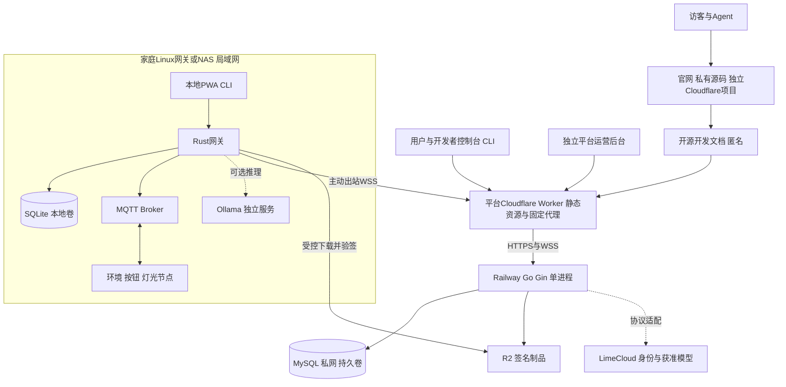

# 本地开发、部署与运维

更新日期：2026-11-02。本地模拟、家庭PWA、网关配对及备份恢复已实现；NAS容器源码/清单已建立，镜像运行与实机待验收。Go/MySQL账户及配对API已有可运行模块，部署和验证见 [控制面](../server/README.md)；远程与管理界面仍待实现。运行见 [开发入口](../deploy/dev/README.md)、[NAS安装](../deploy/nas/README.md)。产品为NAS私有化版及Cloudflare + Railway上的LimeIoT官方云服务版，完整云控制面仍待实现。

## 1. 开发模式

| 模式 | 依赖 | 用途 |
| --- | --- | --- |
| 模拟 | Rust网关、SQLite、模拟设备 | Agent和开发者无实物验证 |
| 原生实机 | 加Broker、ESP板卡和烧录工具 | 配网、身份、控制与OTA |
| 协议实验 | 加NCP/BLE/射频/Matter组件 | 指定型号适配 |
| 多模态 | 加选定本地或云提供方及媒体服务 | 流、模型、预算与组合应用 |
| 官方云试点 | Go服务、MySQL、Web站点、受控中继/存储 | 官方托管的远程、发布、开发与运营入口 |

优先本地原生进程，容器可作为可选隔离手段，不从其他项目继承强制部署限制。不同模式显式选择依赖，不因为缺云或Ollama阻止基本模拟任务。

## 2. 配置与私有数据

统一配置装配入口，声明必填、默认、来源和校验；领域不自行加载 `.env`。按空间/环境隔离数据库、端口、设备证书和提供方配置。

目标私有目录 `.dev/` 保存实验配置、测试密钥、数据库和受控原始证据，并加入 Git 忽略。正式密钥和生产凭据由部署环境注入，不写入版本库、示例、终端历史或公开诊断包。

## 3. 本地启动顺序

准备固定工具链 → 生成实验信任和配置 → 显式初始化/迁移 → 启动存储与Broker → 启动网关和模拟器 → 确认健康 → 执行连续任务。启动不能偷偷做数据库结构变更、烧录或系统权限修改。

服务管理器只管理本项目进程并记录PID/实例身份，不停止共享本机数据库或其他服务。健康区分 live、ready、存储可写、协议可用和模型能力，单个模型不可用不让核心健康失真。

## 4. 边缘部署

Linux主机使用受控服务用户和最小设备权限，串口/蓝牙/网络能力按适配器需要授予。SQLite与密钥有持久卷/目录，安装包与私有配置分离；日志有大小与保留限制。

只开放必要本地API和配网入口；生产MQTT、数据库和调试口不直接暴露公网。远程访问通过受控出站中继，TLS与本地证书信任有明确安装和恢复流程。

当前可选 `deploy/nas/compose.control.yaml` 为网关增加到安装者允许控制面的出站网络。设置精确 `LIMEIOT_CONTROL_ALLOWED_ORIGINS`，使用初始化生成的 `secrets/gateway-identity.pk8`；私有CA放入已挂载config目录。家庭PWA“网关配对”读取控制面配对信息，再由本地所有者审核批准。额外设置 `LIMEIOT_CONTROL_RELAY_ENABLED=1` 可启用已验证的WSS机器认证/保活；当前没有设备动作转发。原机器密钥与SQLite共同备份，已有安装不得覆盖原密钥。完整命令与恢复边界见NAS安装说明。

### 4.1 NAS私有化交付

首批目标是支持Linux容器的x86_64/ARM64 NAS，例如具备Container Manager的群晖或具备Container Station的QNAP；具体型号、系统及容器版本必须实测，不能把品牌列为全系列支持。发行多架构镜像与Compose清单，厂商界面作为导入方式；不先制作每家商店安装包。

| 目标配置 | 运行单元 | 数据与用途 |
| --- | --- | --- |
| 本地家庭，默认 | Rust网关（含PWA）、MQTT Broker | SQLite、设备身份、规则、审计、固件/模型制品目录；完整家庭MVP |
| 私有集中控制面，按需启用 | 增加同一Go/Gin服务、MySQL；按启用范围提供Console/Admin静态制品 | 空间投影、发布目录和中继；文件存储适配器代替R2，不要求公有云 |
| 本地模型，可选 | Ollama在NAS或另一台主机独立运行 | 模型文件单独持久化与限额；不支持模型不影响基本控制 |

配置名称描述目标方案，不是同名Compose profile。当前默认清单和`simulation`可用；`deploy/nas/compose.inference.yaml`是连接既有局域网Ollama的可选覆盖，增加独立出站网络和配置，不内置模型容器。完整容器与实际模型主机连通性仍待安装验收。运行命令、私有CA与网络前提统一在[NAS说明](../deploy/nas/README.md)维护。

当前`deploy/nas`已提供网关/PWA/Broker、HTTPS入口、`simulation` Profile、独立凭据/ACL及独立HTTPS/设备CA。容器声明发布HTTPS和设备mTLS 8883，明文MQTT只在回环；CA签发私钥不挂载到运行容器。设备签发/撤销、错误CA和无证书拒绝、跨设备ACL均通过真实Broker测试。`manage.py backup/restore`包含签发数据库/CRL并校验恢复后撤销；运行中SQLite快照与新目录恢复测试通过。设备目标编译、真实硬件、完整容器仍待验收，该实际子集不等同上表全部能力。

NAS本地家庭界面使用`apps/home`制品；私有控制台/后台复用官方同一源码，切换到本地身份与本实例权限。官网由官方公开维护，不要求在NAS安装；开发文档可从同一发布源导出离线指南。私有实例与官方平台不共享数据库、Cookie或管理员身份。

iOS和Android原生客户端分别由`apps/ios`与`apps/android`提供，直接使用同一个NAS HTTPS Origin、会话和业务API，不需要在NAS安装官网或手机专用服务。证书信任由各系统安装，客户端持续验证证书与主机名。

初始容量假设：默认配置预留2核/2GB可用内存和10GB本地存储；加Go/MySQL时预留总计4GB可用内存，资源据设备数和日志负载测量调整。以上均不含NAS原有业务与模型；模型另测，不以装有16GB内存推断任意模型可运行。

持久目录建议按职责分为网关数据、身份、Broker配置/状态、制品、备份及可选MySQL/Ollama数据。SQLite工作库放NAS本机可锁定的本地文件系统，不能放挂载到其他主机的SMB/NFS共享；WAL要求同主机共享内存语义。备份使用SQLite备份API或停写一致性快照，不在线只复制单个`.db`文件。

所有持久目录挂载到明确路径并记录属主；配置尽可能只读，凭据单独受控挂载。禁用特权容器和宿主Docker socket挂载，Wi-Fi样板不需要USB直通。可选蓝牙/串口适配器进入后续阶段再授予精确设备权限，不因此扩大默认配置权限。

### 4.2 NAS本地网络与页面

ESP节点连接与NAS可达的2.4GHz Wi-Fi，经局域网访问Broker；PWA由本地网关/Go服务提供，API与页面使用同源入口。外部字体、CDN脚本、在线认证和云端配置均不能成为本地页面的必要依赖。离线媒体和OTA制品须事先下载并验证，断网不承诺取得未缓存的新版本。

默认局域网地址通过固定租约/受控DNS与配置发现；本地HTTPS由NAS已有可信证书入口或明确安装的本地CA提供。浏览器信任、设备mTLS与公网证书是三套不同问题；不通过关闭证书校验解决。用户访问NAS本地地址完成离线任务，不让Cloudflare页面直接调用家庭HTTP地址，避免混合内容和浏览器私网访问限制。

容器内部网络只开放必要服务间连接；Broker TLS端口按需要绑定NAS局域网地址，MySQL不发布公网端口。NAS远程访问默认仍走网关出站中继，内网完全私有部署不要求Cloudflare Tunnel、UPnP或路由器端口转发。自行选择VPN属于独立入口方案，不能绕过IoT当前授权。

### 4.3 NAS交付检查

在干净NAS上导入清单、明确创建持久目录/本地身份、显式初始化、启动并认领三节点。记录架构、NAS型号、系统、容器运行时、镜像摘要和资源。测试容器删除重建后的数据保留、宿主重启、断公网24小时、磁盘满和从加密备份恢复。

只有编译/仿真通过的架构标记为构建可用；x86_64与ARM64的实际交付状态分开登记。当前两者均无实机证据。

## 5. Migration 与发布

迁移显式执行，保存版本、摘要和结果；预检确认当前制品兼容。不可逆或大数据迁移先演练并验证备份，程序升级和Schema变化分别说明。

发布使用不可变源输入和签名制品，核对固件/网关/模型/映射兼容矩阵，再按 [13](13-OTA与制品交付规范.md) 灰度。发布检查不是自动提交、推送或上线授权。

## 6. 备份与恢复

备份涵盖数据库一致性快照、规则/包版本、身份材料、撤销与安全代次、协调器网络材料及必要媒体索引。大媒体按保留政策单独处理，备份访问加密且最小授权。

恢复到隔离实例核对版本、密钥、撤销水位、设备映射和未知操作，再连接实际设备。旧Outbox和非幂等任务不能自动重放；备份成功必须以实际恢复演练证明。

## 7. 运维与诊断

提供有界日志、设备/任务健康、最近失败、版本、资源和可恢复建议。诊断包只输出允许字段，屏蔽Token、空间密钥、儿童音视频与无关客户数据。运维委托有期限，交付后撤销并核对新请求被拒绝。

## 8. 验收

清洁环境安装、重复准备、端口占用、依赖缺失、断电重启、磁盘满、权限不足、备份损坏和版本不兼容均有明确结果。目标是同一任务能被Agent和人复现，而非依赖作者本机的隐式状态。

## 9. LimeIoT官方云服务版：Cloudflare + Railway

### 9.1 最小部署单元

| 位置 | 单元 | MVP职责 |
| --- | --- | --- |
| Cloudflare私有官网项目 | 独立网站构建/静态制品 | 由私有仓库发布，匿名访问；与开源核心独立修订 |
| Cloudflare平台Workers Static Assets | 一个Worker分发Docs/Console/Admin | 按允许Host/固定前缀路由；API/WSS代理不持业务事实 |
| Railway | 一个Go/Gin容器，初期单副本 | Console/Admin独立BFF/授权路由、OIDC适配、状态投影、远程中继、制品目录、任务/Outbox |
| Railway私网 | 一个MySQL服务及持久卷 | 云事实及任务；可复用已有实例的独立数据库/账号，不能与LimeCloud混用表/迁移 |
| Cloudflare R2 | 一个受控制品桶 | 固件、发布包和摘要；媒体业务以后按权限单独开放 |
| 家庭Linux网关，可复用NAS | Rust、Broker、SQLite、本地家庭PWA | 实时执行和离线事实；官方云用户不必自部署控制面或拥有NAS |
| LimeCloud | 已登记应用可调用的外部服务 | 账号及获准模型；不部署到IoT容器内部 |

采用Worker静态资源作为新项目入口，当前Cloudflare官方已优先推荐Workers；不同时建设Pages与Workers两套前端发布路径。Redis、Kafka、Kubernetes、云MQTT和独立Agent微服务均不进入MVP依赖。

### 9.2 HTTP、WebSocket和代理合同

Go进程在未显式设置监听地址时使用平台注入的`PORT`与`0.0.0.0`；没有平台端口则默认回环17890。健康路径`/health/live`及`/health/ready`已实现，ready以两秒期限验证当前MySQL/迁移状态，不要求LimeCloud和模型始终在线。只有这两个精确GET路径允许平台探针免Host/回源凭据，普通API继续校验；不暴露配置和业务详情。实际业务依赖健康单独展示。

Worker仅向固定、允许的Railway HTTPS源站转发约定API与WSS路径，不能按用户URL做开放代理；这些路径先于SPA回退匹配，未找到API必须返回结构化错误而不是`index.html`。用户响应、BFF会话及控制数据禁用共享缓存，Cookie和授权头按合同传递，转发头由Worker覆盖。

官网与文档中心共用一个Cloudflare项目、域名和发布制品，公开指南位于 `/docs/`。控制台、管理后台及API优先以路径接入同一公开入口，不因页面职责增加域名。Console/Admin的BFF、回调、会话受众与服务端权限仍独立，Cookie Path不作为授权边界；不能使用通配回调共享认证。官网/文档匿名，不登记OIDC客户端。运营身份不自动获得家庭命令权。

源站校验独立回源凭据和允许Host，并继续验证用户/机器当前权；凭据只在Worker/Railway Secret中保存。平台探针仅对精确健康路径有受限规则，不能为探针放开普通API。浏览器使用同源受控会话与CSRF措施；网关使用独立机器认证，不把长期Token放在WebSocket URL查询参数。

Cloudflare普通HTTP代理不承载MQTT TCP 1883/8883；设备只连家庭Broker，中继使用HTTPS/WSS 443。Worker只负责协议转发，不承载Rust网关、MQTT Broker或Ollama模型。

WebSocket会因边缘更新、网络、服务发布或平台限制断开。网关实现心跳、带抖动退避重连、当前凭据复核、游标和快照缺口恢复，并设置有界缓冲；应用不能承诺一条连接永久存在。Cloudflare/Railway的实际连接限制在发布时复核，不能以普通HTTP请求超时直接推导WebSocket时限。

### 9.3 存储、迁移与制品

Railway应用文件系统不保存业务数据；MySQL使用持久卷与实际可恢复备份，R2保存对象。Railway部署前任务只迁移MySQL，不依赖服务持久卷，因为pre-deploy环境不挂载服务卷；迁移失败阻断发布。NAS文件存储迁移使用NAS自己的显式任务。

同一Go服务通过`ArtifactStore`选择R2或NAS文件实现。MVP R2用于自有固件/发布包，不重建LimeCloud Media领域。R2预签名地址视为短期Bearer凭据，仅适用于其S3 API域名，不能生成后直接替换为自定义域名；对象地址、内容摘要和固件发布签名分别验证。NAS可将受信制品缓存到本地再交给设备升级。

开源Console/Admin、Go镜像和数据库迁移来自同一IoT release清单。私有官网与同站文档使用独立源修订和发布记录，核对链接及产品能力说明即可，不要求不同仓库使用同一SHA。先演练迁移/回滚与WebSocket重连，再发布平台静态资源；不能把Railway健康检查通过当作设备控制、身份和LimeCloud联调通过。生产凭据与专有运营配置由私有发布环境注入，公开仓库只提供通用模板。

### 9.4 开发预算与网络验证

按少量家庭、三节点、低频遥测和无音视频流估算，先预留每月20–40美元作为Cloudflare/Railway云资源实验预算，再依据实际CPU、内存、卷、网络与R2用量调整。这是团队规划假设，不是官方报价、免费额度承诺或已测成本；LimeCloud模型费用、域名、税费及其他供应商另算。发布前核对当期价格、计划最低费用和账单告警。

NAS纯本地部署没有Cloudflare/Railway运行依赖，但仍有硬件、电费、备份和维护成本。国内家庭访问境外云需实测目标运营商、地区的登录、WSS重连、远程命令及固件下载；网络不达标时仍保留NAS本地能力，再选择其他公有云适配，不预先承诺可用性。

官方依据及研究限制统一见 [02](02-参考项目与技术调研.md)，云/平台事实归属见 [14](14-云端服务与边云协同.md)。
