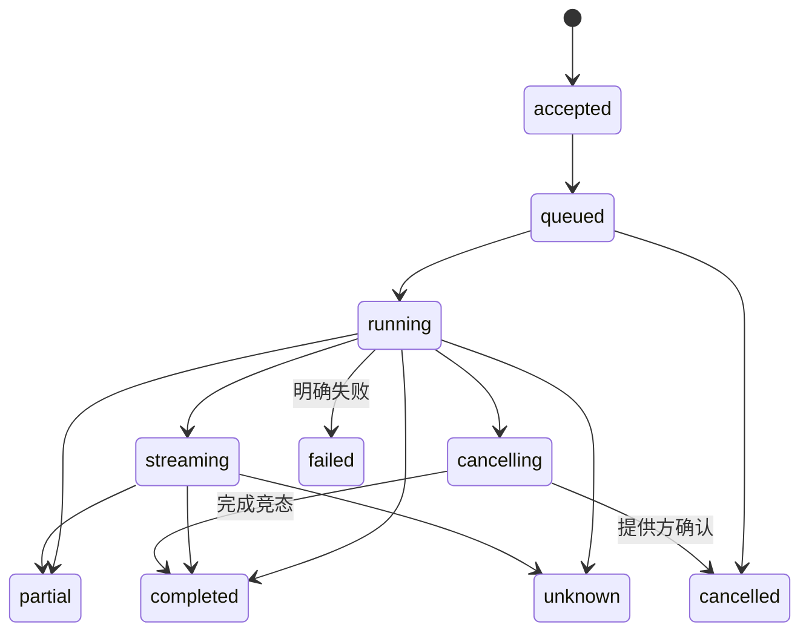

# 多模态模型与媒体服务

更新日期：2026-11-01。状态：设计基线。平台提供可调用的智能能力及治理，基础模型和处理引擎作为独立提供方经适配器接入。

当前运行子集为本地 Ollama 文字规则草案：已实现 `RuleInference` 适配、结构化输出、耐久幂等与上下文/时间/用量边界，CLI、家庭 PWA、Swift/Kotlin 端可生成、查询、预演并明确启用。它不提供任意模型聊天或媒体上传；本文其余统一目录、语音、视觉、图像、媒体与会话能力仍为目标设计。运行见[本地开发](../deploy/dev/README.md)，证据见[实施进度](24-实施计划与进度.md)。

## 1. 服务能力

| 能力类型 | 输入 | 输出与典型用途 |
| --- | --- | --- |
| `text.generate` | 文本、消息和有限上下文 | 文本/结构化结果/工具请求，规划与对话 |
| `vision.understand` | 授权图片或有界帧 | 识别、解释和结构化观察 |
| `image.generate` / `image.transform` | 文本、图像和参数 | 图片引用、故事配图与角色作品 |
| `audio.transcribe` | 音频流或片段 | 部分/最终文本及时间信息 |
| `audio.synthesize` | 文本、声音配置 | 音频引用或可停止的流 |
| `media.process` | 受控媒体引用 | 转码、采样、缩略等可追踪结果 |

Ollama适配其实际支持的模型能力；ASR、TTS、图片生成等由各自提供方实现。统一接口不意味着每个提供方具备全部模态。平台不以训练基础大模型作为首期工作。

## 2. 目录、策略与路由

目录记录稳定模型/能力ID、提供方、版本、模态、输入输出Schema、工具/结构化/流式支持、部署位置、上下文限制、资源、许可和费用政策。能力定义、提供方部署与当前健康分别表示。

路由按空间、应用、数据位置、许可、质量、成本和硬件能力选择允许提供方，并在原调用记录冻结有效策略。允许降级的备选需事先声明；本地失败不能无声切云，权限或预算失败不能换身份绕过。

## 3. 调用生命周期

请求含invocation_id/幂等键、space/application/actor、能力/模型政策、输入引用、输出Schema、数据政策、预算与期限。返回原引用、状态、流或受控结果，记录部分与完整性。客户端断流不自动证明调用取消。

## 4. 流式与工具

每流包含调用身份、序列、片段类型和结束/错误标记。ASR区分partial/final，TTS分段有会话代次和停止控制；图像任务通常异步返回制品引用。恢复能力依提供方合同，不能假称任何流都可从任意字节继续。

模型返回工具名与参数后，经正式工具目录、当前授权、输入Schema和任务预算校验。模型不能直接访问设备MQTT、宿主Shell、所有媒体或提供方密钥。迟到或取消会话的工具请求拒绝执行。

## 5. 媒体平面

MQTT承载控制、事件和媒体引用；图片、音频、视频通过受控HTTP上传/下载或有明确合同的实时通道。首期按需实现片段与音频流，视频实时传输在实际品类需要时选择标准通道。

媒体记录media_id、空间/应用/主体、用途、类型、大小、来源、摘要、访问与保留政策。授权引用不能变成任意URL代理；校验类型、文件签名、尺寸、解码资源及路径，避免无界处理或越权读取。

临时签名地址限制用途和有效期，普通日志与模型上下文使用media_id；访问时再次核验当前权。删除涉及正文、派生文件、索引和缓存，已经外发的数据按提供方政策处理，不能承诺远程副本即时收回。

## 6. 预算、用量与商业接口

设置每任务/会话/应用的token、图片数、音频时长、媒体字节、并发、时间和费用上限。接受前核对预算，执行中限制追加步骤，结束记录真实可得用量。

估算、预算预留、提供方报告用量、成本和客户计费分别处理。未知调用在取得证据前不盲目释放全部预留或重试计费请求；提供方不支持查询时明确未知。商业结算可经独立适配器接入，基础本地使用不要求云账本。

## 7. 空间、应用与会话隐私

应用只能访问获准媒体与会话上下文；长期记忆有独立授权、用途、来源、期限和删除规则。儿童、课堂、企业和健身数据采用对应政策，切换参与者或会话时清理旧上下文与迟到结果。

视觉推断记录模型来源和不确定性，不能自动写成已证实设备或专业事实。情绪、学习或运动评价归具体应用专业流程，提供人工复核与服务接续能力。

## 8. 部署与验收

边缘模型/媒体服务使用Rust应用层与提供方Port，可先同进程装配，重处理按资源隔离到Worker；云控制面通过生成合同调用，避免共享运行时私有类型。CPU、GPU、内存、磁盘和并发受限，模型崩溃不影响网关控制。

逐模态验证输入输出、类型、流、取消、超时、部分、未知、预算、媒体授权、许可、云外发与删除。假提供方只证明合同与故障行为，真实模型质量、延迟和硬件资源须分别测量。
