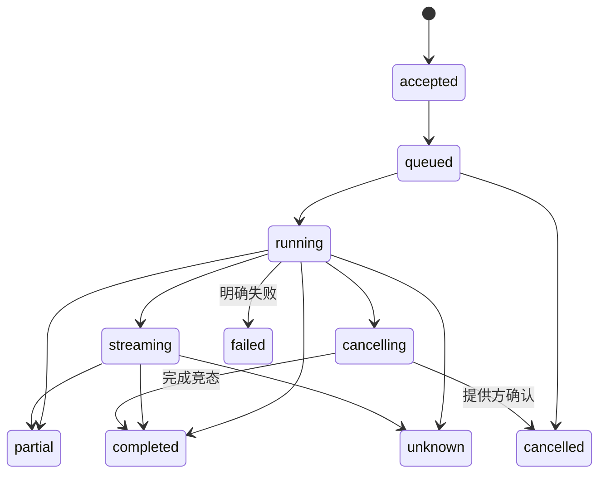

# 多模态模型与媒体服务

更新日期：2026-11-04。状态：文字规则草案、有限文字生成、有限音频管理、本地有限TTS和ASR及单张图片观察已接入软件链路。真实文字的三个有限样本与恢复通过，语音闭环、全面文字与视觉质量仍待验收，其他统一能力仍为设计基线。平台提供可调用的智能能力及治理，基础模型和处理引擎作为独立提供方经适配器接入。

真实文字阶段使用Ollama 0.40.14与`qwen2.5:1.5b-instruct`，模型及许可摘要固定，权重不随平台分发。`npm run test:text:live`完成实际网页、CLI、三次网关重启、unknown不重推、清文与提供方连接故障下的明确设备控制；响应原样校验，未修改运行时或增加依赖。结果见[真实文字证据](evidence/2026-11-04-text-local-model.json)，准备和运行见[验收入口](../contracts/text.md#真实模型验收)。有限样本不替代儿童场景、完整语音、NAS性能或原规则意图质量验收。

NAS同机文字服务新增`compose.text-local.yaml`与`npm run test:nas:text:live`，复用相同样本和已有任务账本；4项配置检查通过。实际Linux模型旅程受官方归档下载阻塞，未执行，具体范围与失败材料见[同机阶段记录](evidence/2026-11-04-text-local-nas.json)。默认推理镜像版本没有升级，宿主模型结果不替代同机容器验收。

使用正式外部覆盖的NAS真实文字闭环已通过：Linux ARM64网关连接Darwin ARM64专用Ollama进程，网页/CLI/API三个样本、v5备份恢复、unknown保留、清文后重启与模型进程实际停止后的明确灯控均通过；4次真实推理，恢复后新增0次。入口首次退出0，临时进程和容器已清理，见[外部本地模型证据](evidence/2026-11-04-text-external-nas.json)。它不替代同机模型、N100性能、真实语音或完整原生App验收。

当前Linux ARM64陪伴版整包已通过文字、TTS、ASR和视觉的独立容器协议旅程：v5快照逐字节备份/新目录恢复、未完成任务unknown占用、恢复后零推理调用、旧授权拒绝与清文后再次重启均通过。完整私有工作台另通过16菜单安装与空数据库恢复，恢复后AI目录和陪伴未配置时无执行入口。网关基础包在初始、重建和恢复三个时点核对目录与原服务配置一致，发现均零推理/播放；恢复后HTTPS打包页面另完成两轮模拟录音陪伴、准确角色/历史、刷新只查询与停止清文后重启，6次推理且无新增授权/命令。见[最新NAS整包证据](evidence/2026-11-04-companion-nas.json)。提供方、麦克风和音箱为协议夹具，真实模型质量、完整原生App及AMD64多模态分别验收。

文字运行子集包含本地 Ollama 规则草案：已实现 `RuleInference` 适配、结构化输出、耐久幂等与上下文/时间/用量边界，CLI、家庭 PWA、Swift/Kotlin 端可生成、查询、预演并明确启用。新增[有限文字生成](../contracts/text.md)通过独立`TextProvider`接入Ollama，显式传入user/assistant上下文，保存摘要任务及可清除的短期回答，不调用设备工具。API/CLI、家庭网页及SwiftUI/Compose本地对话入口已接线，实际验证结果见[原生文字证据](evidence/2026-11-04-text-native.json)；完整原生App运行、真实模型效果、完整会话政策与长期记忆仍单独验收。可选的[本地有限音频服务](../contracts/media.md)提供PCM WAV上传、保留、短时音箱授权、撤销、删除与独立HTTP拉取，已接有限DLNA、CLI/AI工具和家庭网页；NAS可选配置、媒体快照备份恢复和Nginx上传入口有宿主软件结果，当前ARM64协议容器结果见上方证据，真实引擎容器、完整原生运行和其他架构另验。本地只读统一目录已实现，见第2节；目录治理、流式ASR、连续视觉、图像生成、转码和流式TTS仍为目标设计。运行见[本地开发](../deploy/dev/README.md)，证据见[实施进度](24-实施计划与进度.md)。

有限 `vision.understand` 的[正式合同](../contracts/vision.md)接受单张有界 PNG/JPEG 和明确问题，通过 `VisionProvider` 隔离 Ollama。API、CLI、家庭网页及Swift/Kotlin客户端库共用摘要任务和原键查询，输入图片与问题不持久保存；成功观察文本按60–3600秒保留，可明确清除。SwiftUI/Compose在“设置 → 图片观察”接入文件选择与状态恢复，后台读取和构造请求；生成后清输入，后台/离线/离开/退出及期限经过清正文，前台只恢复元数据，完成正文需明确查询。状态层和真实网关宿主旅程入口为`npm run test:vision:native:state`，系统图片选择与完整页面运行另验。媒体快照v4保留TTS/ASR与旧版本读取，NAS支持独立内部网络模型覆盖；观察不会更新设备状态或创建命令。真实视觉质量、完整原生运行、摄像头和连续帧仍单独实施。

有限`audio.transcribe`已有[正式合同](../contracts/transcription.md)、本地HTTP提供方适配、API/CLI和家庭网页。只接已有WAV的编号与固定摘要，任务先持久保存，不在重启后重发录音；输出文本沿用源录音保留期限，删除/到期清除。媒体快照v3承载转写任务，NAS按原字节备份恢复；转写没有设备执行权。[独立sherpa ASR服务](../providers/sherpa-asr/README.md)已接Paraformer Small/Whisper Tiny，以25秒分段覆盖完整录音；上游录音示例、390px网页、CLI、网关重启未知零重发和源删除清文的软件集成通过。两模型在8kHz VITS合成语音上的质量检查未通过，根因未归定为单一组件；家庭环境质量、转换权重分发许可、原生页面和完整NAS容器继续单独验收。

可选[文字转语音](../contracts/speech.md)通过 `SpeechProvider`接本地HTTP引擎，先保存摘要任务再请求，输出有界PCM WAV并复用原媒体服务。提供方断流/期限/网关重启保留unknown和耐久预算占用，所有者明确放弃后才允许新调用；不重发正文，不自动授权或播放。API/CLI与390px家庭网页旅程已有交付，原生语音界面的状态与宿主结果见后文，ARM64协议容器结果见上方证据；真实模型质量、流式会话和完整原生运行仍分别验收。

## 1. 服务能力

已上传录音的[有限语音回合](../contracts/voice-turns.md)由共用客户端依次调用ASR、文字和TTS，家庭网页入口为“音频 → 语音对话”，CLI为`voice-turns schema/start/resolve/continue/stop`。每阶段原键和输入摘要先保存回读，自动推进仅限当前明确批准的在线前台/进程；恢复先查询，下一阶段须明确继续。最长5分钟，固定部署修订，无跨轮记忆；超出TTS限制不截断。生成媒体不授权或播放，结束不隐式删除媒体或停止设备。6组协议夹具软件旅程及构建结果见[回合阶段证据](evidence/2026-11-04-voice-turns.json)；该阶段证据仅覆盖网页/CLI；原生统一回合见下段，真实质量、流式语音、完整App与NAS镜像分别验收。

[有限陪伴会话](../contracts/companion.md)已由独立源码CLI和共享JS客户端实现：固定角色、三类部署与会话预算，每轮明确选择录音，内部v2回合加入调用者持有的准确问答历史。上限8轮、30分钟；上下文、政策或模型变化不继续，unknown不替代，停止先耐久记录并清各轮文字回答。`npm run test:companion`完整15项通过，含真实网关、CLI和原v1网页回归；中断错误码归一化后另有1项针对性复验。见[CLI阶段证据](evidence/2026-11-04-companion.json)和[积木小狗样板](../examples/companions/block-puppy/README.md)。历史正文不自动落会话账本，生成不授权播放；既有网页/原生v1单回合与该会话分开。家庭网页新增“陪伴”入口，选择默认或自定义角色后明确开始，复用录音上传与独立播放授权；内存历史在重载/离页后清除，恢复不创建推理。Swift/Kotlin专用SDK、状态层与音频页入口已实现，独立摘要存储与v2角色上下文遵守相同合同；原生后台清除历史，返回只查询原任务，停止清各轮文字。`npm run test:companion:native`检查共享账本、实际状态层和真实网关宿主恢复；完整原生页面运行、真实质量及儿童/监护政策仍待验收。网页检查入口为`npm run test:companion:web`，见[网页合同](../contracts/companion.md#家庭网页)及[网页阶段证据](evidence/2026-11-04-companion-web.json)。

家庭网页支持明确开始的有限麦克风录音：本站AudioWorklet输出16 kHz单声道PCM16 WAV，最多60秒，录音完成后停止轨道并关闭AudioContext。录音只在内存保留，另行明确上传后才能进入上述回合；后台、离线或离页放弃未上传录音，文件读取/摘要计算期间仍在发送前核对页面和录音代次。权限拒绝、取消后迟到授权及模块加载失败按[采音合同](../contracts/voice-turns.md#网页有限录音)处理，不自动重录或调用模型。独立网页检查见[网页证据](evidence/2026-11-04-browser-recording.json)；最新[ARM64整包证据](evidence/2026-11-04-ai-catalog-nas.json)已在恢复后的网关基础包中，从HTTPS实际完成模拟录音、独立上传、ASR→文字→TTS及另行授权播放。识别提供方收到的字节摘要与该次录音一致，三阶段各调用一次，刷新查询不新增调用，音箱Range拉取与合成原字节一致。完整私有工作台安装恢复为独立实例；模拟麦克风、模型及音箱不证明真实采音、质量或发声。原生有限录音结果见下段；唤醒词、远场效果和全双工仍独立开发。

原生库的`MediaClient`复用NAS所有者会话，仅保存摘要原记录，上传/授权不自动播放；“设置 → 音频”已接有界文件选择、当前绑定音箱、明确授权与管理。SwiftUI/Compose另接最长60秒的内存录音，独立AudioRecord与AVAudioEngine适配器输出16 kHz单声道PCM16 WAV；完成关闭采音后另行上传，后台/离页/离线清除未上传录音。两端实际状态层与真实Rust/SQLite的明确上传、丢回执及新进程/网关重启只查原键见[原生录音证据](evidence/2026-11-04-native-recording.json)。采音输入为夹具，Apple适配器以macOS SDK编译；系统权限、实际采音、安全存储与完整App仍分别验收；原生统一回合见下方新增阶段。检查入口为`npm run test:recording:native`，正式边界见[原生录音合同](../contracts/voice-turns.md#原生有限录音)。

Swift/Kotlin统一`VoiceTurnClient`及原生语音对话入口已补齐，遵循同一v1摘要账本、停止事实和恢复规则。`npm run test:voice-turns:native`完整退出0；两端各四次独立宿主进程、三次真实网关重启，原键GET、明确继续、单次放弃及清文后恢复通过，三阶段各调用一次，零授权或设备命令。Swift实际状态层/Home检查、Android十三项及APK/lint通过，详见[原生统一回合证据](evidence/2026-11-04-native-voice-turns.json)与[合同](../contracts/voice-turns.md#原生统一回合)。模型和恢复存储为夹具，完整App、系统采音、生产安全存储和真实语音质量分别验收。

SwiftUI/Compose已补齐同页分步语音：录音独立上传，识别文字经“带入新对话”准备新问题，回答经“带入语音合成”准备完整语音文本，各次请求仍须明确发送。两端真实状态层完成三类协议提供方、独立授权、confirmed命令与软件音箱Range播放；新进程/网关重启只查询原任务，零新增推理或播放。见[分步组合合同](../contracts/voice-turns.md#原生分步组合)和[本轮证据](evidence/2026-11-04-native-voice-handoff.json)。该路径沿用各独立任务，无网页回合的统一账本、自动推进或统一期限；真实系统采音、模型质量和完整App运行另验。

| 能力类型 | 输入 | 输出与典型用途 |
| --- | --- | --- |
| `text.generate` | 文本、消息和有限上下文 | 文本/结构化结果/工具请求，规划与对话 |
| `vision.understand` | 授权图片或有界帧 | 识别、解释和结构化观察 |
| `image.generate` / `image.transform` | 文本、图像和参数 | 图片引用、故事配图与角色作品 |
| `audio.transcribe` | 音频流或片段 | 部分/最终文本及时间信息 |
| `audio.synthesize` | 文本、声音配置 | 音频引用或可停止的流 |
| `media.process` | 受控媒体引用 | 转码、采样、缩略等可追踪结果 |

Ollama适配其实际支持的模型能力；ASR、TTS、图片生成等由各自提供方实现。统一接口不意味着每个提供方具备全部模态。平台不以训练基础大模型作为首期工作。

## 2. 目录、策略与路由

已实现[本地 AI 能力目录](../contracts/ai-catalog.md)：`ai-catalog.list`统一返回规则草案、文字、视觉、识别和合成的定义、当前部署及独立健康状态。API/CLI、家庭网页、NAS私有工作台与SwiftUI/Compose“设置 → AI 服务”共用真实服务配置，发现不调用提供方。已配置不表示健康；未实施探测时返回unknown，许可、费用、资源与质量字段保持null。规则草案没有部署修订或完整任务Schema，均明确为null。

Swift/Kotlin的`GatewayClient.aiCatalog`复用认证会话和现有各模态校验，接受最多32KiB、8层、2048节点的目录。原生页面由经过校验的能力枚举选择本地功能，不从响应加载任意URL；未配置没有入口，刷新/后台/离页/离线清除目录，取消代次隔离迟到响应。目录不写持久存储、模型不因此取得设备权限，检查入口为`npm run test:ai-catalog:native`；完整App、系统安全存储及真实模型质量保持独立验收。

完整目录目标还包括经过登记核验的模型版本、输入输出Schema、工具/结构化/流式支持、部署位置、上下文限制、资源、许可和费用政策。当前实现不替代模型制品身份、质量评估、健康探测或下方政策路由。

路由按空间、应用、数据位置、许可、质量、成本和硬件能力选择允许提供方，并在原调用记录冻结有效策略。允许降级的备选需事先声明；本地失败不能无声切云，权限或预算失败不能换身份绕过。

## 3. 调用生命周期

请求含invocation_id/幂等键、space/application/actor、能力/模型政策、输入引用、输出Schema、数据政策、预算与期限。返回原引用、状态、流或受控结果，记录部分与完整性。客户端断流不自动证明调用取消。

## 4. 流式与工具

每流包含调用身份、序列、片段类型和结束/错误标记。ASR区分partial/final，TTS分段有会话代次和停止控制；图像任务通常异步返回制品引用。恢复能力依提供方合同，不能假称任何流都可从任意字节继续。

模型返回工具名与参数后，经正式工具目录、当前授权、输入Schema和任务预算校验。模型不能直接访问设备MQTT、宿主Shell、所有媒体或提供方密钥。迟到或取消会话的工具请求拒绝执行。

## 5. 媒体平面

MQTT承载控制、事件和媒体引用；图片、音频、视频通过受控HTTP上传/下载或有明确合同的实时通道。首期按需实现片段与音频流，视频实时传输在实际品类需要时选择标准通道。

媒体记录media_id、空间/应用/主体、用途、类型、大小、来源、摘要、访问与保留政策。授权引用不能变成任意URL代理；校验类型、文件签名、尺寸、解码资源及路径，避免无界处理或越权读取。

临时签名地址限制用途和有效期，普通日志与模型上下文使用media_id；访问时再次核验当前权。删除涉及正文、派生文件、索引和缓存，已经外发的数据按提供方政策处理，不能承诺远程副本即时收回。

采音与播放可以由不同终端承担：电脑或独立麦克风采音，经 ASR、文字模型和 TTS 处理，再由可选局域网音箱播放。DLNA 音箱仅承担媒体输出，不因此取得原机麦克风或默认语音后端；媒体地址须从音箱可达，格式、取消、半双工与原厂抢占逐项验证，设计见 [36](36-音频播放终端与DLNA接入.md)。

## 6. 预算、用量与商业接口

设置每任务/会话/应用的token、图片数、音频时长、媒体字节、并发、时间和费用上限。接受前核对预算，执行中限制追加步骤，结束记录真实可得用量。

估算、预算预留、提供方报告用量、成本和客户计费分别处理。未知调用在取得证据前不盲目释放全部预留或重试计费请求；提供方不支持查询时明确未知。商业结算可经独立适配器接入，基础本地使用不要求云账本。

## 7. 空间、应用与会话隐私

应用只能访问获准媒体与会话上下文；长期记忆有独立授权、用途、来源、期限和删除规则。儿童、课堂、企业和健身数据采用对应政策，切换参与者或会话时清理旧上下文与迟到结果。

视觉推断记录模型来源和不确定性，不能自动写成已证实设备或专业事实。情绪、学习或运动评价归具体应用专业流程，提供人工复核与服务接续能力。

## 8. 部署与验收

边缘模型/媒体服务使用Rust应用层与提供方Port，可先同进程装配，重处理按资源隔离到Worker；云控制面通过生成合同调用，避免共享运行时私有类型。CPU、GPU、内存、磁盘和并发受限，模型崩溃不影响网关控制。

逐模态验证输入输出、类型、流、取消、超时、部分、未知、预算、媒体授权、许可、云外发与删除。假提供方只证明合同与故障行为，真实模型质量、延迟和硬件资源须分别测量。

### 本地TTS候选的宿主兼容性

2026-11-03在项目私有Python环境使用sherpa-onnx 2.0.1、NumPy 2.5.4和`vits-icefall-zh-aishell3`，按[官方VITS说明](https://k2-fsa.github.io/sherpa/onnx/tts/pretrained_models/vits.html)测试sid 21与2个CPU线程。模型加载约0.75秒；3条中文样本分别输出2.07、2.71、3.62秒的8kHz单声道PCM16 WAV，生成耗时约0.12、0.14、0.20秒，进程峰值内存约127MiB。3份输出通过平台WAV校验器，幅值有限且非静音。

这些是当前Mac宿主的格式、延迟与资源样本，不是NAS性能、人工听感、儿童语音质量或真实HTTP提供方接入验收。报告在`.dev/speech-engine/synthesis-smoke-result.json`，文件摘要和来源在同目录`model-source.json`；没有将依赖加入核心运行时，也没有将权重纳入仓库。

引擎采用Apache-2.0，[AISHELL-3数据集](https://www.openslr.org/93/)页面标注Apache-2.0；下载归档未附权重许可，官方模型说明中也未取得明确权重许可。权重分发状态保持未确认，不能据引擎或数据集许可直接视为可商业分发。

后续已交付[独立sherpa HTTP服务](../providers/sherpa-tts/README.md)：固定模型文件摘要、声音映射、逐请求隔离进程、1计算并发、80秒期限、有界输入输出、无正文日志。真实模型通过网页生成、原字节入库、单独授权及软件音箱Range拉取；真实响应丢失保留unknown，重启与原查询不重新合成。配置Schema及NAS内部网络覆盖已加入，服务不进入网关进程。证据为`.dev/sherpa-provider-report.json`；容器隔离实际运行、跨架构、许可确认及人工音质继续验收。

### 原生语音入口

有限语音识别同样接入SwiftUI/Compose“设置 → 音频”，通过 `TranscriptionClient` 固定已有音频及摘要，复用网关正式任务合同。网络返回完整文本并校验UTF-8摘要，本机 `observation` 明确去正文，原任务和清除事实分别保存；成功文本只在前台内存保留，后台、离线、离开、会话切换、源录音不可用或期限经过后清除。

原生识别库、状态层及两端真实网关宿主旅程由 `npm run test:transcription:native:state` 验证。五个独立客户端进程和两次网关重启覆盖丢回执、原键查询、未知占用与明确放弃、删除源录音清文；没有设备命令或播放授权。提供方和恢复文件为夹具，完整原生界面、真实模型质量与新NAS整包仍分开验收，见[原生识别阶段](24-实施计划与进度.md#原生语音识别页面与状态恢复软件阶段)。

SwiftUI与Compose在“设置 → 音频”复用同一SpeechClient合同，提供生成、原键查询和明确确认放弃。文本只保留在当前前台页面；后台、离线、离开或会话切换清除文本和确认，迟到响应不更新页面。成功只刷新媒体选择并清除授权勾选，不创建授权、命令或新播放通道。

实际状态层与真实Rust/SQLite/MQTT旅程通过`npm run test:speech:native:state`验证：丢回执只查原键，四次客户端进程与两次网关重启后保留原任务，unknown保持预算，明确放弃不发布输出，播放由原授权和命令合同单独完成。HTTP提供方和DLNA终端为夹具；这不提升真实引擎质量、系统安全存储、完整App运行、NAS整包或实机状态。阶段范围见[实施进度](24-实施计划与进度.md#原生语音页面与状态恢复软件阶段)。
