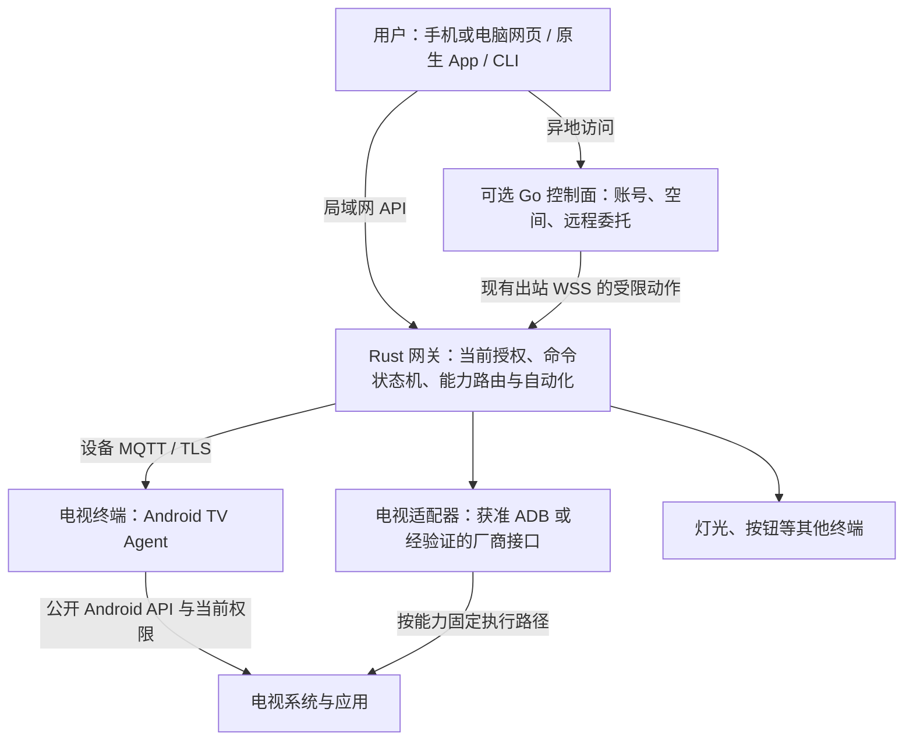

# 电视终端与 Android TV 接入

更新日期：2026-11-03。状态：接入设计基线与分阶段实现；动作、受限ADB、既有空间接入及显式动作组合已有软件证据，组合使用原生协议夹具与假ADB。已有设备跨内置模型的独立JVM软件旅程通过，实际JVM Agent/假ADB组合也已取得软件通过证据；早期Android镜像已取得实际AOT及安全组证据；真实API23电视的AES/错误主机名2项、P-256持钥基础单项及一次目标界面启动见24第4.51节，完整链路失败后按用户要求暂停。关联FR-32、US-25、UC-23；当前进度只在 [24](24-实施计划与进度.md) 维护，型号证据只在 [30](30-设备支持矩阵与证据台账.md) 维护，动作输入与证据见 [命令合同](../contracts/commands.md)。

## 1. 产品定位与范围

电视是 LimeIoT 的一种设备终端，与灯光、按钮等设备共用 Space、Device、物模型、命令、观测和自动化。平台内置电视能力的模型、工具与界面投影；品牌、型号、Android 版本和具体协议由终端实现或适配器处理。

第一条目标流程为：所有者接入指定电视 → 手机或电脑打开家庭网页 → 查看连接与能力 → 使用方向、确认、返回和主页 → 启动允许的应用 → 调整音量 → 核对执行阶段。每项能力单独验收，不因同属 Android TV 或小米品牌而继承支持。

电视接入是存量设备扩展切片，不替代桌面环境灯首个 MVP，也不改变 ESP-IDF MCU 固件 SDK 的首期目标。去广告、替换系统桌面、任意应用管理、实时投屏和断电开机不属于基础遥控验收范围。

### 1.1 网页与电视的交互方向

| 用户任务 | 运行位置与身份 | 执行方式 |
| --- | --- | --- |
| 手机或电脑网页遥控电视 | 浏览器作为当前用户的控制客户端 | 网页调用网关/远程用例，网关交给已绑定的 Agent 或适配器；基础遥控无需电视先打开网页 |
| 电视显示家庭大屏并控制其他设备 | 电视浏览器或专用界面作为用户客户端 | 使用独立用户授权，调用同一套控制 API；遥控器焦点导航及旧浏览器另验 |
| 电视接收指令、上报自身状态 | TV Agent 使用单设备身份 | 只执行获准的本机能力；设备凭据不提供整个家庭的用户控制权 |

首个闭环选择第一项。电视大屏与 Agent 可以在同一设备共存，但会话、凭据和权限各自管理；网页可运行不代表网页具有系统遥控或跨应用输入权限。

工程上，网页独立构建并随控制客户端交付，TV Agent用自身Gradle wrapper构建独立APK，ADB第一方静态集成随网关二进制交付。统一设备与领域用例由核心提供，具体模型目录由发行装配层注入；按能力明确组合，APK安装或网页上线不能替代执行绑定。网关可按Cargo feature裁剪集成，当前不支持动态插件热更新。具体边界见 [21第1.4节](21-Monorepo与开发规范.md#14-核心集成与独立工程)。TV过期身份的软件阶段见 [24第4.33节](24-实施计划与进度.md#433-tv过期身份维护与持续有效期软件闭环)，Android完整运行、物理归属和APK更新仍分别验收；其他设备的分层标准见 [23第5.1节](23-测试策略与验收矩阵.md#51-身份到期与执行链路的分层验收)。

## 2. 四层架构与角色

| 角色 | 身份与职责 |
| --- | --- |
| 手机、网页、CLI | 当前用户身份；展示能力、创建命令、查询原操作 |
| Rust 网关 | 空间本地执行入口；核验授权、模型、期限和路由，保存命令与观测 |
| Android TV Agent | 单设备身份；配对、声明能力、上报状态、执行获准的设备指令 |
| 电视适配器 | 已绑定设备的受限执行路径；封装协议、连接健康、结果和来源映射 |
| Go 控制面 | 用户、空间、绑定和远程原操作；沿用本地命令与授权语义 |

TV Agent 是电视上的设备接入进程，不是取得任意 Shell 或工具权限的推理 Agent。电视若另外显示家庭大屏控制台，则同时承担用户控制客户端角色；用户会话与设备凭据分别管理。

## 3. 两种接入路径与统一设备身份

### 3.1 原生终端

TV Agent 通过设备身份与 MQTT/TLS 接入，复用握手、会话、期限和去重规则，见 [06](06-MQTT报文与设备通信规范.md)、[12](12-身份认证与安全体系.md)。设备只接收本设备命令、上报本设备状态；公开 Android API 能完成的能力由终端执行。

普通 APK 不因通过 ADB 安装而获得 Shell 或系统签名权限。音量、应用启动、当前应用观测、无障碍操作与开机恢复分别核对所需权限、系统版本和厂商限制。无障碍服务需用户启用，不能承诺覆盖所有第三方应用的方向键与确认操作。

### 3.2 存量电视适配

网关电视适配器使用所有者在电视端明确允许的 ADB 连接，或已核实接口范围的厂商协议。ADB 私钥保留在网关受控存储，网页只提交类型化业务动作；不提供任意 Shell、包名命令拼接或网络目标代理。

适配器产生带来源的内部观测和命令证据，不伪装成持有电视原生设备证书的 MQTT 客户端。ADB 返回成功仅证明所调用过程完成，不能直接证明第三方应用产生了预期界面变化。

当前 NAS 网关运行于内部网络。实现 ADB 路径时须明确适配器到电视局域网的网络出口与限制；不能假定现有容器能直连电视。原生 Agent 的 MQTT/TLS 入站、CA、时钟和重连也需要单独验证。

### 3.3 身份与执行路由

一台电视只有一个稳定逻辑 `device_id`；IP、MAC、ADB serial、应用安装实例和传输地址是绑定或路由信息。Agent 与 ADB 的归并需要当前所有者批准和设备侧证明，不能只凭地址、名称或型号相同自动合并。

每项能力固定当前执行路径及映射修订。一条命令只选择一个执行端，并记录该选择及对应授权；执行结果未知时保留原操作，不自动切另一端补发。切换路由须重新核对能力和授权，不产生第二套命令账本。

当前 `bindings.compose` 可在同一逻辑模型中明确把 `apps.launch` 选给原生路径，其余 `remote.press` 留给ADB；要求当前原生会话声明覆盖所选能力，两个动作路径组成完整分区。`bindings.bind` 保持完整动作集交给一个候选。组合与撤销复用原账本，跨端FIFO、单路径离线和重启不补发已有协议夹具证据。Agent可显式选择android-tv-remote逻辑模型，hello仍只声明apps.launch；这不会授予按键权限或证明物理归属。正式字段及限制见 [执行路由](../contracts/execution-routes.md#显式能力组合与原生证明)，协议夹具证据见 [24第4.14节](24-实施计划与进度.md#414-显式能力组合与文档同步)，实际JVM组合的软件通过范围见 [24第4.22节](24-实施计划与进度.md#422-adb身份预检合并与实际jvm组合软件验收)。

设备本机材料/日志迁移、网关Device的模型绑定变更、执行compose是三个独立步骤。本机迁移不修改网关模型绑定；已有android-tv-agent网关设备迁到内置android-tv-remote模型已完成独立JVM软件旅程，见 [24第4.19节](24-实施计划与进度.md#419-内置模型绑定与跨模型软件闭环)。组合旅程从已准备遥控模型的逻辑设备开始，不能代替已有设备跨模型验证，也不能以迁移通过代替组合验收；不得修改config_hash、删库或绕过发布者命名空间规则补齐该缺口。

组合设备以action_availability逐动作呈现可用性；一端离线只关闭对应动作，不自动改变路径或模型。原生应用启动不沿用ADB发现列表或授权，设备消费者须核对自身安装与白名单。设备身份、物理归属、执行能力和当前用户授权分别证明。

### 3.4 已有设备迁入遥控模型的目标流程

该流程补齐已有应用模型设备的网关换模入口，已通过独立JVM的软件迁移旅程；实际电视和Agent/ADB组合仍各自验收，状态见 [24第4.19节](24-实施计划与进度.md#419-内置模型绑定与跨模型软件闭环)。内置模型来源与签名安装共用模型绑定用例，正式操作见 [模型合同](../contracts/model-release.md#本地信任安装和设备绑定)，领域约束见 [04第2.4节](04-领域模型与数据设计.md#24-内置模型来源与明确换绑)。

| 步骤 | 事实归属与推进条件 |
| --- | --- |
| 核对目标和当前基线 | 所有者核对只读目录的精确模型、当前模型/模型绑定修订及规则、路由和OTA影响；保留原设备与config_hash |
| 明确变更网关模型绑定 | 模型变更账本先耐久保存请求、决定与来源；清除旧会话/观测/能力，旧accepted拒绝、dispatched转unknown，完整原命令与序号保留 |
| 迁移电视本机材料与日志 | 本机核对遥控配置，按设备合同保留旧完整原包、结果、unknown/未决及退休边界；失败保留原记录并阻断新控制 |
| 重新接入并声明实际能力 | Agent用精确新修订完成新会话和完整快照，只声明apps.launch；目录中的remote.press在没有获准执行路径时不可用 |
| 独立批准执行组合 | 核对同模型的ADB候选、当前原生能力和绑定修订，再明确compose；网关模型绑定成功不代替这项决定 |

这些步骤跨网关与设备，不能放进一个事务或自动回滚为旧授权。中断后读取原操作和各端实际状态，再明确继续；旧成功只读，未知动作不重发。网关快照、本机材料/日志、APK和模型修订各自版本化，升级其中一个不隐含其余步骤完成。软件迁移旅程、实际Agent/假ADB组合、Android端上及物理归属分别验收。

## 4. 能力与动作语义

基础能力组合已进入 [android-tv.json](../contracts/models/android-tv.json)；以下另含待扩展能力。模型是定义，不是型号支持或自动开放的运行时能力目录，实际绑定必须与已验证的执行路径一致。

| 类别 | 语义与定义范围 | 约束 |
| --- | --- | --- |
| 属性 | `audio.volume`、`audio.muted` | 读写分别声明；范围、单位和厂商刻度由模型及映射明确 |
| 只读观测 | 屏幕状态、前台应用 | 依可用权限发布；不可读保持 unknown/stale，不以期望值代替 |
| 动作 | `remote.press` | 有界按键白名单；每次点击是独立动作，重复投递按原 command_id 去重 |
| 动作 | `apps.launch` | 只允许已发现且获准启动的应用；区分请求受理与实际前台回读 |
| 可选媒体 | 截图或画面预览 | 独立授权、资源和留存；媒体不放入有界 MQTT 控制报文 |
| 型号专项 | 待机、唤醒、输入源 | 逐型号验证；通信离线不能推断关机，不承诺断电开机 |

当前 Schema 2 支持动作，调用形式为 `action.invoke`、path=`remote.press`、value=`{"key":"home"}`，或 path=`apps.launch`、value=`{"application_id":"…"}`。按键枚举限于 up/down/left/right/select/back/home/menu/play_pause；音量为0–100 percent，厂商原始刻度由适配器转换。两个动作均为非幂等、低风险、completion=submitted，当前只确认输入提交。

应用 ID 的1–255字符结构校验不构成应用白名单。执行端仍须发现并核对获准应用，不允许任意命令拼接；按键、启动应用与音量/静音分别验证。当前核心仍要求绑定模型的完整属性快照，缺少真实音量/静音能力时不能绑定该完整组合并补假值；应提供与实际能力一致的精确模型，动态能力子集合同另行演进。

首轮适配使用独立的 [android-tv-remote.json](../contracts/models/android-tv-remote.json)，只有基础动作。核心原生空属性快照、网页及 Swift/Kotlin 宿主库已取得该模型的软件运行证据；不沿用完整电视模型的 ID、版本或摘要冒充其能力。音量/静音读写作为独立能力门槛，通过后再按模型兼容与绑定流程加入。部分能力通过时，支持台账只登记该部分及其执行路径。

音量扩展先核对系统实际音频流、离散刻度、权限与回读，定义百分比写入的取整和回读量化；设备实际读数才可形成reported，不能把desired直接回填为已生效。静音状态独立读取，不从音量为0推断；通知或轮询分别说明来源和新鲜度。当前两种Agent配置与compose只承接动作，加入属性前须另行验证精确模型、快照与属性执行路径，不能直接绑定完整电视模型。

属性设定与离散动作沿用统一命令生命周期，重试政策按语义区分。按键流保持单设备有界顺序与短期限；长按/连发另定义开始、释放、上限和断连处理。断线或浏览器恢复不补发旧按键。

“输入已提交”“能力回读一致”“应用已进入目标界面”是不同证据范围。现行 action_result 的字段、输入摘要、完成范围与时间校验见[命令合同](../contracts/commands.md)；未经回读或对应证据，不能把 ADB 退出码或 MQTT PUBACK 转成已确认的界面结果。

## 5. Android TV Agent 工程边界

TV Agent 使用独立 Android 应用模块，提供遥控器可操作的配对、连接和诊断界面，与手机控制端分别构建。模型和报文定义按实际依赖复用，不复制权限、命令状态机或另建电视专用后端。

样本系统和 ABI 以 [30](30-设备支持矩阵与证据台账.md) 为准。当前手机应用 `apps/android/app` 的 `minSdk` 为 26，不能直接安装到 API 23 样本；TV 模块须覆盖 API 23。复用 `java.time` 等库时检查低版本 API 与 desugaring；引入原生库时提供样本实际支持的 ABI。

保活、开机启动、待机断网、系统回收、权限撤销和 APK 升级分别实测。Agent 在线不表示所有系统能力可用；权限变化应收紧能力并拒绝对应新命令。电视网页大屏只是可选表现，旧浏览器/WebView 的兼容性单独验证。

### 5.1 首个 Agent 的最小交付

首个 Agent 先证明设备接入与真实权限，不以安装成功代替遥控能力。以下为完整交付门槛，沿用现有身份、模型与命令语义，不在本节新增报文字段或 API；源码、构建、宿主检查和端上结果分别按第5.2节及24登记。

| 交付面 | 最小范围与验收依据 |
| --- | --- |
| 配对与身份 | 电视端可用遥控器完成配对与核对；所有者批准和设备侧证明后才关联既有逻辑设备；安装实例、地址变化不自动创建重复设备或接管旧身份 |
| 连接与恢复 | API 23 与样本 ABI 上验证证书、可信时间、设备会话、断网和进程回收；凭据撤销后拒绝新命令，重启不重放未知动作 |
| 能力与权限 | 只声明当前系统公开 API 及已取得权限确实支持的能力；无法跨应用注入按键时保留该限制，ADB 的 Shell 能力不能记作普通 APK 能力 |
| 命令与证据 | 每条命令固定执行端、期限和原操作；分别证明输入提交和实际回读，权限变化拒绝受影响的新动作；与 ADB 共存时验证两端发送计数 |
| 安装与更新 | 核对包名、签名连续性、API/ABI 和安装交互；Agent 更新与电视 OS 更新分别验收，更新提供方边界见 [13](13-OTA与制品交付规范.md) |

核心显式组合及Agent受控模型/日志迁移已有实现，同一逻辑设备的唯一分发已有实际JVM/假ADB组合证据，Android端上与物理归属继续分别验收。当前组合只支持仅动作/submitted/严格空输出模型，一个原生端加一个外部候选；不能任意混合属性、事件或多个适配器，也不能放宽模型校验或清日志实现接入。最新组合结果见 [24第4.22节](24-实施计划与进度.md#422-adb身份预检合并与实际jvm组合软件验收)，其他依赖按4.21继续推进。

### 5.2 设备协议核心与 Android 应用分阶段交付

[apps/tv-agent](../apps/tv-agent/README.md) 已建立独立Gradle工程，复用现有wrapper，设备核心不依赖手机控制库或Android SDK。当前Android产品连接仍只启用公开系统API可承接的apps.launch；新增音频协议源码与运行门禁见[后续切片](#音频协议与日志基础)。原逻辑模型可选独立 [Agent模型](../contracts/models/android-tv-agent.json) 或组合所用的 [遥控模型](../contracts/models/android-tv-remote.json)。两者由固定仓库资源生成精确修订，不能导入任意模型或摘要；逻辑模型包含remote.press不表示APK能执行该动作。

| 本机配置 | 材料兼容 | 日志与迁移 |
| --- | --- | --- |
| android-tv-agent | 旧材料v1隐含此配置；材料v2显式选择 | 写日志v2，兼容只读加载旧v1 |
| android-tv-remote | 材料v2必须显式选择并在电视核对模型/指纹 | 写日志v3；允许旧应用模型v1/v2单向迁入，保留完整原Envelope、结果、unknown/未决及high_watermark，拒绝退回旧模型 |

Android在同一SQLite事务保存加密材料和迁移日志，失败一起回滚，原应用授权保留；直接JVM核心在hello前耐久提交迁移。实时入站只接受当前精确模型，旧模型只用于验证保留记录和原结果查询。材料格式、日志归属和拒绝条件由 [设备合同](../contracts/tv-agent.md) 维护。

核心通过设备mTLS、挑战/会话、认证时间与单调时钟接入，外部调用前提交耐久尝试。`DeviceStorage`、`ApplicationPort`和`DeviceClock`由消费方定义；JVM旅程使用文件存储及应用入口审计夹具。Android app另接Keystore加密、私有SQLite、实际Leanback启动入口、系统单调时钟及用户主动运行的前台服务；它与手机APK分别构建。协议、材料导入及恢复边界见 [设备合同](../contracts/tv-agent.md)，构建与操作见 [Agent说明](../apps/tv-agent/README.md)，应用初版与当前回收结果分别见 [24第4.11节](24-实施计划与进度.md#411-电视android应用与宿主边界检查)、[第4.13节](24-实施计划与进度.md#413-电视命令回执确认与安全回收)。

`:core:test :core:journeyRuntime`的核心/材料24项通过、默认网络项1项跳过保留于4.16。此后独立Java原回收旅程通过，两个JVM完成132次文件应用提交、回收及旧快照/网关重启核对；12项Android宿主、0.3.0调试APK和lint也已复验通过，详见 [24第4.17节](24-实施计划与进度.md#417-tv-agent独立jvm回收与android软件复验)。这些是4.17冻结范围；后续固定身份查询与实际JVM/假ADB组合已通过，见 [24第4.22节](24-实施计划与进度.md#422-adb身份预检合并与实际jvm组合软件验收)，不覆盖Android端上。宿主使用API23启动端口、API28原生SQLite和API29后台限制，Keystore为替身，不能合并为API23端上全链通过。API23旧SQLite测试桥不支持当前aarch64宿主，失败保留；真实Keystore单项的新证据与完整端上未通过范围见4.20，API23及指定电视继续待验收。日志v2/v3均按网关提交后确认回收最终结果，尚未回收记录仍最多128条/1MiB，unknown/未决保留，具体恢复边界见第5.4节。

### 5.3 Android 应用的交付门槛

独立Android instrumentation入口的初始失败保留在 [24第4.20节](24-实施计划与进度.md#420-tv-agent-android端上验证入口与当前阻塞)，最新启动诊断、实际AOT及Keystore/错误主机名安全组2项通过见 [第4.24节](24-实施计划与进度.md#424-独立启动诊断与android安全组端上验证)。业务旅程曾在按钮焦点断言失败；非触摸输入与窗口就绪前置修正已编译，后续两次复验均止于系统启动，完整入口仍未通过。独立启动模式保留具体boot/ADB/归属值，不安装应用；先启动再构建的顺序尚未解决不稳定性。普通debug ANR、软件渲染或大分辨率的根因判断仍需新证据，当前恢复条件见 [第4.21节](24-实施计划与进度.md#421-电视与多品牌文档复核及后续交付顺序)。API36手机系统不替代下表API23、电视系统与指定设备门槛。

独立应用先覆盖本机材料确认和实际应用启动，不同时扩展遥控权限、通用Android SDK或插件宿主。以下为完整退出条件，应用初版见24第4.11节，回收证据见第4.13节，当前模型/日志阶段见第4.15节；未取得端上结果的项目继续待验收，不由APK构建推导兼容。

| 交付面 | 实现边界与退出条件 |
| --- | --- |
| 独立应用与交互 | 与手机 APK 分别构建；电视入口、非触屏焦点导航及连接/停止/授权/诊断均可用遥控器操作；构建和 lint 后仍须在 API 23 与指定电视上分别运行 |
| 凭据确认与保护 | 电视端核对空间、设备、Broker 和 CA 指纹；当前导入材料含私钥，由 Keystore AES-GCM 加密后存入应用私有数据库；这不等于身份私钥不可导出。本机密钥/CSR 路线按第5.5节另行交付；关闭备份与秘密日志，拒绝替换身份绕过原记录 |
| 耐久记录 | 优先用私有 SQLite 事务及明确的同步策略实现 `DeviceStorage`，用写入失败/进程中断检查证明耐久语义；损坏或提交结果不明时停止控制并重开核对，不能退回旧内存继续执行 |
| 实际应用端口 | `ApplicationPort` 在提交前重新核对安装、启用状态、可用电视启动入口和当前所有者白名单，使用限定目标的启动入口；安装/卸载、禁用和撤权后拒绝失效调用，结果最多为 submitted |
| 运行与停止 | `DeviceClock` 使用系统单调时钟；连接生命周期由单一应用组件持有，Activity 重建不重复连接；用户停止或撤权阻断新动作，进程回收后只恢复记录并建立新会话，不续发旧动作 |
| 可见运行与系统限制 | 明确连接、断线、停止及容量不足状态；按实际 Android 版本核对后台/前台运行和应用启动限制，端上验证待机、回收与恢复，不把进程存在当成能力可用 |
| 长期运行 | 日志v2/v3均最多保留128条/1MiB未回收记录；按第5.4节以耐久边界及网关确认回收最终结果，unknown/未决保留；满容量继续拒绝，原结果与恢复分别验证 |

先通过当前源码的应用构建、存储/端口故障检查与隔离协议旅程，再做端上和指定电视验收。组合旅程须统计两端调用，验证撤权、崩溃、丢回执与恢复不双发；已有网关设备的跨模型绑定变更与物理归属另验，本机日志迁移不替代这些证明。APK更新的记录连续性见 [13第10.1节](13-OTA与制品交付规范.md#101-tv-agent-更新与设备记录连续性)。

### 5.4 耐久回执容量与安全回收的设计门槛

当前日志v2/v3绑定空间、设备、当前逻辑模型修订及high_watermark，最多128条/1MiB尚未回收的原命令/结果；v3还允许保留旧应用模型原包，不能重写其模型或会话。成功和拒绝在得到网关确认前同样占容量。原网关提交结果后，设备核对完整原包与结果摘要并耐久移除该记录，拒绝边界始终保留。达到容量上限继续拒绝新增记录。`result=null` 是可能已开始的尝试，`status=unknown` 是结果未知，两者都不能当成可淘汰的成功或未执行记录。当前会话内相同完整原包可返回原结果；重启不恢复旧动作；最终结果可通过新会话的up/receipt核对，网关确认后回收。准确行为仍以 [设备合同](../contracts/tv-agent.md) 为准。

当前已采用有序命令ID、原账本序号与提交后确认，正式边界由 [回执确认合同](../contracts/command-receipts.md) 维护。以下保留安全性与兼容门槛，软件证据和剩余端上验收分别登记：

| 必须解决的问题 | 设计与验证要求 |
| --- | --- |
| 退休依据来自哪里 | 复用网关原命令账本的持久受理序号，编码到command_id并绑定下行message_id；设备只接受高于本机边界的新ID，上行seq仍只用于报文排序 |
| 删除正文后如何拒绝旧请求 | 回收后保留high_watermark；旧ID原包、异参或新会话重包均不能越界。旧不透明ID仅可核对保留记录，不能作为新的执行请求 |
| 哪些记录不能删除 | 未决尝试与 unknown 保留；网关确认收到 unknown 不能证明无副作用。最终结果的正文压缩须保持原结果语义及必要的请求绑定，不能把已提交输入提升为界面完成 |
| 何时确认回收完成 | 原结果先随网关事务提交，再发送当前会话确认；设备匹配两份摘要后提交回收。提交结果不明则冻结并重开，不靠旧内存推进或重放 |
| 如何跨版本与恢复 | 应用配置只读加载v1、实际提交写v2；遥控配置在hello前耐久迁为v3，Android与材料原子保存；拒绝反向迁移及未知/错归属日志。welcome先耐久恢复原网关序号；网关历史低于本机边界时拒绝。两端同时回退及APK更新/回退仍需独立恢复与验收 |

命令正文仍只有command_id、issued_at、expires_at和operation，执行序号绑定在ID内；hello/welcome及receipt扩展由正式合同定义，未协商设备保持原握手。[设备通信](06-MQTT报文与设备通信规范.md)、[命令合同](../contracts/commands.md) 与 [设备合同](../contracts/tv-agent.md) 共同约束消费者，网关继续复用原命令账本，未增加第二套动作队列。领域保留职责见 [04 第4.1节](04-领域模型与数据设计.md#41-控制回执的保留与安全回收)，更新连续性见 [13 第10.1节](13-OTA与制品交付规范.md#101-tv-agent-更新与设备记录连续性)。

软件验收至少覆盖条数/字节容量、保留未知记录时耗尽、退休前后重复与异参、旧消息在新会话重包、重复/乱序确认、确认两侧提交失败、进程中断、换证/撤权和旧备份恢复。分别统计实际应用调用与其他执行端发送次数，证明压缩与恢复均不增加副作用。当前实现及新增核心、SQLite宿主和隔离mTLS旅程证据见 [24第4.13节](24-实施计划与进度.md#413-电视命令回执确认与安全回收)。这不等于网关命令账本无限保留、两端联合旧备份恢复或真实电视已验收；容量不足仍不提供清空日志解锁入口。

### 5.5 本机身份接入与保留原记录的换钥方案

本节定义设计约束与分阶段路线。持钥/TLS、耐久初次请求与公开证书导入已有软件实现，见 [设备合同](../contracts/tv-agent.md#初次本机身份与原请求恢复)；受控双键轮换、激活证明及已撤销旧键的明确清理已有软件实现，Android实际EC不可导出/CSR/重开单项已有4.51证据，EC删除、完整身份流程及运行仍未通过。最新软件证据见 [24第4.30节](24-实施计划与进度.md#430-tv已撤销旧密钥的受控清理与文档同步)，基础层与未验证原型历史保留在4.26/4.27。跨终端复用 [CSR签发与轮换合同](../contracts/device-enrollment.md)，电视侧使用Android的密钥与存储设施；C3的NVS Blob布局、USB维护命令和密钥保护结论不移植到电视。通用信任与物理认领要求仍由 [12](12-身份认证与安全体系.md) 维护。

#### 5.5.1 当前实现与合同缺口

| 已有实现 | 可以证明的范围 | 尚缺的部分 |
| --- | --- | --- |
| [TV材料Schema](../contracts/tv-agent-enrollment.schema.json)与现有导入入口 | v1/v2旧材料含私钥，v3由本机原请求生成且只保存密钥引用/公开指纹；两类字段互斥 | 现有文件选择器不接受外部v3引用；初次流程不导入管理端`enrollment.json`，轮换入口仅将其用于原操作核对 |
| 公开配置、原CSR恢复与耐久初次请求 | `DeviceIdentitySetup`、原CSR校验、SQLite v3保留初次请求并新增轮换记录、CSR导出与公开证书确认已接入；实际NAS签发→重开→同键mTLS软件旅程通过 | 宿主持钥替身不证明Android EC或电视交互；已有身份不能借初次请求换钥，模型扩展走[明确改模](#本机引用身份的明确模型扩展) |
| `AndroidEnrollmentVault`与`AndroidAgentStore` | AES-GCM保护旧材料及本机请求/引用；SQLite v3保留绑定、应用授权和原日志 | 旧PEM与本机EC是不同路线；API36的AES-GCM检查不证明EC不可导出或硬件支持。双键切换已有宿主事务/故障证据，真实端上恢复另验 |
| `DeviceSigningKey`与`DeviceTls` | 私钥句柄随机持钥验证、P-256公开CSR及客户端KeyManager；旧PEM路径复用校验，不再复制设备私钥到临时KeyStore | 实际API23 EC持钥基础单项及旧PEM正向mTLS见4.51，两者不是同一身份路线；EC签发/连接完整流程与电视交互仍待验收 |
| `AndroidIdentityKeys` | 明确创建/读取P-256、拒绝覆盖，由耐久原请求控制建钥；窄删除端口在原清理意图后核对公钥并删除旧键 | 实际API23不可导出/CSR/重开方法1项通过，删除与EC身份完整mTLS另验；不承诺所有电视有硬件保护 |
| 离线CSR签发与轮换管理端 | 固定设备/空间/CA、原请求恢复、新键激活证明及撤旧证书已有合同和实现；TV初次流程已复用签发/恢复 | TV双键暂存、耐久激活证明与真实NAS/隔离Broker CRL软件闭环已通过；实际Android、物理认领与自动续期另验；初次签发不替代轮换或物理认领 |

#### 5.5.2 目标流程与职责

1. **明确身份与信任。** 在停止控制后，由所有者核对既有`space_id`、`device_id`、Broker、固定CA和模型。首次接入仍需独立核对本机公钥；CSR仅证明持钥，不替代物理持有或所有者批准。已有身份迁入时保持同空间、设备和CA，不通过新建Device避开原记录。
2. **在本机生成并保留请求。** 目标使用AndroidKeyStore生成P-256签名密钥，只输出公开CSR及SPKI指纹；不承诺所有电视都具备TEE/StrongBox。使用成熟CSR/ASN.1组件，满足管理端的单CN、无附加属性/扩展与P-256/SHA-256约束。CSR及其本机密钥引用、请求ID和归属须耐久绑定；重复操作返回原请求，不重新生成密钥。
3. **独立签发并导入公开证书。** 管理者按原合同核对指纹并签发；响应丢失只用`resolve-csr`恢复原证书。电视核对原请求、新证书公钥、CA、设备CN、用途和有效期，再提交凭据引用。Broker、模型及信任锚来自已核对配置，不由待导入证书或回执自行授予。
4. **经持钥接口接入TLS。** 设备核心通过窄接口使用证书链和签名密钥；Android实现负责KeyStore/KeyManager集成，保留链、用途、时间及Broker主机名校验。旧PEM导入路径独立兼容，不能在本机持钥失败时静默降级或导出私钥。基础持钥接口、本机材料v3、初次请求及SQLite v3轮换记录已实现；后续格式变化仍须连同消费者、Schema及兼容测试一起交付。
5. **保留旧身份直到换钥有据可查。** 新键在原键继续可用时暂存；管理端`rotate-csr`核对前证书序列号和指纹。电视验证候选证书、耐久切换后，用新键生成合同限定的激活证明；管理者明确`complete-rotation`后撤旧证书并更新CRL。设备切换、管理完成、Broker重载和新键正向连接分别核对，不将任一步骤显示为全部完成。
6. **另行确认旧键清理。** 核对原轮换及固定CA签名CRL后，由所有者明确删除；先提交清理意图再调用KeyStore，不确定结果只恢复原决定。旧记录缺少引用时保留诊断，不枚举猜测；精确规则见 [5.5.7](#557-已撤销旧键的受控清理)。

激活消息的精确字节、摘要和签名格式仅由 [轮换合同](../contracts/device-enrollment.md#保留旧身份的密钥轮换) 定义；不另造TV专用证明或通用签名接口。既有含私钥材料迁入本机持钥路线应视为同一身份的新键轮换，不能以重新导入或清库替代撤旧流程。过期恢复的管理端已独立交付，TV端侧软件及实际Android缺口见 [5.5.8](#558-过期身份维护与原请求连续性)；CA迁移、自动续期及完整物理认领仍分别推进。

#### 5.5.3 两种存储之间的崩溃恢复

AndroidKeyStore与SQLite不能共享原子事务。数据库是当前/待切换凭据引用、原请求及切换决定的耐久来源，KeyStore保存实际密钥；每次恢复都核对引用对应公钥和证书，而不是只判断alias存在。

| 中断或异常 | 必须保持的行为 |
| --- | --- |
| 建钥意图尚未提交，或建钥后CSR记录尚未提交 | 意图未提交时零建钥；建钥后尚不输出成功CSR，保留已提交的原引用并核对原键。无归属密钥不能自动认领，界面重试不能连续生成新键 |
| 原请求已提交，CSR交付或签发响应丢失 | 恢复原请求、原键和原CSR；签发状态未知时只查原管理操作，不能用新请求绕过 |
| 新证书已取得，切换事务结果不明 | 停止控制，重开数据库并核对实际当前引用及KeyStore；不得用旧内存猜测成功，也不自动回切或补发命令 |
| 本机已切换，激活证明或管理响应丢失 | 从已切换的新键恢复同一原请求的证明，查询或完成原轮换；管理端尚未撤旧与Broker尚未重载分别显示 |
| 旧键清理的删除、提交或回读结果不明 | 冻结并重开，沿保存的CRL/批准时刻恢复原意图；意图前缺钥拒绝，意图后缺席可收敛完成，不换CRL重做批准 |
| 所引密钥丢失、证书不匹配或材料无法解密 | 拒绝连接及新控制，保留授权、原账本与诊断；不自动建新身份、清日志或退回开发材料 |

切换事务保留原应用白名单、完整命令/结果、unknown/未决、high_watermark和回收边界；同一工作包不顺带变更模型绑定或compose。旧键清理须晚于耐久切换与原轮换完成核对；清理失败不回滚为已撤销旧证书，也不能宣称Flash旧页或备份已安全擦除。应用重装、系统清数据和恢复数据库备份可能丢失或错配不可导出密钥，不能承诺数据库副本足以恢复身份。

#### 5.5.4 分阶段交付与退出条件

| 阶段 | 最小交付与验证 |
| --- | --- |
| 本机密钥与TLS边界 | 保留旧PEM兼容，证明无需私钥编码即可校验证书/持钥并建立隔离mTLS；错CA、公钥、用途、时间和主机名仍拒绝。宿主替身与AndroidKeyStore结果分别登记 |
| 初次CSR与公开证书导入 | 明确的电视交互、原请求恢复、管理端真实签发、公开包校验及新进程恢复；注入KeyStore/SQLite两侧失败，证明不换身份、不丢账本 |
| 双键轮换与原记录连续 | 旧身份可用期间暂存、新键切换、原激活证明、撤销/CRL/Broker核对；丢响应及进程中断后仍沿原请求恢复，原授权与unknown不被绕过 |
| 已撤销旧键受控清理 | 固定CA的CRL核验、明确确认、意图先提交与故障恢复；保护当前/候选键，旧v1与PEM分别处理，宿主替身和实际KeyStore删除分别取证 |
| 过期身份维护 | 停止连接后明确恢复，区分尚无候选与已有未完成换钥；原请求/CSR连续，管理回执用途严格核对；连接前后到期均阻止新控制，管理端与端侧分别取证，见5.5.8 |
| Android与电视系统验收 | 在前述软件检查后取得实际EC持钥/mTLS、交互和恢复证据，API23与电视系统另验；已通过的AES安全组不能补算本阶段 |

前几阶段可以在不启动模拟器的条件下推进软件实现，但Android完整入口仍按 [24第4.21节](24-实施计划与进度.md#421-电视与多品牌文档复核及后续交付顺序) 的新证据条件恢复；该单台电视已有4.51分项证据，当前按用户要求暂停，其余实机继续跳过，不计通过。APK更新仍由 [13第10.1节](13-OTA与制品交付规范.md#101-tv-agent-更新与设备记录连续性) 单独验证，不因新增密钥路线而继承安装、降级或回滚保证。

#### 5.5.5 初次接入的耐久状态设计

先实现没有既有身份的初次接入，再实现保留旧身份的双键轮换。已有PEM身份或有效本机身份必须走轮换，不能用初次签发、替换请求或新建Device跳过前证书核对与撤旧。以下内部状态已有软件实现，不能由外部材料直接提交；公开配置与凭据格式分别见 [配置Schema](../contracts/tv-agent-identity.schema.json) 和 [材料Schema](../contracts/tv-agent-enrollment.schema.json)。

| 状态 | 耐久事实与允许操作 | 重开后的行为 |
| --- | --- | --- |
| `prepared` | 先保存经确认的空间、设备、Broker、CA、模型、请求ID及唯一密钥引用；此时尚未建钥 | 核对原配置后，以预期记录提交建钥尝试，不分配新引用 |
| `creating` | 在调用建钥前提交；只有完成本次`prepared`→`creating`转换的调用可创建该键 | 只加载原键；存在则核对持钥并继续，缺失则拒绝并保留诊断，不自动再建钥 |
| `pending` | 保存原CSR全文、DER摘要及SPKI指纹，提交并回读成功后才允许导出 | 加载原键、验证保存的CSR及指纹，返回字节完全相同的原CSR，不重新签名 |
| `active` | 公开证书验证后，同一SQLite事务保存凭据引用、证书指纹与完成状态 | 核对请求、原键与当前凭据一致；重复导入同证书只读，不同证书必须走独立轮换 |

相同请求和配置可恢复；不同请求ID、身份、CA、Broker或模型均视为冲突，不能覆盖待完成请求。旧PEM导入入口也不能覆盖任何已保存的本机请求。密钥引用由本机分配，不接受外部文件指定任意KeyStore alias；单独导入证书不能改变原配置或产生新授权。

公开证书只接收有界的单份PEM，严格核对格式、用途、有效期、设备CN、固定CA、原CSR公钥与本机持钥；输入错误在写入前拒绝。证书与完成状态提交时在事务内重读原记录并检查预期值，防止不同存储实例覆盖。写入或建钥结果不确定时冻结当前存储对象，阻断后续变更与连接；明确关闭重开后按实际耐久状态核对，不用旧内存推断结果。

初次身份阶段的数据库v2增加身份请求表，当前v3另增轮换表，明确支持1→3/2→3并保留现有材料、应用授权及完整日志；未知数据库版本、损坏或密钥丢失均拒绝，不删库重建。迁移仅在隔离宿主SQLite验证，未操作任何用户数据库。原配置和CSR始终保留，当前模型通过[本机明确扩展](#本机引用身份的明确模型扩展)单独记录；从PEM迁入只走独立受控轮换，不能借初次签发覆盖。

该切片的软件检查覆盖：意图提交失败零身份建钥；建钥成功但响应异常后重开复用原键；`creating`缺钥拒绝；CSR提交前后失败及原字节恢复；错证书零写入；凭据与完成状态原子提交；旧库迁移及授权/原日志字节连续。既有JVM旅程分别核对unknown与回收边界，不能据此宣称实际Android进程、密钥或安装恢复已验收。宿主与端上证据分开登记，全部状态见24。

#### 5.5.6 受控轮换的软件交付边界

初次流程之后，已有旧PEM或本机引用身份通过独立轮换用例暂存新键、核对管理端原回执和证书，再原子切换。原请求独立保留，激活证明先提交回读，恢复返回相同字节；下一轮暂存期间仍可按原ID查询前证明。材料v3保持不变，SQLite v3仅新增轮换表，1→3/2→3保留初次记录、授权与完整日志，最多128条历史、满容量拒绝。

精确解析、状态、事务及故障语义由 [设备合同](../contracts/tv-agent.md#保留原身份的受控轮换) 维护，操作入口见 [Agent说明](../apps/tv-agent/README.md#保留原记录的换钥)，轮换阶段软件证据见 [24第4.29节](24-实施计划与进度.md#429-tv双键轮换激活证明与撤旧软件闭环)。公开管理完成JSON仅作原操作观测，NAS独立核对激活与CA/CRL，Broker重载另验；旧KeyStore alias仅经下述明确受控流程清理。过期维护的软件范围见第5.5.8节；实际Android EC/删除/交互/完整恢复、自动续期、CA迁移与物理认领仍待交付，不能由宿主持钥、SQLite或隔离Broker通过推断。

#### 5.5.7 已撤销旧键的受控清理

清理是独立于换钥、管理撤旧和Broker重载的明确决定。内部轮换记录v2/v3保存公开旧证书与原旧键引用，v3另有第5.5.8节的维护用途；历史active v1仍显示`untracked`，旧PEM无本机旧alias，显示`not_applicable`。旧v1 pending显式转维护时只取当前已核对身份的引用，不枚举或猜测alias。材料v3、SQLite v3、内部身份v1及命令日志v2/v3均不变，不为清理新增服务或表。

停止连接后，核对已完成的原轮换、耐久激活证明及固定CA签署的有效CRL，预览原请求和指纹，再明确确认删除。先提交`deleting`和原证明/批准时刻，再核对实际旧键并删除，确认缺席后提交`retired`；不确定结果冻结重开，恢复原决定。当前键与最新候选键不能清理；历史清理不依赖中间代私钥。精确校验、容量及状态唯一维护在 [正式合同](../contracts/tv-agent.md#已撤销旧密钥的受控清理)，操作见 [Agent说明](../apps/tv-agent/README.md#核对并清理已撤销旧密钥)。

最新宿主故障、实际NAS/隔离Broker与清理后新键连接证据见 [24第4.30节](24-实施计划与进度.md#430-tv已撤销旧密钥的受控清理与文档同步)。它不证明AndroidKeyStore实际删除或电视进程恢复，不承诺安全擦除、旧备份防回退或自动清理；端上阻塞与实机跳过状态继续保留。

#### 5.5.8 过期身份维护与原请求连续性

状态：已有TV端侧软件实现，当前证据与实际Android缺口见 [24第4.33节](24-实施计划与进度.md#433-tv过期身份维护与持续有效期软件闭环)。管理端`recover-csr`和v3用途记录的独立历史证据见 [24第4.31节](24-实施计划与进度.md#431-过期身份恢复的管理端合同与软件闭环)。维护读取、明确恢复、耐久原请求、回执消费及持续有效期保护已接入；宿主、隔离Broker与APK检查不代替实际Android或指定电视验收。

维护沿用原设备、空间、Broker、CA、模型、应用授权及完整命令边界。读取已保存的过期身份只用于诊断与恢复，旧PEM材料和本机引用材料都需核对实际持钥；正常读取与TLS连接仍严格检查有效期。停止连接后提供明确的“恢复过期身份”入口，不能借初次接入、替换材料或换设备ID绕过前身份。通用限制由 [12第3.1节](12-身份认证与安全体系.md#31-维护读取与当前执行资格) 维护。

| 到期时已有的耐久事实 | 维护决定与恢复路径 |
| --- | --- |
| 尚无候选或换钥请求 | 明确批准后保存恢复用途与建钥意图，再创建不同新键；管理端按`recover-csr`核对原过期证书并生成v3用途记录。响应不明仍查询原请求 |
| 已有未完成普通换钥，旧证书随后过期 | 先恢复原请求ID、密钥及CSR字节，明确记录进入维护。已有管理意图按原版本/用途恢复；尚无管理意图时才经核对以原请求申请过期恢复。不能另建候选规避未知签发 |
| 已取得候选证书或原激活决定 | 核对原回执摘要、挑战、用途及有效候选；已保存的意图和证明不可被另一版本回执替换。原候选也过期时保留阻塞，交由管理核对，不自动重签 |
| CA过期、原键丢失、材料损坏或归属不符 | 保留记录并拒绝连接/恢复；这些不属于叶证书过期恢复，分别需要相应维护方案 |

恢复用途与原请求耐久绑定，正常轮换与新过期恢复严格区分；兼容原未完成请求时，同时核对原管理意图，不能仅凭回执版本推断已获批准。内部轮换v3记录固定恢复原因及来源，区分新过期身份与原未完成换钥；旧v1/v2仍可读，普通轮换继续写v2。精确字段与回执兼容唯一维护在 [设备合同](../contracts/tv-agent.md#过期身份的受控维护)，它与管理v3、TV材料v3及SQLite v3分别演进，不新增数据库表。

新证书严格验证通过后，凭据与恢复决定同事务切换，保留原授权、confirmed/unknown/未决记录及high_watermark。其后继续复用原限定激活证明、管理撤旧、CRL、Broker核对和明确旧键清理；旧键清理仍晚于原操作完成，不因旧证书过期而自动删除。公开管理JSON不能单独证明Broker已应用CRL。

端侧验收分为以下验证面，软件结果见24第4.33节；Android实际持钥/交互与指定型号仍单列：

| 验证面 | 最小证据 |
| --- | --- |
| 维护读取 | 已保存PEM/本机引用身份过期后仍可核对；未来叶、过期CA、错用途/签发/公钥和缺钥拒绝，错误输入零写入 |
| 原请求连续 | 两类到期场景分别覆盖重开、重复确认、同ID恢复及新ID冲突；已有候选保留原CSR、密钥和签发意图，缺钥不补建 |
| 崩溃与事务 | 建钥/CSR/切换提交两侧故障，不确定时冻结重开；原授权、全部命令及拒绝边界连续，不重新签发或发送动作 |
| 连接后到期 | 使用真实到期的测试证书，验证已创建TLS对象及已连接会话均不能继续发起新控制；同时核对实际副作用计数，不能只测试界面按钮 |
| 管理与Broker | 隔离NAS实际恢复签发、原证明、撤旧/CRL；过期旧身份拒绝，新身份连接通过；管理结果与Broker应用分别核对 |

实际Broker检查覆盖已连接会话、真实到期和副作用计数；宿主存储检查覆盖新恢复与原换钥转维护。当前工作包和已有阻塞见 [24第4.21节](24-实施计划与进度.md#421-电视与多品牌文档复核及后续交付顺序)，[第4.32节](24-实施计划与进度.md#432-多品牌架构与过期维护文档复核)保留文档复核时的历史范围。C3维护、自动续期、CA迁移、密钥丢失恢复及物理认领均不继承TV软件切片的完成状态。

## 6. 代码职责落位

代码职责及当前边界如下；规划路径不作为构建前提，不创建空工程代替能力交付：

| 位置 | 职责 |
| --- | --- |
| [完整电视模型](../contracts/models/android-tv.json) / [仅动作模型](../contracts/models/android-tv-remote.json) / [Agent模型](../contracts/models/android-tv-agent.json) | 三个独立模型；ADB使用仅动作模型，Agent可选择后两种逻辑模型但只执行apps.launch；完整模型另含音量/静音，需对应执行与回读支持；定义不代表型号验收、已签名安装或可任意组合 |
| [音频Agent模型](../contracts/models/android-tv-audio-agent.json) / [音频遥控模型](../contracts/models/android-tv-audio-remote.json) | 音量/静音动作及只读观测，源码端口、当前运行授权和网页控件有软件分项证据；协议夹具与假ADB的显式音频组合已通过，已有v3身份改模、实际JVM音频及实机仍待交付，不能据此判为TV Agent全链路通过 |
| [apps/tv-agent](../apps/tv-agent/README.md) | 独立core/app与wrapper、材料核对、Keystore/SQLite、Leanback端口和可见服务；先前调试APK与宿主结果按冻结版本记录，本次未重验APK；API23完整端上、生产认领及ADB归并另验，不复用手机APK |
| [gateway/adapters/android-tv](../gateway/adapters/android-tv/README.md) | 已有固定目标/指纹/序列号、受限 ADB、应用白名单与进程故障检查；厂商协议及实机另验 |
| `gateway/crates/core` | 通用动作、跨执行端FIFO、模型来源及执行绑定账本；不引用具体电视模型或ADB库 |
| `gateway/crates/runtime/src/integrations`、`model_bundles.rs` | 装配可选协议执行端与可信模型目录；API共用Registry入口，协议类型不进入媒体用例；通用IPC、热加载和自动切换仍未实现 |
| `apps/home/src/capabilities`、`integrations`、`ExecutionBinding.tsx` | 标准动作/属性控件、电视与DLNA面板、通用绑定恢复分别内聚；依服务归属选择面板，音量语义不自动代表DLNA。网页可审阅两端职责、创建组合、控制/撤销及查询原请求；音频模型不提供普通bind入口 |
| 现有 `server`、`packages/cli` | 既有远程动作与回执；CLI另提供本地适配候选/绑定/发现/原决定工具，重算完整请求摘要；不自动扩展独立控制面的远程管理权限 |
| 现有 `apps/ios`、`apps/android` | NAS/云共用模型动作控件、原操作及完成范围；两端宿主库本地/云动作旅程与Android构建已有结果，手机界面运行单独验收 |
| 现有 `apps/console` | 复用统一模型与远程用例；专门电视面板未单独验收 |

拆包以真实依赖为准；先形成单型号纵向闭环，再依据复用需求提取公共 Android 设备 SDK。REA 用于实验分析和证据获取，不作为发布后遥控电视的运行依赖。

## 7. 实施与验收入口

依赖顺序为：记录样本和只读基线 → 动作合同及消费者验证 → 唯一执行路径与网页/获准 ADB 闭环 → TV Agent 接入同一设备 → 手机与场景扩展。已验证的身份、CA、模型安装、命令和远程链路按范围复用，新增语义分别验证。TV Agent APK 更新与电视 OS 更新是独立目标，安装权限、API/ABI、签名与恢复按 [13](13-OTA与制品交付规范.md) 核对；不借原生 MCU 固件合同承诺电视升级。

软件验证入口为 `npm run test:actions`：构建当前网页与Rust workspace，再用虚拟动作设备、真实HTTP/MQTT及Chromium验证遥控、完成范围、原操作恢复和布局。CLI远程动作通过 `npm run test:remote` 验证；原生本地/云分别使用 `npm run test:actions:native` 和 `npm run test:control:native`。结果与缺口见24；这些旅程均不能证明样本电视已收到按键、启动应用或支持更新。

设备核心与隔离TLS旅程入口为`npm run test:tv-agent`：先构建Rust、执行`:core:test :core:journeyRuntime`，再由Node直接启动Java，串行运行回收、已有设备跨模型换绑和JVM/假ADB组合三条旅程；编译不占连接等待期限，设备重启不启动Gradle。单跑Node的前置条件见 [Agent说明](../apps/tv-agent/README.md#构建与验证)。Android核心/宿主边界、调试APK及lint入口为`npm run test:tv-agent:android`；独立模拟器端上入口为`npm run test:tv-agent:runtime`，仅向本任务AVD安装应用/测试APK；只定位启动可用`node "tools/test-tv-agent-android-runtime.mjs" --boot-only`，不运行应用。跨模型与实际JVM组合软件结果分别见24第4.19、4.22节，端上初始失败与后续诊断/安全组结果见4.20、4.24，当前工作包状态见4.21；重负载检查串行，API23与电视系统、同设备共存及物理归属分别取证；单台电视分项结果与暂停状态见4.51，其余实机继续跳过。

`npm run test:tv` 验证真实网关/网页到假ADB的执行路由、耐久提交、白名单和恢复；新增同一目标逻辑电视的原生协议夹具/假ADB组合旅程，覆盖明确会话证明、两端计数、单路径离线、网页撤销和重启不补发。历史结果见 [24第4.14节](24-实施计划与进度.md#414-显式能力组合与文档同步)，普通绑定与事件刷新历史结果保留于4.7；本轮JVM旅程见 [第4.26节](24-实施计划与进度.md#426-tv持钥tls与公开csr基础层)。正式结构、当前快照版本及本地工具见 [执行合同](../contracts/execution-routes.md)，前提见 [CLI](../packages/cli/README.md#电视适配绑定与应用发现)。

### 7.1 现有空间的所有者接入流程

宿主准备获准电视配置 → 读取候选和当前模型/绑定修订 → 在电视端核对目标身份及应用授权 → 所有者明确绑定 → 新探测成功后使用统一动作控件。候选本身不产生执行权，也不自动创建或合并逻辑设备；首次启动静态routes保留兼容，已有空间无需更改核心初始配置或删除数据库。

宿主config变更后重启，旧路由在摘要不匹配时休眠；明确绑定新候选后才恢复探测。撤销以持久记录阻止控制和MQTT回退；历史绑定成功只证明当时决定，原键恢复不会复活设备。换绑要求没有dispatched和OTA占用，撤销可以立即阻断，可能已发送的命令保持unknown。绑定、会话与型号差异的领域归属见[04](04-领域模型与数据设计.md)，通用交接约束见[07](07-异构协议与适配器规范.md)。

应用GET只读取当前绑定修订的后台发现缓存，15秒失效；已发现、已授权及已在前台分别表达。网页对未授权包禁用启动；真正调用仍走统一命令并重新核对身份、发现结果和白名单。当前网页没有修改宿主白名单的入口，手机/远程控制面的同类接入管理也未随本地API自动提供。

进度、阶段和下一步以 [24](24-实施计划与进度.md) 为准；用例见 [UC-23](17-用户故事与用例.md)，功能与故障验收见 [23](23-测试策略与验收矩阵.md)。只有按精确型号完成控制、回读、重连、撤权与恢复，才可提升支持状态；只读设备观察不代表平台电视控制已实现。

首个适配交付须提供固定目标的类型化按键、应用发现与当前授权白名单、进程超时/输出限制、唯一执行路由及耐久恢复证据。应用安装、卸载或权限变化后重新核对发现结果；拒绝失效授权，不允许客户端传任意 Shell、Intent 或网络目标。实现先经假 ADB/协议进程故障测试，随后验证真实网关与网页，最后按已获准操作取得实机证据。

通用执行交接与路由更新约束见 [07](07-异构协议与适配器规范.md) 第11节。测试必须分别统计 MQTT 与适配器的发送次数，并在持久化失败、标记后崩溃、丢回执和撤权时验证不双发；ADB 进程退出成功最多支持 submitted，不能据此上报 observed。原生 Agent 加入后对同一逻辑设备重跑这些检查。

## 8. API23传输兼容与实机恢复边界

Paho MQTT5 1.2.5默认SSL模块直接引用API24的SNIHostName，不能仅凭minSdk或Java8字节码推定API23可运行。当前通过Paho公开NetworkModuleFactory接入第一方传输：外部只接受ssl，内部私有scheme选择实现，系统分层TLS工厂使用原始host，保持独立CA、客户端证书、连接/握手期限与严格主机名校验。SPI声明在APK中合并；此局部实现只修复固定依赖兼容性，不扩展07所定义的设备适配器或插件准入边界。

真实电视11-03的分项结果、第二次Activity记录超时和暂停保留在 [24第4.51节](24-实施计划与进度.md#451-tv-agent-api23兼容修复与实机阶段暂停)。2026-11-04用户明确恢复后，独立包的前台/后台singleTask启动、撤权拒绝、回收和新进程恢复通过，见[恢复证据](evidence/2026-11-04-tv-agent-api23-resumed.json)；型号事实统一见 [30第9节](30-设备支持矩阵与证据台账.md#9-dev-cand-08-tv-agent-api23阶段验证)。测试导入材料与完整产品配置分开验收；P-256单项与旧PEM mTLS不能合并为本机身份端到端通过。厂商拒绝服务提升为前台的历史日志、长稳和待机仍需独立验收，不通过系统签名、无障碍或权限绕过解决。

## 9. APK更新的离线预检切片

独立宿主[预检工具](../tools/tv-agent-apk.py)已接固定基线/候选整包摘要、签名证书与目标API/打包ABI核对，见 [合同](../contracts/tv-agent.md#apk离线预检) 和 [24第4.52节](24-实施计划与进度.md#452-tv-agent-apk离线预检与签名制品验证)。报告始终不授权安装，不宣称已核对设备当前状态、存储兼容或健康；ABI不证明ELF可加载。基础APK、单签名证书不变及严格版本递增是当前已实现范围，其他安装前提拒绝处理。

此切片只补13第10.1节的安装前材料核对。实际安装器、用户确认/取消、原安装会话恢复、更新后身份/授权/原日志连续与健康须随后实现；电视Agent和电视OS更新继续分开，不能将离线APK工具变成通用固件或插件更新入口。用户暂停实机期间仅使用本机SDK、冻结APK与测试签名材料。

## 10. APK安装意图与原任务恢复基础

APK离线预检之后，新增专用[原任务账本](../contracts/tv-agent.md#apk安装任务账本)及独立SQLite存储，固定原计划、会话和创建/提交前耐久意图。缺少创建返回只匹配自有原会话，查询/重开不安装；冲突/写盘异常冻结当前实例，系统安装成功仍为待验证并保留占用。API23无法使用较新isSealed/isCommitted读取，恢复设计不依赖它们。

此阶段没有产品界面、实际系统安装器或连接门禁接线，不能替代系统确认/取消、当前包/身份、完整原记录、跨更新KeyStore与健康验收。宿主基础结果和后续依赖见 [24第4.53节](24-实施计划与进度.md#453-apk安装原任务账本与sqlite恢复基础)；电视按用户要求继续暂停，无后台安装或探测。

后续已补[Android系统会话/私有回执适配层](../contracts/tv-agent.md#android安装会话与私有回执适配层)及新连接启动保护，软件证据见 [24第4.54节](24-实施计划与进度.md#454-android安装会话与私有回执软件适配)。API23原创建声明从系统自有会话标签核对，实际字节完整读回；API27起额外核对系统长度，API31起要求用户动作与可变的显式结果PendingIntent。该层没有产品更新入口或系统确认界面，未决/待验证更新继续阻断新连接；停止已有连接/在途命令、预检来源、完整记录及健康仍待接入，真实电视保持暂停。

后续[当前已装包基线核对](../contracts/tv-agent.md#当前已安装apk的基线核对)已默认接入Android提供方，见 [24第4.55节](24-实施计划与进度.md#455-当前安装包基线核对与提供方接入)。系统自身包/UID、完整版本、单一无轮换签名和实际整包摘要在创建/暂存/提交边界核对；API23与现代签名分开处理，未知查询保持只读。该层依赖受系统保护的安装路径，仅有宿主文件与系统元数据夹具证据；产品入口、安装授权、预检来源、完整停止/在途及跨更新连续性/健康仍待交付，电视保持暂停。

安装来源政策已默认接入提供方，见[合同](../contracts/tv-agent.md#安装来源授权与系统策略)及 [24第4.56节](24-实施计划与进度.md#456-安装来源授权与系统策略门禁)：API23–25未知来源开关、API26起按应用授权和用户/管理员限制分别核对，逐块和关键边界失权即阻断。系统设置跳转只构造并固定可访问的系统组件，不自动弹出或改设置；产品授权界面与完整更新流程仍未接通。AOSP参考与宿主夹具验证不提升指定小米型号、实际安装或跨更新健康验收，电视保持暂停。

更新前的运行线程退出门禁已接到AgentRuntime内部安装Owner，见[合同](../contracts/tv-agent.md#更新期间的运行owner与停止边界)及 [24第4.57节](24-实施计划与进度.md#457-运行owner与更新前线程退出门禁)。stop请求后旧线程尚未退出仍拒绝更新；统一锁顺序和tryLock阻止更新期间新连接，原未决任务继续阻断，失败/取消不自动重连。宿主5项使用实际线程/SQLite及受控连接端口，不证明真实MQTT在途或完整记录连续性；产品更新交互、完整身份/原命令及安装健康继续待交付，电视保持暂停。

更新前的原记录连续性摘要已接Runtime默认提供方，见[合同](../contracts/tv-agent.md#更新前原记录连续性摘要)与 [24第4.58节](24-实施计划与进度.md#458-更新前原记录连续性摘要与边界核对)。原身份请求、授权、完整合法命令字节/head、全部轮换及原清理决定和实际键状态在原库事务内形成摘要，安装效果边界变化即拒绝；旧键按原决定缺席无需补建。新增15项宿主执行通过，保留原字节断言和失败诊断；这不证明实际安装、AndroidKeyStore或安装后健康。可信预检、产品系统交互及真实完整更新继续分阶段验收，当前不访问电视。

更新预检来源已在软件层接入签名材料：当前系统自身APK签名是信任锚，原SDK报告及候选长度通过同一APK身份签名，端侧复核实际基线/候选，再与原库摘要准备原任务；未知提交查询不要求文件仍存在。见[合同](../contracts/tv-agent.md#签名预检材料与当前apk信任锚)与 [24第4.59节](24-实施计划与进度.md#459-签名预检材料与实际候选来源接入)。新增8方法/13次宿主执行及2条实际SDK→签名包→JVM链通过，均未访问电视；本机导入/权限审阅的软件结果见下一节；实际Android验签、系统确认恢复、实际安装和健康继续独立验收。

## 11. 本机更新材料与批准入口

电视作为设备终端，在自身Android机制层承接私有材料导入和可见批准：设备页“更新材料与批准”进入独立非导出页面，SAF选择同次发布的预检/候选，noBackupFilesDir保留原申请和精确副本。UI展示版本、签名/整包摘要及权限增减，开发包需单独允许；Runtime重新完整核对后，在worker退出及可见条件下保存PREPARED计划，可明确取消尚未创建会话的计划。

未批准导入不阻止连接，中断part不覆盖；只有无账本记录的副本可明确丢弃。目录异常时仍保留并显示原计划。限额/同步/原ID和恢复合同见[设备合同](../contracts/tv-agent.md#本机更新材料导入与可见批准)，宿主7方法/13次新增执行及APK/lint结果见[24第4.60节](24-实施计划与进度.md#460-电视更新材料持久导入与可见批准)。原安装推进及来源设置/临时系统确认现由下一节接入，实际安装与安装后健康继续交付；宿主页面与实际电视交互分别验收，当前继续不访问电视。

## 12. 原安装会话与系统交互

本机页面可显式打开来源设置、再次审阅并继续原安装、查询原任务，以及打开已收到的原系统确认。Runtime复用同一材料/账本/连续性及平台安装器，前台许可离开即失效；设置和确认返回都只刷新，不代替原系统回执。确认仅在进程内保留并固定原系统组件/会话，每次重验；入口丢失或厂商载荷不支持时保留原待核对任务，不通过重提交补取。

细节见[设备合同](../contracts/tv-agent.md#原安装任务与系统确认交互)与[24第4.61节](24-实施计划与进度.md#461-原安装任务推进与系统确认交互)。新增9方法/18次宿主执行通过，APK/lint通过；实际系统安装、电视交互、包替换和跨更新完整健康仍待设备验证，installed_unverified不解除，当前没有访问电视。

## 安装后本机健康核对与明确接受

本机APK更新后的接受边界：原系统成功后核对实际候选整包、编译版本/当前进程路径、原身份/授权/完整命令/键及当前有效凭据，页面明确接受后保存LOCAL_HEALTH_ACCEPTED；接受前重验，失败继续阻断。APK账本BLOB写v2/兼容v1读取，SQLite和身份库结构不变，旧程序拒绝新格式。接受只解除手动连接门禁，不自动联网、重放命令或补安装；提交未知仍保留。核心50过/3跳、App201过/2跳，合计251过/5跳，新增13方法/21次执行及APK/lint通过。详见[合同](../contracts/tv-agent.md#安装后本机健康核对与明确接受)、[24第4.62节](24-实施计划与进度.md#462-安装后本机健康核对与明确接受)及[证据](evidence/2026-11-03-tv-apk-health.json)。

本轮PM/进程路径是宿主夹具，EC持钥为宿主实际签名；没有实际Android更新或跨更新KeyStore证明，没有小米/华为新增REA或电视访问。正式OTA kind仍device-firmware，第二种实际机制/通用插件准入保持待验，完整平台未完成。

## 提交结果未知时的本机独立恢复

当前为部分交付：新增15方法/24次执行通过，最后完整回归为核心56过/3跳、App217过/2跳，合计273过/5跳，2项失败。两轮针对性修复仍未解除既有API23安装流程超时，第三轮重复失败后中止，阶段验收阻塞；APK构建与lint通过（0错误/4既有警告）。详细失败与范围见本阶段证据。

提交/待确认缺最终回执时新增独立本机入口：未过滤mySessions为空、完整原候选/新进程与原连续性/有效持钥重验后，由当前前台明确接受LOCAL_PACKAGE_RECOVERED，保留recovered_from及迟到recovery_result。最终会话再次核对；任一会话存在、查询失败/超限或状态变化均拒绝。创建未知不走此路径。仅解开手动连接门禁，不重安装、自动连接或改判原系统成功。

当前BLOB写v3、读v1/v2/v3，取代上一阶段v2写入；SQLite和身份库不变。核心56过/3跳、App217过/2跳，合计273过/5跳，2项失败，新增15方法/24次执行及APK构建与lint通过（0错误/4既有警告），详见[合同](../contracts/tv-agent.md#提交结果未知时的本机独立恢复)、[24第4.63节](24-实施计划与进度.md#463-提交结果未知时的本机独立恢复)及[证据](evidence/2026-11-03-tv-apk-recovery.json)。会话/包/进程为宿主夹具，没有访问电视或新增小米/华为REA；真实更新/厂商会话/AndroidKeyStore跨更新与完整控制仍待验，正式OTA类别/第二种实际机制/通用插件准入不提升。

## Android媒体音频接口基础

> 下述音频基础与协议段落记录4.64/4.65冻结快照，其未接线与lint范围仅适用于对应阶段。当前本机授权及Runtime接线见[本次运行授权](../contracts/tv-agent.md#本次运行音频授权与电视端接线)。

系统端口已提供STREAM_MUSIC实际刻度/静音读取及明确调节调用，百分比按设备离散范围量化，setter仅表示提交；不从音量零推断静音，不用请求值回填状态。API23–27使用零下界，API28起读取系统下界；每次访问核对原RunPermit、本机授权、当前凭据和普通音频权限，范围变化/固定音量拒绝。flags=0不主动请求系统音量界面，实际厂商行为尚待验证。

本阶段新增12方法/19次宿主执行及Debug APK构建通过，音频源码未另跑lint；实际AudioManager/电视效果未验，既有两项APK回调超时保留。MQTT、精确模型、本机本次运行授权与网页入口仍待接线，原模型不新增音频能力。见[合同](../contracts/tv-agent.md#android媒体音频接口基础)、[24第4.64节](24-实施计划与进度.md#464-android媒体音频接口与量化基础)及[证据](evidence/2026-11-03-tv-audio-port.json)。没有探测、连接或操作电视。

## 音频协议与日志基础

新增固定音频应用/音频遥控模型，以只读audio.volume/audio.muted配合明确调节动作表达系统量化；核心命令耐久账本、独立实际完整快照与v4单向迁移已接线。原两模型保持，SQLite仍v3，现有本机引用身份不增加改模。核心71过/3跳，应用定向28次通过；新增11方法/11次执行通过，另有1项公开配置工具旅程、19组Schema检查及2份共享Rust模型校验通过，Debug APK构建通过。音频源码未另跑lint，完整应用回归未运行，4.63两项APK回调超时保留。 Android产品连接仍以本机音频授权功能尚未开放为由拒绝启动新音频模型；网关内置模型目录、音频MQTT旅程、本机运行授权与网页控制未接通。没有电视探测、连接、操作、安装或模拟器，实际音频与完整平台未验收。 见[合同](../contracts/tv-agent.md#音频精确模型命令与完整状态)、[24第4.65节](24-实施计划与进度.md#465-音频精确模型命令日志与完整状态)及[证据](evidence/2026-11-03-tv-audio-protocol.json)。

## 本次运行音频授权与电视端接线

> 本节保留4.66冻结范围；后续网关及网页组合的软件实现见[音频与ADB的显式组合](#音频与adb的显式组合)。

电视是IoT终端之一，本机页面掌握本次音量/静音授权，Runtime拥有连接与不可复活许可，AndroidAudio承担公开系统API边界。明确开始后可继续后台，停止或撤权立即失效；进程重开不继承批准。新音频配置现由明确批准接线，4.65无条件拒绝门禁已替换，已有v3本机引用身份仍无改模入口。

核心71过/3跳，应用定向32次通过，其中新增16方法/16次执行全过；Debug APK构建和当前全部音频源码lint通过（0错误/4项警告）。完整应用回归未运行，4.63两项APK回调超时保留且未重试。 连接/online/音频/权限为明确宿主夹具，实际Runtime线程、设备核心、AndroidAudio调用与宿主原生SQLite运行；未执行DeviceMqtt.run、Socket或真实系统Service调度。没有电视探测、连接、操作、APK安装或模拟器。网关内置目录、音频MQTT旅程、属性与动作组合、网页控制及已有v3本机身份改模仍待交付。 见[合同](../contracts/tv-agent.md#本次运行音频授权与电视端接线)、[4.66](24-实施计划与进度.md#466-本次运行音频授权与电视端接线)及[证据](evidence/2026-11-03-tv-audio-consent.json)。当前仅软件与宿主范围，实际电视/厂商及完整平台待验。

## 音频与ADB的显式组合

> 本节待办与验证范围记录4.68快照；本机身份改模的后续实现见[明确模型扩展](#本机引用身份的明确模型扩展)。

ADB候选现在按模型声明实际支持的按键/应用路径，兼容不再表示能接管整个模型。只读音频模型通过compose明确分区：原生端执行音量/静音及应用启动、上报实际音频状态，ADB执行按键；模型的外部动作须全部落在候选路径内。普通bind不能把音频动作或属性交给ADB，调度还会复核完整分区。路径语义和输入范围继续严格校验，没有增加ADB音量Shell命令。

设备的`native_execution`投影独立显示原生会话、声明路径和新鲜度，不能从设备总ready推断Agent在线。网页读取同一设备/模型的证明、绑定及候选，显示两端职责，所有者核对后保存完整原请求再提交。存储失败零发送，丢响应或刷新只查询原操作；恢复旧applied不重新激活撤销记录。音频submitted与实际观测独立，Agent离线时只禁用原生动作，外部按键仍可在原绑定内运行。机器合同及恢复规则见[执行合同](../contracts/execution-routes.md#显式能力组合与原生证明)。

`npm run test:tv:audio-composition`使用真实Rust网关、mTLS/MQTT、SQLite、浏览器及假ADB；原生端是明确协议夹具，没有运行实际TV Agent或Android音频系统。已有v3本机身份改模、实际JVM音频、Android后台与厂商行为及实机仍待交付，4.63的两项APK超时未重试。当前软件结果和缺口见[4.68](24-实施计划与进度.md#468-音频原生路径与adb的明确组合及网页入口)。

## 本机引用身份的明确模型扩展

设备能力配置由终端本机维护，不放入网关核心、型号特判或APK更新协议。当前有效v3身份可以在完全停止后明确增加遥控逻辑或音频能力；回退、交叉丢能力以及以导入材料覆盖已有身份均拒绝。原CSR、请求配置、密钥/证书和全部原操作保留，当前选择独立编码为内部身份BLOB v2；之后轮换按当前模型申请。SQLite仍v3、材料仍v3，模型选择、日志版本和APK制品版本独立。

预览绑定全部原记录密文字节、日志、授权和实际键状态。Runtime沿原安装Owner与运行锁核对完整worker退出、当前前台代次、无阻断更新及已完成身份维护；确认一次消费，取消/后台/重建或记录变化后重新审阅。提交以原SQLite事务更新材料、日志、身份及最新active轮换候选的当前选择；原轮换申请/回执/证明和更早轮换行保持。失败回滚，未知保存结果冻结并重开读取，不清数据、不自动重试确认。

页面明确展示当前/目标能力及证书摘要。保存不会开始连接、授予音频运行权限或改变网关模型绑定；网关换绑、Agent原生声明、外部ADB明确组合及每次连接的本机音频授权分别成立。准确行为以[设备合同](../contracts/tv-agent.md#本机引用身份的明确模型扩展)为准，验证数字在实施进度维护。

本机扩展的宿主验证及剩余范围见[4.71](24-实施计划与进度.md#471-本机引用身份的明确模型扩展与记录连续性)与[脱敏证据](evidence/2026-11-03-tv-model-assignment.json)。

## 实际JVM音频网络旅程

2026-11-04：`npm run test:tv-agent:audio`已接入实际DeviceAgent/DeviceMqtt、mTLS Broker、Rust网关、SQLite及390px网页，所有者明确组合后，音频与应用走Agent、按键走无网络假ADB。音频系统由文件端口替代，独立读取实际刻度：请求5%得到1/15并上报7%，外部更改后上报41%，submitted不回填状态。

旅程核对两端意图先耐久再产生效果，原生离线后外部按键仍可用；音频生效后丢结果保留unknown，网关/JVM重启不重放；撤销两端后查询原applied不能重新激活。结果为4次原生夹具效果、2次假ADB效果，两个JVM进程。核心71过/3跳，新增网络旅程1项通过；本次收尾未重跑另外三条JVM旅程或Android应用检查。实际AudioManager、Android后台/厂商和物理电视仍待验，4.63两项APK超时未重试。详见[4.72](24-实施计划与进度.md#472-实际jvm音频与网页及adb组合软件闭环)及[脱敏证据](evidence/2026-11-04-tv-jvm-audio.json)。

## 电视原生交互与视觉资源

2026-11-04：电视Agent第3版使用顶部横向导航区分总览、连接设置、应用授权、设备维护、诊断信息。首页在风景背景上呈现实际连接状态与主操作，下方为应用授权、连接设置、设备维护三个入口，证书/密钥维护按需展开。页面仅组织既有Runtime用例，不新建网关、状态存储、设备插件或配对协议；文件首配流程和系统文件选择器可用性仍是当前接入限制。

设计实测MiTV4-ANSM0/API23桌面VIP页深灰背景`#1B1D21`与系统设置焦点`#0072FF`，VIP页的香槟金不视为所有小米电视的统一强调色；另查看Google TV官方首页及Projectivy官方商店的背景案例。第3版使用原创山湖暮色WebP、原生暗渐变、蓝色焦点和半透明入口，替代已弃用的绿色及黑白侧栏方案；操作页加深遮罩保证可读。来源与取舍见[体验设计](../apps/tv-agent/DESIGN.md)。Flare生成正式背景与首页设计参考，Sunburst生成备选云海背景；完整提示词及摘要见[素材记录](../apps/tv-agent/artwork.json)。电视私有截图没有上传图像服务或进入公开文档，服务凭据不进入源码。

各版独立APK、宿主检查、lint与MiTV4-ANSM0实机方向键/返回键结果分别见[体验证据](evidence/2026-11-04-tv-agent-experience.json)，不将旧版导航结果用于新版。实机检查核对页面、内容焦点、连接停止及数据库字节一致；API33以后的系统返回回调运行仍另验。自动截图测试因电视测试组件登记路径缺失而受阻，当前没有新UI运行截图，不宣称完整视觉验收。系统音频、生产认领、长稳与APK连续性仍另验。
