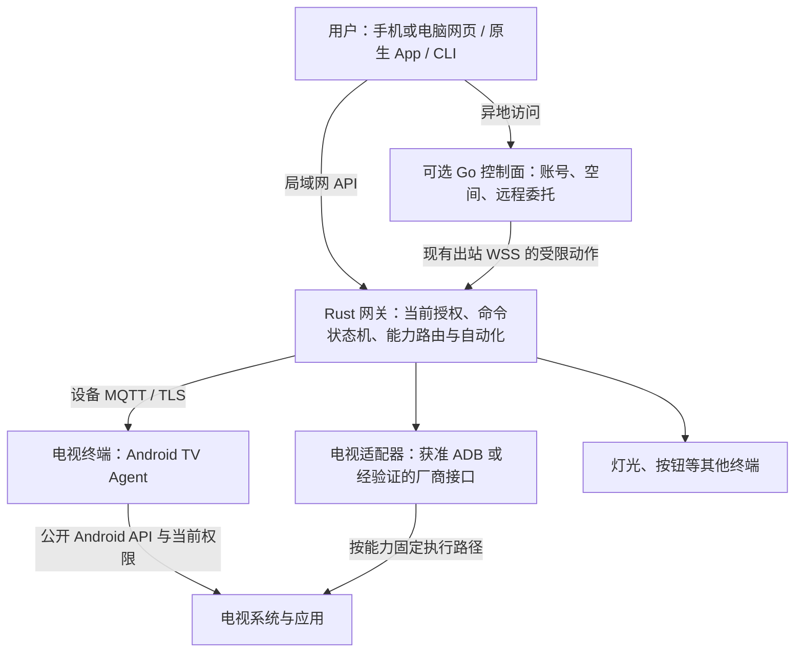

# 电视终端与 Android TV 接入

更新日期：2026-11-02。状态：接入设计基线与分阶段实现；动作、受限ADB、既有空间接入及显式动作组合已有软件证据，组合使用原生协议夹具与假ADB。设备Agent已实现两种受控逻辑模型及保留原记录的单向迁移；真实JVM Agent/假ADB组合旅程尚未通过，Android端上TLS/Keystore/存储与物理归属分别验收。关联FR-32、US-25、UC-23；当前进度只在 [24](24-实施计划与进度.md) 维护，型号证据只在 [30](30-设备支持矩阵与证据台账.md) 维护，动作输入与证据见 [命令合同](../contracts/commands.md)。

## 1. 产品定位与范围

电视是 LimeIoT 的一种设备终端，与灯光、按钮等设备共用 Space、Device、物模型、命令、观测和自动化。平台内置电视能力的模型、工具与界面投影；品牌、型号、Android 版本和具体协议由终端实现或适配器处理。

第一条目标流程为：所有者接入指定电视 → 手机或电脑打开家庭网页 → 查看连接与能力 → 使用方向、确认、返回和主页 → 启动允许的应用 → 调整音量 → 核对执行阶段。每项能力单独验收，不因同属 Android TV 或小米品牌而继承支持。

电视接入是存量设备扩展切片，不替代桌面环境灯首个 MVP，也不改变 ESP-IDF MCU 固件 SDK 的首期目标。去广告、替换系统桌面、任意应用管理、实时投屏和断电开机不属于基础遥控验收范围。

### 1.1 网页与电视的交互方向

| 用户任务 | 运行位置与身份 | 执行方式 |
| --- | --- | --- |
| 手机或电脑网页遥控电视 | 浏览器作为当前用户的控制客户端 | 网页调用网关/远程用例，网关交给已绑定的 Agent 或适配器；基础遥控无需电视先打开网页 |
| 电视显示家庭大屏并控制其他设备 | 电视浏览器或专用界面作为用户客户端 | 使用独立用户授权，调用同一套控制 API；遥控器焦点导航及旧浏览器另验 |
| 电视接收指令、上报自身状态 | TV Agent 使用单设备身份 | 只执行获准的本机能力；设备凭据不提供整个家庭的用户控制权 |

首个闭环选择第一项。电视大屏与 Agent 可以在同一设备共存，但会话、凭据和权限各自管理；网页可运行不代表网页具有系统遥控或跨应用输入权限。

## 2. 四层架构与角色

| 角色 | 身份与职责 |
| --- | --- |
| 手机、网页、CLI | 当前用户身份；展示能力、创建命令、查询原操作 |
| Rust 网关 | 空间本地执行入口；核验授权、模型、期限和路由，保存命令与观测 |
| Android TV Agent | 单设备身份；配对、声明能力、上报状态、执行获准的设备指令 |
| 电视适配器 | 已绑定设备的受限执行路径；封装协议、连接健康、结果和来源映射 |
| Go 控制面 | 用户、空间、绑定和远程原操作；沿用本地命令与授权语义 |

TV Agent 是电视上的设备接入进程，不是取得任意 Shell 或工具权限的推理 Agent。电视若另外显示家庭大屏控制台，则同时承担用户控制客户端角色；用户会话与设备凭据分别管理。

## 3. 两种接入路径与统一设备身份

### 3.1 原生终端

TV Agent 通过设备身份与 MQTT/TLS 接入，复用握手、会话、期限和去重规则，见 [06](06-MQTT报文与设备通信规范.md)、[12](12-身份认证与安全体系.md)。设备只接收本设备命令、上报本设备状态；公开 Android API 能完成的能力由终端执行。

普通 APK 不因通过 ADB 安装而获得 Shell 或系统签名权限。音量、应用启动、当前应用观测、无障碍操作与开机恢复分别核对所需权限、系统版本和厂商限制。无障碍服务需用户启用，不能承诺覆盖所有第三方应用的方向键与确认操作。

### 3.2 存量电视适配

网关电视适配器使用所有者在电视端明确允许的 ADB 连接，或已核实接口范围的厂商协议。ADB 私钥保留在网关受控存储，网页只提交类型化业务动作；不提供任意 Shell、包名命令拼接或网络目标代理。

适配器产生带来源的内部观测和命令证据，不伪装成持有电视原生设备证书的 MQTT 客户端。ADB 返回成功仅证明所调用过程完成，不能直接证明第三方应用产生了预期界面变化。

当前 NAS 网关运行于内部网络。实现 ADB 路径时须明确适配器到电视局域网的网络出口与限制；不能假定现有容器能直连电视。原生 Agent 的 MQTT/TLS 入站、CA、时钟和重连也需要单独验证。

### 3.3 身份与执行路由

一台电视只有一个稳定逻辑 `device_id`；IP、MAC、ADB serial、应用安装实例和传输地址是绑定或路由信息。Agent 与 ADB 的归并需要当前所有者批准和设备侧证明，不能只凭地址、名称或型号相同自动合并。

每项能力固定当前执行路径及映射修订。一条命令只选择一个执行端，并记录该选择及对应授权；执行结果未知时保留原操作，不自动切另一端补发。切换路由须重新核对能力和授权，不产生第二套命令账本。

当前 `bindings.compose` 可在同一逻辑模型中明确把 `apps.launch` 选给原生路径，其余 `remote.press` 留给ADB；要求当前原生会话声明覆盖所选能力，两个动作路径组成完整分区。`bindings.bind` 保持完整动作集交给一个候选。组合与撤销复用原账本，跨端FIFO、单路径离线和重启不补发已有协议夹具证据。Agent可显式选择android-tv-remote逻辑模型，hello仍只声明apps.launch；这不会授予按键权限或证明物理归属。正式字段及限制见 [执行路由](../contracts/execution-routes.md#显式能力组合与原生证明)，协议夹具证据见 [24第4.14节](24-实施计划与进度.md#414-显式能力组合与文档同步)，真实JVM组合未通过的状态见 [第4.15节](24-实施计划与进度.md#415-tv-agent模型配置与日志迁移文档同步)。

设备本机材料/日志迁移、网关Device的模型绑定变更、执行compose是三个独立步骤。本机迁移不修改网关模型绑定；已有android-tv-agent网关设备迁到内置android-tv-remote模型的完整路线尚未验证。当前组合旅程从已准备遥控模型的逻辑设备开始，不能据此宣称已有设备跨模型迁移通过；不得修改config_hash、删库或绕过发布者命名空间规则补齐该缺口。

组合设备以action_availability逐动作呈现可用性；一端离线只关闭对应动作，不自动改变路径或模型。原生应用启动不沿用ADB发现列表或授权，设备消费者须核对自身安装与白名单。设备身份、物理归属、执行能力和当前用户授权分别证明。

## 4. 能力与动作语义

基础能力组合已进入 [android-tv.json](../contracts/models/android-tv.json)；以下另含待扩展能力。模型是定义，不是型号支持或自动开放的运行时能力目录，实际绑定必须与已验证的执行路径一致。

| 类别 | 语义与定义范围 | 约束 |
| --- | --- | --- |
| 属性 | `audio.volume`、`audio.muted` | 读写分别声明；范围、单位和厂商刻度由模型及映射明确 |
| 只读观测 | 屏幕状态、前台应用 | 依可用权限发布；不可读保持 unknown/stale，不以期望值代替 |
| 动作 | `remote.press` | 有界按键白名单；每次点击是独立动作，重复投递按原 command_id 去重 |
| 动作 | `apps.launch` | 只允许已发现且获准启动的应用；区分请求受理与实际前台回读 |
| 可选媒体 | 截图或画面预览 | 独立授权、资源和留存；媒体不放入有界 MQTT 控制报文 |
| 型号专项 | 待机、唤醒、输入源 | 逐型号验证；通信离线不能推断关机，不承诺断电开机 |

当前 Schema 2 支持动作，调用形式为 `action.invoke`、path=`remote.press`、value=`{"key":"home"}`，或 path=`apps.launch`、value=`{"application_id":"…"}`。按键枚举限于 up/down/left/right/select/back/home/menu/play_pause；音量为0–100 percent，厂商原始刻度由适配器转换。两个动作均为非幂等、低风险、completion=submitted，当前只确认输入提交。

应用 ID 的1–255字符结构校验不构成应用白名单。执行端仍须发现并核对获准应用，不允许任意命令拼接；按键、启动应用与音量/静音分别验证。当前核心仍要求绑定模型的完整属性快照，缺少真实音量/静音能力时不能绑定该完整组合并补假值；应提供与实际能力一致的精确模型，动态能力子集合同另行演进。

首轮适配使用独立的 [android-tv-remote.json](../contracts/models/android-tv-remote.json)，只有基础动作。核心原生空属性快照、网页及 Swift/Kotlin 宿主库已取得该模型的软件运行证据；不沿用完整电视模型的 ID、版本或摘要冒充其能力。音量/静音读写作为独立能力门槛，通过后再按模型兼容与绑定流程加入。部分能力通过时，支持台账只登记该部分及其执行路径。

属性设定与离散动作沿用统一命令生命周期，重试政策按语义区分。按键流保持单设备有界顺序与短期限；长按/连发另定义开始、释放、上限和断连处理。断线或浏览器恢复不补发旧按键。

“输入已提交”“能力回读一致”“应用已进入目标界面”是不同证据范围。现行 action_result 的字段、输入摘要、完成范围与时间校验见[命令合同](../contracts/commands.md)；未经回读或对应证据，不能把 ADB 退出码或 MQTT PUBACK 转成已确认的界面结果。

## 5. Android TV Agent 工程边界

TV Agent 使用独立 Android 应用模块，提供遥控器可操作的配对、连接和诊断界面，与手机控制端分别构建。模型和报文定义按实际依赖复用，不复制权限、命令状态机或另建电视专用后端。

样本系统和 ABI 以 [30](30-设备支持矩阵与证据台账.md) 为准。当前手机应用 `apps/android/app` 的 `minSdk` 为 26，不能直接安装到 API 23 样本；TV 模块须覆盖 API 23。复用 `java.time` 等库时检查低版本 API 与 desugaring；引入原生库时提供样本实际支持的 ABI。

保活、开机启动、待机断网、系统回收、权限撤销和 APK 升级分别实测。Agent 在线不表示所有系统能力可用；权限变化应收紧能力并拒绝对应新命令。电视网页大屏只是可选表现，旧浏览器/WebView 的兼容性单独验证。

### 5.1 首个 Agent 的最小交付

首个 Agent 先证明设备接入与真实权限，不以安装成功代替遥控能力。以下为完整交付门槛，沿用现有身份、模型与命令语义，不在本节新增报文字段或 API；源码、构建、宿主检查和端上结果分别按第5.2节及24登记。

| 交付面 | 最小范围与验收依据 |
| --- | --- |
| 配对与身份 | 电视端可用遥控器完成配对与核对；所有者批准和设备侧证明后才关联既有逻辑设备；安装实例、地址变化不自动创建重复设备或接管旧身份 |
| 连接与恢复 | API 23 与样本 ABI 上验证证书、可信时间、设备会话、断网和进程回收；凭据撤销后拒绝新命令，重启不重放未知动作 |
| 能力与权限 | 只声明当前系统公开 API 及已取得权限确实支持的能力；无法跨应用注入按键时保留该限制，ADB 的 Shell 能力不能记作普通 APK 能力 |
| 命令与证据 | 每条命令固定执行端、期限和原操作；分别证明输入提交和实际回读，权限变化拒绝受影响的新动作；与 ADB 共存时验证两端发送计数 |
| 安装与更新 | 核对包名、签名连续性、API/ABI 和安装交互；Agent 更新与电视 OS 更新分别验收，更新提供方边界见 [13](13-OTA与制品交付规范.md) |

核心显式组合及Agent受控模型/日志迁移已有实现，同设备唯一分发仍须通过真实JVM组合旅程，再独立验证Android端上与物理归属。当前组合只支持仅动作/submitted/严格空输出模型，一个原生端加一个外部候选；不能任意混合属性、事件或多个适配器，也不能放宽模型校验或清日志实现接入。阶段依赖与未通过项见 [24第4.15节](24-实施计划与进度.md#415-tv-agent模型配置与日志迁移文档同步)。

### 5.2 设备协议核心与 Android 应用分阶段交付

[apps/tv-agent](../apps/tv-agent/README.md) 已建立独立Gradle工程，复用现有wrapper，设备核心不依赖手机控制库或Android SDK。本机执行能力始终只有公开系统API可承接的apps.launch；逻辑模型可选独立 [Agent模型](../contracts/models/android-tv-agent.json) 或组合所用的 [遥控模型](../contracts/models/android-tv-remote.json)。两者由固定仓库资源生成精确修订，不能导入任意模型或摘要；逻辑模型包含remote.press不表示APK能执行该动作。

| 本机配置 | 材料兼容 | 日志与迁移 |
| --- | --- | --- |
| android-tv-agent | 旧材料v1隐含此配置；材料v2显式选择 | 写日志v2，兼容只读加载旧v1 |
| android-tv-remote | 材料v2必须显式选择并在电视核对模型/指纹 | 写日志v3；允许旧应用模型v1/v2单向迁入，保留完整原Envelope、结果、unknown/未决及high_watermark，拒绝退回旧模型 |

Android在同一SQLite事务保存加密材料和迁移日志，失败一起回滚，原应用授权保留；直接JVM核心在hello前耐久提交迁移。实时入站只接受当前精确模型，旧模型只用于验证保留记录和原结果查询。材料格式、日志归属和拒绝条件由 [设备合同](../contracts/tv-agent.md) 维护。

核心通过设备mTLS、挑战/会话、认证时间与单调时钟接入，外部调用前提交耐久尝试。`DeviceStorage`、`ApplicationPort`和`DeviceClock`由消费方定义；JVM旅程使用文件存储及应用入口审计夹具。Android app另接Keystore加密、私有SQLite、实际Leanback启动入口、系统单调时钟及用户主动运行的前台服务；它与手机APK分别构建。协议、材料导入及恢复边界见 [设备合同](../contracts/tv-agent.md)，构建与操作见 [Agent说明](../apps/tv-agent/README.md)，应用初版与当前回收结果分别见 [24第4.11节](24-实施计划与进度.md#411-电视android应用与宿主边界检查)、[第4.13节](24-实施计划与进度.md#413-电视命令回执确认与安全回收)。

0.3.0调试APK、24项核心/材料与12项Android宿主检查已有阶段通过记录，早于最后模型摘要规范化及存储读取异常处理微调；当前源码最终复验未完成，真实JVM组合旅程未通过，详见24第4.15节。宿主使用API23启动端口、API28原生SQLite和API29后台限制，Keystore为替身，不能合并为API23端上全链通过。API23旧SQLite测试桥不支持当前aarch64宿主，失败保留；真实Keystore、SQLite、TLS、生命周期和指定电视仍待端上验收。日志v2/v3均按网关提交后确认回收最终结果，尚未回收记录仍最多128条/1MiB，unknown/未决保留，具体恢复边界见第5.4节。

### 5.3 Android 应用的交付门槛

独立应用先覆盖本机材料确认和实际应用启动，不同时扩展遥控权限、通用Android SDK或插件宿主。以下为完整退出条件，应用初版见24第4.11节，回收证据见第4.13节，当前模型/日志阶段见第4.15节；未取得端上结果的项目继续待验收，不由APK构建推导兼容。

| 交付面 | 实现边界与退出条件 |
| --- | --- |
| 独立应用与交互 | 与手机 APK 分别构建；电视入口、非触屏焦点导航及连接/停止/授权/诊断均可用遥控器操作；构建和 lint 后仍须在 API 23 与指定电视上分别运行 |
| 凭据确认与保护 | 电视端核对空间、设备、Broker 和 CA 指纹；设备 CA、客户端证书与私钥匹配，私钥/加密材料由 API 23 Keystore 与应用私有存储保护；关闭备份与秘密日志，拒绝替换身份绕过原记录 |
| 耐久记录 | 优先用私有 SQLite 事务及明确的同步策略实现 `DeviceStorage`，用写入失败/进程中断检查证明耐久语义；损坏或提交结果不明时停止控制并重开核对，不能退回旧内存继续执行 |
| 实际应用端口 | `ApplicationPort` 在提交前重新核对安装、启用状态、可用电视启动入口和当前所有者白名单，使用限定目标的启动入口；安装/卸载、禁用和撤权后拒绝失效调用，结果最多为 submitted |
| 运行与停止 | `DeviceClock` 使用系统单调时钟；连接生命周期由单一应用组件持有，Activity 重建不重复连接；用户停止或撤权阻断新动作，进程回收后只恢复记录并建立新会话，不续发旧动作 |
| 可见运行与系统限制 | 明确连接、断线、停止及容量不足状态；按实际 Android 版本核对后台/前台运行和应用启动限制，端上验证待机、回收与恢复，不把进程存在当成能力可用 |
| 长期运行 | 日志v2/v3均最多保留128条/1MiB未回收记录；按第5.4节以耐久边界及网关确认回收最终结果，unknown/未决保留；满容量继续拒绝，原结果与恢复分别验证 |

先通过当前源码的应用构建、存储/端口故障检查与隔离协议旅程，再做端上和指定电视验收。组合旅程须统计两端调用，验证撤权、崩溃、丢回执与恢复不双发；已有网关设备的跨模型绑定变更与物理归属另验，本机日志迁移不替代这些证明。APK更新的记录连续性见 [13第10.1节](13-OTA与制品交付规范.md#101-tv-agent-更新与设备记录连续性)。

### 5.4 耐久回执容量与安全回收的设计门槛

当前日志v2/v3绑定空间、设备、当前逻辑模型修订及high_watermark，最多128条/1MiB尚未回收的原命令/结果；v3还允许保留旧应用模型原包，不能重写其模型或会话。成功和拒绝在得到网关确认前同样占容量。原网关提交结果后，设备核对完整原包与结果摘要并耐久移除该记录，拒绝边界始终保留。达到容量上限继续拒绝新增记录。`result=null` 是可能已开始的尝试，`status=unknown` 是结果未知，两者都不能当成可淘汰的成功或未执行记录。当前会话内相同完整原包可返回原结果；重启不恢复旧动作；最终结果可通过新会话的up/receipt核对，网关确认后回收。准确行为仍以 [设备合同](../contracts/tv-agent.md) 为准。

当前已采用有序命令ID、原账本序号与提交后确认，正式边界由 [回执确认合同](../contracts/command-receipts.md) 维护。以下保留安全性与兼容门槛，软件证据和剩余端上验收分别登记：

| 必须解决的问题 | 设计与验证要求 |
| --- | --- |
| 退休依据来自哪里 | 复用网关原命令账本的持久受理序号，编码到command_id并绑定下行message_id；设备只接受高于本机边界的新ID，上行seq仍只用于报文排序 |
| 删除正文后如何拒绝旧请求 | 回收后保留high_watermark；旧ID原包、异参或新会话重包均不能越界。旧不透明ID仅可核对保留记录，不能作为新的执行请求 |
| 哪些记录不能删除 | 未决尝试与 unknown 保留；网关确认收到 unknown 不能证明无副作用。最终结果的正文压缩须保持原结果语义及必要的请求绑定，不能把已提交输入提升为界面完成 |
| 何时确认回收完成 | 原结果先随网关事务提交，再发送当前会话确认；设备匹配两份摘要后提交回收。提交结果不明则冻结并重开，不靠旧内存推进或重放 |
| 如何跨版本与恢复 | 应用配置只读加载v1、实际提交写v2；遥控配置在hello前耐久迁为v3，Android与材料原子保存；拒绝反向迁移及未知/错归属日志。welcome先耐久恢复原网关序号；网关历史低于本机边界时拒绝。两端同时回退及APK更新/回退仍需独立恢复与验收 |

命令正文仍只有command_id、issued_at、expires_at和operation，执行序号绑定在ID内；hello/welcome及receipt扩展由正式合同定义，未协商设备保持原握手。[设备通信](06-MQTT报文与设备通信规范.md)、[命令合同](../contracts/commands.md) 与 [设备合同](../contracts/tv-agent.md) 共同约束消费者，网关继续复用原命令账本，未增加第二套动作队列。领域保留职责见 [04 第4.1节](04-领域模型与数据设计.md#41-控制回执的保留与安全回收)，更新连续性见 [13 第10.1节](13-OTA与制品交付规范.md#101-tv-agent-更新与设备记录连续性)。

软件验收至少覆盖条数/字节容量、保留未知记录时耗尽、退休前后重复与异参、旧消息在新会话重包、重复/乱序确认、确认两侧提交失败、进程中断、换证/撤权和旧备份恢复。分别统计实际应用调用与其他执行端发送次数，证明压缩与恢复均不增加副作用。当前实现及新增核心、SQLite宿主和隔离mTLS旅程证据见 [24第4.13节](24-实施计划与进度.md#413-电视命令回执确认与安全回收)。这不等于网关命令账本无限保留、两端联合旧备份恢复或真实电视已验收；容量不足仍不提供清空日志解锁入口。

## 6. 代码职责落位

代码职责及当前边界如下；规划路径不作为构建前提，不创建空工程代替能力交付：

| 位置 | 职责 |
| --- | --- |
| [完整电视模型](../contracts/models/android-tv.json) / [仅动作模型](../contracts/models/android-tv-remote.json) / [Agent模型](../contracts/models/android-tv-agent.json) | 三个独立模型；ADB使用仅动作模型，Agent可选择后两种逻辑模型但只执行apps.launch；完整模型另含音量/静音，需对应执行与回读支持；定义不代表型号验收、已签名安装或可任意组合 |
| [apps/tv-agent](../apps/tv-agent/README.md) | 独立core/app、材料核对、Keystore/SQLite、Leanback端口和可见服务；调试APK与宿主检查通过，API23完整端上、生产认领及ADB归并另验；不复用手机APK |
| [gateway/adapters/android-tv](../gateway/adapters/android-tv/README.md) | 已有固定目标/指纹/序列号、受限 ADB、应用白名单与进程故障检查；厂商协议及实机另验 |
| 现有 `gateway/crates/` | 动作、跨执行端FIFO、第一方路由/内部结果与执行绑定账本；本地bind/compose/revoke、能力声明及发现API已接通，通用IPC、宿主热加载和自动切换待实现 |
| 现有 `apps/home` | 统一动作控件逐路径禁用；支持普通绑定、组合状态显示/撤销、原请求恢复及适配发现；创建组合目前用通用CLI，无专用网页表单；端上与实机另验 |
| 现有 `server`、`packages/cli` | 既有远程动作与回执；CLI另提供本地适配候选/绑定/发现/原决定工具，重算完整请求摘要；不自动扩展独立控制面的远程管理权限 |
| 现有 `apps/ios`、`apps/android` | NAS/云共用模型动作控件、原操作及完成范围；两端宿主库本地/云动作旅程与Android构建已有结果，手机界面运行单独验收 |
| 现有 `apps/console` | 复用统一模型与远程用例；专门电视面板未单独验收 |

拆包以真实依赖为准；先形成单型号纵向闭环，再依据复用需求提取公共 Android 设备 SDK。REA 用于实验分析和证据获取，不作为发布后遥控电视的运行依赖。

## 7. 实施与验收入口

依赖顺序为：记录样本和只读基线 → 动作合同及消费者验证 → 唯一执行路径与网页/获准 ADB 闭环 → TV Agent 接入同一设备 → 手机与场景扩展。已验证的身份、CA、模型安装、命令和远程链路按范围复用，新增语义分别验证。TV Agent APK 更新与电视 OS 更新是独立目标，安装权限、API/ABI、签名与恢复按 [13](13-OTA与制品交付规范.md) 核对；不借原生 MCU 固件合同承诺电视升级。

软件验证入口为 `npm run test:actions`：构建当前网页与Rust workspace，再用虚拟动作设备、真实HTTP/MQTT及Chromium验证遥控、完成范围、原操作恢复和布局。CLI远程动作通过 `npm run test:remote` 验证；原生本地/云分别使用 `npm run test:actions:native` 和 `npm run test:control:native`。结果与缺口见24；这些旅程均不能证明样本电视已收到按键、启动应用或支持更新。

设备核心与隔离TLS旅程入口为`npm run test:tv-agent`；Android核心/宿主边界、调试APK及lint入口为`npm run test:tv-agent:android`。两者顺序运行，均不安装APK或操作电视；Android API23端上和同设备共存单独验收，应用初版范围见24第4.11节，回执回收与当前软件结果见第4.13节。

`npm run test:tv` 验证真实网关/网页到假ADB的执行路由、耐久提交、白名单和恢复；新增同一目标逻辑电视的原生协议夹具/假ADB组合旅程，覆盖明确会话证明、两端计数、单路径离线、网页撤销和重启不补发。当前结果见 [24第4.14节](24-实施计划与进度.md#414-显式能力组合与文档同步)，普通绑定与事件刷新历史结果保留于4.7。正式结构、快照v7与本地工具见 [执行合同](../contracts/execution-routes.md)，前提见 [CLI](../packages/cli/README.md#电视适配绑定与应用发现)。

### 7.1 现有空间的所有者接入流程

宿主准备获准电视配置 → 读取候选和当前模型/绑定修订 → 在电视端核对目标身份及应用授权 → 所有者明确绑定 → 新探测成功后使用统一动作控件。候选本身不产生执行权，也不自动创建或合并逻辑设备；首次启动静态routes保留兼容，已有空间无需更改核心初始配置或删除数据库。

宿主config变更后重启，旧路由在摘要不匹配时休眠；明确绑定新候选后才恢复探测。撤销以持久记录阻止控制和MQTT回退；历史绑定成功只证明当时决定，原键恢复不会复活设备。换绑要求没有dispatched和OTA占用，撤销可以立即阻断，可能已发送的命令保持unknown。绑定、会话与型号差异的领域归属见[04](04-领域模型与数据设计.md)，通用交接约束见[07](07-异构协议与适配器规范.md)。

应用GET只读取当前绑定修订的后台发现缓存，15秒失效；已发现、已授权及已在前台分别表达。网页对未授权包禁用启动；真正调用仍走统一命令并重新核对身份、发现结果和白名单。当前网页没有修改宿主白名单的入口，手机/远程控制面的同类接入管理也未随本地API自动提供。

进度、阶段和下一步以 [24](24-实施计划与进度.md) 为准；用例见 [UC-23](17-用户故事与用例.md)，功能与故障验收见 [23](23-测试策略与验收矩阵.md)。只有按精确型号完成控制、回读、重连、撤权与恢复，才可提升支持状态；只读设备观察不代表平台电视控制已实现。

首个适配交付须提供固定目标的类型化按键、应用发现与当前授权白名单、进程超时/输出限制、唯一执行路由及耐久恢复证据。应用安装、卸载或权限变化后重新核对发现结果；拒绝失效授权，不允许客户端传任意 Shell、Intent 或网络目标。实现先经假 ADB/协议进程故障测试，随后验证真实网关与网页，最后按已获准操作取得实机证据。

通用执行交接与路由更新约束见 [07](07-异构协议与适配器规范.md) 第11节。测试必须分别统计 MQTT 与适配器的发送次数，并在持久化失败、标记后崩溃、丢回执和撤权时验证不双发；ADB 进程退出成功最多支持 submitted，不能据此上报 observed。原生 Agent 加入后对同一逻辑设备重跑这些检查。
