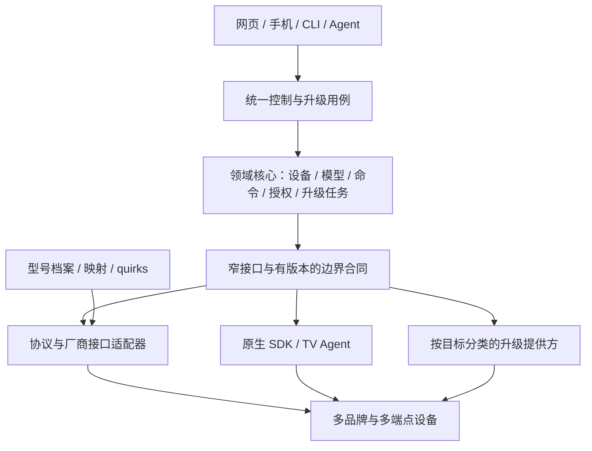

# 多品牌设备接入与升级架构调研

调研日期：2026-11-02。状态：公开资料调研与设计输入；未进行小米/华为完整系统逆向、协议实机验收或设备升级。本页拥有比较依据、适用范围和研究缺口；领域归属见 [04](04-领域模型与数据设计.md)，扩展规范见 [07](07-异构协议与适配器规范.md)，升级规范见 [13](13-OTA与制品交付规范.md)，当前实现只以 [24](24-实施计划与进度.md) 为准。

## 1. 结论与比较口径

LimeIoT 的目标是开放的异构设备平台：原生设备与存量设备并存，逐步覆盖多品牌、多型号和多种协议。“万国牌”意味着接入架构可扩展，不意味着所有设备都能控制、离线运行或更新固件。

不能由公开资料断言小米、华为的整体系统比 LimeIoT 简单。小米本身支持大量合作厂商和品类；其 SDK、产品规范、认证及准入机制能够约束一部分差异。LimeIoT 还要处理无法安装 Agent、不能改固件、只有单向遥控、依赖厂商云或缺少接口资料的设备，复杂度主要来自异构性和证据不足，而非品牌数量。

小米足以作为物模型、产品开发闭环和控制界面的主要参考；现有证据不足以把它作为开放异构接入与全部更新机制的唯一蓝本。采用“小米的模型与产品经验 + HA/openHAB 的异构接入经验 + 目标系统的更新机制”，核心保留自有领域语义。

### 1.1 研究结论对应的设计选择

| 设计问题 | 主要参考与采用范围 | 本平台落点 |
| --- | --- | --- |
| 如何统一不同品类 | MIoT 的服务、属性、动作、事件及标准界面经验 | 自有物模型与默认生成控件；外部标识通过映射转换，不改变核心 ID/授权语义 |
| 如何兼容大量存量设备 | HA/openHAB 的集成、设备/功能与桥接分层 | 协议适配器复用，型号档案/映射处理差异，必要时增加 quirks；按实际接口选择接入路线 |
| 是否使用插件 | 区分米家 UI 扩展、协议集成、固件组件与升级提供方 | 第一方静态模块起步，重依赖或第三方代码优先进程；UI 扩展独立，通用分发与宿主合同由真实样本推动 |
| 如何统一升级 | 小米分部件更新经验、HA 的能力呈现、ESP-IDF/Matter/RAUC 等目标机制 | 平台治理信任与原任务，各提供方分别承诺安装、查询、取消、回滚及健康证据 |
| 小米是否需要完整 REA | 先用公开规范/源码回答结构问题，再对明确制品核实缺口 | 优先解决指定电视的执行入口和权限问题；不以客户端或单样本推断整个小米平台 |

这些是基于下述已有来源形成的架构取舍，决定登记为 [ADR-21](26-架构决策记录与风险.md)，不是新增协议支持或本轮完成逆向的结果。扩展与升级的正式设计分别由07、13维护；领域仍按事实归属划分，首期保持模块化核心，不按品牌增设后端。

## 2. 小米：覆盖广，但不同扩展机制不能混为一谈

| 官方来源 | 本次观察 | 对 LimeIoT 的意义 |
| --- | --- | --- |
| [选择接入方式](https://iot.mi.com/v2/new/doc/introduction/preparation/access_mode) | 直连通过模组/SDK；云对云由开发者自有云完成设备控制。列有 RTOS/无 OS、Linux OT、Android OT、BLE、BLE Mesh 等路径 | 同一平台覆盖多种设备系统，不应要求所有设备运行同一固件或 Agent |
| 同上 | 自建 App “只能控制自己的硬件产品”；云对云目前仅对受邀伙伴开放 | 产品接入能力与任意已有米家设备的访问权是不同事项 |
| [MIoT 服务目录](https://miot-spec.org/miot-spec-v2/spec/services)、[Light 服务定义](https://miot-spec.org/miot-spec-v2/spec/service?type=urn:miot-spec-v2:service:light:00007802) | 服务定义 required/optional 的属性、动作与事件 | 复用能力语义并允许真实能力子集，不能按品类补齐不存在的功能 |
| [官方 HA 集成说明](https://github.com/XiaoMi/ha_xiaomi_home/blob/main/README.md) | Device → Service → Property/Event/Action；先做特殊实体映射，再做通用映射；云端订阅与命令、本地中枢、部分 LAN 控制分别说明 | 物模型、协议通信、模型解析及目标平台投影应分开；这些是公开集成的行为，不是整个闭源平台的内部实现 |
| [标准扩展程序概述](https://iot.mi.com/v2/new/doc/plugin/standard-plugin/standard-plugin-overview) | 原文：“扩展程序作为米家 App 的插件，可向用户展示产品 UI 界面”；标准界面依赖 Spec，允许跳转自定义页面，品类有开放限制 | 米家 UI 插件不能直接作为网关协议驱动的设计依据；LimeIoT 默认按能力生成界面，特殊交互单独扩展 |
| [固件开发概述](https://iot.mi.com/v2/new/doc/embedded-dev/overview_fw_dev) | 通用模组、SDK 二次开发、INC、Linux/Android 分支；模组固件与业务 MCU 可能分别更新；批量发布有测试与认证要求 | 设备可能由多个可升级部件组成，制品与兼容条件应分别登记 |
| [MCU OTA 升级](https://iot.mi.com/v2/new/doc/embedded-dev/module-dev/ota/mcu-ota) | 模组下载并校验后，通过 Xmodem-128 传 MCU；MCU 可返回 ready/busy；示例 Firmware 区暂存，Bootloader 拷贝至 App 区，使用 CRC32，最后上报新版本 | 可借鉴设备忙碌检查、分阶段传输、容量限制和失败测试；该示例不是直接从 A/B 两个应用槽切换的证据，CRC 也不替代签名 |

MCU 文档只描述该接入模式，不能据此断言所有小米产品仅用 CRC、没有安全启动或都支持自动回滚。标准扩展程序页面还明确提示实际情况须以测试为准。

官方 HA 集成的本地模式受中枢、固件和地区等条件限制；部分 LAN 路径仅覆盖 IP 设备，不能由此推断 Zigbee/BLE Mesh 通用直连。其 [许可](https://github.com/XiaoMi/ha_xiaomi_home/blob/main/LICENSE.md) 将授权作品及相关接口限定为非商业 Home Assistant 用途，明确不授权用于其他 App/Web 服务。本平台不能把该集成或身份直接移植成 LimeIoT 的生产接入路径，既有生态边界见 [31](31-多生态兼容与开放接入.md)。

## 3. 华为：分别研究消费生态与 IoTDA

[HarmonyOS 设备开发入口](https://device.harmonyos.com/)提供设备开发与 HarmonyOS Connect 资料入口，但本次未取得足以核实其消费中枢内部插件运行时、数据库、命令一致性或 OTA 回滚实现的资料。解决方案页面的介绍不能作为这些内部机制的证据。

华为云 IoTDA 有可核对的产品模型资料，它是云物联网服务，不能直接代表 HarmonyOS Connect/华为全屋智能的内部架构。

| 官方来源 | 本次观察 | 可采用的经验 |
| --- | --- | --- |
| [什么是产品模型](https://support.huaweicloud.com/devg-iothub/iot_01_0017.html) | 产品按服务组织属性和命令；支持自定义、文件导入、Excel 导入和标准/厂商模型库 | 标准能力与厂商扩展共存，产品定义和实际设备实例分开 |
| [离线开发产品模型](https://support.huaweicloud.com/devg-iothub/iot_02_4012.html) | `omCapability` 描述软件、固件和配置更新能力，不涉及升级时可删除；升级协议与设备通信协议分别描述 | 控制接入不自动产生升级能力；升级需独立能力声明和执行路径 |

以上资料未证明本平台可以调用华为商业设备接口，也未证明任意 IoTDA 设备都有同样的升级或回滚能力。

## 4. 更贴近异构接入目标的参考

| 项目与官方依据 | 实际机制 | 采用方式与边界 |
| --- | --- | --- |
| Home Assistant：[集成清单](https://contributors.home-assistant.io/core/integrations/manifest/)、[设备注册](https://contributors.home-assistant.io/core/integrations/device-registry/) | Integration 标明依赖、发现方式、本地/云端及推送/轮询类型；Device 聚合多个 Entity，记录型号、硬件/软件版本及中枢关系 | 学习集成配置、能力组合和连接特性。不能推断其自定义 Python 集成天然具有进程/权限隔离；跨集成自动归并设备也不是可照搬的保证 |
| Home Assistant：[Update Entity](https://contributors.home-assistant.io/core/entities/update/) | 统一呈现版本和进度，INSTALL、SPECIFIC_VERSION、BACKUP、PROGRESS 等特性分别声明，由具体集成执行 | 统一更新用例与呈现，执行能力按提供方声明；有更新信息不代表可安装，更不代表可回滚 |
| openHAB：[Things/Channels/Bridges](https://www.openhab.org/docs/concepts/things.html)、[Bindings](https://www.openhab.org/docs/developer/bindings/) | Binding 接外部系统，Thing 表示设备/服务，Channel 表示功能，Bridge 连接下属设备，Item 链接业务状态 | 借鉴设备、功能、桥接关系与业务投影分离；不因此引入 Java/OSGi 或第二套状态账本 |
| Zigbee2MQTT：[External converters](https://www.zigbee2mqtt.io/advanced/more/external_converters.html) | zigbee-herdsman-converters 做双向转换；外部 JS 定义型号及 exposes/extend 等规则 | 协议栈可共享，型号差异用映射/quirks 消化；JS 是可执行代码，不能当成安全配置文件 |
| Zigbee2MQTT：[OTA](https://www.zigbee2mqtt.io/guide/usage/ota_updates.html) | 查询 manufacturer code、image type、版本后匹配镜像；休眠设备可等待下一次请求；部分设备拒绝降级 | 型号匹配、电池/唤醒和厂商约束都进入升级能力；支持 Zigbee 不等于所有 Zigbee 设备可升级 |
| ESPHome：[External Components](https://esphome.io/components/external_components/) | 从 Git 或本地目录加载含 Python/C++ 的组件，用于固件构建 | 借鉴原生设备组件化和依赖固定；它不同于给已运行的 MCU 动态安装网关插件 |
| ESPHome：[OTA](https://esphome.io/components/ota/)、[Safe Mode](https://esphome.io/components/safe_mode/) | 多种 OTA 传输；连续启动失败可只保留日志、网络与 OTA；Bootloader 回滚另受平台和配置约束 | 恢复入口与业务功能解耦，Safe Mode 与自动回滚分别验收 |
| Matter：[官方 OTA 指南](https://github.com/project-chip/connectedhomeip/blob/master/docs/guides/updating-matter-device-guide.md)、[Provider 示例](https://github.com/project-chip/connectedhomeip/blob/master/examples/ota-provider-app/linux/README.md) | Provider/Requestor、Fabric/ACL、镜像头中的 Vendor/Product/Version 及适用版本范围 | 通过独立提供方接标准 OTA；示例可运行不等于取得厂商制品、信任或任意设备的刷写权限 |
| RAUC：[Basics](https://rauc.readthedocs.io/en/latest/basic.html)、[Integration](https://rauc.readthedocs.io/en/latest/integration.html) | 强制签名 bundle、目标 slots、启动成功标记；回退依赖 Bootloader 与系统集成 | 作为自有 Linux 设备 OS 更新的候选；普通 NAS 应用更新不因此需要接管宿主 OS |
| ESP-IDF：[OTA](https://docs.espressif.com/projects/esp-idf/en/stable/esp32/api-reference/system/ota.html) | 备用分区、启动确认、配置相关的回滚/反回滚 | 当前原生 MCU 路线继续采用其机制，逐板卡验证断电与恢复 |

参考机制不等于引入项目为必需依赖，也不等于已完成这些协议的 LimeIoT 实现。

## 5. 设计落点

领域按事实与不变量划分，不为电视、灯、每个品牌或型号建立独立业务后端。首期仍是模块化核心，接入层作为防腐层翻译外部协议，不预先拆成多组微服务。

关键落点分别维护：

- [04](04-领域模型与数据设计.md)：产品/硬件定义、型号兼容档案、实例身份、连接绑定、组件与能力关系，以及跨域变更的归属。
- [07](07-异构协议与适配器规范.md)：协议适配与型号映射分层；第一方模块和进程扩展；权限、生命周期、版本与回退。一个协议适配器通常服务多个品牌/型号。
- [13](13-OTA与制品交付规范.md)：统一升级治理，MCU、APK、Linux 应用/OS、适配器、映射和厂商 OTA 分别执行；多部件更新不伪装跨设备原子事务。
- [20](20-AI辅助逆向与设备适配流程.md)：公开资料与源码优先，需要确认具体成品行为时再使用 REA，证据按版本和目标归档。

## 6. 小米 REA 的研究范围与停止条件

继续以小米为重点研究对象，但先按问题选择资料或制品。对已提供完整源码的组件用正常源码分析；对只能由 APK、SDK 二进制、固件或运行行为回答的问题，按 REA 工作流分析。工具选择不改变接口权限和证据边界。

| 待回答问题 | 适合的目标/方法 | 可支持与不能支持的结论 |
| --- | --- | --- |
| Spec 如何映射为设备功能、控制界面与工具 | MIoT 定义、官方集成源码、标准扩展程序文档 | 能解释公开结构；无需为已有源码结论运行二进制逆向 |
| 米家客户端如何加载页面与关联设备能力 | 明确版本/渠道的米家 APK，先做包清单和相关调用链分析 | 只说明该客户端版本；不能由客户端推断云端数据库或完整服务实现 |
| 某款电视有哪些本地控制入口和系统权限 | 指定电视构建、相关系统 APK/服务及获准的最小运行观测 | 只说明对应型号/固件；普通 APK 权限与系统签名权限分开 |
| 指定模组/SDK 如何处理升级校验与错误恢复 | 明确型号/版本、来源和用途范围的 SDK/固件制品及隔离测试 | 可核对该更新实现；不能把解包成功当作可安装或可回滚 |

本轮没有取得并选定上述米家 APK、SDK 二进制或完整固件，未宣称已做其反编译。已有电视只读证据见 [30](30-设备支持矩阵与证据台账.md)；它不是米家 App、小米云或完整中枢的证据。后续每项分析固定制品摘要、包/构建版本、观察入口、推断与反例；需要设备写入的验证单独核对实际影响与授权。

如果公开规范或源码已经回答问题，即停止扩大逆向范围；若结论只能来自不可获得的服务器实现，保留未知，改用自有领域不变量与可验证的接口合同设计。研究结果形成独立说明和夹具，不把受限代码或客户端凭据移植进平台。

## 7. 实施顺序与待验证项

1. 沿用原生MQTT与Schema 2动作基础；既有空间绑定/撤销、配置迁移和发现已有假ADB旅程。核心显式compose以相同模型、当前原生会话及能力覆盖固定动作分区，协议夹具/假ADB证据见 [24第4.14节](24-实施计划与进度.md#414-显式能力组合与文档同步)。TV Agent现已实现两种受控逻辑模型、材料确认与保留记录的单向日志迁移，但真实JVM组合旅程尚未通过，当前结果与缺口见 [第4.15节](24-实施计划与进度.md#415-tv-agent模型配置与日志迁移文档同步)。本机迁移、已有网关设备跨模型绑定、执行组合及物理归属分别证明；日志v2/v3仍限128条/1MiB未回收记录，unknown/未决保留，网关4096条归档和两端联合旧备份恢复另行处理。API23完整端上与指定电视分开验收，实机按24顶部要求跳过，不提升型号支持。
2. 再以第二类协议设备验证多端点、休眠/无回读、重连、撤销与未知结果；型号未选定前不承诺支持。
3. 从可复用边界提炼进程适配合同与型号档案，先受控发布，后评估社区分发。插件市场、通用脚本宿主和自动热加载不属于本轮实现。
4. 原生 MCU 按当前设备端验证、安装和启动结果恢复链路继续验收，具体状态只以 [13](13-OTA与制品交付规范.md) 和 [24](24-实施计划与进度.md) 为准；APK/厂商/其他更新提供方按实际需求独立增加。每种机制单独证明安装、健康检查、恢复及回滚能力；Agent程序更新还须保持设备身份、授权和耐久记录连续性，不能清空记录解除控制限制。

当前正式 OTA 制品类型仍只有 `device-firmware`；原生固件校验、下载及本地升级任务按各自合同推进，不自动覆盖 APK、OS 或厂商更新。模型 Schema 2 已支持动作，Schema 1 仍要求 actions 为空；本地动作软件旅程、远程完整链路、插件宿主和真实电视控制分别验收。软件链路的新增证据不改变本报告的小米/华为研究范围，也不构成已完成小米系统 REA 的声明。合同范围分别见 [OTA](../contracts/ota.md)、[本地升级任务](../contracts/ota-tasks.md)、[模型校验](../contracts/model-validation.md)与[命令](../contracts/commands.md)，当前验收证据和缺口只在 [24](24-实施计划与进度.md) 维护。

执行绑定与组合是多品牌接入的本地用例：宿主准备候选，核心保存完整路径计划和明确决定，执行端只接收所选动作。能力声明是会话证明，不能成为动态授权或自动故障切换。它不把ADB配置提升为通用插件manifest，也不合并应用发现、控制权和更新权。第二类协议应先验证共同不变量，再提炼进程合同；不按品牌复制账本或要求每个型号安装相同Agent。现有合同见 [执行路由与绑定](../contracts/execution-routes.md)。

后续工作包见 [24第4.8节](24-实施计划与进度.md#48-文档复核与后续交付门槛)，历史文档复核、回收及协议夹具组合证据保留于4.12–4.14，当前Agent模型/日志实现与未通过项见 [第4.15节](24-实施计划与进度.md#415-tv-agent模型配置与日志迁移文档同步)；通用插件合同的提炼条件见 [07第10.1节](07-异构协议与适配器规范.md#101-提炼通用插件合同的门槛)。只有取得不同协议的真实行为与恢复证据后才扩大共享接口，不因研究材料覆盖广就增加运行时或发布体系。

本次文档同步沿用已有公开来源，没有新增小米/华为制品或 REA 结果。独立Agent核心继续使用现有设备协议，不构成第二类实际协议或第二种更新机制的证据；通用插件IPC与升级提供方合同的准入条件保持不变。小米仍是物模型与产品闭环的主要参考，异构接入、更新和恢复机制继续结合其他项目及目标系统验证。

本次来源包括官方网页、规格服务和官方项目文档；动态页面通过浏览器读取，其他页面及 README 抓取正文。链接为访问时公开入口，部分指向可变化的主分支，并非固定版本离线归档。没有进行 HA/openHAB/Matter/华为生态联调，未核实 HarmonyOS Connect 内部升级实现；本报告不构成这些系统或设备的完整兼容声明。
