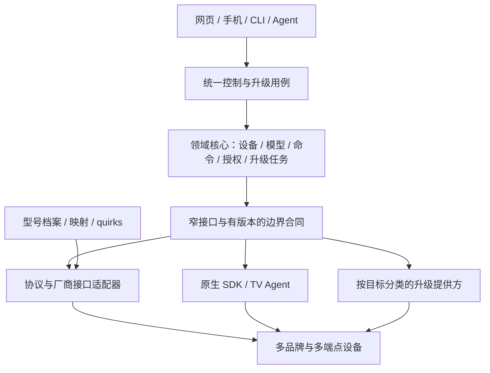

# 多品牌设备接入与升级架构调研

调研日期：2026-11-02；文档复核日期：2026-11-03。状态：公开资料调研与设计输入；未进行小米/华为完整系统逆向、协议实机验收或设备升级。本页拥有比较依据、适用范围和研究缺口；领域归属见 [04](04-领域模型与数据设计.md)，扩展规范见 [07](07-异构协议与适配器规范.md)，升级规范见 [13](13-OTA与制品交付规范.md)，当前实现只以 [24](24-实施计划与进度.md) 为准。

## 1. 结论与比较口径

LimeIoT 的目标是开放的异构设备平台：原生设备与存量设备并存，逐步覆盖多品牌、多型号和多种协议。“万国牌”意味着接入架构可扩展，不意味着所有设备都能控制、离线运行或更新固件。

不能由公开资料断言小米、华为的整体系统比 LimeIoT 简单。小米本身支持大量合作厂商和品类；其 SDK、产品规范、认证及准入机制能够约束一部分差异。LimeIoT 还要处理无法安装 Agent、不能改固件、只有单向遥控、依赖厂商云或缺少接口资料的设备，复杂度主要来自异构性和证据不足，而非品牌数量。

小米足以作为物模型、产品开发闭环和控制界面的主要参考；现有证据不足以把它作为开放异构接入与全部更新机制的唯一蓝本。采用“小米的模型与产品经验 + HA/openHAB 的异构接入经验 + 目标系统的更新机制”，核心保留自有领域语义。

### 1.1 研究结论对应的设计选择

| 设计问题 | 主要参考与采用范围 | 本平台落点 |
| --- | --- | --- |
| 如何统一不同品类 | MIoT 的服务、属性、动作、事件及标准界面经验 | 自有物模型与默认生成控件；外部标识通过映射转换，不改变核心 ID/授权语义 |
| 如何兼容大量存量设备 | HA/openHAB 的集成、设备/功能与桥接分层 | 协议适配器复用，型号档案/映射处理差异，必要时增加 quirks；按实际接口选择接入路线 |
| 是否使用插件 | 区分米家 UI 扩展、协议集成、固件组件与升级提供方 | 第一方静态模块起步，重依赖或第三方代码优先进程；UI 扩展独立，通用分发与宿主合同由真实样本推动 |
| 如何统一升级 | 小米分部件更新经验、HA 的能力呈现、ESP-IDF/Matter/RAUC 等目标机制 | 平台治理信任与原任务，各提供方分别承诺安装、查询、取消、回滚及健康证据 |
| 小米是否需要完整 REA | 先用公开规范/源码回答结构问题，再对明确制品核实缺口 | 优先解决指定电视的执行入口和权限问题；不以客户端或单样本推断整个小米平台 |

这些是基于下述已有来源形成的架构取舍，决定登记为 [ADR-21](26-架构决策记录与风险.md)，不是新增协议支持或本轮完成逆向的结果。扩展与升级的正式设计分别由07、13维护；领域仍按事实归属划分，首期保持模块化核心，不按品牌增设后端。

本轮文档把这些取舍落实到可执行的设计入口：[03第1.4节](03-总体技术架构.md#14-多品牌接入的架构基线)说明电视及后续设备如何纳入平台，[04第1.1节](04-领域模型与数据设计.md#11-领域协作与一致性边界)明确用例与一致性责任，[07第9.2节](07-异构协议与适配器规范.md#92-新增设备的交付流程)规定新增型号的证据与绑定流程，[13第9.1节](13-OTA与制品交付规范.md#91-发布兼容组合与中间状态)明确多部件更新的兼容组合。本页继续维护研究依据，不复制这些规范为第二套事实源。

## 2. 小米：覆盖广，但不同扩展机制不能混为一谈

| 官方来源 | 本次观察 | 对 LimeIoT 的意义 |
| --- | --- | --- |
| [选择接入方式](https://iot.mi.com/v2/new/doc/introduction/preparation/access_mode) | 直连通过模组/SDK；云对云由开发者自有云完成设备控制。列有 RTOS/无 OS、Linux OT、Android OT、BLE、BLE Mesh 等路径 | 同一平台覆盖多种设备系统，不应要求所有设备运行同一固件或 Agent |
| 同上 | 自建 App “只能控制自己的硬件产品”；云对云目前仅对受邀伙伴开放 | 产品接入能力与任意已有米家设备的访问权是不同事项 |
| [MIoT 服务目录](https://miot-spec.org/miot-spec-v2/spec/services)、[Light 服务定义](https://miot-spec.org/miot-spec-v2/spec/service?type=urn:miot-spec-v2:service:light:00007802) | 服务定义 required/optional 的属性、动作与事件 | 复用能力语义并允许真实能力子集，不能按品类补齐不存在的功能 |
| [官方 HA 集成说明](https://github.com/XiaoMi/ha_xiaomi_home/blob/main/README.md) | Device → Service → Property/Event/Action；先做特殊实体映射，再做通用映射；云端订阅与命令、本地中枢、部分 LAN 控制分别说明 | 物模型、协议通信、模型解析及目标平台投影应分开；这些是公开集成的行为，不是整个闭源平台的内部实现 |
| [标准扩展程序概述](https://iot.mi.com/v2/new/doc/plugin/standard-plugin/standard-plugin-overview) | 原文：“扩展程序作为米家 App 的插件，可向用户展示产品 UI 界面”；标准界面依赖 Spec，允许跳转自定义页面，品类有开放限制 | 米家 UI 插件不能直接作为网关协议驱动的设计依据；LimeIoT 默认按能力生成界面，特殊交互单独扩展 |
| [固件开发概述](https://iot.mi.com/v2/new/doc/embedded-dev/overview_fw_dev) | 通用模组、SDK 二次开发、INC、Linux/Android 分支；模组固件与业务 MCU 可能分别更新；批量发布有测试与认证要求 | 设备可能由多个可升级部件组成，制品与兼容条件应分别登记 |
| [MCU OTA 升级](https://iot.mi.com/v2/new/doc/embedded-dev/module-dev/ota/mcu-ota) | 模组下载并校验后，通过 Xmodem-128 传 MCU；MCU 可返回 ready/busy；示例 Firmware 区暂存，Bootloader 拷贝至 App 区，使用 CRC32，最后上报新版本 | 可借鉴设备忙碌检查、分阶段传输、容量限制和失败测试；该示例不是直接从 A/B 两个应用槽切换的证据，CRC 也不替代签名 |

MCU 文档只描述该接入模式，不能据此断言所有小米产品仅用 CRC、没有安全启动或都支持自动回滚。标准扩展程序页面还明确提示实际情况须以测试为准。

官方 HA 集成的本地模式受中枢、固件和地区等条件限制；部分 LAN 路径仅覆盖 IP 设备，不能由此推断 Zigbee/BLE Mesh 通用直连。其 [许可](https://github.com/XiaoMi/ha_xiaomi_home/blob/main/LICENSE.md) 将授权作品及相关接口限定为非商业 Home Assistant 用途，明确不授权用于其他 App/Web 服务。本平台不能把该集成或身份直接移植成 LimeIoT 的生产接入路径，既有生态边界见 [31](31-多生态兼容与开放接入.md)。

## 3. 华为：分别研究消费生态与 IoTDA

[HarmonyOS 设备开发入口](https://device.harmonyos.com/)提供设备开发与 HarmonyOS Connect 资料入口，但本次未取得足以核实其消费中枢内部插件运行时、数据库、命令一致性或 OTA 回滚实现的资料。解决方案页面的介绍不能作为这些内部机制的证据。

华为云 IoTDA 有可核对的产品模型资料，它是云物联网服务，不能直接代表 HarmonyOS Connect/华为全屋智能的内部架构。

| 官方来源 | 本次观察 | 可采用的经验 |
| --- | --- | --- |
| [什么是产品模型](https://support.huaweicloud.com/devg-iothub/iot_01_0017.html) | 产品按服务组织属性和命令；支持自定义、文件导入、Excel 导入和标准/厂商模型库 | 标准能力与厂商扩展共存，产品定义和实际设备实例分开 |
| [离线开发产品模型](https://support.huaweicloud.com/devg-iothub/iot_02_4012.html) | `omCapability` 描述软件、固件和配置更新能力，不涉及升级时可删除；升级协议与设备通信协议分别描述 | 控制接入不自动产生升级能力；升级需独立能力声明和执行路径 |

以上资料未证明本平台可以调用华为商业设备接口，也未证明任意 IoTDA 设备都有同样的升级或回滚能力。

## 4. 更贴近异构接入目标的参考

| 项目与官方依据 | 实际机制 | 采用方式与边界 |
| --- | --- | --- |
| Home Assistant：[集成清单](https://contributors.home-assistant.io/core/integrations/manifest/)、[设备注册](https://contributors.home-assistant.io/core/integrations/device-registry/) | Integration 标明依赖、发现方式、本地/云端及推送/轮询类型；Device 聚合多个 Entity，记录型号、硬件/软件版本及中枢关系 | 学习集成配置、能力组合和连接特性。不能推断其自定义 Python 集成天然具有进程/权限隔离；跨集成自动归并设备也不是可照搬的保证 |
| Home Assistant：[Update Entity](https://contributors.home-assistant.io/core/entities/update/) | 统一呈现版本和进度，INSTALL、SPECIFIC_VERSION、BACKUP、PROGRESS 等特性分别声明，由具体集成执行 | 统一更新用例与呈现，执行能力按提供方声明；有更新信息不代表可安装，更不代表可回滚 |
| openHAB：[Things/Channels/Bridges](https://www.openhab.org/docs/concepts/things.html)、[Bindings](https://www.openhab.org/docs/developer/bindings/) | Binding 接外部系统，Thing 表示设备/服务，Channel 表示功能，Bridge 连接下属设备，Item 链接业务状态 | 借鉴设备、功能、桥接关系与业务投影分离；不因此引入 Java/OSGi 或第二套状态账本 |
| Zigbee2MQTT：[External converters](https://www.zigbee2mqtt.io/advanced/more/external_converters.html) | zigbee-herdsman-converters 做双向转换；外部 JS 定义型号及 exposes/extend 等规则 | 协议栈可共享，型号差异用映射/quirks 消化；JS 是可执行代码，不能当成安全配置文件 |
| Zigbee2MQTT：[OTA](https://www.zigbee2mqtt.io/guide/usage/ota_updates.html) | 查询 manufacturer code、image type、版本后匹配镜像；休眠设备可等待下一次请求；部分设备拒绝降级 | 型号匹配、电池/唤醒和厂商约束都进入升级能力；支持 Zigbee 不等于所有 Zigbee 设备可升级 |
| ESPHome：[External Components](https://esphome.io/components/external_components/) | 从 Git 或本地目录加载含 Python/C++ 的组件，用于固件构建 | 借鉴原生设备组件化和依赖固定；它不同于给已运行的 MCU 动态安装网关插件 |
| ESPHome：[OTA](https://esphome.io/components/ota/)、[Safe Mode](https://esphome.io/components/safe_mode/) | 多种 OTA 传输；连续启动失败可只保留日志、网络与 OTA；Bootloader 回滚另受平台和配置约束 | 恢复入口与业务功能解耦，Safe Mode 与自动回滚分别验收 |
| Matter：[官方 OTA 指南](https://github.com/project-chip/connectedhomeip/blob/master/docs/guides/updating-matter-device-guide.md)、[Provider 示例](https://github.com/project-chip/connectedhomeip/blob/master/examples/ota-provider-app/linux/README.md) | Provider/Requestor、Fabric/ACL、镜像头中的 Vendor/Product/Version 及适用版本范围 | 通过独立提供方接标准 OTA；示例可运行不等于取得厂商制品、信任或任意设备的刷写权限 |
| RAUC：[Basics](https://rauc.readthedocs.io/en/latest/basic.html)、[Integration](https://rauc.readthedocs.io/en/latest/integration.html) | 强制签名 bundle、目标 slots、启动成功标记；回退依赖 Bootloader 与系统集成 | 作为自有 Linux 设备 OS 更新的候选；普通 NAS 应用更新不因此需要接管宿主 OS |
| ESP-IDF：[OTA](https://docs.espressif.com/projects/esp-idf/en/stable/esp32/api-reference/system/ota.html) | 备用分区、启动确认、配置相关的回滚/反回滚 | 当前原生 MCU 路线继续采用其机制，逐板卡验证断电与恢复 |

参考机制不等于引入项目为必需依赖，也不等于已完成这些协议的 LimeIoT 实现。

## 5. 设计落点

领域按事实与不变量划分，不为电视、灯、每个品牌或型号建立独立业务后端。首期仍是模块化核心，接入层作为防腐层翻译外部协议，不预先拆成多组微服务。

当前电视切片进一步区分模型的交付来源与设备的实际执行路径：随网关交付的只读模型目录和发布者验签安装共用明确换绑用例，目录可用不增加Agent权限、不自动compose，也不安装APK。它补齐已有设备选择平台模型的路径，不扩展为通用插件或更新框架；来源归属见 [04第2.4节](04-领域模型与数据设计.md#24-内置模型来源与明确换绑)，软件闭环与当前缺口见 [24第4.19节](24-实施计划与进度.md#419-内置模型绑定与跨模型软件闭环)。

关键落点分别维护：

- [04](04-领域模型与数据设计.md)：产品/硬件定义、型号兼容档案、实例身份、连接绑定、组件与能力关系，以及跨域变更的归属。
- [07](07-异构协议与适配器规范.md)：协议适配与型号映射分层；第一方模块和进程扩展；权限、生命周期、版本与回退。一个协议适配器通常服务多个品牌/型号。
- [13](13-OTA与制品交付规范.md)：统一升级治理，MCU、APK、Linux 应用/OS、适配器、映射和厂商 OTA 分别执行；多部件更新不伪装跨设备原子事务。
- [20](20-AI辅助逆向与设备适配流程.md)：公开资料与源码优先，需要确认具体成品行为时再使用 REA，证据按版本和目标归档。

### 5.1 跨设备复用与端侧实现边界

接入更多品牌时，平台复用的是领域不变量和边界合同，端侧按真实系统实现。电视身份路线进一步说明这一点：C3已有本机CSR/轮换软件实现，管理端也已有公开签发合同；TV已接持钥/TLS、耐久初次CSR与公开证书导入，保留旧PEM材料路径；受控双键轮换、激活证明及已撤销旧键的明确清理已有软件实现，Android实际持钥/删除及生产生命周期仍待完成。AES材料加密不能替代本机EC持钥。电视完整路线见 [34第5.5节](34-电视终端与AndroidTV接入.md#55-本机身份接入与保留原记录的换钥方案)，安全归属见 [12第2.3节](12-身份认证与安全体系.md#23-tv本机身份的设计边界)，持钥基础层的历史证据见 [24第4.26节](24-实施计划与进度.md#426-tv持钥tls与公开csr基础层)。

公开配置、原CSR恢复及v3引用材料现已接入，初次及轮换的实际NAS签发/证明/撤旧、SQLite重开与隔离Broker CRL软件阶段见 [24第4.29节](24-实施计划与进度.md#429-tv双键轮换激活证明与撤旧软件闭环)，受控清理阶段证据见 [第4.30节](24-实施计划与进度.md#430-tv已撤销旧密钥的受控清理与文档同步)。清理复用CA/CRL及原请求，实际删除按OS实现；旧记录无引用时不猜测。耐久请求状态由34维护；C3实现及宿主mTLS结果不能算作TV端上流程通过。本次文档同步没有新增小米/华为REA或公开调研结论。

过期恢复的管理端另有 [24第4.31节](24-实施计划与进度.md#431-过期身份恢复的管理端合同与软件闭环) 的冻结证据，TV端侧后续软件结果见 [第4.33节](24-实施计划与进度.md#433-tv过期身份维护与持续有效期软件闭环)。平台统一恢复用途与原请求语义，各终端分别实现维护读取、持钥和持续有效期检查；恢复身份属于Identity，APK/固件安装属于OTA，协议适配器不接管签发或撤销决定。TV两类到期场景与内部轮换v3见 [34第5.5.8节](34-电视终端与AndroidTV接入.md#558-过期身份维护与原请求连续性)，更新预检见 [13第10.2节](13-OTA与制品交付规范.md#102-身份维护与软件更新分别推进)。TV实际NAS恢复、SQLite重开、隔离Broker及连接后到期保护已有软件证据；C3端侧维护也已有 [第4.34节](24-实施计划与进度.md#434-c3过期身份维护与原csr恢复) 的独立宿主和目标构建证据，USB/芯片及ESP任务运行不在该通过范围。Android实际持钥/完整交互仍分别验收。这些要求来自本平台边界与软件验证，不是小米/华为内部实现的调研结论，也不提升为通用插件或第二种更新机制已交付。

| 关注点 | 平台统一的语义 | 按设备或目标分别实现/验证 |
| --- | --- | --- |
| 设备与执行权 | 稳定设备ID、当前空间授权、明确执行绑定、单命令唯一路径 | 协议地址、端点、发现与同一物理设备证明；品牌/型号只作为档案条件 |
| 身份生命周期 | CSR持钥核对、固定信任、原请求恢复、激活后撤旧 | MCU密钥设施、AndroidKeyStore等不同持钥与存储机制；C3原候选核对原CSR后转维护的软件范围见 [24第4.34节](24-实施计划与进度.md#434-c3过期身份维护与原csr恢复)，不能复制TV二进制布局、回执解析或硬件保护结论 |
| 命令与恢复 | 副作用前耐久意图、unknown不补发、原结果与拒绝边界连续 | 各终端日志、系统API和可观测反馈；连接成功不代表动作完成 |
| 扩展与界面 | 能力合同、明确权限、默认界面投影 | 协议驱动、型号映射/quirks和特殊UI各自版本化；不以通用脚本替代全部边界 |
| 更新与迁移 | 目标匹配、独立信任、明确批准、原任务恢复及健康证据 | MCU固件、TV APK、Linux应用/OS、适配器与厂商更新；安装、取消和回滚能力分别声明 |

密钥轮换、模型换绑、执行组合和软件更新分别改变不同事实，不能打包成一个跨系统原子事务。某设备暂不支持原生身份或更新时，可在有据可查的适配能力内接入，不为凑齐统一界面伪造证书、回读或回滚保证。本节是既有架构的落地约束，不新增协议、通用插件宿主或升级制品类型。

### 5.2 现有样本对通用架构的证明范围

以下只说明哪些架构假设已取得样本证据、哪些仍需独立交付；当前执行结果和原始报告由24维护，不在调研页另设进度账本。

| 样本或扩展点 | 已有依据 | 尚不能推出的结论 |
| --- | --- | --- |
| TV Agent与ADB组合 | [4.22](24-实施计划与进度.md#422-adb身份预检合并与实际jvm组合软件验收) 的实际JVM/假ADB软件旅程，单设备、唯一路径与原命令恢复 | Android完整运行、同一物理电视归属或多品牌实机支持 |
| TV身份维护 | [4.33](24-实施计划与进度.md#433-tv过期身份维护与持续有效期软件闭环) 的本机请求、公开签发、耐久恢复及宿主持续到期保护 | Android实际EC持钥全流程、自动续期或APK更新 |
| C3身份维护 | [4.34](24-实施计划与进度.md#434-c3过期身份维护与原csr恢复) 的实际C身份/存储、原CSR维护及目标构建 | USB运行、芯片持钥/掉电或ESP连接后副作用保护已经通过 |
| C3运行期窗口 | [运行期阶段](24-实施计划与进度.md#c3运行期身份有效窗口) 的真实叶证书/CA到期专项与灯目标构建 | 完整ESP MQTT任务、队列、实际驱动及OTA门禁集成已经运行 |
| C3生产适配器宿主 | [运行期集成](24-实施计划与进度.md#c3适配器运行期软件集成) 的3条真实Broker/网关旅程，分片/排队、叶证书/CA到期及可信时钟失效后新增驱动效果为0 | 换证后新实例恢复、已有OTA日志连续性、实际ESP MQTT/FreeRTOS或实机已通过 |
| C3生产worker边界 | [4.36](24-实施计划与进度.md#436-c3生产worker代次与停止重连边界) 的旧代次、真实5秒失败重试、stop故障与跨到期排队握手检查 | 确定性传输/队列夹具等于真实mTLS、Flash或实际FreeRTOS调度；真实Broker旅程另见 [运行期集成](24-实施计划与进度.md#c3适配器运行期软件集成) |
| C3换证后新进程 | [4.38](24-实施计划与进度.md#438-c3同进程身份与跨进程执行记录恢复) 的实际身份/存储同进程接TLS/worker，明确NAS维护与SQLite重开，原回执和未决OTA日志/占用保留 | 恢复中的提交故障、芯片持钥/掉电、实际ESP系统或真正OTA安装已通过；日志基线与安装端口仍为夹具 |
| C3恢复故障 | [4.39](24-实施计划与进度.md#439-c3恢复读取与控制回执提交故障) 的12项启动拒绝与4项控制回执提交故障，失败后锁住新意图写入，重开不补发 | 控制提交故障可替代OTA日志跨恢复提交故障，或宿主文件NVS等于芯片掉电恢复 |
| C3 OTA日志提交故障 | [4.42](24-实施计划与进度.md#442-ota日志跨身份维护与进程恢复的提交故障) 的8点×提交前/耐久后共16项；同轮维护身份、同对象重连、队列排空及设备进程重开保持原请求与恢复占用，原查询零安装 | 夹具成功/回滚终态等于真实镜像与健康证明、文件NVS等于芯片掉电，或MCU日志证明APK/OS/厂商更新提供方已实现 |
| OTA传输凭据保护 | [4.43](24-实施计划与进度.md#443-ota传输期间凭据失效的软件验证) 的9项生产传输/凭据窗口组合；真实HTTPS及叶证书/CA到期、时钟失信后零新增I/O和镜像验证证明 | 独立传输已覆盖完整安装消费者、worker、NVS、启动选择或重启；不能与4.42相加为完整提供方失权验收 |
| 安装消费者凭据组合 | [4.45](24-实施计划与进度.md#445-安装消费者跨凭据失效与原任务恢复的软件验证) 的12项同进程生产worker/消费者/传输/凭据窗口检查；真实mTLS/HTTPS、原日志、失权与选择/绑定边界及重开原查询 | 宿主基线/finish/选择/重启等于原生ESP安装、Flash或启动健康；恢复有效原凭据等于执行NAS换证或自动续期 |
| ESP原生OTA提供方 | [4.47](24-实施计划与进度.md#447-esp原生ota提供方宿主软件验证) 的99项直接宿主场景，运行生产暂存/激活/观察入口、固定SDK密码与CRC、真实HTTPS和文件分区 | 独立提供方与4.45相加等于worker/消费者/原生日志整链通过；预设选择/镜像验证等于真实Bootloader、Flash或健康验收 |
| 有限DLNA播放 | [4.40](24-实施计划与进度.md#440-有限dlna播放与统一执行软件闭环) 的第一方HTTP/SOAP适配与回环媒体拉取，复用设备、明确绑定、命令账本和逐步授权核对；不同协议的软件样本已有依据 | 小度真实平台接入、发声/停止/音量回读、观测订阅、独立进程隔离或通用插件合同已通过；播放仍只承诺协议受理 |
| 通用协议插件与更新提供方 | [07第10.1节](07-异构协议与适配器规范.md#101-提炼通用插件合同的门槛) 与 [13第10节](13-OTA与制品交付规范.md#10-升级能力声明与提供方准入) 的准入设计 | 电视两种模型等于第二类协议，或APK构建等于第二种更新机制 |

C3运行期软件按 [23第5.1节](23-测试策略与验收矩阵.md#51-身份到期与执行链路的分层验收) 分层取证；换证后新进程及原命令/OTA连续性已有上表4.38的独立常规软件旅程，后续启动读取与控制回执提交故障见4.39，OTA日志跨恢复提交故障软件矩阵见 [23第5.3节](23-测试策略与验收矩阵.md#53-ota日志跨恢复提交故障矩阵) 及4.42，目标系统仍分别取证。身份存储、会话和执行账本须由实际运行链路连接，不能由多个独立报告推定整体验收；当前状态见 [24总览](24-实施计划与进度.md#当前接入与恢复状态)。DLNA已增加不同协议的软件依据，但通用扩展仍需补齐进程部署、权限与协议专项证据；第二种实际更新机制也仍需独立交付。小米参考与REA范围按第2、6节，不因本平台的软件阶段完成而扩大调研结论。

MCU证据须区分通用核心与ESP提供方两个同名`ota_transfer.c`：前者已有传输/消费者组合软件结果，后者的原生暂存、激活与结果观察已有冻结版本的99项直接宿主证据。接回worker/原日志的隔离冻结组合12项、独立提供方99项及共享运行期3条分别通过，旧安装/恢复只构建；后续主工作树变化不继承通过，当前状态见 [24第4.49节](24-实施计划与进度.md#449-esp原生安装组合与隔离回归)；职责及证据有效期由 [13第10.5节](13-OTA与制品交付规范.md#105-esp原生提供方的证据边界)、组合退出条件由 [23第5.6节](23-测试策略与验收矩阵.md#56-esp原生提供方的分层待验收矩阵)维护。它仍属于现有MCU机制的验证，不是新增插件类型，也不替代APK或其他实际更新机制的交付。

这一组合继续检验领域边界是否有效：OTA用例负责原任务与批准，设备日志负责执行事实，原生提供方负责目标系统操作与观察，身份域负责凭据，协议适配器不接管这些事实。多品牌复用以窄接口和同一任务的证据关联为依据；新增组合测试不会自动形成通用插件合同，仍须按07验证独立进程、权限及生命周期，按13分别准入其他更新机制。

## 6. 小米 REA 的研究范围与停止条件

继续以小米为重点研究对象，但先按问题选择资料或制品。对已提供完整源码的组件用正常源码分析；对只能由 APK、SDK 二进制、固件或运行行为回答的问题，按 REA 工作流分析。工具选择不改变接口权限和证据边界。

| 待回答问题 | 适合的目标/方法 | 可支持与不能支持的结论 |
| --- | --- | --- |
| Spec 如何映射为设备功能、控制界面与工具 | MIoT 定义、官方集成源码、标准扩展程序文档 | 能解释公开结构；无需为已有源码结论运行二进制逆向 |
| 米家客户端如何加载页面与关联设备能力 | 明确版本/渠道的米家 APK，先做包清单和相关调用链分析 | 只说明该客户端版本；不能由客户端推断云端数据库或完整服务实现 |
| 某款电视有哪些本地控制入口和系统权限 | 指定电视构建、相关系统 APK/服务及获准的最小运行观测 | 只说明对应型号/固件；普通 APK 权限与系统签名权限分开 |
| 指定模组/SDK 如何处理升级校验与错误恢复 | 明确型号/版本、来源和用途范围的 SDK/固件制品及隔离测试 | 可核对该更新实现；不能把解包成功当作可安装或可回滚 |

本轮没有取得并选定上述米家 APK、SDK 二进制或完整固件，未宣称已做其反编译。已有电视只读证据见 [30](30-设备支持矩阵与证据台账.md)；它不是米家 App、小米云或完整中枢的证据。后续每项分析固定制品摘要、包/构建版本、观察入口、推断与反例；需要设备写入的验证单独核对实际影响与授权。

如果公开规范或源码已经回答问题，即停止扩大逆向范围；若结论只能来自不可获得的服务器实现，保留未知，改用自有领域不变量与可验证的接口合同设计。研究结果形成独立说明和夹具，不把受限代码或客户端凭据移植进平台。

## 7. 实施顺序与待验证项

当前状态统一维护于 [24总览](24-实施计划与进度.md#当前接入与恢复状态)，电视工作包的依赖与退出条件见 [24第4.21节](24-实施计划与进度.md#421-电视与多品牌文档复核及后续交付顺序)，历史工作包定义保留在4.8。工作包1a已完成软件验收，见 [24第4.22节](24-实施计划与进度.md#422-adb身份预检合并与实际jvm组合软件验收)；Android独立启动诊断、实际AOT及安全组2项通过见 [第4.24节](24-实施计划与进度.md#424-独立启动诊断与android安全组端上验证)，完整端上及其他门槛继续保留。本页只记录这些阶段对架构取舍的影响：

| 阶段 | 架构验证目标 | 扩展条件 |
| --- | --- | --- |
| 电视软件与端上 | 验证统一设备、明确模型绑定、唯一执行路径及耐久记录 | 跨模型与实际JVM/假ADB组合的软件结果分别见 [4.19](24-实施计划与进度.md#419-内置模型绑定与跨模型软件闭环)、[4.22](24-实施计划与进度.md#422-adb身份预检合并与实际jvm组合软件验收)；Android完整入口仍未通过，见 [4.20](24-实施计划与进度.md#420-tv-agent-android端上验证入口与当前阻塞)。软件结果不替代系统权限、端上执行或物理归属，不扩大型号支持 |
| 不同协议的软件样本与扩展准入 | 有限DLNA已用HTTP/SOAP、媒体拉取和分步执行验证核心复用，软件范围见 [4.40](24-实施计划与进度.md#440-有限dlna播放与统一执行软件闭环)；其他会话、多端点、休眠/无回读及重连行为分别补证 | 继续按 [07第10.1节](07-异构协议与适配器规范.md#101-提炼通用插件合同的门槛) 验证进程/权限/兼容，再提炼IPC/manifest；静态DLNA软件通过不等于通用宿主或实机准入 |
| 现有MCU完整安装提供方 | 生产worker/消费者的12项失权组合已有 [4.45](24-实施计划与进度.md#445-安装消费者跨凭据失效与原任务恢复的软件验证) 软件证据，矩阵见 [23第5.5节](23-测试策略与验收矩阵.md#55-完整安装提供方的待验收矩阵) | 按 [23第5.6节](23-测试策略与验收矩阵.md#56-esp原生提供方的分层待验收矩阵)补原生提供方、消费者集成及目标系统证据；按实际选择与绑定区分可停止操作和本机收尾，不扩展为其他更新机制已交付 |
| 其他更新机制 | 在MCU之外，用固定目标证明实际安装、原任务恢复、健康及数据连续 | APK按 [13第10.1节](13-OTA与制品交付规范.md#101-tv-agent-更新与设备记录连续性) 独立推进；第二种实际机制取得证据后再固化通用提供方合同，不虚构取消或回滚能力 |

执行绑定与组合是多品牌接入的本地用例：宿主准备候选，核心保存完整路径计划和明确决定，执行端只接收所选动作。能力声明是会话证明，不是授权或自动故障切换；ADB配置不是通用插件manifest。应用发现、控制、身份归属与更新分别管理，现有合同见 [执行路由与绑定](../contracts/execution-routes.md)。

当前正式 OTA 制品类型仍只有 `device-firmware`，不覆盖APK、OS或厂商更新。模型Schema 2支持动作，Schema 1仍要求actions为空；正式范围见 [OTA](../contracts/ota.md)、[本地升级任务](../contracts/ota-tasks.md)、[模型校验](../contracts/model-validation.md)与[命令](../contracts/commands.md)。第一方静态模块、进程适配、型号映射、UI及更新提供方保持各自职责，不提前建设插件市场、通用脚本宿主或自动热加载。

2026-11-03文档复核沿用2026-11-02已有公开来源，没有新增小米/华为制品、源码调研或REA结果。小米继续作为模型与产品闭环的主要参考，异构接入与恢复结合HA/openHAB及目标系统机制；现有材料不足以选择“完整复刻小米”作为唯一方案。需要进一步REA时仍按第6节固定问题、制品及证据范围。

原调研来源包括官方网页、规格服务和官方项目文档；动态页面经浏览器读取，其他页面及README抓取正文。链接为当时公开入口，部分指向可变化的主分支，并非固定版本离线归档，本次未重新联网核验。没有进行HA/openHAB/Matter/华为生态联调，也未核实HarmonyOS Connect内部升级实现；本报告不构成完整兼容声明。实机继续按用户要求跳过，不计通过。

2026-11-03补充：用户授权的小米电视已完成本机网页→统一命令账本→ADB适配器的单样本控制实验，证据仅覆盖该型号/构建与实际操作，见[型号台账](30-设备支持矩阵与证据台账.md#8-dev-cand-08-网页与网关adb控制)。REA只读取构建身份；画面由普通ADB获取，没有新增小米/华为内部OTA逆向或完整平台实现证据。这条运行路径继续复用统一设备/模型/命令领域，不新增品牌专属核心或通用插件合同。

## APK提供方的离线实现进展

TV Agent已新增独立[APK离线预检](../contracts/tv-agent.md#apk离线预检)：官方SDK验证整包摘要、签名连续性、清单及给定API/打包ABI，真实签名夹具和实际TV候选包的软件结果见 [24第4.52节](24-实施计划与进度.md#452-tv-agent-apk离线预检与签名制品验证)。报告明确未授权安装、未核对当前设备/存储；签名轮换/拆分与额外安装前提不自动接受。实际安装、原会话恢复和设备记录连续性仍未交付，不能据此将“第二种实际更新机制”或通用更新提供方准入标为完成。现有device-firmware类别、ESP分区/启动证据与APK用途保持各自合同。

后续已实现APK专用[原任务账本](../contracts/tv-agent.md#apk安装任务账本)与独立私有SQLite基础，保存原计划和创建/提交前意图，查询/重开不重发，未知结果不换键。专用19项宿主测试与当前冻结构建结果见 [24第4.53节](24-实施计划与进度.md#453-apk安装原任务账本与sqlite恢复基础)。该层通过明确的创建/提交和核对端口与Android隔离，尚无PackageInstaller、用户确认/取消、运行门禁或健康接线；系统安装成功只保存installed_unverified并继续占用。它提供Android安装机制的耐久基础，尚不足以抽取通用插件合同；ESP与APK继续按各自实际机制验证，完整记录/KeyStore连续性及第二种实际更新机制仍待验收。

后续Android系统适配层已提供固定原会话的写入/fsync/读回/提交、非导出结果入口与新连接启动保护，见[合同](../contracts/tv-agent.md#android安装会话与私有回执适配层)和 [24第4.54节](24-实施计划与进度.md#454-android安装会话与私有回执软件适配)。API23自有原会话声明与实际字节验证分开，API27起额外核对系统长度；未知提交仍沿原任务，系统成功保持待验证。产品入口、安装来源授权、预检来源与完整停止门禁、实际用户交互及跨更新连续性/健康尚未接通，仍不提升第二种实际更新机制或通用插件准入。

APK提供方后续已默认组合[当前安装包基线读取器](../contracts/tv-agent.md#当前已安装apk的基线核对)，见 [24第4.55节](24-实施计划与进度.md#455-当前安装包基线核对与提供方接入)；固定自身包/UID、完整版本、单一无轮换签名与整包摘要，API23/现代签名分别核对，系统事实变化阻断。该职责留在Android机制提供方，未抽取通用插件，也未扩展品牌专属核心或OTA kind。宿主核验通过仍不代表第二种实际更新机制验收；授权、预检来源、完整停止/在途、系统交互与跨更新连续性/健康继续独立交付。

Android来源政策继续保留在机制提供方，见[合同](../contracts/tv-agent.md#安装来源授权与系统策略)与 [24第4.56节](24-实施计划与进度.md#456-安装来源授权与系统策略门禁)。AOSP Android6/7的Secure开关与Android8起的按来源授权分别实现，并核对用户/管理员限制；没有以统一授权布尔值或品牌白名单替代平台事实。新增11方法/19次宿主执行通过，实际厂商设置、系统安装、连续性和健康仍待独立取证，通用插件与第二种实际更新机制门槛不变。

Android提供方现由AgentRuntime内部运行Owner协调停止与安装阶段，见 [24第4.57节](24-实施计划与进度.md#457-运行owner与更新前线程退出门禁)和[合同](../contracts/tv-agent.md#更新期间的运行owner与停止边界)。要求实际工作线程退出，统一锁顺序并拒绝忙Owner/同线程重入的新连接；复用原队列、账本与平台机制，没有提炼通用插件生命周期。宿主线程/SQLite验证不提升实际厂商升级或第二种更新机制验收；完整材料/记录连续性、产品交互与安装健康仍分阶段交付。

Android更新前连续性采用机制内的原库存储摘要，Runtime组合核心只读日志解析与Android实际键状态，在安装效果边界强制匹配，见[合同](../contracts/tv-agent.md#更新前原记录连续性摘要)和 [24第4.58节](24-实施计划与进度.md#458-更新前原记录连续性摘要与边界核对)。原请求、历史清理决定及已退休键缺席按端侧事实保留，没有抽取通用插件生命周期或将APK会话套用到其他设备。新增15项宿主执行不提升第二种实际更新机制验收；实际安装、跨更新健康和可信预检仍需各机制证据，也没有新增小米/华为内部实现或REA结论。

APK预检材料采用当前APK签名身份认证、系统当前自身签名取锚和实际字节复核，见[合同](../contracts/tv-agent.md#签名预检材料与当前apk信任锚)及 [24第4.59节](24-实施计划与进度.md#459-签名预检材料与实际候选来源接入)。复用JDK/Android标准JAR机制，不复用device-firmware清单或扩展为统一厂商信任；来源认证、用户批准、安装政策和健康分别验收。宿主JDK/SDK及真实隔离签名APK链通过不证明小米/华为内部更新或Android实际验签，仍不提升通用插件或第二种实际更新机制准入。

TV本机导入/批准入口进一步保持机制内职责：Android私有副本、SAF/Views与当前可见决定由终端实现，平台复用原任务、材料摘要、连续性与未知不重发语义，见[合同](../contracts/tv-agent.md#本机更新材料导入与可见批准)和[24第4.60节](24-实施计划与进度.md#460-电视更新材料持久导入与可见批准)。没有将Android文件/系统会话抽象为所有厂商共用插件，也不修改身份库或device-firmware类别。宿主导入/Views验证不证明小米/华为内部方案、实际Android安装或第二种更新机制完成；系统交互与健康仍按该机制独立交付，本轮没有新增厂商REA结论。

Android机制现已组合原任务推进和系统交互，见[合同](../contracts/tv-agent.md#原安装任务与系统确认交互)及[24第4.61节](24-实施计划与进度.md#461-原安装任务推进与系统确认交互)。可见许可、来源设置、原会话、临时系统确认各自按Android事实实现；系统页面返回不代授安装权，丢失临时入口不等于可重发。公开AOSP仅解释Android机制，不作为小米/华为内部逆向结论。宿主原会话/系统输入夹具验证通过不提升实际多品牌升级或通用插件准入；安装后健康与第二种实际更新机制继续独立验收。

## 安装后本机健康核对与明确接受

APK本机健康与多机制准入边界：原系统成功后核对实际候选整包、编译版本/当前进程路径、原身份/授权/完整命令/键及当前有效凭据，页面明确接受后保存LOCAL_HEALTH_ACCEPTED；接受前重验，失败继续阻断。APK账本BLOB写v2/兼容v1读取，SQLite和身份库结构不变，旧程序拒绝新格式。接受只解除手动连接门禁，不自动联网、重放命令或补安装；提交未知仍保留。核心50过/3跳、App201过/2跳，合计251过/5跳，新增13方法/21次执行及APK/lint通过。详见[合同](../contracts/tv-agent.md#安装后本机健康核对与明确接受)、[24第4.62节](24-实施计划与进度.md#462-安装后本机健康核对与明确接受)及[证据](evidence/2026-11-03-tv-apk-health.json)。

本轮PM/进程路径是宿主夹具，EC持钥为宿主实际签名；没有实际Android更新或跨更新KeyStore证明，没有小米/华为新增REA或电视访问。正式OTA kind仍device-firmware，第二种实际机制/通用插件准入保持待验，完整平台未完成。
