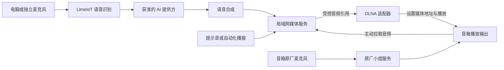

# 音频播放终端与 DLNA 接入

更新日期：2026-11-04。状态：有限播放适配已实现，扩展能力为设计。本文定义存量音箱作为 LimeIoT 可选 IoT 播放终端的接入方式，关联 FR-33、US-26、UC-24。当前实现进度统一见 [24](24-实施计划与进度.md)，小度单样本实验与限制统一见 [30](30-设备支持矩阵与证据台账.md)。

当前可运行入口为[DLNA正式合同](../contracts/dlna.md)、[配置Schema](../contracts/dlna-config.schema.json)和[适配器说明](../gateway/adapters/dlna/README.md)。首版固定目标与UDN，先明确绑定，再通过统一命令播放获准且未过期的媒体ID、停止或设置0–30以内的限幅音量；API/CLI、家庭PWA与invoke自动化共用原命令账本。音频可由所有者配置的HTTP服务提供，也可选择[平台有限音频服务](../contracts/media.md)完成上传、短时授权、撤销和删除。CLI、家庭网页、原生页面状态层及ARM64 NAS协议容器已有各自软件证据，范围以24为准；SSDP自动发现、播放状态、原厂仲裁和完整原生运行仍待验收。实机“用户要求跳过”，不宣称实际发声通过。

## 1. 终端角色与适用场景

支持局域网 UPnP AV / DLNA 渲染服务的存量音箱，可经网关适配器承担提示音、自动化通知、合成语音和对话回复的播放角色。用户按已有设备与实际能力选择，无需将其作为首个环境灯 MVP 的必购硬件。

这条路线保留音箱原厂系统，利用其开放的播放接口；无需为播放方案刷机、修改主板、安装原机 Agent 或配合 MCU OTA。原厂固件升级仍由原厂负责，升级后重新核对协议能力。其他型号或固件必须逐台验证，不能依据品牌或外观推定兼容。

基础配置为一台可运行网关/媒体服务的电脑、Linux 主机或 NAS、一台经过验证的网络音箱和音箱可访问的局域网。只播放提示音时不需要麦克风、ASR 或模型服务；需要语音对话时再使用电脑自带或独立麦克风，以及分别具备实际能力的 ASR、文字模型和 TTS 提供方。

## 2. 采集与播放分离

采音端、智能处理端和播放端可以是不同设备。统一语音与媒体能力的调用、数据政策和预算沿用 [33](33-多模态模型与媒体服务.md)；已有 OpenAI 兼容聊天接口只提供其实际支持的能力，不能据此假定 ASR/TTS 可用。

播放适配不会取得小度原机麦克风、唤醒词或语音上传权限。LimeIoT 对话使用外部采音入口；原厂对话仍使用原厂唤醒词和音箱麦克风。两条入口可供用户选择，但这不是原机麦克风后端切换，也不保证两套服务同时占用扬声器时互不影响。

网页及SwiftUI/Compose源码可在“音频 → 上传音频”明确录制最多60秒的WAV，完成后独立上传，网页进入[有限语音回合](../contracts/voice-turns.md)，原生按[分步组合](../contracts/voice-turns.md#原生分步组合)逐步生成回答音频。授权与播放仍分别明确执行；录音不自动停止正在播放的设备，使用者须避免将回复重新录入。后台、离线或离页会停止采音并放弃未上传录音。免唤醒、远场、回声消除、自然打断和全双工均需独立实现与实测，不能从“能播放”推导出来。

## 3. 接入与能力映射

设备身份与空间绑定沿用 [04](04-领域模型与数据设计.md) 和 [12](12-身份认证与安全体系.md)，模型语义沿用 [05](05-自研物模型规范.md)，协议隔离沿用 [07](07-异构协议与适配器规范.md)，用户入口沿用 [16](16-API事件与CLI规范.md)。音箱作为设备资源，DLNA 适配器负责协议执行；媒体服务负责音频文件与访问，应用会话负责回复是否仍有效。

正式物模型仅发布play/stop/set_volume三个submitted动作，见上述合同。下表其余能力为适配设计，服务存在不自动取得执行支持：

| 能力方向 | 候选 UPnP 服务/动作 | 发布与证据要求 |
| --- | --- | --- |
| 发现与绑定 | SSDP、设备描述、服务描述 | 用户选择并批准目标；保存身份线索与来源，IP 变化后重新核对 |
| 设置音频与播放 | AVTransport `SetAVTransportURI`、`Play` | 仅接收当前获准媒体引用，不允许任意 URL 代理 |
| 停止 | AVTransport `Stop` | 单独验证；返回成功不直接等于物理声音已停止 |
| 播放状态 | AVTransport `GetTransportInfo` | 带观察时间；调用受理、设备状态与实际听感分开记录 |
| 音量 | RenderingControl `GetVolume`、`SetVolume` | 逐设备核对数值范围、读回与实际效果；默认音量保守且可由用户限制 |
| 静音 | RenderingControl `GetMute`、`SetMute` | 读取、取消静音和开启静音分别验证 |
| 格式与事件 | ConnectionManager `GetProtocolInfo`、服务事件 | 空格式列表不代表全部格式可用；事件订阅单独验收 |

暂停、定位、队列、连续流和通知订阅按单能力发布，不因服务存在就宣称支持。仅有局域网发现不能视为已认领或已获控制权；没有强设备认证的接口也不能包装成具备原生设备密钥的身份保证。

## 4. 媒体与局域网要求

常见流程为：生成完整音频文件，媒体服务提供短时 HTTP 地址，适配器设置该地址并发送播放请求，音箱主动拉取文件。地址必须从音箱所在网络可达，不能使用服务主机的 `localhost`；容器端口、防火墙、访客隔离和 VLAN 路由均需按实际网络验证。这条本地路径无需公网隧道或小度自定义技能。

优先从已验证的有限音频文件开始，记录容器、编码、采样率、声道与长度。需要时由媒体服务转为已验证格式；不能把 WAV 文件播放结果扩展为任意格式或实时流兼容。支持设备需要的 GET、Range 和正确媒体类型，并保留足够的拉取时间；完成或过期后按媒体政策清理。

旧设备可能只支持普通 HTTP。媒体访问应限制在可控局域网，使用短时、最小范围的媒体地址，不在 URL 中放入模型密钥、平台令牌或用户身份资料。没有逐设备鉴权时，持有地址的其他局域网主体可能取得音频，敏感内容需据此选择输出端；访问与保留规则沿用 [33](33-多模态模型与媒体服务.md)。

## 5. 会话、抢占与故障处理

| 场景 | 设计行为 |
| --- | --- |
| 同一音箱多个 LimeIoT 请求 | 平台按设备串行协调，定义排队/替换策略和期限；过期通知直接丢弃 |
| 取消、换人或新问题已开始 | 检查会话代次；旧 ASR/模型/TTS 结果不得触发新的播放 |
| 原厂唤醒或其他控制端抢占 | DLNA 不提供与原厂服务共用的排他锁；停止当前平台播报调度，重新读取可得状态，不自动重播或发送 Stop 干扰后来的原厂播放 |
| 播放请求发出后响应丢失 | 保留原操作并标记未知，读取设备与媒体访问记录核对；不盲目重发造成重复播报 |
| 音箱离线、重启或网关恢复 | 重新发现并核对绑定，丢弃过期会话；不自动恢复旧播报，不把离线解释为已停止 |
| 音频地址不可达或模型服务失败 | 返回具体失败或未知，不宣称已播出；仅在既定政策允许时使用文本或预置提示降级 |

`Play` 返回成功只证明协议调用被接受，HTTP 拉取证明媒体请求发生，`PLAYING` 是设备报告；“实际可听到”“自然结束”“停止有效”和“延迟达标”仍需分别取得证据。退出 LimeIoT 会话只结束平台侧调度，原厂功能是否恢复可用需通过原厂入口核对。

## 6. 实施顺序与验收入口

1. 实现有限目标的发现、批准绑定和播放适配；发布最小模型与统一命令入口，先验证预置提示音和保守音量控制。
2. 接入受控媒体服务，补齐地址可达、格式、停止、超时、断连、重复请求和原厂抢占处理，再接设备页及自动化播报。
3. 按需要加入外部采音、ASR、已有 AI 和 TTS，验证半双工对话；远场、回声消除和全双工另立验收。

第一阶段提供手动固定目标的候选与批准绑定、音量限制及三步播放。受控媒体已接通CLI/网页上传到DLNA软件音箱拉取，支持有限PCM WAV、单Range/HEAD、到期/撤销/绑定核对及重启旧地址失效；原操作查询不会重新授权，HTTP记录仅表示准备响应。媒体快照可随NAS备份恢复，原下载凭证不返回客户端，恢复后必须明确新授权；旧备份可能恢复正文。最新[ARM64 NAS整包](evidence/2026-11-04-recording-nas-container.json)已包含网页录音，并分别验证HTTPS模拟采音、四类模型协议、播放与恢复。原生页面有宿主状态层证据，完整App、播放状态、细粒度能力、自动发现和持续会话分别验收；不将局部软件结果扩展为完整型号支持。

专项验收由 [23](23-测试策略与验收矩阵.md) 的音频播放终端条目维护，用户任务由 [17](17-用户故事与用例.md) 的 UC-24 维护。本文不另建兼容清单；设备原始结果、固件范围和未测能力登记在 [30](30-设备支持矩阵与证据台账.md)，平台实施状态登记在 [24](24-实施计划与进度.md)。
