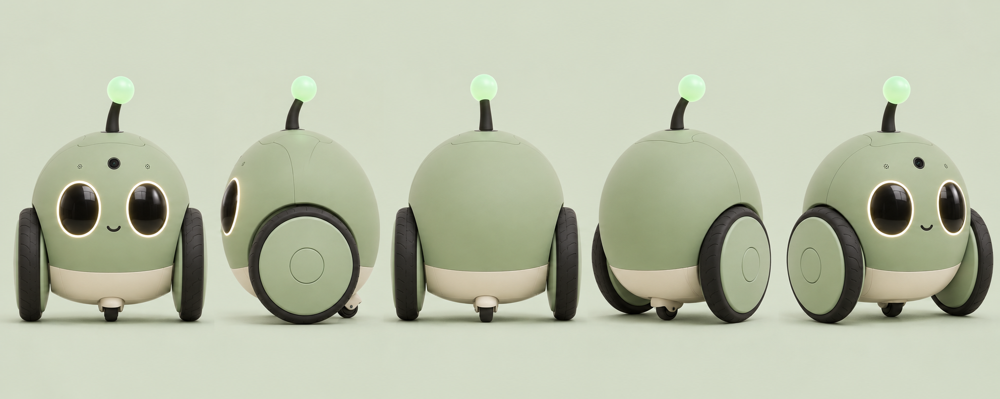

# Gootuan integration and executable example

[简体中文](README.zh-CN.md)

Gootuan is an independent concept for connected wheeled companion toys, using LimeIoT as the generic device and gateway foundation. This case explains the integration boundary and supplies a small example that runs on the current platform. **It does not declare the robot, autonomous movement or synchronized chorus implemented.**



The shared image is generated concept art, not a photograph of an assembled sample or manufacturing CAD. [Image provenance](assets/provenance.json).

## Integration structure

Devices connect through their space gateway. Product applications call authorized APIs and reference existing models, commands and events. Teams, play sessions and scoring belong to the product application; media services handle audio and video separately. Website interest registration grants no device-control authority.

The product handbook calls its configurations **L/Core** and **V/Vision**. Core plans cloud conversation, explicit snapshots/explanations, touch/lights, bounded movement and cached team play. Vision adds local visual tracking for explicitly tested spaces. Core does not claim local autonomous following/chasing. Whole-home navigation and auto-docking are separate future scope. Shell/color preferences do not grant hardware capabilities.

## What the current platform can demonstrate

| Area | Current reusable surface | What remains Gootuan work |
| --- | --- | --- |
| Device identity | Bound-device CSR inspection/signing, per-device identities, mTLS/ACL and controlled identity maintenance paths | Consumer physical claiming, manufacturing ownership transfer and the product-specific onboarding experience |
| Models | Shared Rust schema/semantic validator, model publication/trust/install/bind contracts and software consumers | Approved Gootuan model releases, S3 BSP and real drivers; a valid model is not installed hardware |
| Commands/actions | `property.set`; schema 2 `action.invoke` with typed input/output and bounded result evidence | Robot motion/media task models and drivers; MCU C subset does not yet implement generic actions |
| Rules and staged plans | Event/threshold/schedule rules; local bounded plans, stage result barriers, correlated terminal events, explicit cancellation and original-key recovery | Product teams, local timelines, beat clocks, trajectory checks and device stops |
| AI | Local Ollama text rule drafts with validation and explicit approval boundaries | General conversation, ASR/TTS, multimodal sessions, age-aware creative content and visual understanding |
| Limited audio | PCM WAV upload/retention, short-lived managed-DLNA grants, revoke/delete and separate HTTP fetch | Robot microphone/streaming transport, codec pipeline, continuous voice, chorus synchronization and camera/media workflows |
| Firmware/OTA | C3 product foundations and controlled OTA consumer/target-build paths; evidence levels are separate | Gootuan S3 hardware, full action/event support, product update artifacts and integrated physical acceptance |

Authoritative details remain in the [implementation ledger](../../24-实施计划与进度.md), [device evidence matrix](../../30-设备支持矩阵与证据台账.md) and linked contracts. Existing software tests elsewhere are not rerun by writing this case. No claim of a finished retail toy follows from this table.

## Registration and model binding

The [CSR enrollment contract](../../../contracts/device-enrollment.md) signs devices already bound in the NAS configuration. It does not change ownership, model or Broker ACL, and does not implement a consumer scan-to-claim journey. A serial number, discovery announcement or Gootuan website lead grants no control. Per-device key generation/import and certificate maintenance are distinct from claiming a new physical product.

Use the [model validator](../../../contracts/model-validation.md) for candidate definitions, then the separate [release/trust/install/bind workflow](../../../contracts/model-release.md). Binding must match the exact approved model revision, current session and actual hardware. Do not treat an unsigned example or `valid=true` as a published model, permission grant or production registration.

## A real minimal case: touch starts two virtual lights

The [example package](../../examples/gootuan/README.md) supplies one schema-1 light/touch model, a two-device event rule and a preview event. Both virtual devices use the same model. Touch on the first causes two ordinary `light.power=true` writes after explicit deployment. The legacy development IDs `device-button` and `device-lamp` are reused only to consume the existing isolated test harness; they are not shipping Gootuan identities.

```sh
npm ci
cargo build --locked -p limeiot-model-validator -p limeiot-gateway -p limeiot-simulator
node "docs/examples/gootuan/verify.mjs"
```

The offline check uses the **existing formal** model/rule JSON Schemas, the shared Rust model validator through its real CLI and negative boundary checks. It neither starts the gateway nor sends commands.

To run the isolated HTTP/MQTT/SQLite case, first provide the documented local Broker dependency:

```sh
python3 "tools/bootstrap-broker.py"
node "docs/examples/gootuan/verify.mjs" --integration
```

Alternatively point `LIMEIOT_MOSQUITTO` at an existing Mosquitto binary. The integration check uses dynamic loopback ports, a new ignored `.dev/gootuan-example-*` directory and random experiment credentials. It verifies preview has zero commands/effects, explicitly deploys, sends one synthetic touch, checks both simulated confirmed light results, rejects duplicate/historical replay, and stops the rule before closing its own child processes. Its `verification.json` contains no credentials. It does not touch existing gateway databases, real hardware, cloud services or a public Broker.

This establishes independent virtual light control, **not simultaneous output**, a dance, an interlocked safety system or a finished physical touch sensor. No timestamps are used to claim a synchronization bound. Stopping a rule only prevents future triggers; it is not an emergency stop and does not cancel accepted commands or turn lights off.

## Rules and action contract constraints

Generic operations use exactly `{type,path,value}`. An action is `{"type":"action.invoke","path":"service.action","value":{}}` and requires a schema-2 model. `arguments` is not an alternative field. The minimal example deliberately uses schema-1 properties and events, so it cannot imply implemented robot actions.

The [command contract](../../../contracts/commands.md) limits a new command's expiry to at most thirty seconds after acceptance. Each device has at most 32 pending commands and one unexpired dispatched command. `confirmed` with `completion=submitted` confirms the executor's submission boundary, not a visible or physical result. `unknown` is queried under its original key and never automatically resent.

Rules submit their steps in order of acceptance; they do not wait for each physical action to finish and do not provide a cross-device transaction or beat clock. A performance lasting minutes needs a separately specified product task lifecycle with quick acceptance and observable progress/completion. Local motor loops, watchdogs, safety sensors and a local stop remain independent of cloud and gateway availability. The ordinary FIFO is not a pre-existing priority stop path. Restart must not resume old robot movement.

## Staged multi-device tasks

Use [bounded execution plans](../../../contracts/execution-plans.en.md) when a later stage must wait for the current results. Creating a plan only saves a draft. Explicit start admits work through the original command ledger; a `completion=submitted` action additionally requires a terminal event matching the task, generation, step and device session. The [live event contract](../../../contracts/device-events.en.md) defines polling/SSE provenance and deduplication.

```sh
npm run cli -- schema execution-plan-changes.create
npm run cli -- execution-plan-changes create --space-id space-demo --input "./plan-create.json" --idempotency-key plan-create-001
npm run cli -- execution-plans get --space-id space-demo --id family-show-001
npm run cli -- execution-plan-changes resolve --space-id space-demo --id plan-create-001
```

See the formal contract for bodies, explicit start/cancel/release and revision checks. The current local-owner surface allows eight devices, sixteen steps and fifteen minutes; child commands still expire within thirty seconds. Lost responses only query the original key, and restart never resumes a show. Started plans reserve devices until explicit release. Cancellation blocks future stages but is not a physical emergency stop; stage barriers do not synchronize audio beats. Software simulation does not validate toy drivers or real hardware.

## Integration work packages and evidence

1. Pin generic platform contracts and complete physical ownership/onboarding design without bypassing existing identity policy.
2. Freeze exact product models, S3 BSP, electrical interfaces and bounded drivers; verify current, thermal, audio/camera/network concurrency and local stop.
3. Specify product team/session/task state and participant generations with per-device outcomes, unknown recovery and explicit cancellation.
4. Integrate authorized speech/vision/media providers with content rights, parent controls, retention and budget boundaries.
5. Test clock uncertainty, preloaded assets, output delay/drift, missing readiness and cancellation on multiple real units before advertising synchronized play.
6. Freeze claimed Core/Vision abilities and regional qualification from actual evidence; keep free interest metrics separate from orders.

The independent [English product handbook](https://github.com/limecloud/gootuan/blob/main/docs/README.md) and [Chinese handbook](https://github.com/limecloud/gootuan/blob/main/docs/zh-CN/README.md) own product detail. The platform's [composition design](../../32-能力组合与场景应用.md), [multimodal design/current subset](../../33-多模态模型与媒体服务.md), [rules contract](../../../contracts/rules.md), [limited media contract](../../../contracts/media.md) and [firmware entry](../../../firmware/README.md) own their respective reusable boundaries. The example runs independently within this repository.

## Verification record

See the [gateway software verification report](gateway-support.md) ([简体中文](gateway-support.zh-CN.md)) for source digests, executed tests and remaining product work.


Executed results for this case are recorded in [verification.json](verification.json). The image copy is hash-checked against its recorded provenance. Documentation checks cover local links and language/example consistency. A successful software example does not add an entry declaring Gootuan hardware accepted, alter formal contracts, or claim voice, vision, motion or chorus validation.
