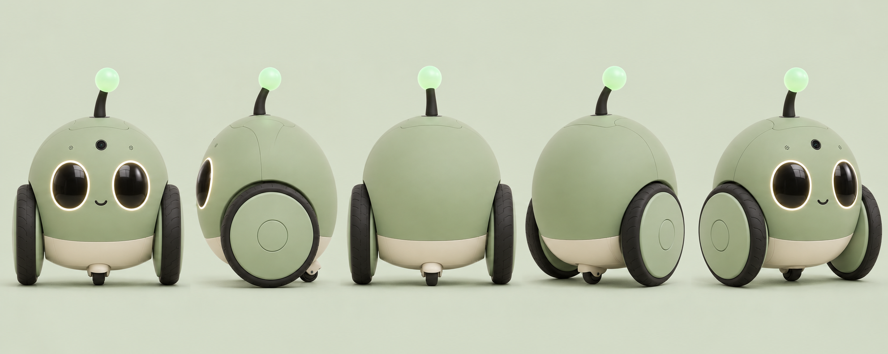

# Gootuan 咕团集成与可执行案例

[English](README.md)

咕团是独立的联网轮式陪伴玩具概念，使用 LimeIoT 的通用设备与网关基础。本案例说明集成边界，并提供能在当前平台运行的小例子，**不宣称机器人、自主移动或同步合唱已实现**。



图片为统一外观的生成式概念参考，并非已装配样机照片或可制造 CAD。[图片来源](assets/provenance.json)。

## 接入结构

设备通过当前空间的网关接入；产品应用调用授权 API，引用已有模型、命令与事件。家庭队伍、玩法场次与计分由产品应用管理，媒体服务独立处理音视频。官网预约仅收集成人意向，不授予设备控制权。

产品资料中的两档为 **L/Core 基础版**和 **V/Vision 视觉版**。Core 规划云对话、显式拍照讲解、触摸灯光、有界运动及缓存组队；Vision 增加限定验证场地的本地视觉跟踪。Core 不宣称本地自主跟随与追逐，全屋导航和自动回充另行立项。外壳或颜色偏好不能赋予硬件能力。

## 当前平台可演示的范围

| 领域 | 当前可复用入口 | 咕团仍需的工作 |
| --- | --- | --- |
| 身份 | 已绑定设备 CSR 检查签发、逐台身份、mTLS/ACL、受控身份维护 | 消费者物理认领、制造归属转移及产品入网体验 |
| 模型 | 共用 Rust 结构语义校验器、发布信任安装绑定合同及软件消费者 | 获准咕团模型、S3 BSP 和真实驱动；模型有效不等于硬件已安装 |
| 命令动作 | `property.set`，Schema 2 的类型化 `action.invoke` 和有界证据 | 机器人运动媒体任务模型与驱动；MCU C 子集尚无通用动作 |
| 规则与分阶段计划 | 事件/阈值/定时规则；本地有界计划、逐阶段结果屏障、关联终态事件、明确取消与原键恢复 | 产品队伍、本地节目、节拍时钟、轨迹校验与设备停止 |
| AI | 本地 Ollama 文字规则草案，校验及明确批准边界 | 任意对话、ASR/TTS、多模态会话、适龄创作与视觉理解 |
| 有限音频 | PCM WAV 上传留存、托管 DLNA 短期授权、撤销删除、独立 HTTP 拉取 | 机器人麦克风流传输、codec、连续语音、合唱同步、相机媒体 |
| 固件 OTA | C3 产品基础及受控 OTA 消费/目标构建路径，证据等级独立 | 咕团 S3 硬件、完整动作事件、升级制品和整机实物验收 |

当前事实以[实施进度](../../24-实施计划与进度.md)、[型号证据矩阵](../../30-设备支持矩阵与证据台账.md)和各正式合同为准。编写本案例没有重跑其他功能的既有测试，该表不能推导零售玩具已完成。

## 注册与模型绑定

[CSR 合同](../../../contracts/device-enrollment.md)仅为当前 NAS 配置中已绑定设备签发，不修改归属、模型或 Broker ACL，不实现消费者扫码认领。序列号、发现广播或官网线索不授予控制权。本机密钥生成导入、证书维护与新产品物理认领是不同生命周期。

使用[模型校验](../../../contracts/model-validation.md)检查候选，再经过独立的[发布、信任、安装和绑定](../../../contracts/model-release.md)。绑定匹配精确批准模型修订、当前会话及实际硬件。未签名例子或 `valid=true` 不是已发布模型、授权或正式注册。

## 最小真实案例：触摸联动两个虚拟灯

[示例包](../../examples/gootuan/README.zh-CN.md)包含一个 Schema 1 灯光触摸模型、双设备事件规则和预演事件，两台虚拟设备使用相同模型。明确部署后，一台的触摸事件产生两条普通 `light.power=true` 属性写入。沿用开发工具的 `device-button`、`device-lamp` ID 仅为复用隔离装配器，不是出厂咕团身份。

```sh
npm ci
cargo build --locked -p limeiot-model-validator -p limeiot-gateway -p limeiot-simulator
node "docs/examples/gootuan/verify.mjs"
```

离线检查消费**现有正式**模型与规则 JSON Schema，通过真实 CLI 调用共用 Rust 校验器，并检查反例；不启动网关或发设备命令。

运行隔离 HTTP/MQTT/SQLite 案例前提供项目内 Broker：

```sh
python3 "tools/bootstrap-broker.py"
node "docs/examples/gootuan/verify.mjs" --integration
```

也可用 `LIMEIOT_MOSQUITTO` 指定现有 Mosquitto 二进制。集成采用动态回环端口、新建被忽略的 `.dev/gootuan-example-*` 目录和随机实验凭据，验证预演无命令无副作用、明确部署、合成触摸、两台模拟灯确认、重复/历史事件不重放，再停用规则并关闭自己的子进程。`verification.json` 不含凭据，不读写已有网关数据库、真实硬件、云服务或公网 Broker。

该结果证明独立虚拟灯控制，**不证明同时输出**、舞蹈、安全联锁或真实触摸器件。没有用时间戳声称同步指标。停用规则只阻止未来触发，不是急停，也不取消已受理命令或关灯。

## 规则与动作约束

通用 operation 精确为 `{type,path,value}`。动作使用 `{"type":"action.invoke","path":"service.action","value":{}}`，要求 Schema 2 模型，不能改为 `arguments`。最小例子刻意只用 Schema 1 属性和事件，不暗示机器人动作已实现。

[命令合同](../../../contracts/commands.md)要求到期不超过受理后 30 秒；每设备最多 32 条待执行及一条未到期 dispatched。`confirmed` 且 `completion=submitted` 只确认执行端输入提交边界，不证明界面或物理效果。`unknown` 按原键查询，不自动重发。

规则按顺序受理步骤，不等待每个物理动作完成，不提供跨设备事务或节拍时钟。数分钟节目需要独立产品任务生命周期、快速受理、进度和完成观测。本地电机闭环、看门狗、传感与停止独立于云和网关，普通 FIFO 不是现成的优先停止通道，重启不能恢复旧运动。

## 分阶段多设备任务

需要等待本阶段结果后再开始下一阶段时，使用[有界执行计划](../../../contracts/execution-plans.md)。创建仅保存草稿，明确启动后复用原命令账本；`completion=submitted` 动作还必须等待匹配任务、代次、步骤与设备会话的终态事件。[实时事件合同](../../../contracts/device-events.md)说明轮询/SSE的严格来源与去重信息。

```sh
npm run cli -- schema execution-plan-changes.create
npm run cli -- execution-plan-changes create --space-id space-demo --input "./plan-create.json" --idempotency-key plan-create-001
npm run cli -- execution-plans get --space-id space-demo --id family-show-001
npm run cli -- execution-plan-changes resolve --space-id space-demo --id plan-create-001
```

正文模板、显式start/cancel/release及修订要求见正式合同。当前仅本地所有者可用，最多8台、16步、15分钟；子命令仍限30秒。丢响应只查原键，重启不续演；启动过的计划解除占用前保留设备占用。取消会阻止未来阶段，但不是物理急停，阶段屏障也不是音频节拍同步。软件模拟验证不代替玩具驱动或实机验收。

## 集成工作包与验收

1. 固定通用合同版本，补全物理归属与入网设计，不绕过身份策略。
2. 冻结产品模型、S3 BSP、电气接口和有界驱动，验证电流、温度、音频相机网络并发及本地停止。
3. 定义产品队伍、会话、任务和参与者代次，保留逐机结果、未知恢复与明确取消。
4. 接入已授权语音视觉媒体提供方，明确内容权利、家长管理、留存与费用预算。
5. 多台真实机器测量时钟不确定度、预加载、输出延迟漂移、未就绪和取消，再宣传同步玩法。
6. 按实证冻结 Core/Vision 对外能力及地区资格，免费意向与订单分开。

[英文产品资料](https://github.com/limecloud/gootuan/blob/main/docs/README.md)与[中文产品资料](https://github.com/limecloud/gootuan/blob/main/docs/zh-CN/README.md)拥有产品细节。平台[组合设计](../../32-能力组合与场景应用.md)、[多模态及当前子集](../../33-多模态模型与媒体服务.md)、[规则合同](../../../contracts/rules.md)、[有限媒体合同](../../../contracts/media.md)和[固件入口](../../../firmware/README.md)各自维护复用边界。示例可在本仓库独立运行。

## 本次验证

新增网关能力的源码摘要、实际测试及剩余工作见[软件验收报告](gateway-support.zh-CN.md)（[English](gateway-support.md)）。


结果见 [verification.json](verification.json)，图片副本按来源哈希核验，本地链接和语言示例对应单独检查。软件例子通过不新增咕团硬件已验收声明，不修改正式合同，也不等于语音、视觉、运动或合唱验收。
