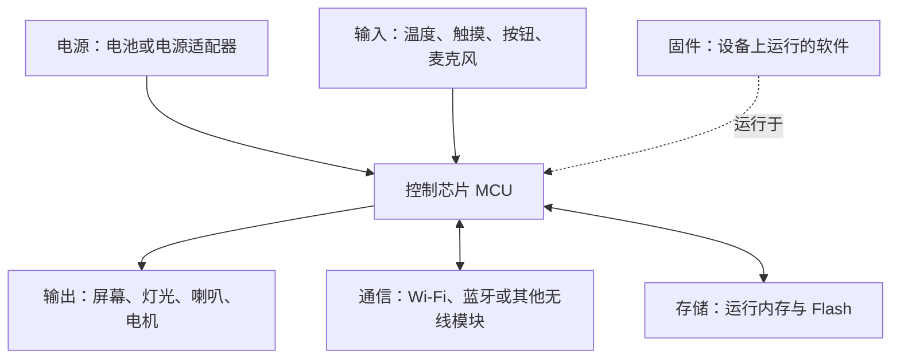

# 设备里面有什么：从温湿度计到智能玩具

类型：入门教程。适合第一次接触物联网的读者。图为教学示意，设备型号资料见[小米设备分类](../04-场景案例/02-小米设备分类.md)。

## 1. 先把物联网理解为一个闭环

物联网（IoT）让真实世界里的设备能够感知、交换信息并执行动作。它可以只在家里的局域网工作，也可以使用互联网服务。联网不必然包含大模型。

以“房间热了，让风扇开启”为例：

查看图形源码（Mermaid）

读图：先有观测，再有判断，然后执行，最后观察环境是否变化。这叫反馈闭环。如果没有最后一步，就只能知道发出了动作，不能确定效果。

风扇通常改善体感，并不保证降低室温。控制目标与反馈要匹配；如果目标是降低室温，就需要相应的制冷设备与温度反馈。

这里的“温度超过阈值就开风扇”用普通规则即可实现；“根据孩子的提问编故事”才需要更复杂的智能服务。

## 2. 一台设备通常有六部分

查看图形源码（Mermaid）

| 部件 | 通俗理解 | 选择时问什么 |
| --- | --- | --- |
| 传感器 | 设备获取外部信息的器官 | 测什么、精度多少、多久采一次？ |
| 执行器 | 改变真实世界的部件 | 控灯、发声还是运动？能否停止？ |
| MCU | 管理设备的小型控制芯片 | 接口、功耗、内存和实时性够不够？ |
| 通信模块 | 收发信息的部件 | 使用什么协议、连谁、需要多少带宽？ |
| RAM / Flash | 工作台 / 持久存储空间 | 音频缓冲能放下吗？固件升级有没有空间？ |
| 电源 | 所有功能的能量来源 | 平均耗电、峰值电流和续航如何？ |

MCU 内部已经有 CPU，通常也集成少量内存和外设。CPU 不是昂贵电脑的专属部件。控制灯和采集温度用不着电脑级处理器；连续音视频或复杂模型则需要更多资源。

固件是写给设备运行的软件。ESP-IDF 是开发 ESP32 系列固件所使用的框架；LimeIoT 的设备 SDK 在这个基础上提供接入能力。两者分工见[固件设计](../../08-ESP-IDF固件SDK设计.md)。

## 3. 传感器和执行器可以在同一台设备里

智能音箱既有麦克风输入，也有扬声器输出；扫地机器人既测距离，也驱动电机。分类描述的是职责，同一设备可以承担多种职责。

小米官网中的温湿度计适合帮助理解感知；智能插座适合理解开关执行；智能音箱适合理解声音输入与输出。这里是在学习设备角色，具体型号的连接和开放接口仍要另行核对。

## 4. 成本与功耗为什么会限制设备

持续开着无线网络、麦克风、屏幕和电机会消耗电量。电池设备经常采用“睡眠 → 唤醒 → 采样 → 上报 → 再睡眠”，代价是它未必随时接收命令。

温湿度计可以较慢上报；对话玩具要连续传输音频。两者不应使用同一套硬件与时延预期。麦克风、扬声器、外壳声学、电源和软件调试也影响成本，不能只看芯片单价。

## 5. 自测

为什么增加网络功能，不能让普通插座直接知道“电风扇是否真的转了”？

参考答案：插座可能只能控制供电；即使有电流检测，也不一定能直接证明风扇机械动作。需要对应的观测证据。平台显示的状态必须说明它来自开关驱动、电量测量还是实际动作反馈。

下一篇：[连接协议与消息](02-连接协议与消息.md)。深入阅读：[物模型规范](../../05-自研物模型规范.md)、[硬件选型](../../19-硬件选型采购与BOM.md)。
