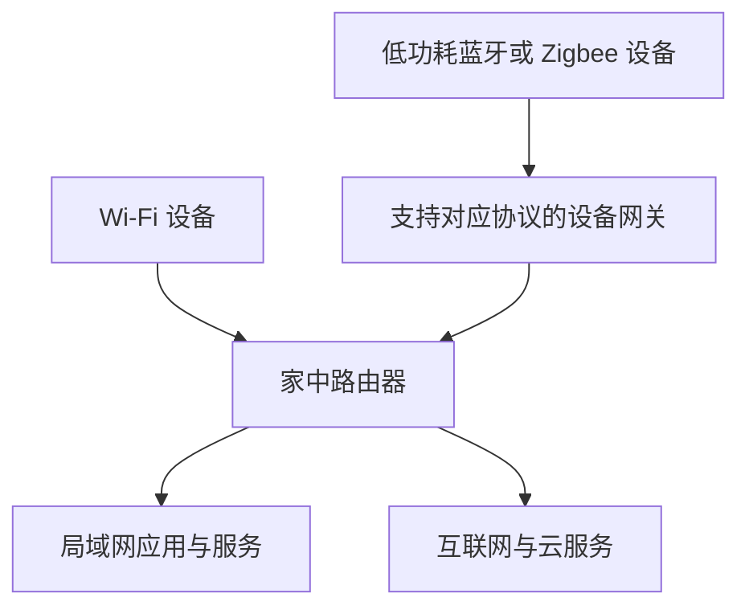
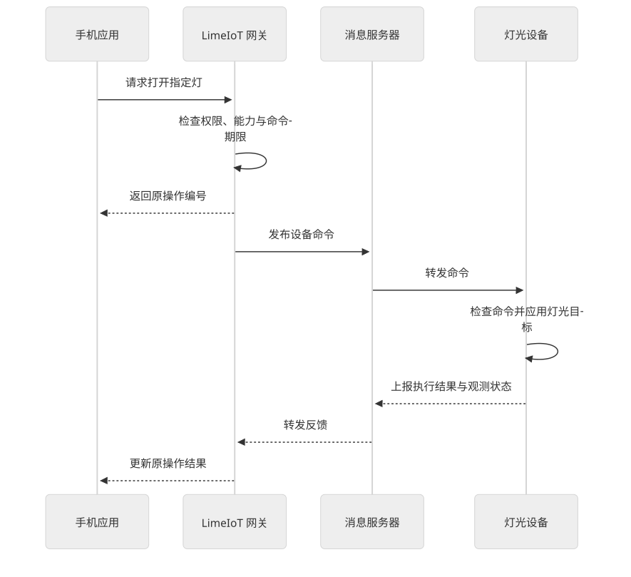
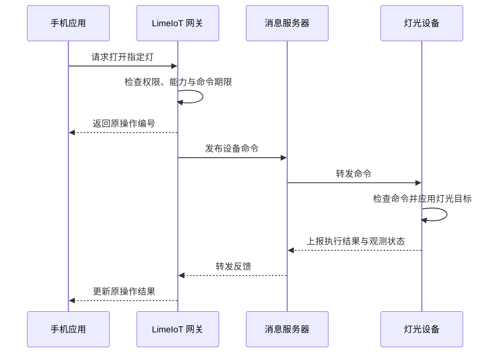

# 设备怎样连起来：路由器、网关和消息

类型：入门教程。先读[设备与硬件](01-设备与硬件.md)。图为通用通信示意，具体产品的协议和可用接口以型号资料为准。

## 1. 三个容易混淆的东西

| 名称 | 主要职责 | 不应由名称直接推断的能力 |
| --- | --- | --- |
| 家庭路由器 | 为手机和设备提供网络连接，转发网络数据 | 不自动理解所有智能设备的功能 |
| 设备网关 | 接入设备协议，映射数据，可能执行本地规则 | 不一定有能力运行大模型 |
| 云服务 | 在远端提供账号、远程访问、模型或内容服务 | 不是家中所有本地动作的必经路径 |

“网关”这个词有多种用途。路由器可能是 IP 网络的默认网关；这里的“设备网关”指接入和管理智能设备的应用角色。一个产品可以集成多个角色，购买时要核对实际功能。

## 2. 两种常见连接路径

查看图形源码（Mermaid）

读图：低功耗设备可能借助网关进入家庭系统；Wi-Fi 设备能连接路由器，也仍需要软件协议、身份和应用服务，才能被正确控制。

蓝牙设备还可能直接与附近手机通信。远程访问通常需要额外常在线节点或厂商服务；“手机靠近能读数”不等于“出门后仍能收到新读数”。

## 3. 无线协议和消息协议回答不同的问题

| 技术 | 主要解决什么 | 初学者应该记住 |
| --- | --- | --- |
| Wi-Fi | 无线网络接入 | 带宽通常适合音视频，但持续连接的耗电要评估 |
| BLE，低功耗蓝牙 | 近距离低功耗通信 | 与经典蓝牙音频、蓝牙 Mesh 的能力有区别 |
| Zigbee | 低功耗设备网络 | 需要相应的协调器或网关；仍有设备能力与兼容差异 |
| MQTT | 应用消息的发布与订阅 | 可以在 IP 网络上传送设备事件和命令，不是一种无线电技术 |
| HTTP / WebSocket | 应用请求或持续双向交换 | 常用于 API、上传下载和实时应用通道 |
| Matter | 智能家居应用互通标准 | 需要看设备类型、传输方式、控制器及实际认证范围 |

例子：设备先通过 Wi-Fi 接入网络，再通过 MQTT 上报“按钮按下”。Wi-Fi 与 MQTT 可以同时出现，它们处在不同层次。

不同系统不必都采用 MQTT。LimeIoT 原生链路采用它，并不代表小米设备内部也采用同样报文。

## 4. MQTT 可以先理解为消息分发站

设备或应用把消息发布到一个主题（Topic）；订阅该主题的接收者通过消息服务器（Broker）获得消息。主题类似分发地址，并不等于访问权限，服务器仍要检查身份与允许范围。

一次“打开灯”可以分成以下阶段。这是 LimeIoT 语义的简化示意，省略了连接、安全和持久化细节：

查看图形源码（Mermaid）

读图：从上往下看时间；横向箭头表示谁把什么交给谁。请求被受理、消息送达、设备执行、真实物理效果是不同证据。没有光学传感器时，灯的驱动回执仍不能保证灯珠真的发光。

## 5. 控制信息和媒体要分开考虑

“把音量设为三档”是一小条命令；持续录音是一条媒体流。LimeIoT 的设计用 MQTT 传控制、事件和媒体引用，音视频走受控媒体通道。这样可以分别管理带宽、访问和取消行为。

小米例子：[智能音箱 Pro 的官方连接参数](https://www.mi.com/xiaomi-smart-speaker-pro/specs)同时列出 Wi-Fi、蓝牙音乐播放和有线音频。它说明一台产品可以拥有多种连接用途，不能把“带蓝牙”直接理解为“具备所有蓝牙网关能力”。

自测：摄像机能连家里的 Wi-Fi，是否就能被任何第三方平台查看？参考答案：仍需匹配设备的应用协议、身份授权及开放接口。

下一步：[标准协议与生态边界](../02-标准与生态/01-标准协议与生态边界.md)。深入阅读：[MQTT 规范](../../06-MQTT报文与设备通信规范.md)、[异构适配](../../07-异构协议与适配器规范.md)。
