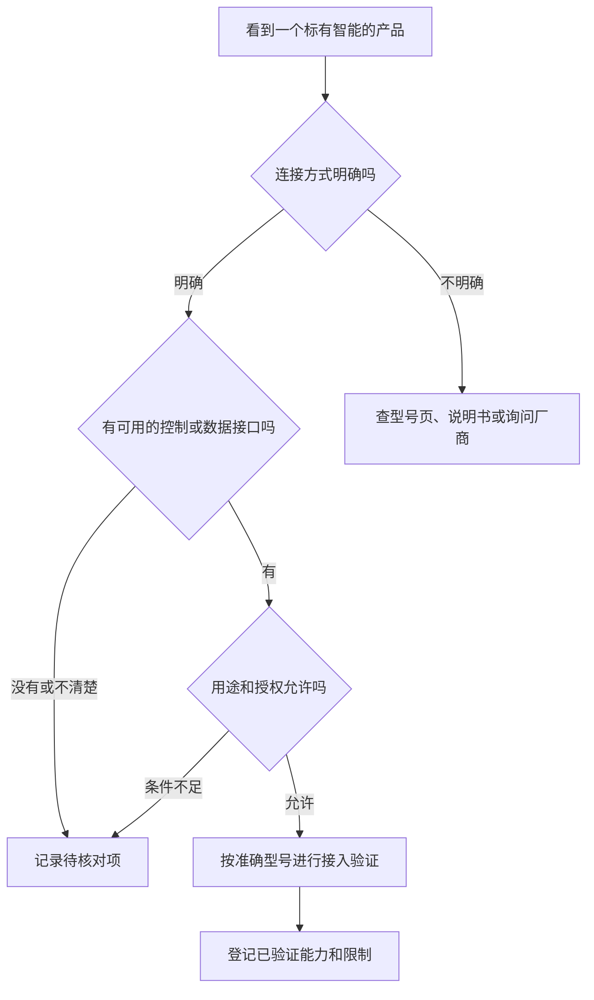

# 标准、协议与品牌生态分别是什么

类型：概念与资料导读。目的：读懂产品参数，区分“有通信能力”“符合某标准”和“已接入某平台”。

## 1. 用四个问题阅读任何一台设备

1. **用什么连接？** 例如 Wi-Fi、以太网、BLE、Zigbee。
2. **怎样描述和控制功能？** 例如厂商协议、Matter 定义的设备能力、平台自己的物模型。
3. **谁允许访问？** 例如本地配对、用户授权、厂商账号或开发者接入资格。
4. **哪些型号真正验证过？** 核对地区、固件、设备类型和控制器版本。

查看图形源码（Mermaid）

读图：联网只是第一步。学会一种无线技术，不会自动获得所有品牌设备的控制能力。

## 2. 标准与生态怎么区分

| 名称 | 应怎样理解 | 本知识库中的用途 |
| --- | --- | --- |
| Wi-Fi / BLE / Zigbee | 连接与通信技术，各自有版本和角色 | 理解功耗、带宽、距离及网关需求 |
| MQTT | 消息传递协议 | 理解发布订阅、命令与事件 |
| Matter | 基于 IP 的智能家居应用互通标准 | 理解设备类型、Controller 和 Bridge 的分工 |
| 米家 / 小米生态 | 品牌平台、产品体验与接入体系 | 学习产品分类和设备协作；接口资格另行确认 |
| LimeIoT 物模型 | 本项目对设备属性、动作和事件的描述 | 统一自身设备与经验证适配器的语义 |

Matter 可使用 Wi-Fi、以太网或 Thread 等承载；不能仅凭“支持 Matter”判断无线硬件。BLE 常用于配网，也不能由此推断它是设备日常业务通信的唯一方式。

“米家设备”“蓝牙设备”“Matter 设备”可能是同一产品的不同标签。标签不是互斥分类，接口和实际能力需要逐项核对。

## 3. 三个典型误解

- **有蓝牙就能当蓝牙网关。** 蓝牙音频播放、低功耗传感器接入、Mesh 网络管理具有不同角色与实现要求。
- **能在厂商 App 控制，就有对第三方开放的 API。** 厂商 App 的能力不能直接证明第三方用途已获支持。
- **开源平台应该已经兼容全部智能家居。** 平台是否开源与某个型号是否适配是两个问题。

小米中枢网关与 Xiaomi 智能音箱 Pro 的官网资料体现了不同的产品职责。已核对内容集中记录在[小米设备分类](../04-场景案例/02-小米设备分类.md)，不根据名称替它们补充未确认的协议。

## 4. 从哪里继续查

| 需要回答的问题 | 首选资料 |
| --- | --- |
| 本项目怎样使用某协议？ | [异构适配规范](../../07-异构协议与适配器规范.md)、[多生态接入](../../31-多生态兼容与开放接入.md) |
| 产品是否真的被支持？ | [设备支持与证据台账](../../30-设备支持矩阵与证据台账.md) |
| 规范中的原始协议语义是什么？ | 专项规范中引用的官方标准原文及对应版本 |
| 某商品的实际接口是什么？ | 准确型号的官方参数页、说明书与厂商开放平台 |

本页提供学习分类，不新增标准合规、生态资格或型号支持结论。收集资料时按[收集规范](../06-资料与工具/01-资料索引与收集规范.md)保留来源、版本和未确认项。
